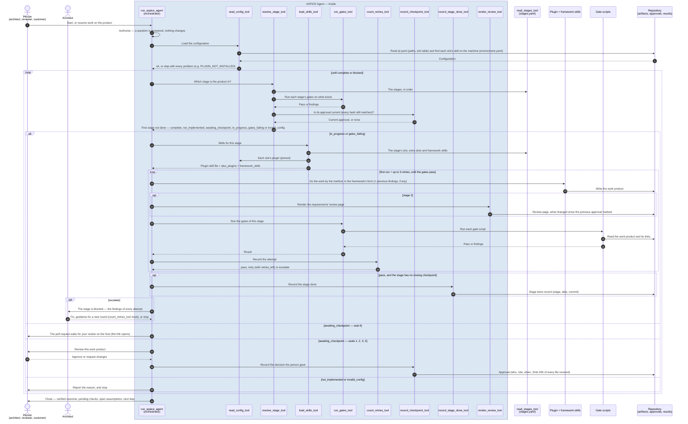

# ASPICE Agent

> **What this is:** the description of the ASPICE Agent as it is. Five parts: the principles; why ASPICE; the tale of the
> bridge; every ASPICE base practice with its final version and gate checks;
> how it is implemented. Appendix A records the forks: where the design chose
> between real options, and why. Appendix B records where the practices came
> from. The principles are the source of truth: every practice they name has a
> gate.

---

## 1. Principles

The framework enforces a best practice for building software products with AI
agents: a **diagram** of the functionality comes first, **requirements** are
derived from it, and **every requirement is tested**. The principles below say
*why*; every practice in § 4 is the checkable form of one of them, and every
practice has a gate.

- **Requirements-driven development** — think requirements through thoroughly before generating code.
- **Inspectability** — full traceability from requirements to tests and code.
- **Testability** — code structured so it can be verified in isolation.
  - Write tests first (TDD)
  - Testing across environments and configurations
  - Reusable test suite across features
- **Modularity** — separation of concerns and clear module boundaries.
- **Security** — defensive posture baked into the pipeline.
  - Reusable security test templates
  - Automated security scanning in CI
- **Static analysis** — lint and format rules configured once, applied consistently.
- **Documentation and code comments** — explain _why_, not _what_.
- **Version control discipline** — clean commits, meaningful messages, branching strategy.
- **Logging** — structured logging derived from the requirement spec.
- **Code review (four-eyes principle)** — human verification gate before merging.
- **Performance testing** — measure response times, query counts, memory usage.
- **Observability** — alerts for unusual patterns, failed authentication, unexpected errors.
- **Architecture governance** — the system-level frame changes only on its own track, with its own approvers, one change at a time.
- **Acceptance** — an increment ships only when it has been verified against a deployed system and accepted by the customer.
- **Feedback loop** — what production and the team learn flows back into the next iteration as tracked work.
- **Framework improvement** — weaknesses found in the framework are recorded and fixed upstream, never worked around.

### What happens to a principle

The rows have two levels of detail. This is not a fourth dimension — it is the
*what* at two resolutions:

```
PRINCIPLE (why)               →   PRACTICE (what, checkable)        →   GATE (how)
"Logging — structured             start/end/error events +              verify_log_events_gate
 logging derived from              an integration test that
 the requirement spec"             asserts them
```

- A **principle** is the quality property the framework is after. It is broad
  and cannot be checked directly.
- A **practice** is the concrete, checkable form of a principle. Every practice
  belongs to exactly one principle; a principle usually has several practices.
- A **gate** checks a practice. Several practices of the same kind may share
  one gate.

Everything else is an **attribute of a practice**, not another level: the V
stage where it is authored and verified, and the ASPICE process it serves.

| Level | What it answers | Where |
|---|---|---|
| Principle | Why | § 1 — 16 principles |
| Practice | What, checkably | § 4 — the final version of every base practice, and § 4.2 |
| Gate | How it is checked | *gates/* — one file per gate |
| *Attributes of a practice* | When (stage), ASPICE process | § 4 and *agent/stages.yaml* |


---

## 2. Why ASPICE

The framework does not invent its own process model. It adopts **Automotive
SPICE® (ASPICE)**, an established process assessment model published by VDA QMC
and recognised by auditors and customers, and defines *how* its processes are
carried out with agents, diagrams and gates.

**Why ASPICE.**

- **It is already a V.** Its engineering processes go down from requirements to
  units and back up through verification — the shape this framework is built on.
- **It defines the *what*, not the *how*.** ASPICE states processes, outcomes,
  base practices and the work products that serve as evidence; it leaves methods,
  tools and formats to each organisation. Diagram-first, TDD, markers and gates
  are this framework's *how*.
- **It avoids reinventing.** A custom process model would have to be defended
  and explained from scratch; ASPICE gives a shared vocabulary and a recognised
  structure for free.
- **It is assessable.** An assessor judges each base practice from evidence;
  every gate in § 4 produces such evidence.

**Version and source.** Automotive SPICE® Process Assessment Model **4.1** (VDA
QMC, August 2026), <https://vda-qmc.de/wp-content/uploads/2026/09/Automotive-SPICE-PAM-v41.pdf>.
Base-practice titles in § 4 are taken from that text. Version 4.1 has the same
base practices as 4.0, with editorial changes only.

**Scope.** SWE.1–SWE.6 (software engineering), VAL.1 (validation), SUP.1 (quality
assurance), SUP.8 (configuration management), SUP.9 (problem resolution) and
SUP.10 (change requests) — 66 base practices.

**SYS processes are out of scope; system-level requirements are verified in
SWE.6.** The system-level processes SYS.1–SYS.5 are not adopted: products built with this framework are pure software, so there is no
system architecture, no hardware and no system integration. The software *is*
the whole product. Therefore:

- Requirements keep both levels (SWE.1 BP2: **Level** — system or software). A
  system-level requirement describes the whole product as seen from outside.
- **SWE.6 verifies every requirement of both levels.** A system-level requirement
  is verified by a test of the whole product, usually end-to-end, with its
  marker, exactly like a software-level one. This covers what SYS.5 would verify
  for a pure-software product.
- **Most products have no system-level requirements.** Then there is nothing to
  verify at that level, and the gate passes without any tests — no placeholder
  test is needed. A test that exists but asserts nothing would also pass; that is
  left to the reviewer, as for every other test.
- A product that includes hardware or runs inside a larger system needs the SYS
  processes; that is a scope change, not something this framework covers.

**ASPICE is the floor, not the ceiling.** Where the principles ask for more than
ASPICE, the extra practices stay (§ 4.2).

**Why some principles are not mirrored by ASPICE base practices.** Two reasons:
ASPICE does not prescribe *how* to build, and part of what the principles ask for
lies outside the scope chosen in § 4.

| Principle (practices) | Why no ASPICE base practice mirrors it | Reason |
|---|---|---|
| Security (#16 templates, #29 scanning) | ASPICE covers security in a separate model, the cybersecurity extension, left out of scope | Scope |
| Observability (#37–#39 alerts, dashboards, health checks) | ASPICE stops at validation and delivery and has no operations process. The *specification* part maps (observability requirements, SWE.1); the *deployment* part does not | Scope (operations) |
| Framework improvement (#47) and Feedback loop (#41) | They are process improvement — the PIM.3 process, left out of scope | Scope |
| Testability (#15 ports, #23 environment and configuration) | ASPICE asks for testable designs but does not say how; ports, a composition root and fail-fast configuration are this framework's techniques | ASPICE states *what*, not *how* |
| Architecture governance (#4 architecture-only runs) | A mechanism of this framework's two tracks; ASPICE asks for change control, not a reduced run | This framework's method |

ASPICE is the floor, not the ceiling: it guarantees a well-run engineering
process, but says nothing about specific product qualities (security, operations)
or techniques (TDD, ports). The principles go further, which is why the
principles stay the source of truth and ASPICE a reference, not a limit. If the
scope is extended later, part of this section maps onto ASPICE: security onto the
cybersecurity model, #41 and #47 onto PIM.3.


### How Logging and Observability map to ASPICE

ASPICE has no process called "logging" or "observability" — and it does not
need one. For software, both are **requirements**: the system must emit
diagnosable events, and must make its health and misbehaviour visible. ASPICE
handles them the way it handles every requirement, through the same chain of
processes:

| Step | Logging (#22) | Observability (#37–39) | ASPICE process |
|---|---|---|---|
| Specified | Which events each feature emits, with which fields — the Logging principle says it is *"derived from the requirement spec"* | Alerts, dashboards and health checks as non-functional requirements | SWE.1 (and system requirements) |
| Designed | Logging is an architectural element: a port the modules write to | Telemetry, alerting and health endpoints in the architecture | SWE.2 |
| Implemented | Start/end/error events in the code | Health endpoint in the code | SWE.3 |
| Verified | An integration test asserts the events | Alerts tested in staging before production | SWE.5 (logging), SWE.6 (observability) |
| Used in operation | Logs are the evidence when something fails | Alerts detect the failure | SUP.9 Problem resolution |

**Consequence for the practices.** For this mapping to be real, logging and
observability exist **as requirements in the corpus**, not only as coding rules
— otherwise SWE.1 has nothing to trace. A requirement of kind
**observability** states which log events (*events*) and which alerts,
dashboards or health checks (*watched_by*) a feature needs. That chains it end
to end — requirement → test → alert — and gives SWE.1 something to trace.


---

## 3. The tale of the bridge


A plain-language view of how the ASPICE processes fit together and how the
ASPICE Agent works, told as the building of a bridge. Every bridge text in this
document — and every explanation the agent gives in bridge terms — uses exactly
the words of the glossary below, one bridge word per framework term.

### The glossary of the tale

**Roles — who does what**

| Framework term | Bridge term |
|---|---|
| ASPICE Agent (the orchestrator) | foreman |
| Architect (checkpoints 1–3) | chief architect |
| Customer (wishes, checkpoint 5) | the village |
| Reviewer agent (every pull request) | fellow craftsman |
| Person on important or risky pull requests (checkpoint 4) | quality auditor |

**ASPICE processes — the professions** (an ASPICE process is a profession of the V)

| Process | Bridge term |
|---|---|
| SWE.1 Software requirements | scribe |
| SWE.2 Software architecture | planner |
| SWE.3 Software detailed design and unit construction | craftsmen |
| SWE.4 Software unit verification | piece tester |
| SWE.5 Component and integration verification | assembler |
| SWE.6 Software verification | bridge tester |
| SUP.1 Quality assurance | quality auditor |
| SUP.8 Configuration management | librarian |
| SUP.9 Problem resolution management | repair book |
| SUP.10 Change request management | change desk |
| VAL.1 Validation | the village crosses |

**The machinery of the framework**

| Framework term | Bridge term |
|---|---|
| Stage | step of the site schedule |
| *agent/stages.yaml* | site schedule |
| Starting a product (*tools/create_product_tool.py*) | construction site setup |
| Plugin (fills a slot) | crew |
| Framework plugin (*derive_…_plugin*, shipped with the framework) | village crew |
| External plugin (e.g. Archify, installed on the machine) | outside crew |
| Archify | drawing studio |
| Slot | job |
| *qf.yaml* slot table | contract register |
| Framework skill (rules) | rulebook |
| Contract (schema) | standard form |
| Adapter | translator |
| Gate | inspector |
| Finding | defect slip |
| Retry (at most 3) | round of defect slips |
| Escalation | handed to the chief architect |
| Checkpoint, approval | seal |
| Pull request | delivery, at the delivery desk |
| CI run | inspection round |
| Merge status (*qf/merge*) | crossing sign |
| Baseline (release tag) | official baseline |

**Work products**

| Framework term | Bridge term |
|---|---|
| Wish (*W-01*) | village wish |
| Requirement (*REQ-0011*) | requirement card |
| Glossary | village dictionary |
| System-level diagram (stage 1) | big plan |
| Invariants file | rules sheet |
| Diagram-wishes file | wish-links sheet |
| Tech stack | materials |
| Stack area | material kind |
| Area marked not needed | struck off the list |
| Decision record (ADR) | decision note |
| Component | big piece |
| External actor or system | outside party |
| Interface | joint |
| Composition root | assembly sheet |
| Test double | mockup |
| Detailed design | piece plan |
| Unit | beam |
| Calls | connections |
| Structure diagram (stage 4) | piece drawing |
| Sequence diagram | load drawing |
| Range and unit of measure | limits (e.g. *holds 0–2 t*) |
| Unit test | unit test bench |
| Stub (a unit that only returns a default) | empty beam |
| Lint, format and static-analysis tools | workshop standards |
| Environment variables (configuration) | beam settings |
| Code | the beam itself |
| *code_dir* (where code and tests are stored) | warehouse |
| Folder | rack |
| *@unit* / *@sdoc* marker | beam label / card stamp |
| Verification plan | test plan |
| Validation scenario | crossing scenario |
| Component or integration test | assembly test |
| *integration_tests_dir* | assembly yard |
| Flow (an approved sequence diagram, *@flow*) | route |
| Integration order (the plan's integration section) | assembly schedule |
| Software-level test | bridge test |
| *software_tests_dir* | testing ground |
| End-to-end test (*e2e* suite) | full-span test |
| Measurements file | measurement log |
| Verification report | site logbook |
| Alert, dashboard, health-check definitions | alarms and gauges |
| Non-conformance (a fault left unfixed) | fault note |
| Security scan | safety sweep |
| Framework version (pinned submodule) | rulebook edition |
| Release record (*releases_dir*) | baseline entry |
| Validation record (*validation_records_dir*) | crossing log |
| Problem record (an issue labelled *problem*) | crack entry |
| Test marked *@problem[n]* | crack bench |
| Retrospective action (an issue labelled *retro-action*) | lesson card |
| Change request (an issue labelled *change-request*) | work order |
| */approve-change* | the chief architect's signature |

### The bridge, part 1 — the professions of the V

The village needs a **bridge**. To build it without disasters, the professions follow
a path shaped like a **V**: going down they *plan*, at the bottom they *build*,
going up they *test*.

**Going down — planning (left side of the V)**

- **SWE.1 — the scribe.** Writes a **requirement card** for every part of the
  sealed big plan: what it must do (*"the bridge shall carry two carts at
  once"*), how to check it, and how important it is.
- **SWE.2 — the planner.** Draws the **big plan**: pillars, deck, railings, and
  how they connect. Only the big pieces, not every nail.
- **SWE.3 — the craftsmen.** Draw each **piece plan** (*this beam is 3 m long and
  holds 2 t*) and **build the beam itself**.

**At the bottom — building.** Every beam is made.

**Going up — testing (right side of the V).** Each tester verifies the planning
profession directly opposite:

| Tester | What it tests | Against |
|---|---|---|
| SWE.4 — the piece tester | Each beam on its own, on its **unit test bench**: does it hold 2 t? | SWE.3, the piece plans |
| SWE.5 — the assembler | The big pieces together: do pillar and deck fit at their **joints**? | SWE.2, the big plan |
| SWE.6 — the bridge tester | The whole bridge: does it carry two carts? | SWE.1, the requirement cards |

**At the top — the real test.** **VAL.1 — the village crosses.** The testers ask
*"did we build it **right**?"* (verification). VAL.1 asks *"did we build the
**right thing**?"* (validation): real carts, in the rain, on market day, in
**crossing scenarios** written from the village's own wishes.

**The professions that are always there (SUP).** They build nothing, but without them
the work falls apart:

| Profession | Role |
|---|---|
| SUP.1 — the quality auditor | Checks that the professions follow the rules, without being one of them |
| SUP.8 — the librarian | Keeps every version of every card and plan — the **official baseline** — so anyone knows exactly which bridge was built |
| SUP.9 — the repair book | A crack is recorded, its cause investigated, fixed, and closed only once tested |
| SUP.10 — the change desk | When the village changes its mind (*"now wider"*), the change is recorded, its effect studied, and approved **before** anyone touches anything |

```
        SWE.1 scribe ─────────────── SWE.6 bridge tester ── VAL.1 the village crosses
           SWE.2 planner ──────── SWE.5 assembler
              SWE.3 craftsmen ── SWE.4 piece tester
                     (building)

   SUP.1 quality auditor · SUP.8 librarian · SUP.9 repair book · SUP.10 change desk
                        (present the whole time)
```

In this framework: the **diagram** is the planner's big plan, the
**requirements** are the scribe's requirement cards, the **tests** are the unit test benches,
and the **gates** are the inspectors.

### The bridge, part 2 — crews, standard forms and translators

A plain-language view of plugins, contracts, adapters, gates and findings
(§ 5).

Every profession is played by a **crew**. The **foreman** (the ASPICE Agent) walks the
**site schedule** and, at every step, hires the crew for that **job**: a
**drawing studio** (e.g. *Archify*) draws the plans, and **village crews** (the
framework's own methods, e.g. *derive_requirements_plugin*) write the cards and
plan the pieces. Any crew can be replaced by another that does the same job; the
**contract register** (*qf.yaml*, the slot table) records which crew does which
job.

**The problem.** Every crew works its own way. If the inspectors had to learn
every crew's drafting style, they would need retraining with every new crew, and
would make mistakes.

**The answer — standard forms.** The village prints its own **standard forms**,
and every piece of work must end up on them. These are the **contracts**:

| Standard form | On the bridge | In the framework |
|---|---|---|
| The requirement card | Number, statement, how to check it, which part of the big plan it comes from | *requirement.v1* |
| The plan sheet | Every pillar and beam numbered, every joint labelled | *diagram.v1* |
| The rules sheet | Rules no drawing can show: *no cart crosses before the railings are on* | *invariants.v1* |
| The defect slip | Which rule, which card, which line, what to fix | *findings.v1* |
| The seal | The chief architect's signature on the exact work approved | *approval.v1* |

**Two ways onto the standard forms:**

- **A crew writes straight onto the village's forms.** When it is hired, it
  receives the **rulebook** of its job (the framework skill, e.g.
  *write_requirements_skill*) together with its own way of working: *work your
  way, but your cards come out on our form.*
- **The drawing studio keeps its own drafting style**, because people need to
  look at the drawings. So the village employs a **translator** (the adapter), who
  copies every pillar and joint from the studio's drawing onto the plan sheet.
  **The village employs the translator, not the studio**: a studio tracing its own
  work could leave out a pillar and nobody would notice.

**The rules sheet.** Some rules cannot be drawn, and the studio's drafting style
has no symbol for them. They are written on a separate **rules sheet**, numbered
INV-1, INV-2, and stapled to the big plan; the translator copies them onto the plan
sheet too.

**The inspectors** (the gates) read only the village's standard forms, never a
crew's own drawings. With the plan sheet in one hand and the requirement cards in the
other, an inspector checks that every card names a part of the plan that exists,
and that every part has at least one card. Every problem goes on a **defect
slip**, handed back to the crew; after three **rounds of defect slips**, the
problem is **handed to the chief architect**.

**The seal** (the approval). When the chief architect approves the work, it is
sealed. If anyone changes a line afterwards, the seal breaks — the recorded hash
no longer matches — and the approval no longer counts.

```
 Drawing studio ──drawing──► Translator ──► Plan sheet ─┐
   (Archify)                  (adapter)   (diagram.v1) │
                     Rules sheet ──────────────┘       ├──► Inspector ──► Defect slips
                    (invariants.v1)                    │     (gate)       (findings.v1)
 Village crew + rulebook ──────► Requirement cards ────┘                      │
 (method plugin) (framework skill)     (requirement.v1)                        ▼
        ▲                                             back to the crew (3 rounds)
        └─────────────────────────────────────────── then the chief architect
```

**In one line:** crews can change, standard forms never do. Whoever produces the
work fits it onto the form, or the village's translator does it for them, and the
inspectors only ever read forms.

### The bridge, part 3 — the steps of the site schedule

What each step of the site schedule does, in the words of the glossary: one
description per step. In each step, the first
mention of a bridge word carries the framework's name in parentheses, e.g.
*drawing studio (plugin Archify)*; the inspectors' gate names and rule IDs are
in square brackets, e.g. *[UNCOVERED_WISH]*.

**How to read a step's label** — *Step 1 · SWE.2, the planner · seal 1*:

| Part | Means |
|---|---|
| *Step 1* | Its place in the site schedule (*agent/stages.yaml*): the order in which the foreman (ASPICE Agent) runs the steps |
| *SWE.2* | The ASPICE process whose base practices the step produces evidence for |
| *the planner* | The profession doing the work, in bridge words |
| *seal 1* | The human approval (checkpoint) that closes the step, if any |

The five seals (checkpoints): **1** the chief architect (architect) approves the
big plan (diagrams) · **2** the chief architect approves the requirement cards
(requirements) · **3** the chief architect approves the materials (tech stack) ·
**4** the quality auditor (person) approves the important or risky
deliveries (pull requests) · **5** the village (customer) accepts or rejects the
bridge (product). A step without a seal closes when its inspectors (gates)
pass. Steps 12 and 13 are not in the sequence: they run when a crack (defect) is
found or a village wish (wish) changes; a change also needs the chief
architect's approval, recorded with the change rather than as a seal.

**Step 1 — the big plan is drawn** · SWE.2, the planner · seal 1

The foreman (ASPICE Agent) hands the village wishes (wishes *W-01*, …) to the
drawing studio (plugin Archify) together with the rulebook for drawings
(framework skill *draw_diagram_skill*). The studio draws two kinds of drawing.
The big plan (system-level diagram) shows the whole village at a glance: its
pillars and how they carry each other. One big plan always draws the pillars
themselves (architecture diagram), since each becomes a big piece at step 3
[NO_ARCHITECTURE_DIAGRAM]; a plan of the work's order (workflow) may hang
beside it, never instead. For every feature, a load drawing
(sequence diagram) shows each step in detail. The studio staples two sheets to
every drawing: the rules sheet (invariants file, *INV-1*, …) and the wish-links
sheet (diagram-wishes file), naming the village wish every pillar (node) and
joint (edge or message) answers. Every village wish that asks for behaviour is
answered in a load drawing [WISH_NOT_IN_SEQUENCE]. The translator (adapter) copies the
drawing onto the plan sheet (standard form *diagram.v1*), and the inspectors
(gates) check it: every part numbered and labelled, every joint joining parts
that exist, no pillar standing alone [ORPHAN_NODE], every rule naming parts that
exist, every part of a load drawing a pillar of the big plan, under the same
name [UNKNOWN_PARTICIPANT], and every village wish answered somewhere
[UNCOVERED_WISH]. Then the
chief architect (architect) corrects the big plan and puts the seal (checkpoint
1 approval) on it. Once a requirement card (requirement) is written from it, the
seal must be older than that card; if anyone redraws a line, the seal breaks
[APPROVAL_OUTDATED] and the work goes back to this step.

**Step 2 — the requirement cards are written** · SWE.1, the scribe · seal 2

The foreman (ASPICE Agent) hands the sealed big plan and load drawings (approved
diagrams) to a village crew (framework plugin) with its way of working (method
*derive_requirements_plugin*) and three rulebooks (framework skills): how to
write a requirement card (*write_requirements_skill*), how to keep the village
dictionary (glossary, *define_glossary_terms_skill*), and how to make a
performance requirement measurable (*specify_nfr_measurement_skill*). The crew
writes the requirement cards at two levels. System-level cards come from every
pillar, joint and rule of the big plan, and software-level cards from every
participant and rule of the load drawings. Each software-level card names the
system-level card it refines, and each message of a load drawing becomes a test
condition (acceptance criterion) on a card. A step is written once, at the level
that details it. The inspectors (gates) check the requirement cards
against the big plan in both directions — every card names a part that exists,
every part has a card [UNCOVERED_NODE, UNCOVERED_EDGE] — that every card is
complete and every feature has a card for the events it must record (an
observability requirement), and that every special word is in the village
dictionary, once [check_glossary_gate]. The chief architect (architect) puts the
seal (checkpoint 2 approval) on the requirement cards; from then on, a card
changed after planning has started sends the work back to this step.

**Step 3 — materials and big pieces** · SWE.2, the planner · seal 3

First the materials (tech stack): the village crew (framework plugin
*derive_architecture_plugin*)
proposes steel, not wood, with a decision note (decision record, ADR) of the
options it weighed, and stops. The materials (tech stack) go kind by kind
(area) — stone, timber, mortar, crane — and every material kind (area) is
either chosen or struck off the list (not needed) with the reason, so none is
forgotten; the chief architect reads it as one table. Nothing is planned on materials without the
chief architect's (architect's) seal (checkpoint 3 approval). Then the crew
turns every pillar and joint of the big plan (diagram) into a described big
piece (component): what it carries (responsibility), its budget (memory,
response time, with units), its size, its modes (start-up, normal, degraded),
what it does in parallel (concurrency), and which requirement cards
(requirements) it fulfils. Every joint (interface) names what stands on its far
side and the mockup (test double) a unit test bench (unit test) can use instead
(framework skill *ensure_testability_skill*), and every big piece names its
assembly sheet (composition root), the one place where its real parts are
fitted. Every joint to an outside party (external interface) also names the
attacks the big piece behind it must resist, from the framework's catalog of
five (security templates, *create_security_tests_skill*). The inspectors (gates) check one big piece per pillar and one joint per
line of the big plan, that every requirement card is fulfilled by some big
piece [UNMET_REQUIREMENT], and that every big piece has its
assembly sheet and every joint its mockup [check_testability_gate]. If the
materials change after the seal, the seal is withdrawn.

**Step 4 — the piece plans** · SWE.3, the craftsmen · no seal

Once the big pieces (components) pass, the foreman (ASPICE Agent) hands each
big piece to the craftsmen, along with their way of working (method
*derive_detailed_design_plugin*), the rulebook (framework skill
*write_detailed_design_skill*) and the drawing studio (plugin Archify). The
craftsmen split the big piece into beams (units) and write what each beam takes
and gives (inputs and outputs), with its limits (range and unit of measure,
*holds 0 to 5, counted*), the connections (calls) between beams, and the beam
settings (environment variables) the beams will read, each with what it means,
whether it is required and its valid values; then they
ask the drawing studio for two drawings: the piece drawing (structure diagram)
and, once a beam calls another, the load drawing (sequence diagram). The
inspectors (gates) check that every big piece has its piece plan (detailed
design), that every beam comes from its own piece drawing [UNKNOWN_ELEMENT], and
that beam labels are unique on the whole bridge [DUPLICATE_ID]. They also check
that no limits are written upside down [INVALID_RANGE], and that the connections
in the list, the lines in the piece drawing and the load drawing all agree
[UNDRAWN_CALL, UNSHOWN_CALL, UNDECLARED_CALL], and that every beam setting is
written in full, once [DUPLICATE_VARIABLE]. The piece plans are agreed at the
delivery desk (pull request, step 9). A correct piece plan moves the work to
step 5; a broken one goes back with a round of defect slips (findings, retry);
one that stays broken is handed to the chief architect (escalation) after 4
attempts.

**Step 5 — unit test benches and empty beams first** · SWE.4, the piece tester · no seal

The foreman (ASPICE Agent) works one big piece (component) at a time. The piece
tester's crew (plugin) gets the requirement cards (requirements), the piece plan
(detailed design) and the joints (interfaces), but never the beams themselves
(code). In one go (one commit) it saves the test plan (verification plan), a
unit test bench (unit test, *must hold 2 t*) for every acceptance criterion and
every limit, a bench for every attack its joints to an outside party name
(security test, *@security[input-validation]*), and one empty beam (stub) per
beam (unit) of the piece plan: the
right shape, nothing inside, each laid in the warehouse (*code_dir*) in a rack
(folder) named after its big piece. The inspectors (gates) load every bench
against the empty beams, and every new bench must say *does not hold*
[TEST_NOT_FAILING]; every beam of the piece plan must have its empty beam and
its bench [MISSING_STUB, MISSING_UNIT_TEST] — all in [verify_test_first_gate] —
and the test plan must be complete [check_verification_plan_gate]. When every
big piece has its benches, the work moves to step 6; broken work goes back to
the piece tester with a round of defect slips (findings, retry); work that stays
broken is handed to the chief architect (escalation) after 4 attempts.

**Step 6 — the beams themselves** · SWE.3 and SWE.4, the craftsmen · no seal

The craftsmen's crew (plugin) gets the piece plan (detailed design), the unit
test benches (unit tests) and the empty beams (stubs), and replaces each empty
beam with the beam itself (code) until every bench says *holds*, then tidies it
up (refactor). Each beam writes the events its observability requirement card
lists (log events, *emit_log_events_skill*); step 7 checks them. The craftsmen never touch a bench: one they think wrong goes
back to the piece tester as a defect slip (finding). The inspectors (gates)
check that no bench changed together with a beam [TEST_CHANGED_WITH_CODE] and
that no beam came before its bench [CODE_BEFORE_TEST] — both in
[verify_test_first_gate] — that every beam carries its beam label (*@unit*
marker) and every label belongs to a beam of the piece plans, in both
directions, and that every beam and bench lies, at any depth of the warehouse
(*code_dir*), in a rack (folder) named after its big piece
[UNIT_OUTSIDE_COMPONENT] — both in [verify_code_to_design_link_gate] — that
every beam carrying a card stamp (*@sdoc* marker) names a requirement card that
exists, that the workshop standards (lint, format and static-analysis tools)
pass with pinned versions [check_stack_commands_gate], that every beam setting
(environment variable) the beams read is declared, every declared one is read,
and every required one has a passing bench of its own [check_env_config_gate],
that every big piece facing an outside party has a passing bench for every
attack its joint names [verify_security_tests_gate], that the benches finish
within the time the test plan allows, each bench quick on its own
[check_time_budget_gate],
and that every bench
has a recorded result against the test plan (verification plan)
[verify_tests_to_requirements_link_gate, check_verification_plan_gate]. Broken
work goes back to the craftsmen with a round of defect slips (findings, retry);
work that stays broken is handed to the chief architect (escalation) after 4
attempts.

**Step 7 — big pieces alone, then joined** · SWE.5, the assembler · no seal

The assembler's crew (plugin *derive_integration_tests_plugin*, with the
rulebooks *verify_integration_skill* and *emit_log_events_skill*) first writes
the assembly schedule (integration section of the test plan): in which order
the big pieces (components) are joined, what must hold before each step, and
which tests run after it. Then, in one go with no beam (one test-only commit,
in the assembly yard, *integration_tests_dir*), it tests each big piece on its
own, through its joints (interfaces) only, with mockups (test doubles) on the
other side (*@component[web-app]*), and the big pieces joined along every route
(flow, an approved sequence diagram) of the big plan (*@flow[login]*), checking
on the way that the events every feature must record (log events) are
written. Then the craftsmen (coder) change the beams until every assembly test
says *holds*, and never touch an assembly test [TEST_CHANGED_WITH_CODE]. The
inspectors (gates) check that the schedule exists once assembly tests do and
joins every big piece [check_verification_plan_gate], that every big piece has
a passing test of its own and every step of the schedule a passing test
[verify_tests_to_components_link_gate], that every route has a passing
assembly test (integration test), every joint between two big pieces is
crossed by a tested route, and no assembly test fails
[verify_tests_to_flows_link_gate], and that every event of every observability
requirement card is named by a passing assembly test carrying the card stamp
(*@sdoc* marker) [verify_log_events_gate], and that the assembly tests finish
within the time the test plan allows [check_time_budget_gate]. Broken work goes back to the crew
whose work broke with a round of defect slips (findings, retry); work that
stays broken is handed to the chief architect (escalation) after 4 attempts.

**Step 8 — the whole bridge tested** · SWE.6, the bridge tester · no seal

The bridge tester (crew *derive_software_tests_plugin*) writes the test plan's
(verification plan) page for the whole bridge and, in its own testing ground
(*software_tests_dir*), a bridge test (software-level test) for every
requirement card (requirement), stamped with its card stamp (*@sdoc[REQ-0049]*).
A card about the whole village (system level) is proved by a full-span test
(end-to-end test, the *e2e* suite), walked across the bridge from outside. A
measurable card (non-functional requirement, *opens within 200 ms*) is proved
by its instrument, which writes the value into the measurement log
(measurements file); a card about materials (constraint) is proved by the
materials seal. The bridge tester also hangs the alarms and gauges (alert,
dashboard and health-check definitions), each naming the card it watches. Then
the craftsmen (coder) change the beams until every bridge test holds, and never
touch a bridge test [TEST_CHANGED_WITH_CODE]. The inspectors (gates) check that
the page exists once bridge tests do [check_verification_plan_gate], that
every card has a passing bridge test in the right suite
[verify_software_tests_to_requirements_link_gate], that every measured value
meets its threshold [verify_nfr_thresholds_gate], that every observability
card has its alarm or gauge [check_observability_gate], and that one site
logbook (verification report) lists every beam, big piece, route and card with
its latest result and how long each test took, written from the current
results [check_verification_report_gate], and that the bridge tests finish
within the time the test plan allows [check_time_budget_gate]. Keeping the logbook for every official
baseline comes with the release steps [verify_release_evidence_gate].

**Step 9 — the delivery desk** · SUP.1, the quality auditor · seal 4

The foreman (ASPICE Agent) brings the work to the delivery desk as one
delivery (pull request). The inspection round (CI run) runs every inspector
(gate) again, with the inspectors of the site's rulebook edition (framework
version, a pinned submodule) untouched and released
[verify_framework_integrity_gate]; no inspector can be sent home, because the
inspection round is required on the main branch and only a code owner may change
it [verify_required_checks_gate]. A safety sweep (security scan) looks for
leaked secrets and weak materials (vulnerable dependencies)
[scan_security_gate], and the site's notes on the rulebook (framework feedback)
are complete [check_framework_feedback_gate]. A fellow craftsman (reviewer
agent), working from its own account and in a room of its own, never the
author, reviews every delivery from the first step on, with a checklist of what
the delivery holds. The quality auditor (person) reviews every delivery that
changes the big plan (architecture), and every other delivery that is important
or risky: it touches what the chief architect rated critical or security at
seal 2, crosses the site's boundary, weakens a test, holds a remark the author
disputed, or the fellow craftsman asks for the auditor — never one chosen by
lot, so what matters is always seen and nothing else costs the auditor's time.
At the desk the auditor finds the delivery explained in plain words — what it
does, why the auditor is called, each plan told as what happens step by step
and each test as given, when, then, both from the work alone and next to the
approved condition, a gap in the plan marked ⚠ — ticks one answer per question
and gives the seal; a delivery that needs
it waits until the seal is on its latest version [verify_delivery_reviewed_gate].
At the desk's gate hangs the crossing sign (the *qf/merge* status): *wait*, with
what is still missing, or *cross* once every seal and inspector agree; the
foreman reads it there and lets a delivery through only on *cross*, never a
person. A
remark fixed before the delivery leaves the desk stays in the review; a fault
left unfixed becomes a fault note (non-conformance issue), followed up at the
release. This is where the *agreed* part of SWE.2 and SWE.3 is completed.

**Step 10 — the official baseline** · SUP.8, the librarian · no seal

The accepted delivery (pull request) joins the bridge (is merged). The rules
about deliveries live here: every delivery follows the village's naming of its
records (commit conventions) [check_commit_conventions_gate], nobody
rewrites the bridge's history without the librarian noticing at once (history
kept) [verify_history_kept_gate], every card, plan and beam the librarian keeps
(configuration item) is on the shelf [check_config_items_gate], no delivery
changes the big plan and a beam at once (track rule) [check_track_rule_gate],
and a delivery that changes the big plan contains no beams (code)
[verify_architecture_tests_gate]. For a release, the foreman brings one more
delivery: a baseline entry (release record) with its number, what changed and
the rulebook edition. The number is not chosen, it is worked out from the kind
of changes since the last baseline. Only after every inspector and the village
(step 11) have said yes does the librarian stamp the official baseline
(annotated release tag) [verify_baseline_gate], a stamp that never moves. Every
builder keeps a full copy of the bridge's records (a clone), so a lost library
can be rebuilt.

**Step 11 — the village crosses** · VAL.1, the village crosses · seal 5

A crew that knows only the village wishes (wishes), never the requirement
cards or the beams, writes the crossing scenarios (validation scenarios, *a
1-tonne cart crosses on market day*); every village wish has at least one, and
every scenario names a real wish [verify_acceptance_to_wishes_link_gate]. For a
release, the bridge (product) is set up on a site that looks like the real
river (staging): realistic data, the same connections to outside parties
(external systems). The crossings run there, and the crossing log (validation
record) says which bridge was set up and how every crossing went; every wish
the release touches has crossed, and none failed
[verify_release_evidence_gate]. The village accepts or rejects the release,
with a reason (checkpoint 5); the baseline is stamped only after it accepts. A
rejection comes back as a new or changed village wish.

**Step 12 — the repair book** · SUP.9, the repair book · no seal

Runs when a crack (defect) is found, not in the sequence. The crack goes into
the repair book as a crack entry (problem record) — what happens, where, how to
see it — and before anyone repairs it, why it happened, which cards and parts it
touches and how bad it is; a bad crack is announced to whoever else uses the
bridge [check_problem_record_gate]. A crack that cannot wait is repaired only
with the word of one of the few the village trusts with it
[check_urgent_fix_gate]. The tester first builds a crack bench (a failing test
naming the crack), the builder repairs until it passes, and the entry is
closed only with its bench on the bridge and the word of whoever found the
crack [verify_problem_closure_gate]. At every handover the repair book counts
the cracks by part and by how bad they were [report_problem_trends_gate].

**Step 13 — the change desk** · SUP.10, the change desk · no seal

Runs when the village (customer) changes its mind (*now wider*), not in the
sequence. The change is written up as a work order (change request): what, who
asks and why, then the village wishes, plans (diagram elements) and requirement
cards (requirements) it touches, the orders it waits for and its size
[check_change_record_gate]. The chief architect (architect) signs the work
order before anyone touches anything (*/approve-change*)
[verify_change_approval_gate]. Then it re-enters the normal steps where the
change begins — a new or changed village wish — and every delivery that builds
it names the order. Every card the order names exists, and an order that a
crack (problem) caused and that crack name each other [verify_change_trace_gate].
The order is closed only once its deliveries are on the bridge and whoever asked
for it says it is what they wanted; at every handover the open and finished
orders are listed [verify_change_closure_gate].


---

## 4. Base practices, final versions and gates

### 4.1 ASPICE base practices

Every ASPICE 4.1 base practice in scope, the final version of the practice that
fulfils it, and how the gates check it. A *Relies on* line means the check
belongs to another process group and is referenced, not repeated.

| ASPICE process | Base practice | Final version | How the gates check it |
|---|---|---|---|
| SWE.1 | BP1: Specify the software requirements | Requirements are **derived from the approved diagrams, at two levels**:<br>• **System level** — the picture of the system at a glance (an architecture, workflow, dataflow or lifecycle diagram): each node, edge and behavioural invariant produces a system-level requirement.<br>• **Software level** — the feature's sequence diagram, with each step in detail: each participant and behavioural invariant produces a software-level requirement, and each message produces an acceptance criterion.<br>A step is derived once, at the level that details it, so a flow drawn as a picture and as a sequence does not produce its requirements twice.<br><br>Every requirement follows the requirement schema and contains:<br>• **UID** — unique.<br>• **Level, kind and criticality** — as defined in BP2.<br>• **Statement** — one sentence.<br>• **Acceptance criteria** — at least one testable condition that proves the requirement is met, written as **Given** (the starting situation) / **When** (the action or event) / **Then** (the observable result). Example: *Given a user with 4 failed logins, When a 5th login fails, Then the account is locked.* Each criterion becomes at least one test.<br>• **Feasibility** — a short note on its technical feasibility.<br>• **Size** — its relative size on the T-shirt scale S, M, L or XL (see BP3).<br>• **Environment** — its impact on the operating environment, or "none".<br>• **Refines** — for software-level requirements, the UID of the parent system-level requirement.<br><br>A requirement of a non-functional kind also states its **metric**, **threshold** and **measurement method**.<br><br>In addition:<br>• Every requirement names, in its **Derived from** field, the diagram element it comes from.<br>• Every feature with runtime behaviour has a requirement of kind **observability**, stating which events it logs and which alerts or health checks watch it. | **Statement:** Requirement schema complete<br>**Evidence:** The requirement files<br>**Gate:** check_requirements_contract_gate<br>**What it verifies:** Every requirement has a unique UID and all schema fields; a requirement of a non-functional kind also has metric, threshold and measurement method<br>────────────────<br>**Statement:** Derived from an approved diagram<br>**Evidence:** Derived from fields + the approved diagrams<br>**Gate:** verify_requirements_to_diagram_link_gate<br>**What it verifies:** Every requirement names an existing diagram element, and every node, edge, participant and invariant of every diagram has at least one requirement of the diagram's level<br>────────────────<br>**Statement:** Observability specified<br>**Evidence:** Requirements of kind observability + the components of the architecture<br>**Gate:** check_requirements_contract_gate<br>**What it verifies:** Every component with runtime behaviour has at least one requirement of kind observability<br>────────────────<br>**Not checkable:** that each acceptance criterion faithfully reflects its diagram message — the architect confirms it at checkpoint 2 |
|  | BP2: Structure the software requirements | Every requirement states three attributes:<br>• **Level** — system or software.<br>• **Kind** — functional; a non-functional category (performance, security, usability, observability, …); a constraint; or an interface.<br>• **Criticality** — high, medium or low: the impact if the requirement is not met.<br><br>Every software-level requirement has a **Refines** field holding the UID of the system-level requirement it comes from (e.g. *Refines: REQ-0012*). System-level requirements have no **Refines** field: they are the roots of the tree.<br><br>System-level requirements come from the **system-level diagrams** (architecture, workflow, dataflow, lifecycle); software-level requirements come from the **feature's sequence diagram**. A requirement's level is the level of the diagram it is derived from.<br><br>Requirements are presented as a tree — system → software — ordered by criticality. | **Statement:** Level, kind and criticality<br>**Evidence:** The requirement files<br>**Gate:** check_requirements_contract_gate<br>**What it verifies:** Every requirement has a valid level, kind and criticality<br>────────────────<br>**Statement:** Tree system → software<br>**Evidence:** Refines fields<br>**Gate:** check_requirements_contract_gate<br>**What it verifies:** Every software-level requirement refines an existing system-level requirement; no self-reference, no cycle; system-level requirements have no Refines<br>────────────────<br>**Statement:** Level matches the diagram<br>**Evidence:** Level and Derived from fields + the diagram types<br>**Gate:** verify_requirements_to_diagram_link_gate<br>**What it verifies:** A system-level requirement derives from a system-level diagram, a software-level one from a sequence diagram<br>────────────────<br>**Statement:** Presented as a tree<br>**Evidence:** The report of the CI run<br>**Gate:** check_verification_report_gate<br>**What it verifies:** The report shows the requirements as a tree, ordered by criticality |
|  | BP3: Analyze the software requirements | Every requirement is analysed before it is agreed:<br>• **Diagram critique** — before requirements are derived, the diagram is checked for unlabelled edges, ambiguous flows and missing error paths.<br>• **Correctness** — its acceptance criteria are testable, and it only uses terms defined once in the glossary.<br>• **Technical feasibility** — its **Feasibility** field records whether it can be implemented, and under what conditions.<br>• **Interdependencies** — its relationship with other requirements is explicit through **Refines**.<br>• **Size** — an estimate of its relative size, on the T-shirt scale S, M, L or XL, as input for project planning. | **Statement:** Diagram critique (structural part)<br>**Evidence:** The diagram source, read through its adapter<br>**Gate:** check_diagram_contract_gate<br>**What it verifies:** No unlabelled edge or message, no dangling endpoint, no orphan node<br>────────────────<br>**Statement:** Correctness of terms<br>**Evidence:** The requirements + the glossary<br>**Gate:** check_glossary_gate<br>**What it verifies:** Every domain term used is defined exactly once in the glossary<br>────────────────<br>**Statement:** Feasibility, size, testable criteria<br>**Evidence:** The requirement files<br>**Gate:** check_requirements_contract_gate<br>**What it verifies:** Every requirement has a feasibility note, a size from S, M, L, XL, and acceptance criteria in Given/When/Then form<br>────────────────<br>**Not checkable:** ambiguous flows, missing error paths and the quality of the feasibility analysis — the architect reviews them at checkpoints 1 and 2 |
|  | BP4: Analyze the impact on the operating environment | Every requirement states, in its **Environment** field, its impact on the operating environment:<br>• **Elements affected** — the hardware, operating system, network or neighbouring systems it touches.<br>• **Impact** — what changes for each one (e.g. *opens port 443 towards the payment gateway*, *needs 200 MB of extra memory*).<br>• **None** — if it touches nothing outside the software, the field says "none" explicitly, so it is clear it was analysed and not forgotten. | **Statement:** Environment impact stated<br>**Evidence:** The Environment field of every requirement<br>**Gate:** check_requirements_contract_gate<br>**What it verifies:** Every requirement has an Environment field naming affected elements and their impact, or none<br>────────────────<br>**Not checkable:** that the impact analysis is right — the architect reviews it at checkpoint 2 |
|  | BP5: Ensure consistency and establish bidirectional traceability | Every software requirement is traceable in both directions:<br>• **To the system requirements** — through its **Refines** field. In the other direction, every system requirement is refined by at least one software requirement.<br>• **To the system architecture** — through its **Derived from** field, which names the diagram element it comes from. In the other direction, every diagram element is covered by at least one requirement.<br>• **Consistency** — no link points to a requirement or element that does not exist.<br><br>A report generated on every CI run shows these links for every requirement, together with the tests and code linked to it and their latest pass/fail. | **Statement:** Requirements ↔ architecture<br>**Evidence:** Derived from fields + the diagram elements<br>**Gate:** verify_requirements_to_diagram_link_gate<br>**What it verifies:** Every requirement names an existing element, and every element is covered by at least one requirement<br>────────────────<br>**Statement:** Software ↔ system requirements<br>**Evidence:** Refines fields<br>**Gate:** check_requirements_contract_gate<br>**What it verifies:** Every software requirement refines an existing system requirement, and every system requirement is refined by at least one software requirement<br>────────────────<br>**Statement:** Report generated<br>**Evidence:** The report of the CI run<br>**Gate:** check_verification_report_gate<br>**What it verifies:** The report exists for the run and shows every requirement's links, tests, code and latest pass/fail |
|  | BP6: Communicate the agreed software requirements and the impact on the operating environment | Requirements are agreed and communicated through the repository:<br>• **Diagram approval** — the diagram is approved by a human before the requirements are derived from it, and that approval is recorded in the repository.<br>• **Approval of the derived requirements** — the architect approves the requirements the agent derived from the diagram, confirming they say what was meant, before any design or code starts. The approval is recorded in the repository.<br>• **What the person reads** — the diagrams are approved on their pictures, the requirements on a review page rendered from the committed files, never written by hand: the requirements as a tree with every field, what changed since the previous approval marked. Each approval covers what the person saw; that of the requirements also the diagrams they are derived from.<br>• **Agreement** — a requirement reaches the main branch only through a pull request approved by a reviewer other than its author. Merged means agreed.<br>• **Communication** — the pull request notifies the reviewers, and the report generated on every CI run (BP5) shows anyone the agreed requirements and their **Environment** impact.<br>• **Baseline** — every release tag records which requirements were agreed at that moment. | **Statement:** Diagram approved before derivation<br>**Evidence:** The recorded diagram approval + the first commit of the derived requirements<br>**Gate:** verify_diagram_approval_gate<br>**What it verifies:** The first approval is dated before the requirements were derived, the latest covers the current diagrams and their pictures, each committed with its diagram<br>────────────────<br>**Statement:** Requirements approved before design<br>**Evidence:** The recorded requirements approval + the first design or code commit<br>**Gate:** verify_requirements_approval_gate<br>**What it verifies:** The architect's approval exists and is dated before any design or code commit, and it covers the review page as the requirements render it now and the diagrams they are derived from<br>────────────────<br>**Statement:** Agreed through a reviewed pull request<br>**Evidence:** Branch protection + review records<br>**Gate:** verify_delivery_reviewed_gate<br>**What it verifies:** Requirements reach the main branch only through an approved pull request<br>────────────────<br>**Relies on:** SUP.8 BP5 for the release baseline (verify_baseline_gate) — no SWE gate of its own |
| SWE.2 | BP1: Specify the static aspects of the software architecture | The architecture is built **from the approved architecture diagram** (flowchart), and documented in one document that follows the architecture model:<br>• **Components** — each node of the diagram is a software component, with its responsibility.<br>• **Interfaces** — each labelled edge is an interface between components; the edges that cross the system boundary are the external interfaces.<br>• **Relationships** — the edges show how the components depend on and connect to each other.<br>• **Link to the wishes** — every element of the diagram names the wish it comes from (e.g. *wish: W-03*), so every wish can be followed into the architecture and every element can be justified by a wish.<br>• **Diagram as source of truth** — the document never copies or redraws the approved diagram: every component and interface names the diagram element it comes from (e.g. *derived_from: auth-flow#auth-service*), and every node and edge of the diagram is one of them. If prose and diagram disagree, the diagram wins.<br><br>Every component is justified by the software requirements, functional and non-functional, that it serves (see BP4). | **Statement:** Architecture built from the approved diagram<br>**Evidence:** The architecture document + the approved diagram source<br>**Gate:** check_design_contract_gate<br>**What it verifies:** Every diagram node is a documented component with a responsibility, every labelled edge an interface, and the boundary-crossing edges are marked as external<br>────────────────<br>**Statement:** Diagram as source of truth<br>**Evidence:** The derived_from link of every component and interface + the approved diagram source<br>**Gate:** check_design_contract_gate<br>**What it verifies:** Every component and interface comes from an element of the approved diagram, and every node and edge is one of them<br>────────────────<br>**Not checkable:** that the prose agrees with the diagram — the reviewer checks it at the pull request<br>────────────────<br>**Statement:** Linked to the wishes<br>**Evidence:** The wish link of every diagram element + the wishes document<br>**Gate:** verify_diagram_to_wishes_link_gate<br>**What it verifies:** Every diagram element names an existing wish<br>────────────────<br>**Statement:** Components justified by requirements<br>**Evidence:** Derived from fields<br>**Gate:** verify_requirements_to_diagram_link_gate<br>**What it verifies:** Every component serves at least one requirement |
|  | BP2: Specify the dynamic aspects of the software architecture | The run-time behaviour is described **from the approved behaviour diagrams**:<br>• **Behaviour and interaction** — every relevant flow is an approved sequence diagram. Its participants are the components of the architecture diagram, and its messages show how they interact.<br>• **Software modes** — each component lists its modes and the transitions between them (e.g. *start-up → normal → degraded*).<br>• **Concurrency** — each component states what runs in parallel, which resources are shared and how access to them is coordinated (e.g. *sign-ins run in parallel; the failure counter is updated atomically*).<br><br>The document never copies or redraws the sequence diagrams. Modes and concurrency may be declared "not applicable" with a reason (e.g. *a single-threaded script with one mode*). | **Statement:** Behaviour from approved diagrams<br>**Evidence:** Sequence and state diagrams of the architecture<br>**Gate:** check_diagram_contract_gate<br>**What it verifies:** Every participant of every sequence diagram is a node of the architecture diagram, and so a component — checked on the diagrams themselves, before the architect approves them at checkpoint 1<br>────────────────<br>**Statement:** Modes and concurrency stated<br>**Evidence:** The modes and concurrency of every component<br>**Gate:** check_design_contract_gate<br>**What it verifies:** Every component states both, or declares each not applicable with a reason, and every transition goes to one of its own modes<br>────────────────<br>**Not checkable:** that the described behaviour is correct — the architect approves it at checkpoint 1 |
|  | BP3: Analyze the software architecture | The architecture is analysed before it is agreed:<br>• **Diagram critique** — the architecture diagram is checked for missing trust boundaries, components with overlapping responsibilities, ambiguous or bidirectional flows, and missing cross-cutting concerns (observability, security).<br>• **Technical aspects** — each component states its **resource budget** (e.g. time, memory, throughput), with value and unit, inside the architecture document.<br>• **Design decisions** — every non-obvious decision is recorded in an ADR with its rationale and the alternatives rejected, and is referenced from the code it affects.<br>• **Tech stack** — the first design decision: every tool the product takes from outside, one row per tool in its area (e.g. *language: Java 21*, *llm: not needed — the product generates no text*), every area either chosen with an exact version or marked not needed with the reason, chosen against the alternatives in a decision record and approved by the architect (checkpoint 3) before any component is designed.<br>• **Size** — each component carries a relative size (S, M, L or XL) as input for project planning, as requirements do in SWE.1 BP3. | **Statement:** Diagram critique (structural part)<br>**Evidence:** The diagram source, read through its adapter<br>**Gate:** check_diagram_contract_gate<br>**What it verifies:** No unlabelled edge, no dangling endpoint, no orphan node<br>────────────────<br>**Statement:** Budget and size per component<br>**Evidence:** The architecture document<br>**Gate:** check_design_contract_gate<br>**What it verifies:** Every component has a resource budget with value and unit, and a size from S, M, L, XL<br>────────────────<br>**Statement:** Decisions recorded<br>**Evidence:** ADR files + ADR markers in the code<br>**Gate:** verify_decision_records_gate<br>**What it verifies:** Every ADR marker resolves to an existing ADR file<br>────────────────<br>**Not checkable:** missing trust boundaries, overlapping responsibilities and missing cross-cutting concerns — the architect reviews them at checkpoint 1<br>────────────────<br>**Statement:** Tech stack decided<br>**Evidence:** The stack file + its decision record<br>**Gate:** check_stack_decision_gate<br>**What it verifies:** The stack follows *stack.v2* with exact versions, its decision record exists, every area has a tool or is marked not needed with its reason, and the areas the framework gives name its tools<br>────────────────<br>**Statement:** Tech stack approved first<br>**Evidence:** The recorded approval of checkpoint 3 + the first component design<br>**Gate:** verify_stack_approval_gate<br>**What it verifies:** The architect approved the current stack before any component was designed |
|  | BP4: Ensure consistency and establish bidirectional traceability | The architecture and the software requirements are traceable in both directions through the **Derived from** links described in SWE.1 BP5 (every requirement names the diagram element it comes from, every diagram element is covered by at least one requirement, and no link points to something that does not exist). In addition:<br>• **Acceptance criteria** — the architecture states which component meets each software requirement (*meets: [REQ-0011]*), and with it every acceptance criterion of that requirement; since a requirement holds one behaviour (SWE.1), the requirement is the right grain. It is approved before implementation. | **Statement:** Requirements ↔ architecture<br>**Evidence:** Derived from fields + the diagram elements<br>**Gate:** verify_requirements_to_diagram_link_gate<br>**What it verifies:** As in SWE.1 BP5: both directions, no dangling link<br>────────────────<br>**Statement:** Acceptance criteria assigned<br>**Evidence:** The meets list of every component + the software requirements<br>**Gate:** check_design_contract_gate<br>**What it verifies:** Every software requirement, with its acceptance criteria, is met by a component, and no component meets a requirement that does not exist<br>────────────────<br>**Statement:** Approved before implementation<br>**Evidence:** The recorded diagram approval + the first code commit<br>**Gate:** verify_diagram_approval_gate<br>**What it verifies:** The architecture approval is dated before any implementation commit |
|  | BP5: Communicate the agreed software architecture | The architecture is agreed and communicated through the repository:<br>• **Own track** — a pull request changes either the architecture or a feature, never both; architecture changes go on their own branch and are reviewed on their own.<br>• **Diagram approval** — the architecture diagrams are approved by a human before anything is derived from them, and that approval is recorded in the repository (as in SWE.1 BP6).<br>• **Agreement** — the pull request is approved by the architecture's owners. Merged means agreed.<br>• **Communication** — the merged architecture document, with its diagrams, is the reference every feature builds on.<br>• **Baseline** — every release tag records which architecture was agreed at that moment. | **Statement:** Own track<br>**Evidence:** The paths changed by each pull request + its branch<br>**Gate:** check_track_rule_gate<br>**What it verifies:** No pull request changes both architecture and feature paths; architecture changes come from an architecture branch<br>────────────────<br>**Statement:** Diagrams approved<br>**Evidence:** The recorded diagram approvals<br>**Gate:** verify_diagram_approval_gate<br>**What it verifies:** Every architecture diagram has a recorded human approval before anything is derived from it<br>────────────────<br>**Statement:** Approved by the architecture owners<br>**Evidence:** Review records + code owners of the architecture<br>**Gate:** verify_delivery_reviewed_gate<br>**What it verifies:** Every architecture pull request is approved by a person among the architecture's owners<br>────────────────<br>**Relies on:** SUP.8 BP5 for the release baseline (verify_baseline_gate) — no SWE gate of its own |
| SWE.3 | BP1: Specify the static aspects of the detailed design | Every component has its own detailed-design document, which every feature that changes the component keeps up to date:<br>• **Units** — the software units the component is made of, each with its responsibility.<br>• **Interfaces** — the interfaces of each unit. For every input and output, its type, its **valid range** and its **unit of measure** (e.g. *temperature: number, 0 to 150, °C*).<br>• **Relationships** — how the units depend on and call each other.<br>• **From the diagrams** — every unit appears in its component's design diagram, drawn at this stage and agreed at the pull request (SWE.3 BP5: reviewer agent, plus a person when important or risky). The document never copies or redraws the diagram: every unit names the node it comes from (e.g. *derived_from: auth-service#check-credentials*), and every node is a unit.<br><br>Inputs and outputs that are not numeric declare range and unit as "not applicable". | **Statement:** Every component has a detailed design<br>**Evidence:** The detailed-design documents + the architecture components<br>**Gate:** check_detailed_design_contract_gate<br>**What it verifies:** Every architecture component has its detailed-design document<br>────────────────<br>**Statement:** Interfaces with range and unit<br>**Evidence:** The unit interfaces<br>**Gate:** check_detailed_design_contract_gate<br>**What it verifies:** Every numeric input and output has type, valid range and unit; non-numeric ones declare not applicable<br>────────────────<br>**Statement:** Units from the design diagram<br>**Evidence:** The derived_from link of every unit + the component's design diagram<br>**Gate:** check_detailed_design_contract_gate<br>**What it verifies:** Every unit comes from a node of its component's design diagram, and every node is a unit |
|  | BP2: Specify the dynamic aspects of the detailed design | The detailed design describes how the units of a component interact:<br>• **Interactions** — every relevant interaction between units is a sequence diagram agreed at the pull request (SWE.3 BP5), consistent with the component's behaviour in the architecture (SWE.2 BP2: the architecture shows how components behave and interact in approved sequence diagrams, including their modes and concurrency).<br>• **Link to requirements** — each message in those diagrams corresponds to an acceptance criterion of a requirement (SWE.1 BP1: requirements are derived from approved diagrams, and each message in a sequence diagram produces an acceptance criterion), so every step of the behaviour traces back to a requirement.<br><br>The document never copies or redraws these diagrams; it names them. | **Statement:** Interactions as sequence diagrams<br>**Evidence:** The detailed-design sequence diagrams<br>**Gate:** check_detailed_design_contract_gate<br>**What it verifies:** Every relevant interaction is a sequence diagram that names only declared units, consistent with the architecture's flows<br>────────────────<br>**Not checkable:** that each message corresponds to the right acceptance criterion — the architect confirms requirements at checkpoint 2 |
|  | BP3: Develop the software units | Every software unit is developed consistently with its detailed design and according to the coding principles:<br>• **Link to the design** — every source file states, with a marker, the unit it implements (e.g. *@unit[parse-csv]*). Every unit in the detailed design is implemented by at least one source file.<br>• **Coding principles** — the lint, format and static-analysis tools the product declares, with pinned versions, pass with zero errors.<br>• **One folder per component** — every file with a unit marker lies, at any depth, in a folder named after the unit's component (e.g. *src/main/java/com/acme/auth_service/Login.java*), so the code's structure mirrors the architecture; the rest of the path follows the stack's own conventions. | **Statement:** Code ↔ design units<br>**Evidence:** Unit markers in the source files + the detailed designs<br>**Gate:** verify_code_to_design_link_gate<br>**What it verifies:** Every source file names an existing unit, and every unit is implemented by at least one source file<br>────────────────<br>**Statement:** Coding principles<br>**Evidence:** The lint, format and static-analysis commands declared with pinned versions<br>**Gate:** check_stack_commands_gate<br>**What it verifies:** Each declared command runs with its pinned version and passes with zero errors<br>────────────────<br>**Statement:** One folder per component<br>**Evidence:** The paths of the files with unit markers + the detailed designs<br>**Gate:** verify_code_to_design_link_gate<br>**What it verifies:** Every file with a unit marker has its unit's component id as a segment of its path |
|  | BP4: Ensure consistency and establish bidirectional traceability | The detailed design, the code and the requirements are traceable to each other:<br>• **Detailed design ↔ architecture** — every detailed design belongs to a component in the architecture, and every component in the architecture has its detailed design.<br>• **Code ↔ detailed design** — the unit markers in the code (SWE.3 BP3: every source file names its unit, and every unit is implemented) link each unit to its code in both directions.<br>• **Code ↔ requirements** — every source file that implements a requirement carries that requirement's marker (e.g. *@sdoc[REQ-0047]*), and no marker names a requirement that does not exist.<br>• **Detailed design ↔ requirements** — there is no separate link. It comes from combining the other links (unit → code → requirement), which avoids the redundancy ASPICE warns against. | **Statement:** Detailed design ↔ architecture<br>**Evidence:** The detailed-design documents + the architecture components<br>**Gate:** check_detailed_design_contract_gate<br>**What it verifies:** Every detailed design belongs to an existing component, and every component has one<br>────────────────<br>**Statement:** Code ↔ units and requirements<br>**Evidence:** Unit and requirement markers in the source files<br>**Gate:** verify_code_to_design_link_gate<br>**What it verifies:** Every unit is linked to its code in both directions, every requirement-implementing file carries an existing requirement marker, and no marker is orphan |
|  | BP5: Communicate the agreed software detailed design and the developed software units | The detailed design and the code are agreed and communicated through the repository:<br>• **Agreement** — every pull request that changes a detailed design or code is reviewed by a **reviewer agent** that is not its author, with the review checklist completed (correctness, style, traceability, and logging for a change with code). A **person** also reviews every architecture pull request and every one that is important or risky — a requirement rated criticality high or security at checkpoint 2, a trust boundary, a weakened test, a finding closed without a change, or the reviewer agent's request — on a review in plain words, one answer per item. Merged means agreed.<br>• **Communication** — the pull request notifies the reviewers, and the merged documents and code are the reference for everyone.<br>• **Baseline** — every release tag records which detailed design and which code were agreed at that moment. | **Statement:** Reviewed by an agent that is not the author<br>**Evidence:** The pull request's review record<br>**Gate:** verify_delivery_reviewed_gate<br>**What it verifies:** Every merged pull request has an approving review from a reviewer agent different from its author, with the checklist completed<br>────────────────<br>**Statement:** A person's review where it matters<br>**Evidence:** The pull request's files and their links to the rated requirements + the review record + the person's answers and approval<br>**Gate:** verify_delivery_reviewed_gate<br>**What it verifies:** Every architecture pull request and every important or risky one has a person's approval of its head, with every item of its review answered yes<br>────────────────<br>**Not checkable:** the quality of the review itself — the person's review checks it where it matters |
| SWE.4 | BP1: Specify software unit verification measures | Every software unit has its verification measures specified before its code is written:<br>• **Verification plan** — one plan, with a section per level (unit, integration, software, validation). For unit verification it states the techniques, the pass/fail criteria, the entry and exit criteria, and the infrastructure needed (e.g. *test runner, mocks*).<br>• **From the acceptance criteria** — every unit's tests are derived from the acceptance criteria of the requirements it implements (SWE.1 BP1: each criterion is a Given/When/Then condition, derived from a message in the diagram).<br>• **Test first, by an independent tester** — the tester, who never sees the code, commits the unit tests of a batch together with one **stub** per unit (generated from the detailed design: signature and a default return) in one test-only commit, and every new test fails on that commit. The coder then replaces the stubs with the real units until the tests pass, and never edits a test. CI checks the order, the failure and that no test changes together with code. | **Statement:** Defined in the plan<br>**Evidence:** The unit section of the verification plan<br>**Gate:** check_verification_plan_gate<br>**What it verifies:** The section exists with techniques, pass/fail criteria, entry and exit criteria and infrastructure<br>────────────────<br>**Statement:** Test first<br>**Evidence:** The commit history of each pull request + the test results per commit<br>**Gate:** verify_test_first_gate<br>**What it verifies:** Every unit has a stub and a test in a test-only commit; on that commit every new test fails or errors, never passes (red run); no test is committed after the first file of its unit; no test changes together with code; each test is judged at the last test-only commit that changed it<br>────────────────<br>**Not checkable:** that the tests are derived meaningfully from the acceptance criteria — left to the reviewer |
|  | BP2: Select software unit verification measures | The unit tests to run are chosen by documented rules:<br>• **Selection criteria** — the verification plan (SWE.4 BP1: one document in the product, with a section per level: unit, integration, software, validation) states which unit tests run and when (e.g. *every unit test on every pull request*).<br>• **Regression** — every unit test runs again on every change, so a change cannot silently break what already worked. While working, the coder first runs the unit tests traced to the change: those carrying the *@unit* or *@component* marker of each changed file, each with the reason it was selected (a changed file that traces to no unit, e.g. a configuration or build file, runs every unit test).<br>• **Fast by design** — the plan states the unit suite's time budget on CI (default: *2 minutes for the suite, 0.5 s per test*); the tests run in parallel and test each behaviour once, at the lowest level that can show it, so the full run stays affordable on every change. A budget looser than the default states why.<br>• **Coverage of the release** — every unit in the release has at least one selected test, and the tests reach the minimum code coverage the plan declares (e.g. *80 % of lines*). CI checks both. | **Statement:** Selection, regression and coverage defined<br>**Evidence:** The unit section of the verification plan<br>**Gate:** check_verification_plan_gate<br>**What it verifies:** The section states the selection, the regression rule and the minimum code coverage<br>────────────────<br>**Statement:** Every unit in the release has a test<br>**Evidence:** Unit markers in the tests + the units of the release<br>**Gate:** verify_tests_to_requirements_link_gate<br>**What it verifies:** Every unit in the release has at least one selected test<br>────────────────<br>**Statement:** Coverage reached<br>**Evidence:** The coverage result of the declared command<br>**Gate:** check_stack_commands_gate<br>**What it verifies:** The measured code coverage meets the minimum declared in the plan<br>────────────────<br>**Statement:** Within the time budget<br>**Evidence:** Each suite's run time + each test's JUnit time<br>**Gate:** check_time_budget_gate<br>**What it verifies:** Every suite and every unit test ran within the plan's budget, or the default; a looser budget gives its reason |
|  | BP3: Verify the software units | Every unit test selected by the verification plan runs on every CI run, and its result is recorded:<br>• **Run** — CI runs the unit tests with the test command the product declares.<br>• **Pass** — every selected test passes, and a failing test blocks the merge. The unit's security tests run with them (e.g. *rejects malformed input*).<br>• **Recorded results** — every run stores a machine-readable result for each test (pass or fail, duration, and which test it belongs to; e.g. *a JUnit XML file*), kept for every release. | **Statement:** Unit tests pass and are recorded<br>**Evidence:** The run's result file<br>**Gate:** verify_tests_to_requirements_link_gate<br>**What it verifies:** The tests ran with the declared command, every selected unit test has a result, and it passed<br>────────────────<br>**Statement:** Results kept per release<br>**Evidence:** Artifacts of the release<br>**Gate:** verify_release_evidence_gate<br>**What it verifies:** Every release has its unit-test results stored |
|  | BP4: Ensure consistency and establish bidirectional traceability | Unit tests, units and results are traceable to each other:<br>• **Tests ↔ units** — every unit test names, with a marker, the unit it verifies (e.g. *@unit[parse-csv]*), and every unit in the detailed design has at least one test.<br>• **Results ↔ tests** — every recorded result names the test that produced it (SWE.4 BP3: every run stores a pass/fail result per test), and every selected test has a result in every run.<br>• **Consistency** — no marker names a unit that does not exist. | **Statement:** Tests ↔ units<br>**Evidence:** Unit markers in the tests + the detailed designs<br>**Gate:** verify_code_to_design_link_gate<br>**What it verifies:** Every unit test names an existing unit, and every unit has at least one test<br>────────────────<br>**Statement:** Results ↔ tests<br>**Evidence:** The run's result file<br>**Gate:** verify_tests_to_requirements_link_gate<br>**What it verifies:** Every result belongs to an existing test, and every selected test has a result |
|  | BP5: Summarize and communicate the results | The results of unit verification are summarised and communicated on every CI run:<br>• **Summary** — the report generated on every CI run (SWE.1 BP5: one report showing, for every requirement, its links, tests and code, with the latest pass/fail) includes, per unit, how many tests passed and failed and the code coverage reached.<br>• **Communication** — the summary appears in the pull request's CI run, where the author and reviewers see it, and is kept as an artifact for every release. | **Statement:** Unit summary generated<br>**Evidence:** The report of the CI run<br>**Gate:** check_verification_report_gate<br>**What it verifies:** The report contains, per unit, the passed and failed tests and the coverage reached<br>────────────────<br>**Statement:** Kept for every release<br>**Evidence:** Artifacts of the release<br>**Gate:** verify_release_evidence_gate<br>**What it verifies:** Every release tag has its report stored |
| SWE.5 | BP1: Specify software integration verification measures | Integration tests are specified before components are integrated:<br>• **Integration order** — the integration section of the verification plan (SWE.4 BP1: one document with a section per level) states the order in which components are integrated, and what must be true before each step (e.g. *storage before api; database migrated*).<br>• **From the architecture** — every interface between components, and every approved sequence diagram in the architecture (SWE.2 BP1–BP2: components, interfaces and behaviour diagrams), has at least one integration test.<br>• **Criteria and infrastructure** — each integration test states its technique, its pass/fail criteria, its entry and exit criteria, and the infrastructure it needs (e.g. *test database in a container*). | **Statement:** Defined in the plan<br>**Evidence:** The integration section of the verification plan<br>**Gate:** check_verification_plan_gate<br>**What it verifies:** The section states the integration order with preconditions, techniques, criteria, entry and exit criteria and infrastructure; the order names existing components<br>────────────────<br>**Statement:** Every interface and flow has an integration test<br>**Evidence:** Flow markers in the integration tests + the interfaces and sequence diagrams of the architecture<br>**Gate:** verify_tests_to_flows_link_gate<br>**What it verifies:** Every interface between components and every approved sequence diagram has at least one integration test |
|  | BP2: Specify verification measures for verifying the software component behavior | Every component is verified on its own, against what the architecture says it does:<br>• **Component tests** — each component has tests that exercise it through its own interfaces, as a black box (SWE.2 BP1–BP2: each component's responsibility, interfaces and behaviour diagrams). Every component test names its component with a marker (e.g. *@component[billing]*).<br>• **In the plan** — the integration section of the verification plan (SWE.4 BP1) states, for these tests, their technique, their pass/fail criteria, their entry and exit criteria, and the infrastructure they need (e.g. *a stub for the external payment service*). | **Statement:** Component tests exist<br>**Evidence:** Markers *@component[...]* in the tests + the component list in the architecture<br>**Gate:** verify_tests_to_components_link_gate<br>**What it verifies:** Every component in the architecture has ≥ 1 test with its marker, and no marker names a component that does not exist<br>────────────────<br>**Statement:** Defined in the plan<br>**Evidence:** The integration section of the verification plan<br>**Gate:** check_verification_plan_gate<br>**What it verifies:** The section exists, with technique, criteria, entry/exit and infrastructure filled in<br>────────────────<br>**Not checkable:** that the test is really black-box — left to the reviewer (SWE.3 BP5 checklist) |
|  | BP3: Select verification measures | The integration and component tests to run are chosen by documented rules:<br>• **Selection per step** — for each step of the integration order (SWE.5 BP1: the order in which components are integrated), the integration section of the verification plan states which integration tests run (e.g. *after integrating storage: every storage–api test*).<br>• **Regression** — every integration and component test runs again on every change, within the integration suite's time budget (default: *5 minutes*). While working, the coder first runs those involving the changed components: the tests marked with a changed component or one joined to it by an interface, and the integration tests of the flows those components take part in. Each tests an interaction, never a rule a unit test already shows.<br>• **Coverage of the release** — every integration step and every component in the release has at least one selected test. | **Statement:** Selection per step and regression<br>**Evidence:** The integration section of the plan<br>**Gate:** check_verification_plan_gate<br>**What it verifies:** Every step of the integration order has its selection, and the regression rule exists<br>────────────────<br>**Statement:** Coverage of the release<br>**Evidence:** Markers *@component[...]* + integration order + the run's results<br>**Gate:** verify_tests_to_components_link_gate<br>**What it verifies:** Every step and every component has ≥ 1 test, and it ran<br>────────────────<br>**Not checkable:** whether the selection is good — left to the reviewer |
|  | BP4: Integrate the software elements and perform the integration verification | The software is integrated step by step and verified at each step:<br>• **Integration** — components are integrated in the order and with the preconditions the verification plan states (SWE.5 BP1: integration order and preconditions per step), through the interfaces the architecture defines.<br>• **Integration tests** — after each step, the selected integration tests run (SWE.5 BP3: selection per step) and must pass. A failing test blocks the merge.<br>• **Logging verified** — for every requirement of kind observability (SWE.1 BP1), an integration test checks that the expected log events are emitted with their required fields (e.g. *start, end and error events carrying the requirement UID*).<br>• **Recorded results** — every run stores a pass/fail result for each integration test, linked to its test (SWE.4 BP3: one machine-readable result per test). | **Statement:** Every integration step verified<br>**Evidence:** The plan's integration order and selections + the integration suite's result file<br>**Gate:** verify_tests_to_components_link_gate<br>**What it verifies:** Every step of the order has at least one passing test among its selection<br>────────────────<br>**Statement:** Integration tests pass and are recorded<br>**Evidence:** The run's result file<br>**Gate:** verify_tests_to_flows_link_gate<br>**What it verifies:** The integration suite wrote its results, and every integration test in them passed<br>────────────────<br>**Statement:** Logging verified<br>**Evidence:** Observability requirements + their tests (event names and required fields)<br>**Gate:** verify_log_events_gate<br>**What it verifies:** Every observability requirement has a passing integration test carrying its *@sdoc* marker and naming each of its events<br>────────────────<br>**Not checkable:** that the test checks the content of the logs meaningfully, beyond their presence — left to the reviewer |
|  | BP5: Perform the software component verification | The component tests run, and their results are recorded:<br>• **Run** — on every CI run, the component tests selected for the release (SWE.5 BP3: selection per integration step) run and must pass. A failing test blocks the merge.<br>• **Recorded results** — each component test's pass/fail result is stored, linked to its test and to its component (SWE.5 BP2: every component test names its component with a marker). | **Statement:** Component tests pass<br>**Evidence:** The run's result file<br>**Gate:** verify_tests_to_components_link_gate<br>**What it verifies:** Every component has a passing component test, and every integration result passed (verify_tests_to_flows_link_gate)<br>────────────────<br>**Statement:** Results linked to the component<br>**Evidence:** The result file + the *@component[...]* markers<br>**Gate:** verify_tests_to_components_link_gate<br>**What it verifies:** Every result belongs to a test marked with an existing component |
|  | BP6: Ensure consistency and establish bidirectional traceability | Integration and component tests are traceable to the architecture, the detailed design and their results:<br>• **Tests ↔ architecture** — every component test names its component (SWE.5 BP2: marker *@component[...]*), and every integration test names, with a marker, the flow it verifies (e.g. *@flow[checkout]*, where *checkout* is an approved sequence diagram). Every component and every approved sequence diagram has at least one test.<br>• **Tests ↔ detailed design** — tests that exercise interactions between units name those units (SWE.4 BP4: marker *@unit[...]*).<br>• **Results ↔ tests** — every recorded result names the test that produced it (SWE.4 BP3: one result per test).<br>• **Consistency** — no marker names a component, flow or unit that does not exist. | **Statement:** Every component and flow has a test<br>**Evidence:** *@component[...]* and *@flow[...]* markers + the components and sequence diagrams of the architecture<br>**Gate:** verify_tests_to_components_link_gate (components) · verify_tests_to_flows_link_gate (flows, new)<br>**What it verifies:** Every component and every approved sequence diagram has ≥ 1 test, and no marker names one that does not exist<br>────────────────<br>**Statement:** Tests linked to units<br>**Evidence:** *@unit[...]* markers in the tests<br>**Gate:** verify_code_to_design_link_gate<br>**What it verifies:** No marker names a unit that does not exist<br>────────────────<br>**Statement:** Results linked to tests<br>**Evidence:** The run's result file<br>**Gate:** verify_tests_to_requirements_link_gate<br>**What it verifies:** Every result belongs to an existing test, and every selected test has a result |
|  | BP7: Summarize and communicate the results | The results of component and integration verification are summarised and communicated **the same way as unit results** (SWE.4 BP5: a summary in the report generated on every CI run, shown in the pull request and kept for every release), extended to these levels:<br>• **Summary** — the generated report includes how many tests passed and failed **per component, per integration step and per flow**.<br>• **Communication** — as in SWE.4 BP5, the summary appears in the pull request's CI run and is kept as an artifact for every release. | **Statement:** Summary generated<br>**Evidence:** The report of the CI run<br>**Gate:** check_verification_report_gate<br>**What it verifies:** The report exists for the run, generated from the current results, with the component, integration-step and flow sections<br>────────────────<br>**Statement:** Kept for every release<br>**Evidence:** Artifacts of the release<br>**Gate:** verify_release_evidence_gate<br>**What it verifies:** Every release tag has its report stored |
| SWE.6 | BP1: Specify verification measures for the software verification | The integrated software is verified against every requirement of both levels (SWE.1 BP2: **Level** — system or software), because the software is the whole product. Tests are specified in advance:<br>• **Functional requirements** — every requirement has at least one software-level test that checks its acceptance criteria (SWE.1 BP1: Given/When/Then conditions), and the test names it with its marker (e.g. *@sdoc[REQ-0047]*).<br>• **Non-functional requirements** — every requirement of a non-functional kind is checked by the instrument its **measurement method** names (e.g. *a performance benchmark*), against its **threshold**.<br>• **System-level requirements** — verified by tests of the whole product from the outside (e.g. *an end-to-end test that places an order and checks that the invoice arrives within one minute*). A product without system-level requirements needs no such tests.<br>• **In the plan** — the software section of the verification plan (SWE.4 BP1: one document with a section per level) states the techniques, the pass/fail criteria, the entry and exit criteria, the order in which tests run, and the environment needed (e.g. *the software deployed in a test environment with sample data*). | **Statement:** Every requirement has its software-level test<br>**Evidence:** *@sdoc[...]* markers in the software-level tests (the folder *software_tests_dir*)<br>**Gate:** verify_software_tests_to_requirements_link_gate<br>**What it verifies:** Every requirement, system or software level, has ≥ 1 passing software-level test with its marker — system-level ones in the *e2e* suite, software-level ones in the *software* suite; a constraint is proved by the materials seal, a measured requirement by its measured value (BP3) — and no marker names a requirement that does not exist<br>────────────────<br>**Statement:** Non-functional requirements have their instrument<br>**Evidence:** The measurement method in the requirement + the named test or benchmark<br>**Gate:** check_requirements_contract_gate<br>**What it verifies:** The instrument named in each measurement method exists<br>────────────────<br>**Statement:** Defined in the plan<br>**Evidence:** The software section of the verification plan<br>**Gate:** check_verification_plan_gate<br>**What it verifies:** The section exists, with techniques, criteria, entry/exit, order and environment filled in<br>────────────────<br>**Not checkable:** that the test really covers every acceptance criterion of the requirement — left to the reviewer |
|  | BP2: Select verification measures | The software-level tests to run are chosen **the same way as unit tests** (SWE.4 BP2: selection criteria, regression and release coverage, documented in the verification plan), applied to this level:<br>• **Selection and regression** — every software-level test runs again on every change, within the software suite's time budget (default: *10 minutes*). While working, the coder first runs those of the requirements the changed components meet, or the changed code names (*@sdoc* markers). Each acceptance case is tested once, from the outside.<br>• **Coverage of the release** — every requirement in the release, system or software level, has at least one selected software-level test. | **Statement:** Selection and regression defined<br>**Evidence:** The software section of the verification plan<br>**Gate:** check_verification_plan_gate<br>**What it verifies:** The section states the selection and the regression rule<br>────────────────<br>**Statement:** Coverage of the release<br>**Evidence:** *@sdoc[...]* markers in the software-level tests + the requirements of the release<br>**Gate:** verify_software_tests_to_requirements_link_gate<br>**What it verifies:** Every requirement in the release has ≥ 1 selected software-level test<br>────────────────<br>**Not checkable:** whether the selection is good — left to the reviewer |
|  | BP3: Verify the integrated software | The software-level tests run, and their results are recorded **the same way as unit tests** (SWE.4 BP3: they run in CI, must pass, and every run stores a pass/fail result per test), applied to the integrated software:<br>• **Functional requirements** — the selected software-level tests run and must pass. A failing test blocks the release.<br>• **Non-functional requirements** — the measured value is recorded next to its threshold (e.g. *p95 latency 180 ms, threshold ≤ 200 ms*). The suite that measures writes the value to a measurements file (e.g. *{requirement: REQ-0047, value: 180, unit: ms}*); a value that does not meet the threshold blocks the release. | **Statement:** Software-level tests pass and are recorded<br>**Evidence:** The run's result file<br>**Gate:** verify_software_tests_to_requirements_link_gate<br>**What it verifies:** Every selected software-level test has a result, and it passed<br>────────────────<br>**Statement:** Thresholds met<br>**Evidence:** The measurements file of the instrument's suite + the threshold in the requirement<br>**Gate:** verify_nfr_thresholds_gate<br>**What it verifies:** Every requirement with a measurement method has a measured value from its instrument's suite, in the threshold's unit, and it meets its threshold |
|  | BP4: Ensure consistency and establish bidirectional traceability | Software-level tests, requirements and results are traceable to each other **the same way as unit tests** (SWE.4 BP4: tests name what they verify with a marker, and results name their test), applied to requirements:<br>• **Tests ↔ requirements** — every software-level test names the requirement it verifies (e.g. *@sdoc[REQ-0047]*), and every requirement, system or software level, has at least one (SWE.6 BP1).<br>• **Results ↔ tests** — every recorded result names the test that produced it.<br>• **Consistency** — no marker names a requirement that does not exist. | **Statement:** Tests linked to requirements in both directions<br>**Evidence:** *@sdoc[...]* markers in the software-level tests + the requirements<br>**Gate:** verify_software_tests_to_requirements_link_gate<br>**What it verifies:** Every requirement has ≥ 1 software-level test, and no marker names a requirement that does not exist<br>────────────────<br>**Statement:** Results linked to tests<br>**Evidence:** The run's result file<br>**Gate:** verify_software_tests_to_requirements_link_gate<br>**What it verifies:** Every result belongs to an existing test, and every selected test has a result |
|  | BP5: Summarize and communicate the results | The results of software verification are summarised and communicated **the same way as unit results** (SWE.4 BP5: a summary in the report generated on every CI run, shown in the pull request and kept for every release), extended to this level:<br>• **Summary** — the generated report includes, **per requirement** (system and software level), its software-level tests and their latest pass/fail, and for non-functional ones, the measured value next to its threshold.<br>• **Communication** — as in SWE.4 BP5, the summary appears in the CI run and is kept as an artifact for every release. | **Statement:** Summary generated<br>**Evidence:** The report of the CI run<br>**Gate:** check_verification_report_gate<br>**What it verifies:** The report exists for the run, with the per-requirement section and the measured values<br>────────────────<br>**Statement:** Kept for every release<br>**Evidence:** Artifacts of the release<br>**Gate:** verify_release_evidence_gate<br>**What it verifies:** Every release tag has its report stored |
| VAL.1 | BP1: Specify validation measures for the product validation | Validation is specified in advance, from the customer's wishes:<br>• **From the wishes** — every wish in the wishes document (the stakeholder requirements) has at least one validation scenario showing, in the customer's terms, that the product serves its intended use. For example, wish *W-03 "cross with loaded carts"* → scenario *"a 1-tonne cart crosses on market day"*. A scenario is a file under the scenarios folder that names its wish with a marker (e.g. *@wish[W-03]*): an automated test, or the written steps of a guided demo or a trial use.<br>• **Written from the wishes only** — the scenarios are written by a crew that reads the wishes, the diagrams and the outside interfaces, never the requirements or the code, so validation does not repeat verification.<br>• **In the plan** — the validation section of the verification plan (SWE.4 BP1: one document with a section per level) states, for each scenario in the order they run, the technique (e.g. *guided demo, acceptance test, trial use*), the pass/fail criteria, the entry criteria and the environment: the product running in conditions close to the customer's (e.g. *staging with realistic data*). | **Statement:** Every wish has its validation scenario<br>**Evidence:** *@wish[...]* markers in the scenarios + the identifiers in the wishes document<br>**Gate:** verify_acceptance_to_wishes_link_gate<br>**What it verifies:** On every pull request, every wish has ≥ 1 scenario, and no marker names a wish that does not exist<br>────────────────<br>**Statement:** Defined in the plan<br>**Evidence:** The validation section of the verification plan<br>**Gate:** check_verification_plan_gate<br>**What it verifies:** Once scenarios exist, the section exists, with technique, criteria, entry criteria and environment for every scenario, and names no scenario that does not exist<br>────────────────<br>**Not checkable:** whether the scenario truly reflects the customer's intended use — the customer decides that at acceptance (checkpoint 5) |
|  | BP2: Select validation measures | The validation scenarios to run are chosen **the same way as unit tests** (SWE.4 BP2: selection criteria, regression and release coverage, documented in the verification plan), applied to validation:<br>• **Selection and regression** — the validation section of the verification plan states which scenarios run before each release, and which ones run again after a change. Every automated scenario runs at every release; the plan chooses among the scenarios run by hand (e.g. *every scenario of a wish touched by the release*).<br>• **Coverage of the release** — every wish affected by the release has at least one scenario with a result. A release that changes what the customer gets (the wishes, the diagrams, the requirements, the design, the stack, the configuration, the observability or the code) affects every wish; one that changes only the framework, the tests or the records affects none. | **Statement:** Selection and regression defined<br>**Evidence:** The validation section of the verification plan<br>**Gate:** check_verification_plan_gate<br>**What it verifies:** The section states the selection and the regression rule<br>────────────────<br>**Statement:** Coverage of the release<br>**Evidence:** *@wish[...]* markers + the wishes affected by the release + the validation record<br>**Gate:** verify_acceptance_to_wishes_link_gate<br>**What it verifies:** At release, every wish affected by the release has ≥ 1 scenario with a result<br>────────────────<br>**Not checkable:** whether the selection among the scenarios run by hand is good — left to the reviewer |
|  | BP3: Perform the validation and evaluate the results | Before every release, the customer validates the product in conditions close to real use:<br>• **Deployment** — the release candidate, with its release record (SUP.8 BP5), is deployed to a staging environment that resembles the customer's (e.g. *realistic data, the same integrations*). The framework never deploys: the product's own pipeline does.<br>• **Run and record** — the selected validation scenarios (VAL.1 BP2) run against that deployment, and one validation record per release names the environment, the deployed commit and every result, pass or fail, with its scenario and technique. The automated results are filled in by a tool; the results of a guided demo or a trial use are entered by the person who ran it. After the deployed commit, nothing changes but the validation record and the decision, so what was validated is what is released.<br>• **Customer's decision** — the customer evaluates the results and records their decision, **accept** or **reject** with a reason (checkpoint 5), bound by hash to the release record and the validation record. A rejection closes the release pull request and goes back as a new or amended wish. | **Statement:** Deployed and run<br>**Evidence:** The validation record of the release<br>**Gate:** verify_release_evidence_gate<br>**What it verifies:** The record exists, its deployed commit is in the release's history with nothing but the record and the decision changed since, every automated scenario has a result and none failed<br>────────────────<br>**Statement:** Customer's decision recorded<br>**Evidence:** The checkpoint 5 approval of the release<br>**Gate:** verify_release_evidence_gate<br>**What it verifies:** The release has a current decision from a person in the customer role, and it is accept<br>────────────────<br>**Not checkable:** that the deployment was really made, and the hand results really observed — the customer's decision covers the record; the customer's judgement itself — that is what the decision is for |
|  | BP4: Ensure consistency and establish bidirectional traceability | Validation scenarios, wishes and results are traceable to each other **the same way as unit tests** (SWE.4 BP4: what is verified is named with a marker, and results name their test), applied to the wishes:<br>• **Scenarios ↔ wishes** — every scenario names its wish (VAL.1 BP1: marker *@wish[W-03]*), and every wish has at least one scenario.<br>• **Results ↔ scenarios** — every recorded result names the scenario that produced it (VAL.1 BP3: results recorded next to their scenario).<br>• **Consistency** — no marker names a wish that does not exist, and no result names a scenario that does not exist. | **Statement:** Scenarios linked to wishes in both directions<br>**Evidence:** *@wish[...]* markers + the identifiers in the wishes document<br>**Gate:** verify_acceptance_to_wishes_link_gate<br>**What it verifies:** Every wish has ≥ 1 scenario, and no marker names a wish that does not exist<br>────────────────<br>**Statement:** Results linked to scenarios<br>**Evidence:** The validation record of the release<br>**Gate:** verify_release_evidence_gate<br>**What it verifies:** Every result belongs to an existing scenario, and every automated scenario has a result |
|  | BP5: Summarize and communicate the results | The validation results are summarised and communicated **the same way as unit results** (SWE.4 BP5: a summary in the generated report, shown and kept for every release), extended to validation:<br>• **Summary** — while a release is proposed, the report includes, **per wish**, its scenarios and their pass/fail, and the customer's decision.<br>• **Communication** — the summary is delivered to the customer together with the decision request (checkpoint 5), and the validation record is kept in the release. | **Statement:** Summary generated<br>**Evidence:** The verification report of the release pull request<br>**Gate:** check_verification_report_gate<br>**What it verifies:** The report exists for the current tree, generated with the per-wish section and the customer's decision<br>────────────────<br>**Statement:** Kept for every release<br>**Evidence:** Release tags + validation records<br>**Gate:** verify_release_evidence_gate<br>**What it verifies:** Every release tag holds its validation record |
| SUP.1 | BP1: Ensure independence of quality assurance | Quality assurance is independent of whoever does the work:<br>• **Gates, not agents** — the rules are checked by deterministic scripts that no agent can influence.<br>• **Gates cannot be touched** — they live in the framework, a pinned, read-only submodule; a product can only change the framework version through its own pull request.<br>• **Gates cannot be switched off unnoticed** — every pull request and every push to the main branch runs the gates, any change to the product's CI file, framework pin or *qf.yaml* needs a person's approval, and every change that reached the main branch without a passing gates check or its reviews is caught there and blocks the release.<br>• **Independent review** — every pull request is reviewed by an agent that is not its author, and a person reviews the important or risky ones (operating model: option C). | **Statement:** Gates intact<br>**Evidence:** The framework submodule's SHA and its working tree<br>**Gate:** verify_framework_integrity_gate<br>**What it verifies:** The framework matches the pinned SHA, with no local changes<br>────────────────<br>**Statement:** Gates cannot be switched off unnoticed<br>**Evidence:** The CI file + every merged pull request's checks and reviews<br>**Gate:** verify_required_checks_gate · verify_delivery_reviewed_gate<br>**What it verifies:** The CI file runs the gates; every commit new on the main branch came from a merged pull request whose head passed the gates check, with a person's approval when it changed the CI file, the framework pin or *qf.yaml*<br>────────────────<br>**Not checkable:** conflicts of interest between people — left to the organisation |
|  | BP2: Define the criteria for quality assurance | The quality criteria are written down, complete and published:<br>• **The rulebook** — every practice, its evidence and its gate are published in the framework's practice table, versioned with the framework.<br>• **Complete** — every practice has a gate, and every gate belongs to a practice. The framework checks this before every framework release.<br>• **Known to the product** — a product uses exactly the rulebook of the framework version it pins. | **Statement:** Rulebook complete<br>**Evidence:** The practice table + the gate scripts in the framework<br>**Gate:** Framework test (rulebook completeness) — runs in the framework's CI, not the product's<br>**What it verifies:** Every practice names an existing gate, and every gate script belongs to a practice<br>────────────────<br>**Statement:** Product uses a known rulebook<br>**Evidence:** The pinned framework SHA<br>**Gate:** verify_framework_integrity_gate<br>**What it verifies:** The product runs the rulebook of a released framework version |
|  | BP3: Assure quality of the work products | Every work product is checked against its criteria by the gates defined for it in the engineering and validation processes (SWE.1–SWE.6, VAL.1: requirements, architecture, detailed design, code, tests and validation results). SUP.1 adds no check of its own here; it relies on those gates being intact and required (BP1). | **No gate of its own:** relies on the SWE and VAL gates, kept intact and required by BP1 |
|  | BP4: Assure quality of the process activities | Every process step that matters is checked by the gates defined for it in the engineering and validation processes — for example, the diagram approved before requirements are derived (SWE.1 BP6), the test committed before the code (SWE.4 BP1), the customer's decision before a release (VAL.1 BP3). SUP.1 adds no check of its own here. | **No gate of its own:** relies on the SWE and VAL gates, kept intact and required by BP1 |
|  | BP5: Summarize and communicate quality assurance activities and results | The results of quality assurance are summarised and communicated:<br>• **Per run** — every CI run shows which gates passed and which failed.<br>• **Trends per release** — the release report counts the faults opened and closed since the previous release, by gate and by type (e.g. *4 failures of the requirement gate, 1 escalated fault*), so repeated weaknesses become visible. | **Statement:** Trends in the release report<br>**Evidence:** The fault issues opened and closed since the previous release<br>**Gate:** report_quality_trends_gate<br>**What it verifies:** The release report contains the trend section, generated from the tracker<br>────────────────<br>**Not checkable:** whether anyone acts on the trends — left to the organisation |
|  | BP6: Ensure the resolution of non-conformances | Every fault found by quality assurance is fixed:<br>• **Found by a gate** — a failing gate keeps the pull request red until the fault is fixed; a merge with a red gate is caught on the main branch and blocks the release.<br>• **Found outside a gate** — a fault found by the reviewer or a person is recorded as an issue labelled *non-conformance* whose *nonconformance* block (*nonconformance.v1*) names the pull request it was found in (or, for a commit pushed straight to the main branch, the commit), and is closed only once the block names the merged pull request that fixed it (*fixed_by*) — or, for a delivery that reached the main branch without the desk and was right, once an urgent approver has accepted it (*/accept-delivery*). | **Statement:** Failing gates block<br>**Evidence:** The checks of every merged pull request's head<br>**Gate:** verify_delivery_reviewed_gate<br>**What it verifies:** Every pull request merged into the main branch passed the gates check on its final head before the merge; until a person in urgent_approvers accepts one that did not (*/accept-delivery* on its non-conformance issue), the release is blocked<br>────────────────<br>**Statement:** Faults outside gates closed with their fix<br>**Evidence:** Non-conformance issues + their links<br>**Gate:** check_nonconformances_gate<br>**What it verifies:** At release, every closed non-conformance issue links the pull request that fixed it, or, for a delivery that was right, carries its acceptance |
|  | BP7: Escalate non-conformances | No fault is forgotten:<br>• **Limit** — the product declares how long a non-conformance may stay open (*qf.yaml escalate_after_days*, e.g. *30*).<br>• **Escalation** — a non-conformance older than the limit must be escalated: labelled *escalated* and assigned to a person who can decide.<br>• **Checked at release** — a release cannot go out while an over-age non-conformance is not escalated. | **Statement:** Over-age faults escalated<br>**Evidence:** Non-conformance issues: age, label, owner<br>**Gate:** check_escalations_gate<br>**What it verifies:** At release, every non-conformance older than the limit is labelled escalated and has an owner<br>────────────────<br>**Not checkable:** that the escalation leads to a decision — left to the organisation |
| SUP.8 | BP1: Identify the configuration items | The work products under configuration management are declared:<br>• **The list** — the framework declares which work products are configuration items: the wishes, the diagrams, the requirements, the architecture and detailed designs, the verification plan, the code, the tests, the product configuration and the framework version.<br>• **Extensions** — a product may add its own items to the list, never remove the framework's. | **Statement:** Every declared item is under version control<br>**Evidence:** The list of configuration items + the repository<br>**Gate:** check_config_items_gate<br>**What it verifies:** Every declared item exists and is tracked by git — none is missing, untracked or ignored |
|  | BP2: Define the configuration item properties | Every configuration item has a status, given by where it is:<br>• **In work** — it exists only on a branch.<br>• **Agreed** — it has been merged into the main branch (after the approvals of SWE.1 BP6 and SWE.2 BP5, where they apply).<br>• **Released** — it is contained in a release tag.<br>• **Superseded** — a later version replaced it; git keeps the history. | **No gate of its own:** the status is derived from git, which records exactly where every item is |
|  | BP3: Establish the configuration management | Configuration management uses git:<br>• **Repository** — every configuration item lives in the product's git repository.<br>• **Parallel work** — every change is made on its own branch; conflicts between parallel changes are resolved when merging, and architecture changes travel on their own branch (SWE.2 BP5).<br>• **Main branch** — the main branch is the only source of what is agreed. | **Statement:** The main branch takes only reviewed changes<br>**Evidence:** Every commit new on the main branch + its merged pull request<br>**Gate:** verify_delivery_reviewed_gate<br>**What it verifies:** Every commit a push adds to the main branch came from a reviewed pull request that passed the gates |
|  | BP4: Control the modifications | No configuration item changes without control:<br>• **Through a pull request** — every change reaches the main branch through a reviewed pull request; a commit that did not is caught on the push.<br>• **History is never rewritten** — every push to the main branch keeps the previous main branch in its history, so every past state stays recoverable; a rewrite is caught on the push, and the lost commits come back from any clone.<br>• **Conventional commits** — every commit message follows Conventional Commits and names the requirement or issue it serves (e.g. *feat(parser): reject empty files REQ-0047*). A branch carries meaning only on the architecture track (*arch/slug*) and for a release (*release/v&lt;version&gt;*); any other branch name is free, because every commit already names its reason. | **Statement:** History kept<br>**Evidence:** The main branch before and after every push<br>**Gate:** verify_history_kept_gate<br>**What it verifies:** Every push to the main branch keeps the previous main branch in its history<br>────────────────<br>**Statement:** Commit and branch conventions<br>**Evidence:** Commit messages of the pull request + its branch name<br>**Gate:** check_commit_conventions_gate<br>**What it verifies:** Every non-merge commit of a pull request and of a push to the main branch is a Conventional Commit naming a requirement or issue, and an architecture or release branch has its form |
|  | BP5: Establish baselines | Baselines are recorded as git tags:<br>• **Release baseline** — every release is an annotated tag on the main branch (e.g. *v1.4.0*), recording what was delivered.<br>• **Internal baseline** — every merge into the main branch is an agreed state that can be referenced. | **Statement:** Every release has its baseline<br>**Evidence:** Release tags<br>**Gate:** verify_baseline_gate<br>**What it verifies:** Every release is an annotated tag that points to a commit on the main branch |
|  | BP6: Summarize and communicate the configuration status | The configuration status is communicated with every release:<br>• **What changed** — the release record lists the configuration items changed since the previous release.<br>• **What is pinned** — it states the framework version the release was built with. | **Statement:** Status in the release record<br>**Evidence:** The release record<br>**Gate:** verify_baseline_gate<br>**What it verifies:** The release record lists exactly the items changed since the previous release, and the pinned framework version |
|  | BP7: Ensure completeness and consistency | Every baseline is complete and consistent:<br>• **Complete** — the release tag contains every declared configuration item (BP1).<br>• **Consistent** — the framework version is pinned in the tag (the framework commit), so the release can be rebuilt exactly. | **Statement:** The baseline is complete<br>**Evidence:** The release tag + the list of configuration items<br>**Gate:** verify_baseline_gate<br>**What it verifies:** Every declared item is present in the tag, and the framework commit is recorded |
|  | BP8: Verify the availability of backup and recovery mechanisms | The configuration is backed up and recoverable:<br>• **The clones are the copy** — every developer keeps a full clone of the product with the framework submodule fetched, and the host stores repositories redundantly and restores a deleted one for 90 days; losing the repository or the framework repository is an accepted risk (Appendix A.9).<br>• **Released baselines stay put** — a release tag never moves, so a released state can always be fetched again. | **Statement:** Released baselines unchanged<br>**Evidence:** The release tags + the main branch's history<br>**Gate:** verify_baseline_gate<br>**What it verifies:** Every release tag points to the commit where its release record first appeared on the main branch<br>────────────────<br>**Not checkable:** that every developer keeps an up-to-date clone — left to the team |
| SUP.9 | BP1: Identify and record the problems | Every problem in the product is recorded:<br>• **One issue per problem** — labelled *problem*, distinct from the *non-conformance* issues of SUP.1, which are about rules not followed.<br>• **Template** — the issue body holds one *problem* block (a fenced YAML block, *problem.v1*) stating what happens, where, and how to reproduce it (e.g. *steps, input, expected and actual result*).<br>• **Status** — every problem carries a status: open, under analysis, fixed or closed. | **Statement:** Problems recorded completely<br>**Evidence:** Issues labelled problem<br>**Gate:** check_problem_record_gate<br>**What it verifies:** At release, every problem — and on every pull request, every problem a test names — has its block, the template fields filled in and a status |
|  | BP2: Determine the causes and the impacts of the problems | Every problem is analysed before it is fixed:<br>• **Cause** — why it happened (e.g. *a missing range check in the parser*).<br>• **Impact** — which requirements and components it affects, by their identifiers.<br>• **Severity** — low, medium, high or critical. | **Statement:** Problems analysed<br>**Evidence:** Issues labelled problem<br>**Gate:** check_problem_record_gate<br>**What it verifies:** Every problem past the open status, or named by a test (being fixed), states its cause, the requirements and components it affects, and a severity — on every pull request, so before the fix merges |
|  | BP3: Authorize urgent resolution actions | Urgent fixes are authorized:<br>• **When** — a problem of severity critical may be fixed outside the normal pace.<br>• **Authorization** — a person the product declares as authorized (*qf.yaml urgent_approvers*) comments */authorize-urgent-fix* on the problem issue before the fix is merged. | **Statement:** Urgent fixes authorized<br>**Evidence:** Critical problem issues + their fixing pull requests<br>**Gate:** check_urgent_fix_gate<br>**What it verifies:** Every fix of a critical problem — on its pull request, and after its merge — has the command from a declared authorized person, given before the fix reached the main branch |
|  | BP4: Raise alert notifications | Problems that affect others are announced:<br>• **Affected parties** — a problem of severity high or critical names who else is affected (e.g. *the customer, the teams using this component*).<br>• **Notification** — the issue records that they were notified. | **Statement:** Affected parties notified<br>**Evidence:** Issues labelled problem with severity high or critical<br>**Gate:** check_problem_record_gate<br>**What it verifies:** At release, every such problem names its affected parties and records their notification<br>────────────────<br>**Not checkable:** that the notification reached the right people — left to the organisation |
|  | BP5: Initiate problem resolution | Every problem is resolved for good:<br>• **Fix with proof** — the fixing pull request includes a test that reproduces the problem and now passes; the test names the problem with a marker (e.g. *@problem[123]*), so the same failure cannot come back unnoticed.<br>• **Or a change** — if fixing it needs a change of requirements or design, the problem links the change request that will carry it (SUP.10). | **Statement:** Fixed with a test, or handed to a change<br>**Evidence:** Problem issues + fixing pull requests + *@problem[...]* markers<br>**Gate:** verify_problem_closure_gate<br>**What it verifies:** Every fixed problem has a merged pull request with a test that names it, or a linked change request |
|  | BP6: Track the problems to closure | Every problem is tracked to closure:<br>• **Closed with evidence** — a problem is closed only when its fix and its test are linked (BP5).<br>• **Confirmed** — the person who reported it (the issue's author) comments */confirm-fixed* on the issue after the fix reached the main branch.<br>• **Checked at release** — a release cannot go out with a problem closed without that evidence. | **Statement:** Closed with evidence and confirmation<br>**Evidence:** Closed problem issues<br>**Gate:** verify_problem_closure_gate<br>**What it verifies:** At release, every closed problem links its fix and test and has the reporter's confirmation |
|  | BP7: Report the status of problem resolution activities | Problem resolution is reported with every release:<br>• **Status** — the release report lists the problems opened, fixed and still open since the previous release.<br>• **Trends** — counted by severity and by component (e.g. *3 problems in the parser, 2 of them high*), so a recurring weak spot becomes visible. | **Statement:** Trends in the release report<br>**Evidence:** Problem issues since the previous release<br>**Gate:** report_problem_trends_gate<br>**What it verifies:** The release report contains the problem section, generated from the tracker<br>────────────────<br>**Not checkable:** whether anyone acts on the trends — left to the organisation |
| SUP.10 | BP1: Identify and record the change requests | Every change request is recorded:<br>• **Scope** — a change request asks for something different from what was agreed: a new or amended wish, diagram or requirement. A defect is not a change request; it is a problem (SUP.9).<br>• **One issue per change** — labelled *change-request*, its body one *change_request* block (*change_request.v1*) stating what is asked, who asks for it (the initiator) and why.<br>• **Status** — every change request carries a status: requested, analysed, approved, implemented or closed. | **Statement:** Change requests recorded completely<br>**Evidence:** Issues labelled change request<br>**Gate:** check_change_record_gate<br>**What it verifies:** At release every change request, and on every pull request every change request its commits name, has its block with what, initiator, reason and a status |
|  | BP2: Analyze and assess the change requests | Every change request is analysed before it is approved:<br>• **Affected items** — the wishes, diagram elements and requirements it changes, by their identifiers.<br>• **Dependencies** — the other change requests it depends on, if any.<br>• **Size** — its relative size on the T-shirt scale S, M, L or XL, as for requirements (SWE.1 BP3). | **Statement:** Change requests analysed<br>**Evidence:** Issues labelled change request<br>**Gate:** check_change_record_gate<br>**What it verifies:** At release, every change request past the requested status lists its affected items and its size, and every dependency names an existing change request |
|  | BP3: Approve the change requests before implementation | No change is built before it is approved:<br>• **Signed first** — a person the product declares as approving changes (*qf.yaml change_approvers*) comments */approve-change* on the change request before the first commit that names it.<br>• **Then the normal route** — the change enters as a new or amended wish and follows the same path as everything else: the amended diagram (checkpoint 1) and the derived requirements (checkpoint 2) are approved as usual.<br>• **Named by its commits** — every pull request that implements a change request names it (*#n*) in its commits, as every commit names its requirement or issue (SUP.8 BP4). | **Statement:** Approved before implementation<br>**Evidence:** Change requests + their comments + the commits that name them<br>**Gate:** verify_change_approval_gate<br>**What it verifies:** Every change request a commit names has */approve-change* from a declared approver, given before the first commit that names it |
|  | BP4: Establish bidirectional traceability | Every change request is traceable in both directions:<br>• **To what it changes** — it lists the affected wishes, diagram elements and requirements (BP2), and every one of them exists.<br>• **To its implementation** — every pull request that implements it links it.<br>• **To its origin** — if it came from a problem (SUP.9 BP5: a problem whose fix needs a change), the change request and the problem link each other. | **Statement:** Change requests linked in both directions<br>**Evidence:** Change requests + the implementing pull requests + problem issues<br>**Gate:** verify_change_trace_gate<br>**What it verifies:** Every affected item named exists, every implementing pull request links the change request, and problem and change request link each other where one caused the other |
|  | BP5: Confirm the implementation of the change requests | Every change is confirmed before it is closed:<br>• **Confirmation** — the initiator (the issue's author) comments */confirm-change* on the change request after its last implementing commit reached the main branch.<br>• **With evidence** — the implementing pull requests are merged and linked. | **Statement:** Confirmed before closure<br>**Evidence:** Closed change requests<br>**Gate:** verify_change_closure_gate<br>**What it verifies:** At release, every closed change request has its merged pull requests linked and the initiator's confirmation |
|  | BP6: Track the change requests to closure | Every change request is tracked to closure:<br>• **Status kept** — its status is kept up to date on the issue, from requested to closed.<br>• **Reported** — the release report lists the change requests implemented in the release and those still open.<br>• **Checked at release** — a release cannot go out with a change request closed without its confirmation (BP5). | **Statement:** Tracked and reported<br>**Evidence:** Change requests + the release report<br>**Gate:** verify_change_closure_gate<br>**What it verifies:** The release report contains the change-request section, and no change request is closed without its confirmation |

### 4.2 Practices required by principles beyond ASPICE


Practices that serve no ASPICE base practice in scope but are required by a
principle (Appendix B.3). They are mandatory like every other practice. Their
gates run at the stage that makes their work product, in that stage's gate
group, and the stage table marks them *principle*.

| Practice | Principle | Final version | How the gates check it |
|---|---|---|---|
| #4 Architecture-only verification | Architecture governance | An architecture pull request runs only the gates that apply to architecture work (requirements, diagrams, architecture design):<br>• **Chosen by the branch** — the reduced set is selected by the architecture branch, never by the author.<br>• **No code** — an architecture pull request changes no implementation or test files.<br>• **Labelled** — the run's report states that it was an architecture-only run, so it is never read as a full verification. | **Statement:** Architecture runs are reduced and labelled<br>**Evidence:** The branch + the paths changed + the run report<br>**Gate:** verify_architecture_tests_gate<br>**What it verifies:** An architecture branch changes no implementation or test files, and its report is labelled architecture-only |
| #15 Ports and composition root | Testability | Every component can be tested in isolation:<br>• **Ports** — components reach each other only through the interfaces declared in the architecture.<br>• **Composition root** — concrete implementations are chosen in one declared place per entry point.<br>• **Test doubles** — every interface has at least one real implementation and at least one test double (e.g. *a stub of the payment service*). | **Statement:** Testable design declared<br>**Evidence:** The architecture document<br>**Gate:** check_testability_gate<br>**What it verifies:** Every entry point declares one composition root, and every interface lists a real implementation and a test double<br>────────────────<br>**Not checkable:** that the code really respects the ports instead of importing concrete implementations — left to the reviewer |
| #16 Security test templates | Security · reusable test templates | Security is tested with shared templates:<br>• **Templates** — the framework keeps a catalog of five security test templates — *authentication*, *authorization*, *input-validation*, *stored-data*, *outbound-calls* — each saying what its tests must show.<br>• **Named** — every external interface of the architecture names the templates its boundary needs (*security_templates*).<br>• **Applied** — the component at the product's end of such an interface has, for each, a unit test written first and passing, naming the template with a marker (e.g. *@security[input-validation]*). | **Statement:** Every external interface names its templates<br>**Evidence:** The architecture's interface blocks<br>**Gate:** check_design_contract_gate<br>**What it verifies:** An interface with *external: true* names at least one catalog template<br>────────────────<br>**Statement:** Trust-boundary components have security tests<br>**Evidence:** *security_templates* + *@security* and *@unit* markers in the tests + the unit suite's results<br>**Gate:** verify_security_tests_gate<br>**What it verifies:** Each such component has a passing test for each template named, and every marker names a catalog template |
| #29 Security scanning | Security · automated scanning | Every pull request is scanned for security issues:<br>• **What** — a secret scanner and a dependency scanner, declared by the product with pinned versions.<br>• **Threshold** — no critical or high finding may be merged. | **Statement:** Scans pass<br>**Evidence:** The scanners' result files<br>**Gate:** scan_security_gate<br>**What it verifies:** Both scanners ran on the pull request, and their results contain no critical or high finding |
| #23 Environment and configuration | Testability · across environments and configurations | Every configuration value is declared and validated:<br>• **Declared** — every environment variable the code reads is declared, with a description, whether it is required, an example and its valid values, in the product's list of environment variables; and every declared variable is read somewhere. The stack declares how the code reads one (its read patterns).<br>• **Validated** — for every required variable, a unit test checks that the software stops at start-up when it is missing or invalid; the tester writes it first, like every unit test, and it names the variable (e.g. *@env[DATABASE_URL]*). | **Statement:** Variables declared both ways<br>**Evidence:** The code, read with the stack's read patterns + the list of environment variables<br>**Gate:** check_env_config_gate<br>**What it verifies:** Every variable the code reads is declared, and every declared variable is read<br>────────────────<br>**Statement:** Required variables validated<br>**Evidence:** The tests' environment markers + the unit suite's results<br>**Gate:** check_env_config_gate<br>**What it verifies:** Every required variable is named by at least one passing unit test<br>────────────────<br>**Not checkable:** a read whose variable name is computed at run time — left to the reviewer |
| #37–#39 Alerts, dashboards, health checks | Observability | What the observability requirements specify is deployed with every release:<br>• **Definitions in the repository** — alerts, dashboards and health checks live as files, each naming the observability requirement it serves.<br>• **Deployed** — at release, they are deployed with the command the product declares. | **Statement:** Observability deployed<br>**Evidence:** The observability definition files + the deployment record of the release<br>**Gate:** check_observability_gate<br>**What it verifies:** Every observability requirement has at least one definition naming it, and the release deployed them successfully<br>────────────────<br>**Not checkable:** that the alerts fire correctly in production — left to the organisation |
| #41 Retrospective action items | Feedback loop | Lessons learned are followed up:<br>• **Recorded** — after every release, retrospective action items are issues labelled *retro-action*, each with an owner and a due date.<br>• **Followed up** — at the next release, every overdue item is closed or rescheduled. | **Statement:** Retro actions followed up<br>**Evidence:** Issues labelled retro-action<br>**Gate:** check_retro_actions_gate<br>**What it verifies:** At release, no retro action is past its due date without being closed or rescheduled |
| #47 Framework feedback | Framework improvement | Framework weaknesses are reported, never worked around:<br>• **Logged** — every weakness found in the framework is recorded in the product's framework feedback log.<br>• **Version bumps accounted for** — every update of the framework version records its findings, or states that there were none. | **Statement:** Feedback log complete<br>**Evidence:** The framework feedback log + the framework version history<br>**Gate:** check_framework_feedback_gate<br>**What it verifies:** Every entry is complete, and every framework version bump has its findings or a no-findings line |

---

## 5. How it is implemented

### Levels — what is what

The framework uses the ASPICE 4.1 names for the levels a
product is built and verified at. From the lowest to the highest:

| Level | What it is (ASPICE 4.1) | Built in | Verified in | Marker in tests |
|---|---|---|---|---|
| Software unit | The smallest piece of the design, decided not to be split further (e.g. *a function or class that parses a CSV file*) | SWE.3 | SWE.4 | *@unit[parse-csv]* |
| Software component | A part of the architecture; components can nest (e.g. *billing*) | SWE.2 | SWE.5 — component verification | *@component[billing]* |
| Integrated software | The components assembled and talking to each other along the diagram's flows | SWE.5 | SWE.5 — integration verification | *@flow[...]* |
| Software | The complete, integrated software, checked against the software requirements | SWE.1 | SWE.6 | *@sdoc[REQ-0047]* |
| System | The whole product as seen from outside; for a pure-software product, the software itself (hardware and other systems are out of scope) | SWE.1 (Level: system) | SWE.6 — the SYS processes are out of scope | *@sdoc[REQ-0012]* |

**Software is the highest level the framework builds.** System-level
requirements are verified in SWE.6, because the software is the whole product;
the SYS processes are out of scope (§ 2, *Scope*).

**The requirement classification keeps both levels.** A requirement's **Level**
(SWE.1 BP2: system or software) says what it describes, not which process
verifies it:

- **System** — what the whole product must do as seen from outside, close to the
  wishes (e.g. *an invoice is sent to the customer within one minute of an order*).
- **Software** — what the software must do to fulfil it, refining a system-level
  requirement (e.g. *the billing component creates the invoice from the order*;
  *Refines: REQ-0012*).

### The ASPICE Agent — the flow

The framework is not only a set of rules: it acts as an
agent, the **ASPICE Agent**, that moves the product through the V. At every stage it triggers the
right skill or tool, runs the gates on what that skill produced, and calls a
person in at the five human checkpoints. A failing gate sends the work back to
the skill that produced it. There is one stage per ASPICE process; SWE.2 appears
twice because the diagram is drawn before the requirements (diagram first), and
SWE.3 and SWE.4 are split around the test under TDD — the detailed design
(stage 4), the failing unit tests (stage 5), then the units (stage 6).

**Retry policy.** When a gate fails, the ASPICE Agent sends
the findings back to the skill that produced the work and runs it again, **up to
3 retries in a row**. Only consecutive failing attempts count: an attempt whose
gates pass starts a new round, so a change the architect asks for after a pass
has the full budget. If the gates still fail after the third retry, the agent
stops the stage and **escalates to the architect** with the findings of every
attempt of the round. The architect fixes the work, gives guidance for another
attempt, or stops.

Legend: rectangles — the agent triggers a plugin or tool, with the rules it
loads; circles — the agent calls a person (checkpoint); rounded boxes — a person
starts the work; diamonds — gates; dotted arrows — back to an earlier step.
Stages 12 and 13 start on an event, not in the flow.

Every diagram of the flow names each stage's plugins, rules and gates exactly
as *agent/stages.yaml* declares them; *tests/consistency/test_diagrams.py*
fails when one drifts.

```mermaid
flowchart TD
  start(["Customer writes the wishes<br/>W-01, W-02 …"]):::human
  always{"Always-on gates, on every change whatever the stage:<br/>verify_framework_integrity_gate · verify_required_checks_gate<br/>check_framework_feedback_gate · verify_delivery_reviewed_gate<br/>check_commit_conventions_gate · verify_history_kept_gate"}:::gate
  start ~~~ always

  subgraph P1["1 · SWE.2 Software architecture — diagram, drawn first"]
    d1["Agent triggers create_diagram_plugin<br/>(e.g. archify)<br/>draft diagram from the wishes<br/>rules: draw_diagram_skill"]:::agent
    g1{"check_diagram_contract_gate<br/>verify_diagram_to_wishes_link_gate"}:::gate
    h1(("Checkpoint 1<br/>Architect reviews<br/>the diagram")):::human
    g1a{"verify_diagram_approval_gate"}:::gate
    d1 --> g1
    g1 -- pass --> h1
    g1 -. fail .-> d1
    h1 -. "changes requested" .-> d1
    h1 -- approved --> g1a
  end

  subgraph P2["2 · SWE.1 Software requirements"]
    r1["Agent triggers create_requirements_plugin<br/>derive system- and software-level<br/>requirements from the approved diagram<br/>rules: write_requirements_skill,<br/>define_glossary_terms_skill,<br/>specify_nfr_measurement_skill"]:::agent
    g2{"check_requirements_contract_gate<br/>verify_requirements_to_diagram_link_gate<br/>check_glossary_gate"}:::gate
    h2(("Checkpoint 2<br/>Architect approves<br/>the requirements")):::human
    g2a{"verify_requirements_approval_gate"}:::gate
    r1 --> g2
    g2 -- pass --> h2
    g2 -. fail .-> r1
    h2 -. "wording wrong" .-> r1
    h2 -- approved --> g2a
  end

  subgraph P3["3 · SWE.2 Software architecture"]
    t1["Agent triggers create_architecture_plugin<br/>propose the tech stack from the requirements,<br/>respecting the constraint requirements<br/>rules: choose_stack_skill, record_decisions_skill"]:::agent
    gt{"check_stack_decision_gate<br/>verify_decision_records_gate"}:::gate
    h3(("Checkpoint 3<br/>Architect approves<br/>the tech stack")):::human
    t1 --> gt
    gt -- pass --> h3
    gt -. fail .-> t1
    h3 -. "changes requested" .-> t1
    h3 -- approved --> a1
    a1["Agent triggers create_architecture_plugin<br/>software components and their interfaces,<br/>refining the diagram<br/>rules: write_design_skill, ensure_testability_skill,<br/>create_security_tests_skill"]:::agent
    g3{"verify_stack_approval_gate<br/>check_design_contract_gate · check_testability_gate"}:::gate
    a1 --> g3
    g3 -. fail .-> a1
  end

  subgraph P4["4 · SWE.3 Software detailed design (BP1–BP2)"]
    s1["Agent triggers create_detailed_design_plugin<br/>detailed design of the software units,<br/>per software component;<br/>create_diagram_plugin draws its diagrams<br/>rules: write_detailed_design_skill,<br/>validate_env_config_skill"]:::agent
    g4a{"check_detailed_design_contract_gate"}:::gate
    s1 --> g4a
    g4a -. fail .-> s1
  end

  subgraph P5["5 · SWE.4 Software unit verification — unit tests first"]
    u1["Agent triggers create_unit_tests_plugin<br/>unit tests + one stub per unit,<br/>written first, without the code<br/>rules: enforce_test_first_skill,<br/>validate_env_config_skill, create_security_tests_skill"]:::agent
    g5r{"check_verification_plan_gate<br/>verify_test_first_gate — red run"}:::gate
    u1 --> g5r
    g5r -. fail .-> u1
  end

  subgraph P6["6 · SWE.3 unit construction (BP3) + SWE.4 Software unit verification"]
    c1["Agent triggers create_unit_code_plugin<br/>replace the stubs with the units,<br/>only to turn the unit tests green<br/>rules: enforce_test_first_skill, construct_units_skill,<br/>run_verification_suites_skill, validate_env_config_skill,<br/>create_security_tests_skill, emit_log_events_skill"]:::agent
    g5{"verify_test_first_gate · verify_code_to_design_link_gate<br/>check_stack_commands_gate · verify_tests_to_requirements_link_gate<br/>check_env_config_gate · verify_security_tests_gate<br/>check_time_budget_gate"}:::gate
    c1 --> g5
    g5 -. "fail: the code" .-> c1
    g5 -. "fail: a test is wrong" .-> u1
  end

  subgraph P7["7 · SWE.5 Software component verification and integration verification"]
    i1["Agent triggers create_integration_tests_plugin<br/>component tests, then integration tests<br/>along the flows, in a test-only commit;<br/>then create_unit_code_plugin until they pass<br/>rules: verify_integration_skill, emit_log_events_skill"]:::agent
    g6{"check_verification_plan_gate · verify_test_first_gate<br/>verify_tests_to_components_link_gate<br/>verify_tests_to_flows_link_gate · verify_log_events_gate<br/>check_time_budget_gate"}:::gate
    i1 --> g6
    g6 -. fail .-> i1
  end

  subgraph P8["8 · SWE.6 Software verification"]
    v1["Agent triggers create_software_tests_plugin<br/>tests of the integrated software, one or more<br/>per requirement, system-level ones end-to-end,<br/>in a test-only commit; then create_unit_code_plugin<br/>rules: verify_software_skill, configure_observability_skill,<br/>specify_nfr_measurement_skill"]:::agent
    g7{"check_verification_plan_gate · verify_test_first_gate<br/>verify_software_tests_to_requirements_link_gate<br/>verify_nfr_thresholds_gate · check_observability_gate<br/>check_verification_report_gate · check_time_budget_gate"}:::gate
    v1 --> g7
    g7 -. fail .-> v1
  end

  subgraph P9["9 · SUP.1 Quality assurance"]
    q1["Agent opens the pull request, CI re-runs every gate;<br/>review_pull_request_plugin reviews from its own account<br/>rules: review_code_skill, report_framework_feedback_skill,<br/>track_nonconformances_skill"]:::agent
    g8{"scan_security_gate<br/>(and the always-on gates)"}:::gate
    h4(("Checkpoint 4<br/>A person approves on the host<br/>if the PR is important or risky")):::human
    q1 --> g8
    g8 -. "fail: back to the crew of its stage" .-> q1
    g8 -- pass --> h4
  end

  subgraph P10["10 · SUP.8 Configuration management"]
    m1["Agent merges to the main branch;<br/>for a release, write_release_tool writes the<br/>release record and the agent opens its pull request<br/>rules: record_baseline_skill"]:::agent
    g9{"check_config_items_gate · check_track_rule_gate<br/>verify_architecture_tests_gate<br/>at release: verify_baseline_gate"}:::gate
    m1 --> g9
  end

  subgraph P11["11 · VAL.1 Validation"]
    x1["Agent triggers create_validation_scenarios_plugin<br/>scenarios from the wishes only;<br/>for a release: the person deploys the PR head to staging,<br/>write_validation_record_tool records the results<br/>rules: validate_release_skill"]:::agent
    g10{"verify_acceptance_to_wishes_link_gate · verify_release_evidence_gate<br/>at release: check_nonconformances_gate · check_escalations_gate<br/>report_quality_trends_gate · check_retro_actions_gate"}:::gate
    h5(("Checkpoint 5<br/>Customer accepts<br/>or rejects")):::human
    x1 --> g10
    g10 -. "fail: a scenario failed — back to the crew of its stage" .-> x1
    g10 -- "only finding: no decision yet" --> h5
  end

  subgraph P12["12 · SUP.9 Problem resolution management — on a reported defect"]
    pr0(["Someone reports a defect"]):::human
    pr["Agent records and analyses the problem;<br/>a critical one waits for /authorize-urgent-fix;<br/>create_unit_tests_plugin reproduces it with a failing test,<br/>create_unit_code_plugin fixes it<br/>rules: resolve_problems_skill, enforce_test_first_skill"]:::agent
    g11{"check_problem_record_gate · check_urgent_fix_gate<br/>verify_problem_closure_gate<br/>at release: report_problem_trends_gate"}:::gate
    pr0 --> pr
    pr --> g11
  end

  subgraph P13["13 · SUP.10 Change request management — on a changed wish"]
    ch0(["Customer asks for something<br/>different from what was agreed"]):::human
    ch["Agent records and analyses the change request;<br/>a person in change_approvers gives /approve-change<br/>rules: manage_changes_skill"]:::agent
    g12{"check_change_record_gate · verify_change_approval_gate<br/>verify_change_trace_gate<br/>at release: verify_change_closure_gate"}:::gate
    ch0 --> ch
    ch --> g12
  end

  rel(["Release — merged, tagged by CI"]):::done
  wish(["New or amended wish —<br/>the flow starts again at 1"]):::human
  deliver(["Delivered as any<br/>pull request (9)"]):::done

  start --> d1
  g1a -- pass --> r1
  h2 -. "diagram is wrong" .-> d1
  g2a -- pass --> t1
  g3 -- pass --> s1
  g4a -- pass --> u1
  g5r -- "RED" --> c1
  g5 -- "GREEN" --> i1
  g6 -- pass --> v1
  g7 -- pass --> q1
  h4 -- "approved / not needed" --> m1
  g9 -- pass --> x1
  h5 -- accepted --> rel
  h5 -. "rejected: release PR closed" .-> wish
  rel ~~~ pr0
  rel ~~~ ch0
  g11 --> deliver
  g12 -- "approved" --> wish

  classDef agent fill:#dbe7f3,stroke:#3b6e9e,stroke-width:2px,color:#1d2430
  classDef human fill:#f6e3c8,stroke:#b5761f,stroke-width:2px,color:#1d2430
  classDef gate fill:#e2efe0,stroke:#4f8a4a,stroke-width:2px,color:#1d2430
  classDef done fill:#1d2430,stroke:#1d2430,color:#ffffff
```



The always-on gates run on every change, whatever the stage (§ 5 *What CI fails on*): verify_framework_integrity_gate, verify_required_checks_gate, check_framework_feedback_gate, verify_delivery_reviewed_gate, check_commit_conventions_gate, verify_history_kept_gate.

| Stage (ASPICE process) | Agent triggers | Gates run on the output | Person called in |
|---|---|---|---|
| 1 Diagram (SWE.2 Software architecture, drawn first) | create_diagram_plugin drafts the diagram from the wishes | check_diagram_contract_gate, verify_diagram_to_wishes_link_gate, verify_diagram_approval_gate | Architect corrects and approves — iterate until approved |
| 2 Requirements (SWE.1 Software requirements) | create_requirements_plugin derives the system- and software-level requirements from the diagram | check_requirements_contract_gate, verify_requirements_to_diagram_link_gate, check_glossary_gate, verify_requirements_approval_gate | Architect approves the requirements |
| 3 Architecture (SWE.2 Software architecture) | create_architecture_plugin first proposes the tech stack, then refines the diagram into software components and their interfaces | check_stack_decision_gate, verify_decision_records_gate; after checkpoint 3: verify_stack_approval_gate, check_design_contract_gate; principle: check_testability_gate | Architect approves the tech stack |
| 4 Detailed design (SWE.3 Software detailed design and unit construction — BP1, BP2) | create_detailed_design_plugin writes the detailed design of the software units per component | check_detailed_design_contract_gate | — |
| 5 Unit tests first (SWE.4 Software unit verification — BP1) | create_unit_tests_plugin writes, without seeing the code, the unit section of the verification plan, the unit tests (security tests of trust-boundary components included) and one stub per unit, in one test-only commit per component | verify_test_first_gate (red run: every new test fails; every unit has a stub and a test), check_verification_plan_gate | — |
| 6 Unit construction (SWE.3 BP3 + SWE.4 BP2–BP5) | create_unit_code_plugin replaces the stubs with the units until the tests pass, never editing a test | verify_test_first_gate (again: tests unchanged, none after its unit's code), verify_tests_to_requirements_link_gate, verify_code_to_design_link_gate, check_stack_commands_gate, check_time_budget_gate; principle: verify_security_tests_gate, check_env_config_gate | — |
| 7 Component + integration verification (SWE.5 Software component verification and integration verification) | create_integration_tests_plugin writes the integration section of the verification plan, the component tests and the integration tests along the approved flows, in a test-only commit; then create_unit_code_plugin changes the code until they pass, never editing a test | check_verification_plan_gate, verify_test_first_gate (no integration test changed with code), verify_tests_to_components_link_gate, verify_tests_to_flows_link_gate, verify_log_events_gate, check_time_budget_gate | — |
| 8 Software verification (SWE.6 Software verification) | create_software_tests_plugin writes the software section of the verification plan, a software-level test per requirement (system-level ones end-to-end), the measurements of the measured ones and the observability definitions, in a test-only commit; then create_unit_code_plugin changes the code until they pass, never editing a test | check_verification_plan_gate, verify_test_first_gate, verify_software_tests_to_requirements_link_gate, verify_nfr_thresholds_gate, check_verification_report_gate, check_time_budget_gate; principle: check_observability_gate | — |
| 9 Quality assurance (SUP.1 Quality assurance) | Opens the PR; CI re-runs every gate; review_pull_request_plugin reviews from its own account with the checklist | principle: scan_security_gate (check_nonconformances_gate, check_escalations_gate, report_quality_trends_gate, check_retro_actions_gate run at release, step 11) | A person, on every architecture PR and 1 in N others |
| 10 Configuration management (SUP.8 Configuration management) | Merges to the main branch; for a release, opens the release pull request with the release record (write_release_tool), and CI tags the merge | check_config_items_gate, check_track_rule_gate; principle: verify_architecture_tests_gate; at release: verify_baseline_gate | — |
| 11 Validation (VAL.1 Validation) | create_validation_scenarios_plugin writes, from the wishes only, the validation scenarios and the validation section of the verification plan; for a release, after the deployment to staging, write_validation_record_tool records the deployed commit and the results, and the customer decides | verify_acceptance_to_wishes_link_gate, verify_release_evidence_gate; at release, for SUP.1: check_nonconformances_gate, check_escalations_gate, report_quality_trends_gate, check_retro_actions_gate | Customer accepts or rejects the release |
| 12 Problem resolution (SUP.9 Problem resolution management) | On a defect: records and analyses the problem as an issue; create_unit_tests_plugin reproduces it with a failing test marked *@problem[n]*, then create_unit_code_plugin fixes it; its gates run on every pull request once the flow is done | check_problem_record_gate, check_urgent_fix_gate, verify_problem_closure_gate; at release: report_problem_trends_gate | — |
| 13 Change request (SUP.10 Change request management) | On a changed wish: records and analyses the change request as an issue; once the architect approves it, the change re-enters the flow at stage 1, and every pull request that builds it names it; its gates run on every pull request once the flow is done | check_change_record_gate, verify_change_approval_gate, verify_change_trace_gate; at release: verify_change_closure_gate | Architect approves the change (*/approve-change*) |

*Principle* gates come from practices the principles require beyond ASPICE (§ 4.2).

### What CI fails on

CI runs the stage resolver on every pull request and every push to the main
branch. The resolver works out from what is on disk where the product stands,
and CI fails on three things:

1. **The always-on gates.** Framework integrity, the CI file's gates job, the
   feedback log, the reviewed delivery, the commit conventions and the kept
   history run on every change from the setup on, whatever stage the product
   is in. They guard the change itself, not a stage's work. Two of them read
   the code host (*host_gates*: framework integrity and the reviewed
   delivery); they run where a host is configured — always in CI, on a
   developer's machine once *QF_HOST_TOKEN* is set — so the agent's work on
   the machine is not blocked before a pull request exists.
2. **Every finished stage.** A stage that was finished once stays enforced:
   a change that breaks its work fails CI. A stage with a checkpoint is
   finished once its checkpoint has been approved, even if a later change
   made that approval outdated; changing a sealed stage's work therefore
   needs the seal again, in the same pull request. A stage without a
   checkpoint is finished once its *stage done* record exists: the agent
   writes it, as it records an approval, when the stage's gates first pass.
   The resolver counts such a stage as done only with its record, so the
   record cannot be skipped. The record never goes outdated: it says the
   stage was finished once.
3. **A missing seal 4 or 5.** A pull request waiting for a person's approval,
   or a release waiting for the customer's decision, fails, so it does not
   merge before it.

The **current stage**, the first one not done and never finished, is work in
progress. Its findings are reported but do not fail CI. They are enforced
where a stage ends: its checkpoint is not given while they remain, and while a
release is proposed every stage is enforced, so no release is made while any
finding remains. So a framework bump, a tooling or documentation change, a stage
split over several pull requests, and a checkpoint approval that moves the
product to the next stage all pass.

**Every gate not run is reported.** The resolver lists each gate it did not
run, with the reason: its stage is not reached yet (*stage_not_reached*), it is
planned and not built (*planned*), or it reads the code host and none is
configured (*no_host*). CI prints the list, so no pull request looks more checked than it was.

### The tech stack

Before any code is written, the product's tech stack — every tool the product
takes from outside: language, runtime, frameworks, libraries, data stores,
models and outside services, and the tools that test, check, scan, build and
deliver it — is known, so every plugin generates code for it.

**When.** The stack is the **first decision of SWE.2 architecture** (stage 3),
after the requirements are approved and before the components are designed:

- **Not before the requirements.** The choice depends on what they state —
  performance, security, platform, operating environment. On the bridge: wood or
  stone depends on the load (two carts), the lifespan (50 years) and what is at
  hand (no quarry nearby), and those are written on the wish cards.
- **Not after the architecture.** The components and their interfaces already
  depend on the stack; a web service in Python and an embedded module in C are
  different architectures.

**Given stacks are requirements.** When part of the stack is not a choice (*the
company only runs Java*, *it must use the existing PostgreSQL*), it enters at
SWE.1 as a requirement of kind **constraint**. The stack proposal may not
contradict a constraint; it decides only what is still open.

**Who.** The agent proposes the stack, through *create_architecture_plugin*, with
a decision record naming the alternatives considered and why this one fits the
requirements. The architect approves it at **checkpoint 3**, recorded like every
other approval (*approval.v1*). Checkpoints are numbered in the order they occur:
1 diagram, 2 requirements, 3 tech stack, 4 important or risky pull request,
5 acceptance.

**Where it lives.** In its own work product, contract *stack.v2* — not in
*qf.yaml*, which is human-owned framework configuration (paths, slots) and must
be valid before the agent starts, when no stack exists yet. *stack.v2* holds the
tools only. How the product is tested — the command that runs each verification
suite — is a decision of the verification plan, written with each level's tests
(decision 10 of the architecture stage).

**Every area, chosen or not needed.** The stack is a list of rows, one per
tool, each in an **area** — on the bridge, a **material kind**: stone, timber,
mortar, the crane. Every stack holds the same areas, so none is silently
skipped: language, runtime, package manager, frameworks, libraries, data
stores, LLM, external services, test runner, lint, format, static analysis,
secrets scanner, dependencies scanner, build, deployment, version control,
CI/CD, task management, requirements engineering, documentation, diagram tool.
An area the product does without is **struck off the list**: one row marked
*not needed*, with the reason. Five areas the framework gives — version
control, CI/CD and task management (GitHub, GitHub Actions, GitHub Issues),
requirements engineering and the diagram tool (the plugins in *qf.yaml*'s
slots) — are rows like the others, so the architect sees one complete picture.
The architect reads the stack as a table — *Area · Tool · Version · Status*,
chosen or not needed — that *write_stack_table_tool* prints from it.

| Area | Description | Can be not needed | Given by the framework |
|---|---|---|---|
| *language* | What the code is written in | no | — |
| *runtime* | What the code runs on | yes | — |
| *package_manager* | What the code installs its dependencies with | yes | — |
| *frameworks* | What the code is built on | yes | — |
| *libraries* | The libraries the code uses, one row each | yes | — |
| *data_stores* | Where the product keeps its data | yes | — |
| *llm* | The models the product calls | yes | — |
| *external_services* | The outside services the product calls (e.g. a REST API) | yes | — |
| *test_runner* | The tools that run the suites, each with *version_command* | no | — |
| *lint* | The coding-rule check, with *run* and *version_command* | no | — |
| *format* | The formatting check, with *run* and *version_command* | no | — |
| *static_analysis* | Deeper code checks (types, bugs), with *run* and *version_command* | yes | — |
| *secrets_scanner* | Finds leaked secrets on every pull request, with *run*, *version_command* and its SARIF *results* | no | — |
| *dependencies_scanner* | Finds vulnerable dependencies on every pull request, with *run*, *version_command* and its SARIF *results* | no | — |
| *build* | How the product is packaged | yes | — |
| *deployment* | How the product is delivered | yes | — |
| *version_control* | Where the code and its history live | yes | GitHub |
| *ci_cd* | What runs the gates on every push | yes | GitHub Actions |
| *task_management* | Where faults, problems and changes are tracked | yes | GitHub Issues |
| *requirements_engineering* | The plugin that writes the requirements | yes | the plugin in *qf.yaml*'s *create_requirements_plugin* slot |
| *documentation* | How the product is documented | yes | — |
| *diagram_tool* | The plugin that draws the diagrams | yes | the plugin in *qf.yaml*'s *create_diagram_plugin* slot |

**Requirements name suites, the plan names commands, the stack names tools.** A
requirement says how it is verified by naming a **verification suite** from a
fixed vocabulary (e.g. *unit*, *integration*, *software*, *bench*, *security*,
*e2e*), never a tool. On the bridge, the card says *load test*; only after the
architect chooses stone do the materials say which jack and which
sensors, and the test plan how the load test is run with them. The requirement
does not change whichever stack wins.

**Gates.**

| Gate | What it verifies |
|---|---|
| check_stack_decision_gate | The stack follows *stack.v2* with exact versions; a decision record with alternatives exists; every area has a row, a tool or not needed with its reason (MISSING_STACK_AREA, MISSING_REASON); the areas the framework gives name its tools (GIVEN_AREA_MISMATCH) |
| verify_stack_approval_gate | Checkpoint 3 is recorded, on the current stack content, before the first component design |

**Not checkable:** that the stack really respects every constraint requirement,
fits the non-functional requirements and can run every suite the requirements
name, and that a *not needed* reason holds — the architect confirms it at
checkpoint 3.

**What *stack.v2* holds.** One row per tool: its area, the tool, its exact
version (the areas the framework gives carry none) and optionally its purpose;
the *version_command* of every tool the framework runs (test runners, checks,
scanners); the command of every coding-principle check (*lint*, *format*,
*static_analysis*) and of the two scanners, with the scanners' SARIF results;
the file patterns of the code, the environment read patterns, and the path of
the decision record. Language, test runner, lint, format and the two scanners
cannot be struck off: the gates run them. A requirement's instrument is a suite
from the fixed vocabulary; a framework test keeps the vocabulary of
*requirement.v1* and of the plan's sections the same (the plan alone adds
*validation*, which no requirement names).

**Constraints derive from wishes.** A constraint given by
the customer (*must run on Java 21*) comes from a wish, not from a diagram
element. Its *derived_from* names that wish as *W-&lt;n&gt;* — the wish IDs the
diagram is already linked to. Only kind *constraint* may do so (enforced by
*requirement.v1*); every other kind derives from a diagram element, so the
coverage check stays intact. *verify_requirements_to_diagram_link_gate* also
checks that the wish exists (UNKNOWN_WISH). The bare *W-&lt;n&gt;* form, not
*wish#W-&lt;n&gt;*, cannot be mistaken for a reference into a diagram named *wish*.

#### Sequence — who calls whom

The same stages as messages in time: the ASPICE Agent calls a plugin, runs the
gates on its output, and calls a person at each checkpoint. A failing gate sends
the work back to the plugin that produced it (up to 3 retries, then the
architect).

```mermaid
sequenceDiagram
  autonumber
  actor C as Customer
  actor A as Architect
  participant AG as ASPICE Agent
  participant DP as create_diagram_plugin<br/>(e.g. archify)
  participant PL as create_* plugins<br/>(requirements, architecture, detailed design,<br/>unit tests, unit code, integration tests,<br/>software tests, validation scenarios)
  participant RV as review_pull_request_plugin<br/>(reviewer agent)
  participant G as Gates
  actor R as Person (reviewer, approver)
  participant CI as Repository + CI

  C->>AG: Wishes document (W-01, W-02 …)
  CI->>G: On every change, whatever the stage: verify_framework_integrity_gate, verify_required_checks_gate, check_framework_feedback_gate, verify_delivery_reviewed_gate, check_commit_conventions_gate, verify_history_kept_gate

  rect rgba(59,110,158,0.12)
  Note over C,CI: 1 · SWE.2 Software architecture — diagram, drawn first
  loop until the architect approves
    AG->>DP: Draft the diagram from the wishes (rules: draw_diagram_skill)
    DP-->>AG: Draft diagram and its picture, every element names its wish
    AG->>G: check_diagram_contract_gate, verify_diagram_to_wishes_link_gate
    G-->>AG: Pass (on fail, back to the plugin)
    AG->>A: Checkpoint 1 — review the diagrams on their pictures
    A-->>AG: Corrections or approval
  end
  AG->>G: verify_diagram_approval_gate
  end

  rect rgba(59,110,158,0.06)
  Note over C,CI: 2 · SWE.1 Software requirements
  loop until the architect approves
    AG->>PL: Derive system- and software-level requirements from the diagram (rules: write_requirements_skill, define_glossary_terms_skill, specify_nfr_measurement_skill)
    PL-->>AG: Requirements
    AG->>AG: render_review_tool: the review page
    AG->>G: check_requirements_contract_gate, verify_requirements_to_diagram_link_gate, check_glossary_gate
    G-->>AG: Pass (on fail, back to the plugin)
    AG->>A: Checkpoint 2 — approve the requirements on the review page
    A-->>AG: Approval, corrections, or the diagram is wrong (back to 1)
  end
  AG->>G: verify_requirements_approval_gate
  end

  rect rgba(59,110,158,0.12)
  Note over C,CI: 3 · SWE.2 Software architecture
  AG->>PL: Propose the tech stack from the requirements and constraints (rules: choose_stack_skill, record_decisions_skill)
  PL-->>AG: Stack + decision record
  AG->>G: check_stack_decision_gate, verify_decision_records_gate
  AG->>A: Checkpoint 3 — approve the tech stack
  A-->>AG: Approval or changes
  AG->>PL: Software components and interfaces, refining the diagram (rules: write_design_skill, ensure_testability_skill, create_security_tests_skill)
  PL-->>AG: Architecture model
  AG->>G: verify_stack_approval_gate, check_design_contract_gate, check_testability_gate
  G-->>AG: Pass (on fail, back to the plugin)
  end

  rect rgba(59,110,158,0.06)
  Note over C,CI: 4 · SWE.3 Software detailed design (BP1–BP2)
  AG->>PL: Detailed design of the software units, per component (rules: write_detailed_design_skill, validate_env_config_skill)
  AG->>DP: Draw the design diagrams
  PL-->>AG: Detailed design
  AG->>G: check_detailed_design_contract_gate
  end

  rect rgba(59,110,158,0.12)
  Note over C,CI: 5 · SWE.4 Software unit verification — unit tests first
  AG->>PL: Unit tests + one stub per unit, without the code, one test-only commit (rules: enforce_test_first_skill, validate_env_config_skill, create_security_tests_skill)
  PL-->>AG: Every new test fails (RED)
  AG->>G: check_verification_plan_gate, verify_test_first_gate
  end

  rect rgba(59,110,158,0.06)
  Note over C,CI: 6 · SWE.3 unit construction (BP3) + SWE.4 Software unit verification
  AG->>PL: Replace the stubs until the tests pass, never edit a test (rules: enforce_test_first_skill, construct_units_skill, run_verification_suites_skill, validate_env_config_skill, create_security_tests_skill, emit_log_events_skill)
  PL-->>AG: Tests pass — GREEN, then refactor
  AG->>G: verify_test_first_gate, verify_code_to_design_link_gate, check_stack_commands_gate, verify_tests_to_requirements_link_gate, check_env_config_gate, verify_security_tests_gate, check_time_budget_gate
  G-->>AG: Pass (on fail, back to the plugin whose work broke)
  end

  rect rgba(59,110,158,0.12)
  Note over C,CI: 7 · SWE.5 Software component verification and integration verification
  AG->>PL: Component tests, then integration tests along the flows, test-only commit — then the unit code plugin until they pass (rules: verify_integration_skill, emit_log_events_skill)
  PL-->>AG: Tests and results
  AG->>G: check_verification_plan_gate, verify_test_first_gate, verify_tests_to_components_link_gate, verify_tests_to_flows_link_gate, verify_log_events_gate, check_time_budget_gate
  G-->>AG: Pass (on fail, back to the plugin)
  end

  rect rgba(59,110,158,0.06)
  Note over C,CI: 8 · SWE.6 Software verification
  AG->>PL: Test the integrated software against every requirement, test-only commit — then the unit code plugin (rules: verify_software_skill, configure_observability_skill, specify_nfr_measurement_skill)
  PL-->>AG: Results, measured values
  AG->>G: check_verification_plan_gate, verify_test_first_gate, verify_software_tests_to_requirements_link_gate, verify_nfr_thresholds_gate, check_observability_gate, check_verification_report_gate, check_time_budget_gate
  G-->>AG: Pass (on fail, back to the plugin)
  end

  rect rgba(181,118,31,0.10)
  Note over C,CI: 9 · SUP.1 Quality assurance
  AG->>CI: Open the pull request
  CI->>G: Re-run every gate: the always-on gates and scan_security_gate
  AG->>RV: Review the pull request's head, in the reviewer's own session (rules: review_code_skill, report_framework_feedback_skill, track_nonconformances_skill)
  RV->>CI: Review, posted from its own account
  opt the pull request is important or risky
    R->>CI: Checkpoint 4 — approve the head on the host
  end
  end

  rect rgba(181,118,31,0.05)
  Note over C,CI: 10 · SUP.8 Configuration management
  AG->>CI: Merge to the main branch (rules: record_baseline_skill)
  CI->>G: check_config_items_gate, check_track_rule_gate, verify_architecture_tests_gate
  opt the architect asks for a release
    AG->>CI: Release branch, release record (write_release_tool), its pull request
    CI->>G: verify_baseline_gate
  end
  end

  rect rgba(79,138,74,0.12)
  Note over C,CI: 11 · VAL.1 Validation
  AG->>PL: Validation scenarios from the wishes only (rules: validate_release_skill)
  AG->>G: verify_acceptance_to_wishes_link_gate
  opt release
    R->>CI: Deploy the release pull request's head to staging (the product's pipeline)
    AG->>CI: Validation record (write_validation_record_tool)
    CI->>G: verify_release_evidence_gate, check_nonconformances_gate, check_escalations_gate, report_quality_trends_gate, check_retro_actions_gate
    AG->>C: Checkpoint 5 — accept against the wishes
    alt accepted
      C-->>AG: Accepted
      AG->>CI: Merge — CI tags the release
    else rejected
      C-->>AG: Rejected, with a reason
      AG->>CI: Close the release pull request — the reason becomes a new or amended wish
    end
  end
  end

  rect rgba(181,118,31,0.10)
  Note over C,CI: 12 · SUP.9 Problem resolution management — on a reported defect
  R->>AG: A defect is reported
  AG->>CI: Record and analyse the problem issue (rules: resolve_problems_skill, enforce_test_first_skill)
  opt critical
    R->>CI: /authorize-urgent-fix
  end
  AG->>PL: Reproduce with a failing test (@problem), then fix the code — delivered as any pull request (9)
  CI->>G: check_problem_record_gate, check_urgent_fix_gate, verify_problem_closure_gate, report_problem_trends_gate
  end

  rect rgba(181,118,31,0.05)
  Note over C,CI: 13 · SUP.10 Change request management — on a changed wish
  C->>AG: I now need something different from what was agreed
  AG->>CI: Record and analyse the change request issue (rules: manage_changes_skill)
  R->>CI: /approve-change (a person in change_approvers)
  AG->>AG: Re-enter the flow at 1 as a new or amended wish
  CI->>G: check_change_record_gate, verify_change_approval_gate, verify_change_trace_gate, verify_change_closure_gate
  end
```



#### Sequence — every plugin and skill

The same sequence in detail: every plugin and framework skill the ASPICE Agent
calls at each stage. Plugins produce the work; framework skills are the rules
the agent loads alongside them. Archify and the methods shipped with the
framework fill the slots here; each stage names its plugin in the slot table, so
any of them can be swapped.

```mermaid
sequenceDiagram
  autonumber
  box rgb(246,227,200) People
    actor C as Customer
    actor A as Architect
    actor R as Person (reviewer, approver)
  end
  participant AG as ASPICE Agent
  box rgb(219,231,243) Plugins
    participant ARC as create_diagram_plugin<br/>(archify)
    participant SPEC as create_requirements_plugin<br/>(derive_requirements_plugin)
    participant ARCH as create_architecture_plugin<br/>(derive_architecture_plugin)
    participant DDS as create_detailed_design_plugin<br/>(derive_detailed_design_plugin)
    participant TST as create_unit_tests_plugin<br/>(derive_unit_tests_plugin)
    participant APP as create_unit_code_plugin<br/>(derive_unit_code_plugin)
    participant INT as create_integration_tests_plugin<br/>(derive_integration_tests_plugin)
    participant SWT as create_software_tests_plugin<br/>(derive_software_tests_plugin)
    participant REV as review_pull_request_plugin<br/>(derive_review_plugin)
    participant VAL as create_validation_scenarios_plugin<br/>(derive_validation_scenarios_plugin)
  end
  box rgb(232,236,242) Framework skills — the rules loaded alongside
    participant DRW as draw_diagram_skill
    participant RQA as write_requirements_skill
    participant GLO as define_glossary_terms_skill
    participant NFR as specify_nfr_measurement_skill
    participant STK as choose_stack_skill
    participant DA as write_design_skill
    participant ADR as record_decisions_skill
    participant TD as ensure_testability_skill
    participant STT as create_security_tests_skill
    participant DDA as write_detailed_design_skill
    participant ENV as validate_env_config_skill
    participant TDD as enforce_test_first_skill
    participant CON as construct_units_skill
    participant VSE as run_verification_suites_skill
    participant LOG as emit_log_events_skill
    participant VIN as verify_integration_skill
    participant VSW as verify_software_skill
    participant OBS as configure_observability_skill
    participant CRV as review_code_skill
    participant FF as report_framework_feedback_skill
    participant NC as track_nonconformances_skill
    participant BSL as record_baseline_skill
    participant SAG as validate_release_skill
    participant PRB as resolve_problems_skill
    participant CHG as manage_changes_skill
  end
  box rgb(226,239,224) Checks
    participant G as Gates
    participant CI as Repository + CI
  end

  C->>AG: Wishes document (W-01, W-02 …)
  CI->>G: On every change, whatever the stage: verify_framework_integrity_gate, verify_required_checks_gate, check_framework_feedback_gate, verify_delivery_reviewed_gate, check_commit_conventions_gate, verify_history_kept_gate

  rect rgba(59,110,158,0.12)
  Note over C,CI: 1 · SWE.2 Software architecture — diagram, drawn first
  AG->>DRW: Load the diagram rules
  loop until the architect approves
    AG->>ARC: Draft the diagram from the wishes
    ARC-->>AG: Draft diagram and its picture, every element names its wish
    AG->>G: check_diagram_contract_gate, verify_diagram_to_wishes_link_gate
    G-->>AG: Pass (on fail, back to create_diagram_plugin)
    AG->>A: Checkpoint 1 — review the diagrams on their pictures
    A-->>AG: Corrections or approval
  end
  AG->>G: verify_diagram_approval_gate
  end

  rect rgba(59,110,158,0.06)
  Note over C,CI: 2 · SWE.1 Software requirements
  AG->>RQA: Load the requirement rules (fields, level, kind, criticality)
  AG->>GLO: Load the glossary rules
  AG->>NFR: Load the rules for non-functional requirements
  loop until the architect approves
    AG->>SPEC: Derive system- and software-level requirements from the diagram
    SPEC-->>AG: Requirements + glossary entries
    AG->>AG: render_review_tool: the review page
    AG->>G: check_requirements_contract_gate, verify_requirements_to_diagram_link_gate, check_glossary_gate
    G-->>AG: Pass (on fail, back to create_requirements_plugin)
    AG->>A: Checkpoint 2 — approve the requirements on the review page
    A-->>AG: Approval, corrections, or the diagram is wrong (back to 1)
  end
  AG->>G: verify_requirements_approval_gate
  end

  rect rgba(59,110,158,0.12)
  Note over C,CI: 3 · SWE.2 Software architecture
  AG->>STK: Load the stack rules
  AG->>ADR: Load the decision record rules
  AG->>ARCH: Propose the tech stack from the requirements and constraints
  ARCH-->>AG: Stack + decision record
  AG->>G: check_stack_decision_gate, verify_decision_records_gate
  AG->>A: Checkpoint 3 — approve the tech stack
  A-->>AG: Approval or changes
  AG->>DA: Load the design document rules
  AG->>TD: Load the testability rules (ports, composition root)
  AG->>STT: Load the security test templates (trust boundaries)
  AG->>ARCH: Software components and interfaces, refining the diagram
  ARCH-->>AG: Architecture model + decision records
  AG->>G: verify_stack_approval_gate, check_design_contract_gate, check_testability_gate
  G-->>AG: Pass (on fail, back to create_architecture_plugin)
  end

  rect rgba(59,110,158,0.06)
  Note over C,CI: 4 · SWE.3 Software detailed design (BP1–BP2)
  AG->>DDA: Load the detailed design rules
  AG->>ENV: Load the configuration rules
  AG->>DDS: Detailed design of the software units, per component
  DDS->>ARC: Draw the design diagrams
  DDS-->>AG: Detailed design
  AG->>G: check_detailed_design_contract_gate
  G-->>AG: Pass (on fail, back to create_detailed_design_plugin)
  end

  rect rgba(59,110,158,0.12)
  Note over C,CI: 5 · SWE.4 Software unit verification — unit tests first
  AG->>TDD: Load the TDD rules (RED, GREEN, REFACTOR)
  AG->>ENV: Load the configuration rules
  AG->>STT: Load the security test templates
  AG->>TST: Without the code: unit section of the plan, unit tests + one stub per unit, one test-only commit per component
  TST-->>AG: Test-only commit
  AG->>G: check_verification_plan_gate, verify_test_first_gate (red run — every new test fails)
  G-->>AG: Pass (on fail, back to create_unit_tests_plugin)
  end

  rect rgba(59,110,158,0.06)
  Note over C,CI: 6 · SWE.3 unit construction (BP3) + SWE.4 Software unit verification
  AG->>TDD: Load the TDD rules
  AG->>CON: Load the unit construction rules
  AG->>VSE: Load the verification rules (suites per level)
  AG->>ENV: Load the configuration rules
  AG->>STT: Load the security test templates
  AG->>LOG: Load the logging rules
  AG->>APP: Replace the stubs until the tests pass, never edit a test
  APP-->>AG: Tests pass — GREEN, then refactor
  AG->>G: verify_test_first_gate, verify_code_to_design_link_gate, check_stack_commands_gate, verify_tests_to_requirements_link_gate, check_env_config_gate, verify_security_tests_gate, check_time_budget_gate
  G-->>AG: Pass (on fail, back to the plugin whose work broke)
  end

  rect rgba(59,110,158,0.12)
  Note over C,CI: 7 · SWE.5 Software component verification and integration verification
  AG->>VIN: Load the integration verification rules
  AG->>LOG: Load the logging rules
  AG->>INT: Integration section of the plan, component tests, integration tests along the flows — test-only commit
  INT-->>AG: Tests
  AG->>APP: Change the code until they pass, never edit a test
  APP-->>AG: Tests pass
  AG->>G: check_verification_plan_gate, verify_test_first_gate, verify_tests_to_components_link_gate, verify_tests_to_flows_link_gate, verify_log_events_gate, check_time_budget_gate
  G-->>AG: Pass (on fail, back to the plugin whose work broke)
  end

  rect rgba(59,110,158,0.06)
  Note over C,CI: 8 · SWE.6 Software verification
  AG->>VSW: Load the software verification rules
  AG->>OBS: Load the observability rules (alerts, dashboards, health checks)
  AG->>NFR: Load the measurement rules
  AG->>SWT: Software section of the plan, a test per requirement (system-level ones end-to-end), measurements, observability — test-only commit
  SWT-->>AG: Tests
  AG->>APP: Change the code until they pass, never edit a test
  APP-->>AG: Results, measured values
  AG->>G: check_verification_plan_gate, verify_test_first_gate, verify_software_tests_to_requirements_link_gate, verify_nfr_thresholds_gate, check_observability_gate, check_verification_report_gate, check_time_budget_gate
  G-->>AG: Pass (on fail, back to the plugin whose work broke)
  end

  rect rgba(181,118,31,0.10)
  Note over C,CI: 9 · SUP.1 Quality assurance
  AG->>CI: Push the branch, open the pull request
  CI->>G: Re-run every gate: the always-on gates and scan_security_gate
  AG->>CRV: Load the review checklist
  AG->>NC: Load the non-conformance rules
  AG->>REV: Review the pull request's head, in the reviewer's own session
  REV->>CI: Review, posted from its own account
  opt the pull request is important or risky
    R->>CI: Checkpoint 4 — approve the head on the host
  end
  AG->>FF: Record any framework weakness found
  end

  rect rgba(181,118,31,0.05)
  Note over C,CI: 10 · SUP.8 Configuration management
  AG->>BSL: Load the baseline rules (commits, branches, releases)
  AG->>CI: Merge the accepted pull request to the main branch
  CI->>G: check_config_items_gate, check_track_rule_gate, verify_architecture_tests_gate
  opt the architect asks for a release
    AG->>CI: Release branch, release record (write_release_tool), its pull request
    CI->>G: verify_baseline_gate
  end
  end

  rect rgba(79,138,74,0.12)
  Note over C,CI: 11 · VAL.1 Validation
  AG->>SAG: Load the validation rules
  AG->>VAL: Validation scenarios and the plan's validation section, from the wishes only
  VAL-->>AG: Scenarios
  AG->>G: verify_acceptance_to_wishes_link_gate
  opt release
    R->>CI: Deploy the release pull request's head to staging (the product's pipeline)
    AG->>CI: Validation record of the deployed commit (write_validation_record_tool)
    CI->>G: verify_release_evidence_gate, check_nonconformances_gate, check_escalations_gate, report_quality_trends_gate, check_retro_actions_gate
    AG->>C: Checkpoint 5 — accept against the wishes
    alt accepted
      C-->>AG: Accepted
      AG->>CI: Merge — CI tags the release
    else rejected
      C-->>AG: Rejected, with a reason
      AG->>CI: Close the release pull request — the reason becomes a new or amended wish
    end
  end
  end

  rect rgba(181,118,31,0.10)
  Note over C,CI: 12 · SUP.9 Problem resolution management — on a reported defect
  R->>AG: A defect is reported
  AG->>PRB: Load the problem rules
  AG->>TDD: Load the TDD rules
  AG->>CI: Record and analyse the problem issue (cause, impact, severity)
  opt critical
    R->>CI: /authorize-urgent-fix (a person in urgent_approvers)
  end
  AG->>TST: Reproduce the defect with a failing test marked @problem — test-only commit
  AG->>APP: Fix the code until it passes, never edit the test
  AG->>CI: Deliver as any pull request (9) — once on main, the reporter gives /confirm-fixed
  CI->>G: check_problem_record_gate, check_urgent_fix_gate, verify_problem_closure_gate, report_problem_trends_gate
  end

  rect rgba(181,118,31,0.05)
  Note over C,CI: 13 · SUP.10 Change request management — on a changed wish
  C->>AG: I now need something different from what was agreed
  AG->>CHG: Load the change rules
  AG->>CI: Record and analyse the change request issue
  R->>CI: /approve-change (a person in change_approvers)
  AG->>AG: Re-enter the flow at 1 as a new or amended wish — every commit names the issue
  R->>CI: /confirm-change by the initiator, once its last commit is on main
  CI->>G: check_change_record_gate, verify_change_approval_gate, verify_change_trace_gate, verify_change_closure_gate
  end
```



#### Inside the ASPICE Agent

How the agent itself works: it reads the configuration, works out the current
stage from what is on disk, loads the plugin and rules for that stage, runs the
plugin, runs the gates, retries or escalates on failure, records the human
decision (seals 1, 2, 3 and 5; seal 4 is a review on the code host), and moves
on. Each participant is the tool of that name in *agent/*. Working out the stage from the repository means the
agent can resume at any time without a state file of its own.



### Slots and plugins — one configuration for every plugin

Every stage of the ASPICE Agent that a plugin works is a **slot**, and every
skill set that does the work — the diagram tool (*Archify*), a method shipped
with the framework, or a team's own — is a **plugin** that fills it. Two
questions, two places, the same for every plugin:

| Question | Where | Example |
|---|---|---|
| Which skill fills which stage? | The **slot table** in *qf.yaml* | *create_requirements_plugin: quality-framework/derive_requirements_plugin* |
| Where is it installed? | On the machine: the conventional skill folders, or an *environment.yaml* that is never committed | *~/.claude/skills/archify/SKILL.md* |

The slot table, one entry per slot:

```yaml
slots:
  create_diagram_plugin:               archify                                              # 1 · SWE.2, drawn first
  create_requirements_plugin:          quality-framework/derive_requirements_plugin          # 2 · SWE.1
  create_architecture_plugin:          quality-framework/derive_architecture_plugin          # 3 · SWE.2
  create_detailed_design_plugin:       quality-framework/derive_detailed_design_plugin       # 4 · SWE.3
  create_unit_tests_plugin:            quality-framework/derive_unit_tests_plugin            # 5 · SWE.4, tests and stubs first
  create_unit_code_plugin:             quality-framework/derive_unit_code_plugin             # 6 · SWE.3 BP3, then the units
  create_integration_tests_plugin:     quality-framework/derive_integration_tests_plugin     # 7 · SWE.5
  create_software_tests_plugin:        quality-framework/derive_software_tests_plugin        # 8 · SWE.6
  review_pull_request_plugin:          quality-framework/derive_review_plugin                # 9 · SUP.1
  create_validation_scenarios_plugin:  quality-framework/derive_validation_scenarios_plugin  # 11 · VAL.1
```

Stages 10 and 13 have no slot: the agent works them itself with their
rulebook. Stage 12 uses the slots of stages 5 and 6.

- **Plugin versions are not tracked.** Only the work product counts: the gates
  prove it correct, whatever tool or version produced it.
- **Plugins are tools on the person's machine.** They may be installed for one
  project, one user or system-wide, and never belong to the product. The person
  installs them; the framework never does. An *environment.yaml* (contract
  *environment.v1*, never committed) declares skill folders and individual
  plugin paths — *&lt;product&gt;/.qf/environment.yaml* for a project, else
  *~/.config/quality-framework/environment.yaml* for a user; without it, the
  conventional folders (*.agents/skills*, *.claude/skills*, under the product
  and under *~*) are searched. A skill found nowhere is PLUGIN_NOT_INSTALLED,
  naming where it was looked for; an invalid file is INVALID_ENVIRONMENT. The
  gates use no plugin, so CI needs none.
- **Methods shipped with the framework need no installing.** A slot names one
  as *quality-framework/&lt;method&gt;* (§ *Method skills — the schema*).
- **The framework's own rules are not slots.** The framework skills (e.g.
  *write_requirements_skill*, *enforce_test_first_skill*) are loaded next to the
  plugin at their stage; they belong to the framework and are not swapped.
- **The table is checked before anything runs.** A precondition (not a gate)
  verifies that every slot names a skill and that each skill is found.

### How plugins and framework skills work together

A plugin and the framework skills of a stage are **loaded together** into the
ASPICE Agent's context; both are instructions to the same agent, which then does
the work. They do not hand work to each other.

| | Plugin (e.g. *quality-framework/derive_requirements_plugin*) | Framework skill (e.g. *write_requirements_skill*) |
|---|---|---|
| Brings | The **method** — how to work the stage out (what to explore, what to ask, in which order) | The **contract** — what the work product must look like and which rules it follows |
| Example | *Explore the scope, list the scenarios, clarify open questions* | *Every requirement has a UID, Level, Kind, Criticality, Size, Derived from, and acceptance criteria in Given / When / Then* |
| Swappable | Yes — through the slot table | No — it belongs to the framework |

**One stage, step by step** (SWE.1 as the example):

1. The skill loader reads the slot table — *create_requirements_plugin:
   quality-framework/derive_requirements_plugin* — and the framework skills of
   the stage: *write_requirements_skill*, *define_glossary_terms_skill*,
   *specify_nfr_measurement_skill*.
2. The agent loads all of them, with the approved diagram as input.
3. It follows the plugin's method and writes the result **in the framework's
   format**, directly to disk (the requirement files).
4. The gates check the files: *check_requirements_contract_gate*,
   *verify_requirements_to_diagram_link_gate*, *check_glossary_gate*.
5. On findings: up to 3 retries, then the architect. On pass: checkpoint 2.

**When they disagree, the framework wins.** If a plugin has its own format (e.g.
its own specification layout), the gates accept only the framework's contract,
so the plugin's format never reaches the main branch.

**Only the work product on disk counts.** The gates check the result, so they
never need to prove that a plugin was invoked. That is why the framework skills
are contracts and rules ("a requirement looks like this"), not procedures, so
they can be loaded next to any plugin.

### Operating model — humans, agents and gates

People write the wishes, approve the diagrams and accept the result; agents
with skills do the engineering in between; gates — deterministic scripts, never
agents — check that the rules were followed. The architect cannot read every
detail, so the gates are the architect's eyes: they do not prove the product is
right, they close the doors through which hidden defects get in.

| Role | ASPICE | Who | Produces |
|---|---|---|---|
| Customer — writes the wishes | before SWE.1 | Person | Wishes; they say nothing about the solution |
| Diagram drafter — proposes a draft diagram from the wishes | input to SWE.2 | Agent + create_diagram_plugin (Archify) | A draft diagram for the architect to correct |
| Architect — corrects and approves the diagrams | SWE.2, input to SWE.1 | Person | The approved diagrams |
| Scribe — derives the requirements | SWE.1 | Agent + plugin | Requirements derived from the diagrams |
| Craftsmen — architecture, detailed design and code | SWE.2, SWE.3 | Agent + plugins | Architecture, detailed design and code |
| Piece tester | SWE.4 | Agent + plugin | Unit tests and stubs, written first |
| Assembler | SWE.5 | Agent + plugin | Component and integration tests |
| Bridge tester | SWE.6 | Agent + plugin | Software-level tests and measurements |
| Quality inspector | SUP.1 | Gates | Pass or fail on every rule |
| Reviewer | SWE.3 BP5, SUP.1 | Reviewer agent on every pull request + a person on the important or risky ones | Review on the host |
| Village crew — writes the validation scenarios | VAL.1 | Agent + plugin | Scenarios from the wishes |
| Customer — accepts the release | VAL.1 | Person | Accept or reject |

**Review (four-eyes).** A reviewer agent, different from the author, reviews
every pull request with its own skill and checklist. A person reviews every
architecture pull request and every one that is important or risky, classified
from the files — never chosen by number: importance is the architect's own
rating at checkpoint 2, reached through the links the files carry. An agent
reviewing another agent is not independent; the person's review keeps the
independence SUP.1 BP1 asks for, on what matters, in plain words they can
judge.

**From wishes to diagram.** An agent reads the customer's wishes and proposes a
draft diagram with the diagram plugin; the architect corrects it, iterates, and
approves it (checkpoint 1). The wishes stay in the repository (*qf.yaml
paths.wishes_file*) as the source of the diagram, so the chain starts at the
customer.

**The wishes are the stakeholder requirements.** ASPICE validates the product
against the *stakeholder requirements* (VAL.1); the wishes play that role. Every
wish carries an identifier, so diagrams, constraint requirements and
validation scenarios trace back to it.

**Every diagram element names its wishes** (*&lt;diagram&gt;.wishes.yaml*). That
closes the chain end to end — wish → diagram → requirement → test → code — and
every wish is either served by the diagram or visibly not.

**The full flow.**

```
Customer: wishes ──► Agent: draft diagram ──► Architect: corrects + approves (1)
   ──► Agent: derives requirements ──► Architect: approves requirements (2)
   ──► Agent: proposes the tech stack ──► Architect: approves the stack (3)
   ──► Agents: architecture, design, tests, code (SWE.2–SWE.6) ──► Gates check every rule
   ──► Reviewer agent on every PR + a person on the important or risky ones (4)
   ──► Merge (baseline) ──► Release pull request deployed to staging by the person
   ──► Customer: acceptance (5) ──► merged, tagged by CI
```

**Human checkpoints.** Five points where a person decides, each recorded so a
gate can verify it happened:

| # | Checkpoint | Who | What they decide | Recorded as |
|---|---|---|---|---|
| 1 | Diagram approval | Architect | "This is the shape I want" — before any requirement is derived | An approval file |
| 2 | Approval of the derived requirements | Architect | "These requirements say what I meant" — the last point where the architect can still read everything, because requirements are plain text | An approval file |
| 3 | Approval of the tech stack | Architect | "This stack fits the requirements and the constraints" — before any component is designed | An approval file |
| 4 | Review of an important or risky pull request | A person | Whether the design and the tests make sense, item by item, in plain words | A review on the host, with the answers in CI's review comment |
| 5 | Acceptance of the release | Customer | "This is what I needed" (VAL.1) | An approval file on the release pull request |

### Keeping concerns separate

The implementation keeps three separations visible:

1. **SWE, VAL and SUP never mix.** Every gate belongs to exactly one process
   group, and its location says which: *gates/swe/*, *gates/val/*,
   *gates/sup/*. A SUP gate may read the results other gates produced, but
   never repeats their checks. Shared code lives in *tools/*, which belongs to
   no group.
2. **Framework tests and product gates never mix.** Framework tests check that
   the framework is correct (the rulebook is complete, every gate does what it
   claims); they run in the framework's CI. Product gates check that the product
   follows the rules; they run in the product's CI.
3. **No extra machinery.** Everything runs on a pull request or a release, which
   already exist — no scheduled jobs and no daily exports.

**SUP.1 defines only what makes quality assurance trustworthy**, and references
the rest: gate integrity (the framework pinned and unmodified; the gates run
on every pull request and push, and a merge that bypassed them is caught on
the main branch; a person's approval on changes to the CI file, the framework
pin and *qf.yaml*), the rulebook's
completeness (a framework test), trends in the release report, and escalation
checked at release. BP3 and BP4 are references to the SWE and VAL gates.

**The SUP gates:** verify_framework_integrity_gate, verify_required_checks_gate,
verify_delivery_reviewed_gate, scan_security_gate, check_framework_feedback_gate,
check_nonconformances_gate, check_escalations_gate, report_quality_trends_gate,
check_retro_actions_gate — plus one framework test (rulebook completeness) — for
SUP.1; check_commit_conventions_gate, verify_history_kept_gate,
check_config_items_gate, check_track_rule_gate, verify_architecture_tests_gate,
verify_baseline_gate for SUP.8; check_problem_record_gate,
check_urgent_fix_gate, verify_problem_closure_gate, report_problem_trends_gate
for SUP.9; check_change_record_gate, verify_change_approval_gate,
verify_change_trace_gate, verify_change_closure_gate for SUP.10.

**Two gates serve more than one process.** *check_verification_report_gate*
(SWE.4–SWE.6 BP5, VAL.1 BP5) and *verify_release_evidence_gate* (VAL.1
BP3–BP5) read evidence the other processes produce.

### The rule that holds it together

> **Every row must have its "who checks it" column filled.**

This turns "the principles are the source of truth" into something a script can
verify:

- The practice tables of § 4 are the rulebook: every practice names the gate
  that checks it (**Gate:** …).
- A framework test (*tests/consistency/test_rulebook.py*) fails if a gate script
  belongs to no practice, or a practice names a gate that is neither built nor
  planned for a stage.

A gap between principle and enforcement is closed by **adding the check**, never
by weakening the practice.

**No advisory level.** Every practice is mandatory: its gate blocks. A desired
property that cannot be a hard gate may still be encouraged by **defaults** —
what *create_product_tool* and the shipped methods produce — but it is not a practice and
the framework claims nothing about it.

### What a practice is

> **A practice is a checkable rule that produces or governs a work product, and
> that leaves evidence a gate can verify.**

Practices come in two kinds:

| Kind | What it does | Example | Evidence it leaves |
|---|---|---|---|
| **Produces an artifact** | Creates or changes a work product | Requirement schema, verification plan, generated report | The artifact itself |
| **Governs an activity** | Constrains *how* or *when* something is done | Reviewed merge, escalation of non-conformances, test before code | A record: the pull-request approval, the escalation label, the commit order |

The defining property is the **evidence**, not the artifact. A rule that leaves
no evidence cannot have a gate, and so breaks the rule that every practice has
its gate. That is why a diagram approval typed only in chat (practice 43) cannot
be checked until the approval is recorded on disk.

This matches ASPICE's vocabulary: ASPICE 4.1 speaks of **work products** and
**information items**, and an assessor judges each base practice from that
evidence.

The full chain therefore reads:

```
PRINCIPLE → PRACTICE (rule) → EVIDENCE (work product or record) → GATE (checks the evidence)
```

A practice may serve several base practices at once, and a base practice may
need several practices. The relation is many-to-many because ASPICE splits its
base practices by **activity** (specify, select, perform, trace, communicate)
while a practice is organised by **work product**. Reuse keeps the framework
small, but a practice that serves many base practices needs a gate that checks
every aspect those base practices require — otherwise one gap in the work
product leaves all of them uncovered.


### Naming convention — skills, plugins, gates

Every agent, plugin, skill, gate, adapter and tool is named **action_what_kind**,
words separated by underscores. The name is read by position: the **first word is
the action** — always one verb —, the **last word is the kind**, and everything in
between is the **what** (e.g. *verify · requirements to diagram link · gate*).
Contracts are nouns, named **what_contract**.

| Part | Meaning | Examples |
|---|---|---|
| **action** | What it does | create, write, define, review, check, verify, report, scan |
| **what** | The work product it acts on | diagram, requirements, requirements_to_diagram_link |
| **kind** | agent (the orchestrator), plugin (fills a slot and produces the work), skill (framework rules), gate (deterministic check), adapter (translates a tool's format into a contract), tool (deterministic helper) | agent, plugin, skill, gate, adapter, tool |

**The name is the file name — and the directory.** Each kind has its top-level
directory, and each entity's file carries its name: *agent/run_aspice_agent.md*,
*agent/resolve_stage_tool.py*, *gates/swe/check_requirements_contract_gate.py*,
*adapters/read_archify_diagram_adapter.py*, *tools/emit_findings_tool.py*,
*contracts/requirement_contract.v1.schema.json*. A skill is the exception: it is
a directory with the standard *SKILL.md* inside (*skills/swe/write_requirements_skill/SKILL.md*),
so any Agent Skills host can load it.

Examples: *create_diagram_plugin*, *write_requirements_skill*,
*verify_requirements_to_diagram_link_gate*.

**Gate actions:**

- **check** — the content of one work product against its contract (e.g.
  *check_requirements_contract_gate*).
- **verify** — a link between two work products, an approval or a recorded result
  (e.g. *verify_tests_to_requirements_link_gate*, *verify_diagram_approval_gate*).
- **report** and **scan** — produce evidence (e.g. *report_quality_trends_gate*,
  *scan_security_gate*).

**Only underscores.** A name is also a valid Python module name, spelled the
same in the document, the file name, the findings and the code.

### How the other pieces fit

| Piece | Role in the table |
|---|---|
| Gates | The "who checks it" column. As many as the rows need; small, sharing *tools/* |
| Slots and plugins | The "who writes it" column. One plugin may fill several rows |
| Contracts | The "artifact" column — the schema the gate checks against |
| Manifest | Orders the gates by each row's V stage |


### Base practices and gates

Many-to-many: the 66 base practices in scope are checked by 53 gates — 27 in
*gates/swe/*, 24 in *gates/sup/*, 2 in *gates/val/* — plus one framework test
(rulebook completeness). A few gates serve many base practices (e.g.
*check_verification_plan_gate*, *verify_test_first_gate*); three base practices
have no gate of their own because they only reference others (SUP.1 BP3,
SUP.1 BP4, SUP.8 BP2).

**One file per gate.** Every gate is visible by name in the tree,
*gates/&lt;group&gt;/&lt;gate&gt;.py*, and the code gates share lives in *tools/*.

**Pipeline preconditions are not gates.** They check that the framework can run
(plugins and configuration), not that the product follows a practice; they run
first, and if they fail nothing else runs.

### What is deterministic

**The agent is not one big prompt.** Everything that must give the same answer
every time — which stage the product is in, which skill fills it, whether a gate
passed, how many retries are left, whether an approval is recorded — is a
script. Only the orchestration (running the plugin, reacting to findings) is
done by the LLM. Otherwise the part deciding where the product stands could
guess, which is exactly what the gates exist to prevent.

**The gates are useful without the agent.** They run in CI on every pull request
and protect the main branch no matter who wrote the change — a person, the
ASPICE Agent or any other AI.

### Repository layout

| Folder | Holds |
|---|---|
| *agent/* | The orchestrator (*run_aspice_agent.md*), the start rulebook (*start_product.md*), the stage manifest (*stages.yaml*) and the agent's tools: config reader, stage resolver, skill loader, gate runner, retry counter, checkpoint recorder |
| *gates/swe/*, *gates/sup/*, *gates/val/* | One file per gate |
| *tools/* | The code gates and agent share: readers, the run tool, the report and record writers |
| *adapters/* | One adapter per diagram tool |
| *contracts/* | One JSON Schema per contract, with valid and invalid examples |
| *skills/* | The rulebooks, by process group |
| *plugins/* | The methods shipped with the framework |
| *templates/* | What a product copies: the CI workflows, the framework feedback log |
| *examples/* | The example product and a stand-in method |
| *tests/* | The framework's own tests: schema, consistency, unit, scenarios |
| *docs/* | This document and the changelog |

Every path is relative to the repository root. *.github/workflows/framework-ci.yml*
runs the framework's tests and ruff on every push and pull request.

### Implementation language

The gates, the diagram adapters and the ASPICE Agent's scripts are written in
**Python 3**. The contracts are YAML and JSON Schema, which Python reads and
validates natively (*PyYAML*, *jsonschema*). Python runs where the gates run —
the product's CI and the machine running the agent — not in the product:
nothing Python ships with it. The framework's own bar is pytest and ruff (lint
and format).

### Where everything lives

| File | Does |
|---|---|
| *tools/read_yaml_blocks_tool.py* | Reads the fenced YAML blocks of requirement and glossary files, with their line numbers |
| *tools/validate_contract_tool.py* | Loads a contract and validates a record against it |
| *tools/create_product_tool.py* | The construction site setup, run from the framework cloned into the product: the git repository, the clone adopted as the submodule, *qf.yaml*, the CI workflows, *CODEOWNERS*, the feedback log, and the submodule's release pin staged (starting a product) |
| *tools/emit_findings_tool.py* | Builds and prints a gate result in *findings.v1* |
| *adapters/read_archify_diagram_adapter.py* | Archify JSON + invariants file → element list in *diagram.v1* |
| *gates/swe/check_requirements_contract_gate.py* | The requirement contract across all requirement files |
| *gates/swe/check_glossary_gate.py* | Terms defined once, marked, used, no alias |
| *gates/swe/verify_requirements_to_diagram_link_gate.py* | Requirements ↔ diagram elements and wishes |
| *agent/stages.yaml* | The stage manifest: per stage the process, slot, skills, gates (built, after the checkpoint, and planned), checkpoint and what it approves |
| *agent/read_stages_tool.py* | Reads the manifest for the other agent tools |
| *agent/read_config_tool.py* | Reads *qf.yaml* and the machine's *environment.yaml*; runs the pipeline preconditions — every slot's skill found |
| *agent/resolve_stage_tool.py* | The first stage not done — implemented gates passing and checkpoint approval matching the files; the always-on gates and every finished stage enforced, the current stage reported; every gate not run listed with its reason |
| *agent/load_skills_tool.py* | The slot's plugin plus the stage's framework skills |
| *agent/run_gates_tool.py* | Runs the stage's gates and collects their findings, in the order asked for: the gates that run the product's commands one at a time first, the others in parallel |
| *agent/count_retries_tool.py* | Counts attempts: 3 retries in a row, then the architect; a pass starts a new round |
| *agent/record_checkpoint_tool.py* | Writes the checkpoint decision as *approval.v1* |
| *agent/record_stage_done_tool.py* | Writes the stage done record as *stage_done.v1*, for a stage without a closing checkpoint once its gates pass |
| *agent/render_review_tool.py* | Renders the requirements' review page for checkpoint 2 from the committed files, what changed since the previous approval marked; the approval gate renders it again to compare, and record_checkpoint_tool refuses an approval on a page the files no longer render |
| *agent/run_aspice_agent.md* | The orchestrator: the only LLM part; holds ODD's common steps — Authorize, Classify, Track before write, Close |
| *agent/describe_tests_prompt.md* | The prompt of the session that describes each test from the test alone, never the requirement, for the person's review (§ 5 stage 9, rule 14) |
| *agent/describe_design_prompt.md* | The prompt of the session that tells each changed detailed design as stories from the design alone, never the requirements, a gap marked ⚠, for the person's review (§ 5 stage 9, rule 14) |
| *agent/run_reviewer_agent.md* | The reviewer's own session: the only one holding the reviewer agent's token; loads the reviewer's method and rules, reviews one pull request's head, posts, changes nothing |
| *agent/start_product.md* | The start rulebook: asks the person the setup's values, runs the construction site setup, relays the host steps, then hands over to the orchestrator (starting a product) |
| *examples/login-product/* | The example product: approved diagrams with their pictures, wishes, glossary, configuration |
| *tests/unit/test_&lt;name&gt;.py*, *tests/journey/test_swe1_slice.py* | One test file per gate, adapter and tool; the journey of stages 1 and 2 — a pass, and a stuck requirement retried then escalated |
| *templates/github/quality_gates.yml* | The product's CI: the always-on gates and every finished stage enforced, the current stage reported, the gates not run listed in the summary, the framework from the product's pinned submodule, run again on every review, the host read with the run's own token (*QF_HOST_TOKEN* is *github.token*, read permissions only); no plugin needed |
| *contracts/diagram_wishes_contract.v1.schema.json* | Diagram stage: which wishes each diagram element realises |
| *skills/swe/draw_diagram_skill/SKILL.md* | Diagram stage: the rules a diagram follows, each naming its gate rule or checkpoint 1 |
| *tools/read_approvals_tool.py* | Which files an approval covers and whether the latest decision still counts — shared by gates and agent |
| *gates/swe/check_diagram_contract_gate.py* | Diagram stage: every diagram read faithfully, connected, no orphan node, invariants on existing elements, every sequence participant a node of the architecture diagram; its picture committed with or after it |
| *gates/swe/verify_diagram_to_wishes_link_gate.py* | Diagram stage: every behaviour wish realised; links name existing elements and wishes |
| *gates/swe/verify_diagram_approval_gate.py* | Diagram stage: once requirements exist, a current checkpoint-1 approval of the diagrams and their pictures, dated before them |
| *gates/swe/verify_requirements_approval_gate.py* | Requirements stage: the checkpoint-2 review page as the files render it now; once the stack or architecture exists, a current checkpoint-2 approval, covering the diagrams the requirements are derived from, dated before them |
| *contracts/component_…*, *interface_…*, *decision_contract.v1.schema.json* | Architecture stage: components, interfaces, decision records |
| *skills/swe/choose_stack_skill*, *write_design_skill*, *record_decisions_skill* | Architecture stage: the rules of the stack, the design and the decision records |
| *plugins/swe/derive_architecture_plugin/SKILL.md* | Architecture stage: the method — stack first, checkpoint 3, then the design |
| *tools/check_approval_order_tool.py* | Approved before derived, from git history — shared by the approval gates |
| *gates/swe/check_stack_decision_gate.py* | Architecture stage: the stack follows stack.v2, has its decision record, every area chosen or not needed with its reason, and the areas the framework gives as it gives them |
| *tools/write_stack_table_tool.py* | Architecture stage: the stack as the *Area · Tool · Version · Status* table the architect reads at checkpoint 3 |
| *gates/swe/verify_decision_records_gate.py* | Architecture stage: decision records well-formed, named after their ID, the choice among the options |
| *gates/swe/verify_stack_approval_gate.py* | Architecture stage, after checkpoint 3: the stack approved before the first architecture file |
| *gates/swe/check_design_contract_gate.py* | Architecture stage, after checkpoint 3: one component per node, one interface per edge, every software requirement met |
| *tests/seam/test_gate_scripts.py* | Every gate script run once as a real process on the example product: it imports, takes *--root* and prints one findings.v1 result |
| *tests/consistency/test_every_rule_is_tested.py* | Every rule ID a gate, a tool or the agent reports has a unit test that names it |
| *tests/unit/test_resolve_stage_routing.py* | The resolver's routing for every stage, with the gates, approvals and records stood in |
| *tests/journey/test_swe2_architecture.py* | The architecture stage on the example product, through checkpoint 3 |
| *contracts/unit_contract.v1.schema.json* | Detailed design stage: one unit, its inputs and outputs with range and unit of measure |
| *gates/swe/check_testability_gate.py* | Architecture stage, after checkpoint 3: a composition root per component, a real implementation and a test double per interface |
| *skills/swe/ensure_testability_skill* | Architecture stage: a composition root per component, a real implementation and a test double per interface |
| *skills/swe/write_detailed_design_skill* | Detailed design stage: units from the component's design diagram, calls inside the component, calls and interactions that agree |
| *plugins/swe/derive_detailed_design_plugin/SKILL.md* | Detailed design stage: the method — units, inputs and outputs, calls, then the diagrams from the diagram plugin |
| *skills/swe/enforce_test_first_skill* | Unit tests stage, again at unit construction: the verification plan, a stub and tests per unit in one test-only commit, the red run, no test changed later |
| *skills/swe/construct_units_skill* | Unit construction stage: unit markers both ways, the component folder, requirement markers |
| *skills/swe/run_verification_suites_skill* | Unit construction stage: the declared checks and suites with pinned tools, JUnit XML results, Cobertura XML coverage |
| *plugins/swe/derive_unit_tests_plugin/SKILL.md* | Unit tests stage: the method — without the code, the test list per unit, stubs, tests, the red run, one commit per component |
| *plugins/swe/derive_unit_code_plugin/SKILL.md* | Unit construction stage: the method — replace each stub in place until its tests pass, refactor, run the checks; never edit a test |
| *tools/read_commit_range_tool.py* | The pull request's commits (base..HEAD, decision 9) and the files each changes |
| *tools/read_unit_markers_tool.py* | Code and test files under *code_dir* (decision 14), their *@unit* and *@sdoc* markers, the detailed design's units |
| *tools/read_test_results_tool.py* | JUnit XML results, each tied to its test file (decision 11), with its time |
| *tools/read_coverage_tool.py* | Cobertura XML coverage, the report's root rates (decision 16) |
| *tools/run_stack_commands_tool.py* | The stack's checks and the plan's suites, each after its *version_command*, once per tree under *.qf/runs/* (decision 13); every test, with how long it ran; the coder's selection with *QF_RUN=selected* (decisions 30–32) |
| *tools/select_tests_tool.py* | The coder's loop: the tests traced to a change through the markers, each with its reason, or every test and why (decisions 30–32) |
| *gates/swe/check_verification_plan_gate.py* | Unit tests stage: one verification plan block, complete; every suite run by a test runner of the stack, and a command for every suite a requirement names |
| *gates/swe/verify_test_first_gate.py* | Unit tests stage, again at unit construction: a stub and a test per unit, test-only commits, the red run, no code before its test, no test changed with code |
| *gates/swe/verify_code_to_design_link_gate.py* | Unit construction stage: unit markers both ways, the component folder, requirement markers |
| *gates/swe/check_stack_commands_gate.py* | Unit construction stage: pinned tool versions, clean checks, unit results and coverage against the plan |
| *gates/swe/check_time_budget_gate.py* | Unit construction, integration and software verification stages: every suite and every unit test within its level's time budget, the plan's or the default (decision 33) |
| *gates/swe/verify_tests_to_requirements_link_gate.py* | Unit construction stage: every result tied to a test file, every test passing, every unit tested |
| *contracts/env_variable_contract.v1.schema.json* | One environment variable the code reads: description, required, example, valid values (principle #23) |
| *skills/swe/validate_env_config_skill* | Detailed design, unit tests and unit construction stages: variables declared with the design, read only as declared, each required one tested first |
| *gates/swe/check_env_config_gate.py* | Unit construction stage: every variable read is declared and every declared one read, every required one named by a passing test |
| *skills/swe/create_security_tests_skill* | Architecture, unit tests and unit construction stages: the catalog of five security test templates, named on external interfaces, tested first on the boundary component (principle #16) |
| *gates/swe/verify_security_tests_gate.py* | Unit construction stage: every template an external interface names has a passing test of the component behind it; every marker names a catalog template |
| *skills/swe/verify_integration_skill* | Integration verification stage: the plan's integration section, *@component* and *@flow* tests, interfaces crossed by tested flows, every step tested, tests never changed with code |
| *skills/swe/emit_log_events_skill* | Unit construction and integration verification stages: the observability requirement's events emitted with event, requirement and correlation_id, and named by a passing integration test |
| *plugins/swe/derive_integration_tests_plugin/SKILL.md* | Integration verification stage: the method — the plan's integration section, component tests, integration tests per flow, one test-only commit; the coder follows |
| *tools/read_integration_tool.py* | The architecture's components and interfaces, the approved flows, and one run of the integration suite |
| *gates/swe/verify_tests_to_components_link_gate.py* | Integration verification stage: a passing component test per component, every step of the order tested |
| *gates/swe/verify_tests_to_flows_link_gate.py* | Integration verification stage: a passing integration test per approved flow, every interface crossed, no failing result |
| *gates/swe/verify_log_events_gate.py* | Integration verification stage: every event of every observability requirement named by a passing integration test with its *@sdoc* |
| *contracts/measurements_contract.v1.schema.json* | The values a suite measured for non-functional requirements: requirement, value, unit (SWE.6 BP3) |
| *skills/swe/verify_software_skill* | Software verification stage: the plan's software section, a passing *@sdoc* test per requirement in the right suite, measured values against thresholds, tests never changed with code, the report |
| *skills/swe/configure_observability_skill* | Software verification stage: every observability requirement watched by an alert, dashboard or health-check definition naming it |
| *plugins/swe/derive_software_tests_plugin/SKILL.md* | Software verification stage: the method — the plan's software section, software-level and end-to-end tests, measurements, observability definitions, one test-only commit; the coder follows |
| *tools/read_software_tool.py* | What proves each requirement (seal, measurement, *e2e* or *software* test), thresholds, the measurements of a run |
| *tools/write_verification_report_tool.py* | The verification report of the current tree: unit, component, flow, integration-step and requirement results, with a digest of every suite run |
| *gates/swe/verify_software_tests_to_requirements_link_gate.py* | Software verification stage: a passing *@sdoc* test per requirement in its suite, no unknown marker, no failing software-level test |
| *gates/swe/verify_nfr_thresholds_gate.py* | Software verification stage: a measured value per non-functional requirement, in its unit, meeting its threshold |
| *gates/swe/check_observability_gate.py* | Software verification stage: every observability requirement named by an alert, dashboard or health-check definition |
| *gates/swe/check_verification_report_gate.py* | Software verification stage: the report exists for the current tree, written from its suite runs |
| *tests/journey/test_swe6_software_verification.py* | Stage 8 on the Python product: tests, measurements, definitions and the report to stage 9 |
| *skills/sup/review_code_skill* | Quality assurance stage: every delivery a pull request, a reviewer agent's approval of the head with the checklist, a person on the important or risky ones, faults left unfixed as non-conformance issues |
| *skills/sup/report_framework_feedback_skill* | Quality assurance stage: every framework weakness a complete entry, every framework bump accounted for (principle #47) |
| *plugins/sup/derive_review_plugin/SKILL.md* | Quality assurance stage: the reviewer agent's method — read, judge the checklist, post from its own account |
| *templates/FRAMEWORK_FEEDBACK.md* | The framework feedback log a product copies: the entry template, severities and classes |
| *tools/read_host_tool.py* | The code host: pull requests and their reviews, the checks that passed on a commit, release tags; the delivery of the current branch; a recorded host for tests |
| *tools/classify_pull_request_tool.py* | Whether a person reviews a pull request, why and on what: the importance rated at checkpoint 2 through the files' links, the weakened tests, the disputes and the reviewer agent's request (§ 5 stage 9, rule 14) |
| *tools/post_merge_status_tool.py* | The crossing sign: the commit status *qf/merge* on a pull request's head — wait, with what is missing, or ready to merge — posted by CI from the gates' result |
| *tools/post_review_tool.py* | The reviewer agent's review of the current head, with the checklist in its fixed form: the items the pull request asks for, logging only with code, and the review record (*--record*, *review.v1*) |
| *tools/post_checkpoint_review_tool.py* | The checkpoint-4 review in plain words, posted by CI on a pull request a person must review: why they are asked, each item with a pair of boxes; rewritten only when the head or the items change (§ 5 stage 9, rule 14) |
| *tools/watch_reviews_tool.py* | The watcher the person starts once a working day with the reviewer agent's token: a fresh reviewer session for every new head that waits for it, each once; a stopped review shown as a banner (§ 5 stage 9, rule 1) |
| *gates/sup/verify_framework_integrity_gate.py* | Always-on, from the quality assurance stage: the framework a pinned submodule, unchanged, at a released commit |
| *gates/sup/verify_required_checks_gate.py* | Always-on, from the quality assurance stage: the CI file runs the gates |
| *gates/sup/scan_security_gate.py* | Quality assurance stage: both scanners ran, no critical or high finding (principle #29) |
| *gates/sup/check_framework_feedback_gate.py* | Always-on, from the quality assurance stage: complete feedback entries, every framework bump named (principle #47) |
| *gates/sup/verify_delivery_reviewed_gate.py* | Always-on, from the quality assurance stage: a pull request, the reviewer agent's approval of its head with the checklist and review record, a person's where the classification asks, the person's answers |
| *tests/consistency/test_rulebook.py* | The rulebook is complete (SUP.1 BP2): every gate script belongs to a practice, every gate a practice names is built or planned |
| *tests/journey/test_sup1_quality_assurance.py* | Stage 9 on the Python product with a recorded host: the reviewer agent's approval moves the product to the end of the flow |
| *contracts/release_contract.v1.schema.json* | Configuration management stage: one release record — version, configuration items changed since the previous release, framework version (SUP.8 BP5–BP7) |
| *skills/sup/record_baseline_skill* | Configuration management stage: commit and branch conventions, the main branch's history kept, every configuration item under git, the two tracks apart, a release proposed as a pull request with a computed version, tagged |
| *tools/write_release_tool.py* | The next release's record: the version computed from the commits since the last release tag, the configuration items changed, the pinned framework release; the records not yet tagged |
| *templates/github/release.yml* | The product's release workflow: after the release pull request's merge, tag the merge commit and check the baseline |
| *gates/sup/check_commit_conventions_gate.py* | Always-on, from the configuration management stage: every commit a Conventional Commit naming a requirement or issue, the branch named by convention |
| *gates/sup/verify_history_kept_gate.py* | Always-on, from the configuration management stage: every push to the main branch keeps its previous history |
| *gates/sup/check_config_items_gate.py* | Configuration management stage: every configuration item exists and is tracked by git |
| *gates/sup/check_track_rule_gate.py* | Configuration management stage: an architecture pull request changes no feature-track work product and comes from an *arch/* branch |
| *gates/sup/verify_architecture_tests_gate.py* | Configuration management stage: an architecture pull request contains no code (principle #4) |
| *gates/sup/verify_baseline_gate.py* | Configuration management stage: every release record complete with its computed version; every release tag annotated, on main, holding its record and every item, never moved |
| *tests/journey/test_sup8_configuration_management.py* | Stage 10 on the Python product with a recorded host: a delivery by convention, a release proposed and tagged after its merge |
| *contracts/validation_contract.v1.schema.json* | Validation stage: one validation record — the environment, the deployed commit, every scenario's technique and result (VAL.1 BP3, BP4) |
| *skills/val/validate_release_skill* | Validation stage: every wish a scenario listed in the plan; a release validated on a staging deployment of exactly what is released, every automated scenario and affected wish with a result, none failed, accepted by the customer before its merge |
| *plugins/val/derive_validation_scenarios_plugin/SKILL.md* | Validation stage: the village crew's method — scenarios from the wishes, the diagrams and the outside interfaces only, and the plan's validation section |
| *tools/write_validation_record_tool.py* | The proposed release's validation record: the deployed commit and the automated results of the validation suite, keeping the results entered by hand; the scenarios and the wishes a release affects |
| *gates/val/verify_acceptance_to_wishes_link_gate.py* | Validation stage: every wish a scenario, every marker a real wish; at release, every affected wish a scenario with a result |
| *gates/val/verify_release_evidence_gate.py* | Validation stage: every release tag its validation record; the proposed release validated on exactly what is released, every automated scenario run, none failed, accepted by the customer |
| *tests/journey/test_val1_validation.py* | Stage 11 on the Python product with a recorded host: a release validated on staging waiting for the customer with CI red, accepted and tagged with its record |
| *contracts/problem_contract.v1.schema.json* | Problem resolution stage: one problem — the template, its analysis, its alert and its change request (SUP.9 BP1, BP2, BP4, BP5) |
| *contracts/nonconformance_contract.v1.schema.json* | Quality assurance at release: one fault left open — where it was found, what fixed it (SUP.1 BP6) |
| *contracts/retro_action_contract.v1.schema.json* | Quality assurance at release: one retrospective action — owner and due date (principle #41) |
| *skills/sup/resolve_problems_skill* | Problem resolution stage: a problem recorded, analysed before its fix, announced, authorized when critical, reproduced first, closed with its test and its reporter's word |
| *skills/sup/track_nonconformances_skill* | Quality assurance: every fault left open an issue closed only with its fix, escalated in time, counted per release; every lesson card followed up |
| *gates/sup/check_problem_record_gate.py* | Problem resolution stage: every problem a test names recorded and analysed before its fix; at release every problem, and the alert of a bad one |
| *gates/sup/check_urgent_fix_gate.py* | Problem resolution stage: a critical fix authorized by an urgent approver before it reaches the main branch |
| *gates/sup/verify_problem_closure_gate.py* | Problem resolution stage: every marker a problem; at release, fixed with a test on the main branch or a change request, and confirmed by the reporter |
| *gates/sup/report_problem_trends_gate.py* | Problem resolution stage: the release report counts the problems by severity and component |
| *gates/sup/check_nonconformances_gate.py* | Quality assurance at release: every closed fault note names the merged fix |
| *gates/sup/check_escalations_gate.py* | Quality assurance at release: every old open fault note escalated and assigned |
| *gates/sup/report_quality_trends_gate.py* | Quality assurance at release: the release report counts the fault notes |
| *gates/sup/check_retro_actions_gate.py* | Quality assurance at release: no lesson card past its due date |
| *tests/journey/test_sup9_problem_resolution.py* | Stage 12 on the Python product with a recorded host: an analysed crack reproduced first and fixed |
| *contracts/change_request_contract.v1.schema.json* | Change request stage: one change request — what, initiator, reason, status, then its analysis and its problem (SUP.10 BP1, BP2, BP4) |
| *skills/sup/manage_changes_skill* | Change request stage: a change recorded, analysed, signed before it is built, traced, and closed with its initiator's word |
| *gates/sup/check_change_record_gate.py* | Change request stage: every change its commits name recorded and analysed; at release every change, and its dependencies |
| *gates/sup/verify_change_approval_gate.py* | Change request stage: every change a commit builds signed by an approver before that commit |
| *gates/sup/verify_change_trace_gate.py* | Change request stage: every affected item exists; a change and its problem name each other |
| *gates/sup/verify_change_closure_gate.py* | Change request stage: at release, every closed change built on the main branch and confirmed by its initiator; the report lists the changes |
| *tests/journey/test_sup10_change_request.py* | Stage 13 on the Python product with a recorded host: a change signed before it was built |
| *gates/swe/check_detailed_design_contract_gate.py* | Detailed design stage: per component its units, design diagrams, calls and interactions, all consistent |
| *tests/journey/test_swe3_detailed_design.py* | The detailed design stage on the example product, from a passing architecture to stage 5 |
| *tests/journey/test_swe4_unit_verification.py* | Stages 5 and 6 on a small Python product (decision 3): tests first, then the units, to stage 7 |

### Contracts

Every work product a gate reads has a contract: one JSON Schema under
*contracts/*, *&lt;what&gt;_contract.v1.schema.json*, with valid and invalid
examples under *contracts/examples/&lt;what&gt;/*. *tests/schema/test_contracts.py*
checks that every valid example passes and every invalid one fails for the
reason its *expect.yaml* names. *contracts/README.md* lists every contract,
where it is stored and who reads it. The core ones:

| Contract | What it describes | Stored as | Key points |
|---|---|---|---|
| **requirement.v1** | One requirement (SWE.1 BP1–BP4) | A fenced *yaml requirement* block in a Markdown file, one file per feature | • **UID** untyped — *REQ-0047*; level and kind are fields.<br>• **Kind** — functional, constraint, interface, or a non-functional category: performance, security, usability, reliability, maintainability, portability, compatibility, observability.<br>• **Non-functional kinds** add *metric*, *threshold* (with an operator) and *measurement_method* (*instrument*, *window*, *sample*).<br>• **Observability** also adds *events* and *watched_by*.<br>• **Refines** — one parent UID, required for software level, forbidden for system level.<br>• **Derived from** — a diagram element, or for kind constraint only a wish *W-&lt;n&gt;*.<br>• **Environment** — "none" or a list of element + impact. |
| **diagram.v1** | The elements of one diagram | JSON produced by the framework's diagram adapter | Gates read the element list, never a diagram tool's format. **Element kinds:** node, edge, message, invariant. **Reference:** *&lt;diagram&gt;#&lt;id&gt;* (e.g. *login#INV-1*). **Types:** Archify's — architecture, sequence, workflow, dataflow, lifecycle. **IDs** come from the diagram source; invariants from the invariants file |
| **invariants.v1** | The behavioural invariants of one diagram | *&lt;diagram&gt;.invariants.yaml* next to the diagram, reviewed with it at checkpoint 1 | A rule across the flow (e.g. *no session opens before the credentials are verified*). Each entry: *id* (*INV-&lt;n&gt;*), *statement*, *constrains* (the element IDs it spans). The adapter merges them into the element list, so a forgotten invariant shows up as uncovered |
| **glossary_term.v1** | One glossary entry | A fenced *yaml glossary_term* block in the glossary | *term*, *definition* (one line), optional *examples* and *aliases* |
| **qf.v1** | The framework configuration | *qf.yaml* | The paths of every work product, the slots, the reviewers and the people called in, the approvers |
| **review.v1** | What the reviewer agent hands to the person's review | A *```yaml review* block in the reviewer agent's approval | *person* (*none*, or a condition 1–5 with its reason), *findings* (each with its outcome: fixed, withdrawn, disputed), *tests* (each described: prepares, does, checks, not) |
| **stack.v2** | The product's tech stack: one row per tool, in its area | A YAML work product of stage 3, approved at checkpoint 3 | See *The tech stack* |
| **approval.v1** | One checkpoint decision | One YAML file under the approvals path | Checkpoint 1–5 with the role it needs (architect for 1–3, reviewer for 4, customer for 5); *approved* or *changes-requested* (which requires a comment, fed back as findings); **SHA-256 of every file approved**, so an approval is bound to the exact content |
| **findings.v1** | A gate's result | JSON on the gate's stdout | *gate*, *result* (pass / fail) and *findings*: each with *gate*, *rule* (UPPER_SNAKE_CASE), *file*, *line* (or null for the whole file) and *message*. Pass has no findings; fail has at least one |

**One record per schema.** A schema checks one record; rules across records (a
unique UID, a Refines target that exists, every element covered) are gate rules.

**YAML is read as JSON.** Timestamps are not converted to dates, so every value
is checked as the JSON value it would be.

**The framework owns the diagram adapters.** One adapter per diagram tool,
written and tested in the framework like a gate, so the element list the gates
read is guaranteed; a plugin never ships its own. The adapter reads **Archify's
JSON IR** (*tt-a1i/archify*): Archify writes a JSON spec per diagram
(architecture, sequence, workflow, dataflow, lifecycle) and renders HTML from
it, so the adapter is a field mapping, not a text parser. Components and
participants always carry an ID; connections and messages only optionally, so
*check_diagram_contract_gate* requires it. Archify has no invariant element,
hence the invariants file.

**What the adapter reports.** The adapter only translates: an element it
cannot translate faithfully is left out and reported, never invented, in the
findings shape, so *check_diagram_contract_gate* passes the problems on
unchanged. Rule IDs: MISSING_ID, MISSING_LABEL, MISSING_ENDPOINT, DUPLICATE_ID,
EMPTY_DIAGRAM, UNREADABLE_DIAGRAM, UNSUPPORTED_DIAGRAM_TYPE, INVALID_DIAGRAM_ID,
INVALID_INVARIANTS, INVARIANTS_FOR_OTHER_DIAGRAM.

**Measurements are numbers and suites.** A *threshold* contains a number
(operator, number, unit or counted noun, e.g. *&lt;= 200 ms*, *== 0 findings*),
and *measurement_method.instrument* names a verification suite (e.g. *bench*),
never prose or a tool.

### Method skills — the schema

**The framework writes its own methods.** No provider supplies a method for the
ASPICE stages, so the framework writes one method skill per stage, following
ODD and drawing on Gentle-AI 2.3.0's SDD skills and on OpenSpec.

**Terms.** At every stage the agent reads two kinds of instructions, and the gates
check the result:

| Term | Says | Example (SWE.1) |
|---|---|---|
| Work product | What was produced | *docs/requirements/login.md* |
| Contract | Which fields and values | *requirement_contract.v1* |
| Rules skill | What a correct work product looks like | *write_requirements_skill* |
| Method skill | How to work the content out | the requirements method |
| Gate | Whether it is correct | *check_requirements_contract_gate* |

The rules are fixed — owned by the framework, versioned, and tied to the gates by
a test. The method is swappable through the slot, so a team can bring its own.

**Best of three sources.**

| Source | Brings |
|---|---|
| Gentle-AI 2.3.0 (*sdd-explore*, *sdd-propose*, *sdd-spec*) | The question round, edge cases, deltas, size budgets |
| OpenSpec | Behaviour, not implementation; depth by risk (lite or full); deltas against a source of truth |
| The framework | Gates as evidence, the ASPICE stages, files on disk, the ODD frame |

Left out on purpose: Gentle-AI's sub-agent roles and its persistence (Engram,
OpenSpec folders), and OpenSpec's tool and its "no phase gates" principle — the
framework's gates are hard because ASPICE needs evidence that a stage is done
before the next depends on it.

**The standard.** Every method skill in the framework follows
this schema; *tests/consistency/test_plugins.py* enforces it, and
*plugins/README.md* is the skeleton to copy.

*Where and how it is named.* *plugins/&lt;group&gt;/&lt;name&gt;/SKILL.md*, the group being
the ASPICE process group (*swe*, *sup*, *val*); *&lt;name&gt;* is *action_what_plugin*
(e.g. *derive_requirements_plugin*), the same in the directory, the front matter
and the title.

*Front matter* — what any Agent Skills host reads: *name* (the plugin's name) and
*description* (one line: what it produces from what).

*Title and header.*

```
# plugin: derive_requirements_plugin

**Stage:** 2 · SWE.1 Software requirements
**Fills slot:** create_requirements_plugin
**Loaded with:** write_requirements_skill, define_glossary_terms_skill, specify_nfr_measurement_skill
```

- **Stage** — the stage number and process, as in *agent/stages.yaml*.
- **Fills slot** — the *qf.yaml* slot of that stage.
- **Loaded with** — the stage's rules skills, exactly as *agent/stages.yaml* lists
  them.

*Seven sections, in this order, with these names:*

| Section | Must contain |
|---|---|
| Goal | From which inputs to which work product; behaviour, not implementation; one line on what is not this method's job (the form, the checks, the approval) |
| Explore | What to read before writing: the inputs, the existing work product, earlier findings |
| Ask | The question areas of this stage; one round in one message — 3–5 questions, each with the assumption used if it is skipped; never invent an answer |
| Depth | When the work is lite and when it is full, by risk |
| Steps | The work task by task, edge and error cases included; which gates are the evidence that a task is done |
| Changes | How an existing work product grows — add, modify, remove, rename — instead of being rewritten |
| Done | The stage's gates pass; the size budgets; the rule that completeness wins over a budget; the report and the next step |

*What the test checks.* The location and the name; the front matter; the title;
the header fields; Stage, Fills slot and Loaded with agree with
*agent/stages.yaml*; the seven sections exist in this order; Done states that
completeness wins over a budget. The test also checks itself on a valid and an
invalid sample, so the standard is enforced even before the first method exists.

**ODD across method and orchestrator.** Steps 2, 3, 6 and 7 of ODD are in every
method (Explore, Ask, Steps, Done). Steps 1, 4 and 5 — Authorize, Classify, Track
before write — are the same at every stage, so the orchestrator does them once:
read-only requests change nothing and work starts only on the stage that is due;
small work is done directly; substantial work gets a feature document on disk
before the first write, which is what a resumed session reads first.

**No provider-specific tools.** No Engram, OpenSpec, skill registry or provider
CLI: everything the framework needs lives in files in the product.

**Methods shipped with the framework are built in.** A slot
names one as *quality-framework/&lt;method&gt;* (e.g.
*quality-framework/derive_requirements_plugin*). The preconditions resolve it from
the framework's *plugins/* directory; nothing needs installing. An unknown name is UNKNOWN_FRAMEWORK_PLUGIN. External plugins are found on the
machine (*Slots and plugins*).

**The feature document is temporary.** For substantial work
the orchestrator writes *.qf/tasks/&lt;feature&gt;.md* in the product, ignored by git
like the attempts log: a working document for resuming, not a deliverable. The
evidence that counts — requirements, approvals, gate results — is committed
elsewhere.

### Rulebooks — the framework skills

A framework skill is a rulebook: a contract and its rules, not a procedure —
the plugin brings the method. It lives at *skills/&lt;group&gt;/&lt;name&gt;/SKILL.md*,
next to *gates/&lt;group&gt;/*.

**Template.** Front matter (*name*, *description* — what any Agent Skills host
reads), a header (*Stage*, *Loaded with*, *Contract*, *Gates*) and six sections:
*What it governs*, *Inputs*, *Contract*, *Rules*, *Not checkable*, *Example*.

**Every rule says what checks it.** Each row of the *Rules* table names either a
gate from the header with its rule ID, or a human checkpoint. The rule IDs are
what each gate emits in its findings. For example, the requirements stage:

| Gate | Rule IDs |
|---|---|
| check_requirements_contract_gate | NO_REQUIREMENTS, UNREADABLE_REQUIREMENT, SCHEMA_VIOLATION, DUPLICATE_UID, UNKNOWN_PARENT, PARENT_NOT_SYSTEM, UNREFINED_SYSTEM_REQUIREMENT, MISSING_HAPPY_CASE, MISSING_ERROR_CASE, MISSING_OBSERVABILITY |
| check_verification_plan_gate | UNKNOWN_INSTRUMENT |
| verify_requirements_to_diagram_link_gate | UNKNOWN_DIAGRAM, UNKNOWN_ELEMENT, UNKNOWN_WISH, UNCOVERED_ELEMENT, DIAGRAM_UNREADABLE |
| check_glossary_gate | MISSING_GLOSSARY, SCHEMA_VIOLATION, DUPLICATE_TERM, UNDEFINED_TERM, UNMARKED_TERM, ALIAS_USED, UNUSED_TERM |

**Framework test.** *tests/consistency/test_skills.py* checks the name, header
and sections, that the contract exists, that every rule names a declared gate
with a valid rule ID or a checkpoint, and that every example in a skill
validates against its contract — so a skill cannot drift from its schema.

### Starting a product

A product starts with the construction site setup, *tools/create_product_tool.py*.
Its rules, numbered as the code cites them (*decision N of starting a product*):

1. **The product is the root, the framework its submodule.** The person clones
   the framework at a release tag into the product folder, at *.framework*, and
   runs the setup from that clone —
   *python .framework/tools/create_product_tool.py --root .* — once, before
   stage 1; or opens the agent in the product folder and tells it to follow
   *.framework/agent/start_product.md*, which asks the values, runs the same
   command, relays the host steps, commits with the person's approval and
   hands over to the orchestrator. The setup makes the folder a git repository if it is none and
   adopts the clone in place as the submodule at *.framework*, with the
   clone's *origin* as its URL; a product that already declares that submodule
   keeps it. The framework exists once, inside the product: the setup refuses
   to run from a copy outside it, or from a clone without an *origin*.
2. **A person's values are required, never invented.** The reviewer agent's
   account, the urgent and change approvers and the code owners are
   required arguments; the agent asks the person and passes the answers. The
   tool writes no placeholder, so *qf.yaml* is true from its first commit.
3. **The framework is pinned at a release.** The submodule's checkout must be
   at a release tag (*v&lt;major&gt;.&lt;minor&gt;.&lt;patch&gt;*); the setup stages
   that pin and *.gitmodules* — the pin *verify_framework_integrity_gate*
   requires.
4. **What it writes.** *qf.yaml* (the layout of *examples/login-product*;
   Archify fills the diagram slot, the framework plugins the others; the people
   CI calls in, escalation after 30 days), the two CI workflows and the
   framework feedback log copied from *templates/*, a *CODEOWNERS* naming the
   code owners for the CI file, the framework pin (*.framework* and
   *.gitmodules*), *qf.yaml* and the architecture folder — what
   *verify_delivery_reviewed_gate* guards — and
   the *.gitignore* lines for *.qf/*, *.agents/*, *.claude/* and *.archify/*
   (the diagram plugin's working folders). No work
   product — wishes, diagrams and requirements are the stages' work — and no
   empty folder.
5. **Nothing is overwritten.** It refuses when *qf.yaml* or any file it would
   write already exists, when the framework is not at a release tag, when a
   value would make *qf.yaml* invalid, or when git would refuse the folder
   because another account owns it and git's *safe.directory* does not name it
   — and it checks all of these before it changes anything, the git repository
   included. For a folder of another account it names both accounts and the two
   ways on: run the setup as the owner, or let git trust the folder, a global
   git setting the person changes. A git step that still fails removes the
   repository the run created, so a refusal never leaves a change behind. A
   framework feedback log the product already has is kept with its entries, so
   a weakness met during the setup can be recorded before it is run again.
6. **The person finishes the setup.** The tool commits nothing and never
   changes the code host. It prints what the agent's preconditions still miss
   (e.g. Archify not installed) and the stage the product is at. Nothing needs
   configuring on the code host: CI reads it with its own token.

### How each stage works

The rules of every stage, numbered as the code cites them (*decision N of the
validation stage*). A rule states what is; where it was a real choice between
options, Appendix A records the options and why the others were not taken.

#### Diagram and requirements stages — stages 1 and 2

Stage 1 (SWE.2, the diagram drawn first) and stage 2 (SWE.1 Software
requirements).

1. **Observability per feature.** There are no components yet, so
   *check_requirements_contract_gate* requires at least one requirement of
   kind observability derived from an element of every sequence diagram (one
   feature). Components are checked once they exist, at stage 3.
2. **The refines tree has one level.** A software requirement refines only a
   system requirement, which has no parent; cycles and self-references cannot
   occur (PARENT_NOT_SYSTEM).
3. **Wishes have a contract.** *wish.v1*: one ```yaml wish block per wish (*id*
   W-&lt;n&gt;, *statement*, *source* — who asked, and *kind*: behaviour or
   constraint) in *qf.yaml paths.wishes_file*.
4. **One gate command.** *python gates/&lt;group&gt;/&lt;gate&gt;.py --root
   &lt;product&gt;* prints *findings.v1* on stdout. Exit 0 pass, 1 fail — a
   missing or invalid *qf.yaml* is a finding too, so the gate fails closed —,
   2 wrong usage.
5. **An unreadable diagram fails the link gate once.** One DIAGRAM_UNREADABLE
   finding per diagram the adapter cannot read, and its coverage is skipped;
   the adapter's detailed problems belong to *check_diagram_contract_gate*.
6. **One stage manifest.** *agent/stages.yaml* lists, per stage, the ASPICE
   process, the slot, the framework skills, the gates and the checkpoint; the
   agent's tools read it.
7. **Retries are logged.** Every attempt is written to *.qf/attempts/&lt;stage&gt;/*
   in the product (ignored by git), so the agent can resume and the escalation
   carries the findings of every attempt.
8. **Approval files are dated.** *&lt;approvals_dir&gt;/&lt;date&gt;-checkpoint-&lt;n&gt;-&lt;subject&gt;.yaml*;
   the latest one for a checkpoint and subject counts.
9. **Acceptance criteria state their case.** Every acceptance criterion is
   *happy* (the intended behaviour), *edge* (a boundary or unusual input) or
   *error* (a failure and how it is handled). Every requirement has a happy
   case (MISSING_HAPPY_CASE); every requirement of criticality high has an
   edge or error case (MISSING_ERROR_CASE) — edge and error cases are a known
   blind spot of LLMs, so they are checked, and criticality stands in for the
   method's "full" depth because it is recorded and deterministic. That a
   label is honest, the architect confirms at checkpoint 2.
10. **Diagrams link to wishes in their own file.** *&lt;diagram&gt;.wishes.yaml*
    (*diagram_wishes.v1*) next to each diagram maps each element ID to the
    wishes it realises. It sits on the diagram side because whoever changes
    the diagram keeps the link correct, and checkpoint 1 approves it with the
    diagram and its invariants. Every behaviour wish is realised by some
    element (UNCOVERED_WISH); a constraint wish need not be.
11. **Domain terms are marked.** In a requirement's statement and acceptance
    criteria every domain term is written between underscores (*_lockout_*),
    so *check_glossary_gate* finds an undefined term deterministically
    (UNDEFINED_TERM), and a glossary term written without its marks
    (UNMARKED_TERM). Underscores, not asterisks: a YAML value starting with an
    asterisk is read as an alias.
12. **Constraints derive from wishes.** A constraint given by the customer
    (*must run on Java 21*) names its wish in *derived_from* as *W-&lt;n&gt;*; only
    kind *constraint* may, every other kind derives from a diagram element, so
    coverage stays intact (UNKNOWN_WISH when the wish does not exist).
13. **Behaviour enters through the diagram.** A behaviour wish becomes a
    requirement only through a diagram element or invariant; only constraints
    derive from a wish directly.
14. **One behaviour per requirement.** A rule of *write_requirements_skill*,
    confirmed at checkpoint 2.
15. **One question round.** A method asks its questions in one message, each
    with the assumption it will write from if the question is skipped.
16. **A new domain term may be unmarked.** No gate guesses whether a word is
    a domain term; the method's terms step and checkpoint 2 catch it.
17. **Two levels of diagram.** A stage 1 diagram is at one of two levels, set
    by its type. A **system-level** diagram (architecture, workflow, dataflow,
    lifecycle) is the picture people read at a glance: the parts and how they
    hand over to each other; the architecture diagram is always one of them
    (rule 18). A **software-level** diagram is a sequence
    diagram, one per feature: its steps in detail. Each level is a source of
    requirements of its own level (SWE.1 BP1), and a step is derived once, at
    the level that details it.
18. **Every feature reaches the software level.** Stage 1 has at least one
    architecture diagram — the system-level picture whose nodes become the
    components at stage 3; a workflow, dataflow or lifecycle diagram may stand
    beside it, not replace it — and at least one sequence diagram
    (NO_ARCHITECTURE_DIAGRAM, NO_SEQUENCE_DIAGRAM), and every behaviour wish is realised by an element
    of a sequence diagram (WISH_NOT_IN_SEQUENCE). So every
    feature has a source for its software-level requirements, its
    observability requirement (rule 1) and its flows (*@flow*), and every
    software-level requirement has system-level requirements to refine.
19. **The level is checked.** A requirement's level is the level of the
    diagram its *derived_from* names, checked by
    *verify_requirements_to_diagram_link_gate* (LEVEL_MISMATCH). Coverage counts per level: an
    element is covered only by a requirement of its diagram's level.
20. **The levels agree through the requirements.** No gate compares the two
    drawings step by step — only the names of their parts (rule 26); the
    refines tree joins them (every software-level requirement refines a
    system-level one, every system-level one is refined, rule 2). That the picture stays a picture — the parts and
    the main hand-overs, not every step again — the architect confirms at
    checkpoint 1.
21. **Every diagram keeps its picture.** Next to its three files, every
    diagram has a fourth: the page the diagram plugin renders from it (for
    Archify, *&lt;id&gt;.&lt;type&gt;.html*), committed in the same commit as
    the diagram's last change, or a later one. A gate reports a diagram
    without its page, and a page older in git than its diagram. So the
    pull request's reviewers, another clone and every later reader see the
    picture the architect approved. No hash and no receipt of the plugin
    are kept: git's order of commits is the check, and CI needs no plugin.
22. **The requirements are reviewed on one page.** At checkpoint 1 the
    architect reviews the diagrams on their pictures. Before checkpoint 2
    the agent renders the requirements' review page with a framework tool,
    never by hand, and commits it next to them: each system-level
    requirement, shaded, followed by the software-level ones that refine
    it, indented; every field of every requirement under a readable
    header; glossary terms in italics, each acceptance case coloured by
    its case, a threshold in bold; then the glossary.
23. **What changed is marked.** The page marks what is new, changed or
    removed since the previous approval of checkpoint 2 — the latest
    approval of other content than the page shows — reading the files as
    they were at the commit that added that approval: the row by its
    state, the removed and added words inside a changed row. A summary
    counts the changes, names the diagram files changed since that
    approval, and can hide what did not change. At the first approval
    nothing is marked.
24. **The review page is its source.** The page is a function of the
    committed files and the baseline commit only: no clock, no machine, a
    fixed order. While it awaits approval, a gate renders it again from the
    committed files and compares byte for byte, so a page that is stale or
    edited by hand fails, and an approval is not recorded on a page the
    files no longer render. Once approved, the approval's hashes hold it,
    so a later framework version that renders differently withdraws no
    approval. That every field of every contract appears on the page is a
    test of the framework, not a gate of the product.
25. **The approval covers what the person saw, and what it rests on.** The
    approval of checkpoint 1 covers the pictures with the diagrams; that of
    checkpoint 2 covers the review page with the requirements and the
    glossary, and the diagrams they are derived from — all through the
    hashes every approval already holds. Changing any of them withdraws
    it: a changed diagram sends the product back to checkpoint 1, then to
    checkpoint 2, where the requirements are reviewed against it. Approving
    again restores it, at every checkpoint: the order — the approval before
    the work derived from it (APPROVED_TOO_LATE) — is checked against the
    first approval at the checkpoint, so a corrected input approved again
    needs only an approval of its current content. The derived work's
    moment is its first commit's author date, which a rebase, amend or
    cherry-pick keeps.
26. **A participant is a part of the architecture diagram.** Every
    participant of a sequence diagram is a node of an architecture diagram,
    under the same ID (*check_diagram_contract_gate*, UNKNOWN_PARTICIPANT).
    Every node becomes one component at stage 3, and every participant must
    be one; checked at stage 1, a part named twice is found before
    checkpoint 1, not after the components are written. Without an
    architecture diagram the finding is NO_ARCHITECTURE_DIAGRAM alone, not
    one per participant.

#### Architecture stage — stage 3

Stage 3 (SWE.2 Software architecture) produces the tech stack, approved at
checkpoint 3, and the component architecture derived from the approved
architecture diagram.

1. **Format.** Markdown with fenced YAML blocks, in *qf.yaml
   paths.architecture_dir*: one ```yaml component block per component
   (*component.v1*: the node it comes from, role, responsibility, size,
   resource budget with value and unit, the requirements it meets, modes,
   concurrency, composition root) and one ```yaml interface block per
   interface (*interface.v1*: the edge it comes from, from and to, external or
   internal, protocol, data, implementations, security templates).
2. **Decision records.** One Markdown file per decision in
   *paths.decisions_dir*, *NNNN-&lt;slug&gt;.md*, with one ```yaml decision block
   (*decision.v1*: *ADR-NNNN*, status, context, at least two options with pros
   and cons, the choice, consequences). The stack's *decision_record* points
   at one of them.
3. **Scope.** The static architecture, budgets, decision records, the tech
   stack and the dynamic aspects (modes, concurrency). The track rule — an
   architecture change in its own pull request — needs pull-request data and
   belongs to stage 10.
4. **Principle gates.** *check_testability_gate* runs at this stage after
   checkpoint 3 (item 9); *verify_architecture_tests_gate* (an architecture
   pull request changes no code) needs the pull request's branch and paths
   and runs at stage 10.
5. **The method.** *derive_architecture_plugin*: the stack first, stopped for
   checkpoint 3, then components, interfaces and decisions. A threat table for
   every external interface (each threat applicable with mitigation and test,
   or N/A with the reason); the product's existing patterns followed; a
   migration for every change.
6. **A checkpoint inside the stage.** The stack is approved before any
   component is designed, so *agent/stages.yaml* splits the stage's gates:
   *gates* (check_stack_decision_gate, verify_decision_records_gate) run
   always; *gates_after_checkpoint* (verify_stack_approval_gate,
   check_design_contract_gate, check_testability_gate) run only while the
   checkpoint-3 approval is current. The resolver walks the stage as: stack
   missing → *gates_failing*; stack written → *awaiting_checkpoint*; stack
   approved, no components → *gates_failing*; architecture complete → done.
   *run_gates_tool --stage* runs the gates the stage has reached.
7. **Links instead of copies.** The architecture links to the approved
   diagram through *derived_from*, which the gate checks, rather than
   embedding the diagram (the same holds for SWE.2 BP2 and SWE.3 BP1/BP2).
   *Size* is a field of *component.v1* (S, M, L, XL; required for a component,
   absent for an external). Every acceptance criterion is assigned at the
   requirement's grain: a component *meets* a software requirement and with
   it all its criteria (UNMET_REQUIREMENT).
8. **The dynamic aspects are gated.** Every participant of a sequence
   diagram is a node of an architecture diagram (UNKNOWN_PARTICIPANT) —
   compared diagram to diagram from stage 1 (stages 1 and 2, rule 26), so a
   missing component stays one finding (UNCOVERED_NODE). Every component states its *modes* (each with the modes
   it moves to; UNKNOWN_MODE otherwise) and its *concurrency*, or declares
   each *not_applicable* with the reason; an external states neither.
9. **Testability (principle #15).** An interface declares what fills its *to*
   end in *implementations*: the *real* one and a *double* (*kind* stub,
   fake, in-memory or mock, and a *name*); the interface is the port. Every
   component declares one *composition_root*, the one place its concrete
   implementations are wired; externals have none. Every interface needs
   both, external ones included. The fields are optional in the schema and
   required by *check_testability_gate* (MISSING_COMPOSITION_ROOT,
   MISSING_IMPLEMENTATIONS). *Components reach each other only through these
   interfaces* needs code and stays with the reviewer.
10. **The stack lists tools, by area.** *stack.v2* holds one row per tool the
    product takes from outside — its area, the tool, the exact version — and
    nothing about how the product is tested: the suite commands live in the
    verification plan, each in its level's section, written with that level's
    tests and agreed at the pull request (unit stages, item 5). Every stack
    holds the areas of *write_stack_table_tool*'s *AREAS*, each with its tools
    or one row *not needed* with the reason (MISSING_STACK_AREA,
    MISSING_REASON); a product may add its own areas. Language, test runner,
    lint, format and the two scanners always name a tool: the gates run them.
    The five areas the framework gives name what it uses — GitHub, GitHub
    Actions, GitHub Issues, and the plugins of the slots
    *create_requirements_plugin* and *create_diagram_plugin* — compared but for
    case, spaces and punctuation, and carry no version (GIVEN_AREA_MISMATCH).
    The architect reads the stack as the *Area · Tool · Version · Status* table
    *write_stack_table_tool* prints, Status *chosen* or *not needed*; the file
    stays the source and the approval covers it.

#### Detailed design stage — stage 4

Stage 4 (SWE.3 BP1–BP2) produces, per component, the detailed design of its
units.

1. **The design diagrams are agreed at the pull request.** No checkpoint
   approves a detailed design. The plugin draws the design diagrams of each
   component at stage 4, the gate checks them consistent with the units and
   the architecture, and they are agreed like all other work, at the pull
   request (SWE.3 BP5: the reviewer agent and the sampled person).
2. **Format.** One file per component, *&lt;component-id&gt;.md* in *qf.yaml
   paths.detailed_design_dir*, one ```yaml unit block per unit (*unit.v1*: the
   design-diagram node it comes from as *&lt;component-id&gt;#&lt;node&gt;*, name,
   responsibility, inputs, outputs, and the units of the same component it
   calls).
3. **Range and unit.** Every input and output has a name, a type in the
   product's language, a range and a unit of measure. A range *{min, max}*
   marks a numeric value and needs a real unit (e.g. *count*, *ms*); a range
   *not applicable* needs the unit *not applicable*. The schema checks the
   pairing; *min ≤ max* is a gate rule (INVALID_RANGE).
4. **No requirement link on a unit.** Design ↔ requirements comes from unit →
   code → requirement (SWE.3 BP4); a unit names no requirement.
5. **Reviewed like every feature pull request.** A detailed design travels
   with its code, so it gets the reviewer agent always and a person when the
   pull request is important or risky.
6. **Design here, code later.** Stage 4 writes and checks the detailed design
   only. Test first (SWE.4 BP1) comes between the detailed design and the code
   (SWE.3 BP3), so the tests are stage 5 and the code stage 6. A stage is a
   step of the agent and a process is what ASPICE asks to achieve: ASPICE
   *"neither predefines, nor discourages, any order in which PRM processes or
   Base Practices are to be performed"* (PAM 4.0 § 3.3.4); the life cycle is
   the project's own (MAN.3 BP2), and what counts is that every base
   practice's evidence exists and is consistent.
7. **Its own gate.** *check_detailed_design_contract_gate* checks the detailed
   design; *check_design_contract_gate* stays with the architecture, so each
   stage's gates are its own and every finding names its level.
8. **Diagram files.** Per component, in *paths.detailed_design_dir*:
   *&lt;component-id&gt;.md* (the units), *&lt;component-id&gt;.architecture.json*
   (one node per unit) and *&lt;component-id&gt;.sequence.json* (the interactions
   in one diagram). Both diagrams take the component's ID, which *unit.v1*'s
   *derived_from* uses, and the existing adapter reads them.
9. **Archify draws them.** The plugin of the *create_diagram_plugin* slot
   draws the design diagrams; stage 4 loads it next to the method
   (*also_slots*). *draw_diagram_skill* is not loaded — its wishes file,
   invariants and checkpoint-1 approval belong to stage 1; the structural rules
   that apply are restated in *write_detailed_design_skill*.
10. **Unit IDs are unique in the product.** Code and tests name a unit as
    *@unit[&lt;id&gt;]*, so an ID names one unit anywhere (DUPLICATE_ID across all
    components).
11. **Interactions agree with the calls.** Every participant of a component's
    sequence diagram is one of its units (UNKNOWN_PARTICIPANT); every *calls*
    entry appears as a message between those units, and every message between
    units is a declared call (UNSHOWN_CALL, UNDECLARED_CALL). Consistency with
    the architecture's flows stays with the pull-request review.
12. **Testability is an architecture rule.** Principle #15 takes the
    architecture as evidence, so *ensure_testability_skill* and
    *check_testability_gate* belong to stage 3.
13. **A second plugin at a stage.** *agent/stages.yaml* names, in
    *also_slots*, the plugins a stage loads next to its slot's; stage 4 lists
    *create_diagram_plugin*, so the preconditions check Archify is installed
    before the work starts.
14. **What the method takes from Gentle-AI.** Only *read the existing code and
    patterns before designing* (*sdd-design* v2.0). Data flow is the sequence
    diagram, interfaces are the unit inputs and outputs, the testing strategy
    is SWE.4's plan, the threat matrix is stage 3, file changes are stage 5.
15. **A sequence diagram only when units call each other.** A component of
    one unit, or of units that call none, has no interaction to draw
    (MISSING_DESIGN_DIAGRAM otherwise).
16. **The structure diagram's edges are calls.** Every edge of
    *&lt;component-id&gt;.architecture.json* is a declared call and every call is an
    edge (UNDRAWN_CALL, UNDECLARED_EDGE).

#### Unit construction and verification stages — stages 5 and 6

Stage 5 (SWE.4 BP1: unit tests first) and stage 6 (SWE.3 BP3 unit
construction with SWE.4 BP2–BP5) are the first stages that write code and run
the product's own commands.

1. **Where code and tests live.** *qf.v1 code_dir* is the one directory the
   gates search for *@unit* markers; the unit suite's *test_files* in the
   verification plan (globs, e.g. *\*\*/\*Test.java*) tells a test from code. The folder layout is item 6.
2. **Test first, proven by an independent tester and a red run.** TDD's own
   proof that a test bites is the red step: the test fails while the code is
   missing. Two plugins work in turn, one component at a time, as two stages:
   - **The tester** (*create_unit_tests_plugin*, stage 5) sees the
     requirements, the detailed design, the interfaces and the verification
     plan — never the code. In **one test-only commit** per component it
     writes the unit section of the verification plan (first time only), one
     unit test per acceptance criterion and per range limit (min, max, just
     outside), each with *@unit[x]*, and **one stub per unit** of the detailed
     design (signature and a default return), with *@unit[x]*.
   - **The coder** (*create_unit_code_plugin*, stage 6) replaces each stub
     with the real unit until every test passes, then refactors. It never
     edits a test: a test it thinks wrong goes back to the tester as a
     finding.

   The gates. **On the test commit**, a red run: the commit is checked out,
   the unit suite runs, and every new test fails or errors, never passes, and
   the suite writes its results (TEST_NOT_FAILING, RED_RUN_WITHOUT_RESULTS;
   item 15); every unit has a stub and a test (MISSING_STUB,
   MISSING_UNIT_TEST). **On the head**, no commit changes a test together with
   code (TEST_CHANGED_WITH_CODE), and a unit's test is committed no later
   than the first file with its *@unit* (CODE_BEFORE_TEST).

   **Units stay as designed.** The number of stubs is the number of units in
   the detailed design. The coder may split a unit into several files with the
   same *@unit[x]*; a new unit is a design change, back to stage 4
   (*verify_code_to_design_link_gate* rejects an undeclared *@unit*).
   **Not checkable:** that a test asserts the right thing — the reviewer agent
   on every pull request, a person on the important or risky ones, with each
   test described from the test alone next to its criterion.
3. **Product commands in the framework's CI.** The gates' tests use small
   Python fixture products run with pytest; the Java 21 example product is not
   run in CI. The gates only run commands the product declares, so proving
   them with pytest proves them for any stack.
4. **Result formats.** JUnit XML for test results, Cobertura XML for
   coverage; the verification plan states where each suite writes them.
5. **The verification plan.** A Markdown file with one fenced *yaml
   verification_plan* block (*verification_plan.v1*) at *qf.v1
   verification_plan_file*. The tester writes its unit section before the
   first test; it is agreed at the pull request. Each section holds the
   commands of its level's suites (decision 10 of the architecture stage):
   unit in *unit*, integration in *integration*, software, e2e, bench and
   security in *software*, validation in *validation*. Each names its *tool*,
   a test runner of the stack (UNKNOWN_TOOL); once a section exists, every
   suite of its level a requirement names has a command there
   (UNKNOWN_INSTRUMENT).
6. **One folder per component, as a flexible rule.** Every file with
   *@unit[x]* — code, stub or test — has the id of x's component as one
   segment of its path under *code_dir*, at any depth; a hyphen may be written
   as an underscore (*auth-service* → *auth_service*). The rest of the path
   belongs to the stack: *src/main/java/com/acme/auth_service/Login.java* and
   *src/auth_service/login.py* pass, *src/utils/Login.java* fails
   (UNIT_OUTSIDE_COMPONENT). The code tree mirrors the architecture, so
   path-based tools — code owners per component, dependency rules, test scope
   — work.
7. **Two stages.** The tester and the coder are stages 5 and 6 of
   *agent/stages.yaml*, each with its own slot, gates and retry counter. The
   tester writes every component's tests before the coder starts, one
   test-only commit per component, each with its own red run.
   *verify_test_first_gate* finds the test commits in the history, so it
   keeps checking at stage 6 and when the pull request re-runs every gate.
8. **The rulebooks.** *enforce_test_first_skill* (stage 5, again at 6),
   *construct_units_skill* (stage 6: unit markers both ways, the component
   folder, requirement markers, stubs replaced in place) and
   *run_verification_suites_skill* (stage 6: the declared commands with their
   pinned tools, JUnit and Cobertura results, every test passing, every unit
   tested).
9. **The gates read the pull request's commits.** The history gates read only
   the commits not yet on the main branch, *base..head*; CI passes the
   pull request's base, on its own events and on its reviews' alike; without
   one it is the merge base with the main branch, local or the remote's.
   Older commits were
   proven when their pull request merged, so the cost stays bounded and a
   product that adopts the framework with code already written is not failed
   forever.
10. **A test-only commit is found from its files.** The first commit in the
    range that adds a test marked *@unit[x]* is x's test commit; it holds only
    tests, stubs and the verification plan (CODE_IN_TEST_COMMIT).
11. **A result is tied to its test file by its path.** A JUnit *testcase*
    belongs to the file its *file* attribute names; without one, its
    *classname* is read as a path (*com.acme.auth_service.CountFailuresTest* →
    *…/com/acme/auth_service/CountFailuresTest.java*), dropping trailing parts
    until a test file matches. A result that matches none is UNMAPPED_RESULT.
    This works as it is for Maven Surefire and pytest; other runners are
    configured to write a file attribute or a path-like classname.
12. **A tool's version is read from the tool.** Every tool the framework runs
    — a test runner, a check, a scanner — has a *version_command* in its
    *stack.v2* row; its output must contain the pinned version
    (TOOL_VERSION_MISMATCH). A suite runs with the version of the test runner
    its *tool* names.
13. **Each command runs once per tree.** A shared run tool runs each declared
    command once per tree and keeps its exit status, output, results and
    coverage under *.qf/runs/&lt;tree-hash&gt;/* (ignored by git); every gate reads
    from it.
14. **Code files are named by the stack.** *stack.v2 code_files* (globs
    relative to *code_dir*); a file matching *code_files* and not the unit
    suite's *test_files* is code and needs a unit marker (MISSING_UNIT_MARKER).
15. **Red means fails or errors.** On the test-only commit a new test counts
    as red when its result is a failure or an error; only a pass is
    TEST_NOT_FAILING. A stub returns *0*, *false*, empty or *null*, so a test
    that errors on it is a normal red. A suite that writes no results is
    RED_RUN_WITHOUT_RESULTS.
16. **Coverage over the whole report.** The minimum of the verification plan
    applies to Cobertura's root *line-rate* or *branch-rate*, by the plan's
    metric (COVERAGE_BELOW_MINIMUM).
17. **Environment, logging and security** each have their own contract
    fields, rulebook and gate (items 19–29; logging at the integration stage).
18. **A test is judged at the last test-only commit that changed it.** A test
    fixed in a later test-only commit is judged as fixed; one loosened in a
    later test-only commit runs against the real code and passes, which is
    TEST_NOT_FAILING. Only those commits are checked out, each red run kept
    under its commit's SHA. A commit that mixes tests and code stays a finding
    until it is rewritten.
19. **The environment read patterns belong to the stack.** *stack.v2
    env_read_patterns*: regular expressions with one capture group for the
    variable's name, e.g. `System\.getenv\("([A-Z0-9_]+)"\)` or
    `os\.environ\[["']([A-Z0-9_]+)["']\]`, applied to the code files.
20. **The variables are declared as records.** *env_variable.v1*: one fenced
    *yaml env_variable* block per variable — name, description, required,
    example and valid values — in the Markdown file at *qf.v1
    env_variables_file*. A product may keep a *.env.example* for its tools; the
    framework does not read it.
21. **Each required variable has its own test, written first.** The tester
    writes, at stage 5, a test per required variable showing the software
    stops at start-up when it is missing or invalid, marked *@env[&lt;NAME&gt;]*
    (UNTESTED_VARIABLE).
22. **Declared and read, both ways.** A variable the code reads but no record
    declares is UNDECLARED_VARIABLE; a record no code reads is
    UNUSED_VARIABLE. A read whose name is computed at run time matches no
    pattern and is left to the reviewer.
23. **The variables are declared with the detailed design.** Stage 4 writes
    the records next to the units; its gate checks their form
    (UNREADABLE_BLOCK, SCHEMA_VIOLATION, DUPLICATE_VARIABLE). The tester tests
    what was designed; a variable the coder finds missing goes back to stage 4.
24. **A trust boundary is where an external interface arrives.** A component
    crosses a trust boundary when it is the product's end of an interface
    marked *external: true*. A boundary inside the product (e.g. between
    tenants) is not found this way; the architect reviews it at checkpoint 1.
25. **The external interface names its templates.** *interface.v1
    security_templates*: one or more templates of the catalog, each once,
    required when *external* is true. The architect picks them at stage 3 from
    the interface's threats.
26. **A catalog of five templates.** *authentication*, *authorization*,
    *input-validation*, *stored-data* and *outbound-calls*;
    *create_security_tests_skill* says what the tests of each must show. A
    template is a checklist, not code, so the framework stays free of any
    language.
27. **Security tests are written first.** They are unit tests of the boundary
    component's units, written by the tester at stage 5 in the same test-only
    commits, red on the stubs, and run in the unit suite.
28. **Checked per component.** For each boundary component and each template
    its external interfaces name, a test file with an *@unit* marker of one of
    its units names the template as *@security[&lt;template&gt;]* and passes
    (MISSING_SECURITY_TEST); every marker names a catalog template
    (UNKNOWN_TEMPLATE).
29. **Where the security rules run.** *verify_security_tests_gate* runs at
    stage 6; *create_security_tests_skill* is loaded at stages 3, 5 and 6.
30. **The coder's loop runs what the change touches.** While working, the
    coder runs the tests traced to the change first. *select_tests_tool* reads
    the commits since the base branch and, for each changed file, its *@unit*
    and *@component* markers, and selects the unit tests carrying the same
    markers; stages 7 and 8 extend the selection to their levels. A changed
    file with no marker — a configuration, a shared helper, a build file —
    selects every test. Each selected test keeps its reason (the changed file
    and the marker that links them). *python .framework/tools/select_tests_tool.py --root .*
    lists it; a gate run with *QF_RUN=selected* runs it.
31. **The plan runs a given list.** A suite of the verification plan may
    declare *run_selected*, its command with *{tests}* in place of the selected
    tests, and *selected_form*, whether *{tests}* lists file paths or test
    names, for the coder's loop. Every suite runs in parallel by default
    (*run_verification_suites_skill*).
32. **CI runs every test on every change.** Every suite runs in full on every
    CI run, so every gate judges a full run of every change, and the release
    commit is judged like any other. On a selected run of the coder's loop
    every selected test must pass, a test that was not selected is not
    missing, and the gates judge completeness for what the run covers; the
    coverage minimum and every required environment variable having its test
    are judged on full runs only.
33. **Fast by design.** The unit, integration and software sections of
    *verification_plan.v1* may state a *time_budget*: *suite_seconds*, the
    longest the full suite may run on CI, wall clock, and for unit tests
    *test_seconds*, the longest one test may take. Without one, the defaults
    apply: the unit suite 120 s and each unit test 0.5 s, the integration
    suite 300 s, the software suite 600 s — sized for CI with about twice the
    headroom. *check_time_budget_gate* judges the suites' runs: a suite over
    its budget (SUITE_OVER_BUDGET), a unit test over its own
    (TEST_OVER_BUDGET), and a budget looser than the default without its
    *reason* (MISSING_BUDGET_REASON). The remedy is the design of the tests:
    each level tests only what a lower one cannot show — unit tests the logic
    and the rules, integration tests each interaction once, software-level
    tests each acceptance case once, from the outside. The verification
    report shows every suite's time and its slowest tests. The risk analysis
    is Appendix A.5, *Fast by design*.

#### Integration verification stage — stage 7

Stage 7 (SWE.5 Software component verification and integration verification)
tests the components alone and joined, and verifies the log events (principle
#22). BP7, the summary, comes from the verification report of stage 8.

1. **Two crews in turn.** The assembler (*create_integration_tests_plugin*)
   writes the component and integration tests in test-only commits; then the
   coder (*create_unit_code_plugin*, *also_slots*) changes the code until they
   pass and never touches a test (TEST_CHANGED_WITH_CODE). There is no red run:
   the code exists, and the proof that tests bite was made at unit level.
2. **Their own folder.** *qf.v1 integration_tests_dir* and the integration
   suite's *test_files* in the plan (globs relative to it). The unit gates search only
   *code_dir*, so they never treat an integration test as a unit test.
3. **One suite.** Component and integration tests both run in the plan's
   *integration* suite and are told apart by their markers.
4. **Markers.** A component test names its component as *@component[&lt;id&gt;]*,
   an integration test its flow as *@flow[&lt;sequence-diagram-id&gt;]*.
5. **Interfaces are tested through the flows.** An interface between two
   components of role component counts as tested when a passing *@flow* test's
   sequence diagram has a message between its two ends, in either direction
   (UNTESTED_INTERFACE).
6. **The flows are the approved sequence diagrams.** Every sequence diagram
   under *diagrams_dir* (sealed at checkpoint 1) needs a passing *@flow* test
   (MISSING_FLOW_TEST). The detailed-design sequences stay inside one
   component and are covered by unit tests.
7. **The plan's integration section.** *verification_plan.v1 integration*:
   techniques, pass/fail criteria, entry and exit criteria, infrastructure,
   regression, and the *order*: steps, each with its *components*,
   *preconditions* and *selection* — the flows and components whose tests run
   after it. *check_verification_plan_gate* requires it once integration
   tests exist (MISSING_INTEGRATION_SECTION), and checks the order names
   existing components, every component of role component in some step
   (UNKNOWN_COMPONENT, UNSCHEDULED_COMPONENT).
8. **Step by step, in one run.** The integration suite runs once; every step
   of the order needs at least one passing test among its selection
   (UNTESTED_STEP).
9. **Log events are referenced by a passing test.** For every requirement of
   kind observability, a passing integration test carries its
   *@sdoc[&lt;REQ-UID&gt;]* and names every event of its *events* literally
   (UNTESTED_EVENT).
10. **Every event carries three fields.** The event name, the requirement UID
    and a correlation ID (*emit_log_events_skill*); the reviewer checks them.
11. **The logging rulebook at stages 6 and 7.** The coder emits the events at
    stage 6; the assembler asserts them and the coder fixes them at stage 7.
12. **The integration gates judge the integration results.** Each counts only
    passing tests; *verify_tests_to_flows_link_gate* reports every failing or
    erroring integration result (FAILED_INTEGRATION_TEST) and a run without
    results (MISSING_RESULTS). *verify_tests_to_requirements_link_gate* stays on
    the unit suite.
13. **Names.** *integration_tests_dir*, the integration suite's *test_files*, the plan's
    *integration.order*; *@component*, *@flow*; MISSING_COMPONENT_TEST,
    UNKNOWN_COMPONENT, MISSING_FLOW_TEST, UNKNOWN_FLOW, UNTESTED_INTERFACE,
    UNTESTED_EVENT, FAILED_INTEGRATION_TEST, UNTESTED_STEP; the rulebook
    *verify_integration_skill*; the slot *create_integration_tests_plugin*,
    with *create_unit_code_plugin* in turn.
14. **Regression at this level.** The coder's selection (rules 30–33) adds
    the component tests of each changed component and of the
    components joined to it by an interface, and the *@flow* tests of the
    approved sequence diagrams those components take part in.

#### Software verification stage — stage 8

Stage 8 (SWE.6 Software verification) tests the integrated software against
every requirement of both levels, checks every measured value against its
threshold, writes the verification report, and checks the observability
definitions (principles #37–#39).

1. **Two crews in turn.** The bridge tester (*create_software_tests_plugin*)
   writes the software section of the plan, the software-level tests and the
   observability definitions in test-only commits; then the coder changes the
   code until they pass and never touches a test (TEST_CHANGED_WITH_CODE). No
   red run: the code exists.
2. **Their own folder.** *qf.v1 software_tests_dir* and the software-level
   suites' *test_files* in the plan (globs relative to it). The unit and integration gates
   never read them.
3. **What proves a requirement.** A constraint needs no software test: the
   materials seal (checkpoint 3) and the stack gates prove it. A requirement
   with a *measurement_method* is proved by its measured value meeting its
   threshold (item 6). Every other requirement needs a passing software test
   naming it with *@sdoc[&lt;REQ-UID&gt;]* (UNVERIFIED_REQUIREMENT); a marker naming
   no requirement is UNKNOWN_REQUIREMENT; a failing result is FAILED_TEST.
4. **Which suite runs them.** A system-level requirement's test passes in the
   plan's *e2e* suite, a software-level one in the *software* suite; a
   missing suite or one without results is MISSING_RESULTS.
5. **Its own gate.** *verify_software_tests_to_requirements_link_gate* judges
   the software level; *verify_tests_to_requirements_link_gate* stays on the
   unit suite, which runs at stage 6 before any software test exists.
6. **Measured values in a measurements file.** A suite that measures writes
   JSON files (*measurements.v1*: per entry the requirement, the value and its
   unit) to the path its plan entry names as *measurements*.
   *verify_nfr_thresholds_gate* requires a measurement from the instrument's
   suite in the threshold's unit for every requirement with a
   *measurement_method* (MISSING_MEASUREMENT), meeting the threshold
   (THRESHOLD_NOT_MET).
7. **The plan's software section.** *verification_plan.v1 software*:
   techniques, pass/fail, entry and exit criteria, infrastructure (the
   environment), selection, regression and the *order* of suites; required
   once software tests exist (MISSING_SOFTWARE_SECTION).
8. **One report, written by a tool.** *write_verification_report_tool* runs
   every verification suite (each once per tree) and writes *report.md* and
   *report.json* under *.qf/runs/&lt;tree-hash&gt;/*: per unit-test file, per
   component, flow and integration step, per requirement its tests and their
   latest result, and for measured ones the value next to its threshold; while
   a release is proposed, also the validation, problem, quality and change
   sections. *check_verification_report_gate* requires the report for the
   current tree (MISSING_REPORT), written from the suite runs kept for it
   (STALE_REPORT).
9. **Observability definitions.** *qf.v1 observability_dir*: every alert,
   dashboard or health-check definition there names the observability
   requirement it serves with *@sdoc[&lt;REQ-UID&gt;]*. *check_observability_gate*
   requires one per observability requirement (UNOBSERVED_REQUIREMENT) and no
   marker naming an unknown requirement (UNKNOWN_REQUIREMENT).
10. **Names.** The method *derive_software_tests_plugin*; the rulebooks
    *verify_software_skill* and *configure_observability_skill* (with
    *specify_nfr_measurement_skill*, loaded again); the gate
    *verify_software_tests_to_requirements_link_gate*; UNVERIFIED_REQUIREMENT,
    UNKNOWN_REQUIREMENT, MISSING_MEASUREMENT, THRESHOLD_NOT_MET,
    MISSING_SOFTWARE_SECTION, MISSING_REPORT, STALE_REPORT,
    UNOBSERVED_REQUIREMENT.
11. **Regression at this level.** The coder's selection (rules 30–33) adds
    the software-level tests whose *@sdoc* names a requirement the
    changed components meet or the changed code names.

#### Quality assurance stage — stage 9

Stage 9 (SUP.1 Quality assurance) is the delivery desk: the work arrives in
pull requests (rule 15), CI re-runs every gate, a reviewer agent reviews each,
and a person reviews the important or risky ones (rule 14).

1. **The reviewer agent reviews every pull request, in a session of its
   own.** From the first pull request on, at every stage, the agent opens the
   pull request and the person's watcher starts the reviewer's own session on
   their machine (*agent/run_reviewer_agent.md*). The watcher,
   *watch_reviews_tool*, runs in a terminal of the person's own, started once
   a working day with the reviewer agent's token given to it alone, in the
   same command line — the terminal never holds the token, and it is gone
   when the watcher stops: for every head of the
   product's open pull requests whose crossing sign waits for the reviewer
   agent and that it has not reviewed, it starts one fresh session, one at a
   time, each head once, with the reviewer's tools only — reading, the host,
   the framework's own commands, its record's folder; no edit of the work, no
   commit, no push. Every change of a pull request's state is one line naming
   who acts next — waits for CI, gates red (the author fixes them), waits for
   your review, ready to merge — and a head without a crossing sign after 10
   minutes is a warning, since CI may not run. A line every 5 minutes says a
   review is still running;
   a session longer than 20 minutes is stopped, a limit for a stuck one. A
   session that ends without a review is shown as a
   banner — *REVIEW STOPPED*, why, what to do, the log under *.qf/reviews/* —
   red where the terminal shows colour, with a desktop notification where the
   system has one; the head is reviewed again only when the person types *R*.
   A reviewer never changes the work, and the agent's settings must prevent
   it — Claude Code's allowed tools by default; another agent (*--command*)
   is configured read-only by the person. Whatever the agent, the watcher
   compares the product folder's commit and changed files (*.qf/* left out)
   before and after each session: on any change it shows the banner
   *REVIEWER CHANGED THE WORK* — verify the LLM settings, check the change
   with the author — and pauses every review until the person types *R*.
   Without the watcher, the person starts the session by hand. The session is
   the only one that holds the
   reviewer agent's token, a token for the product's repository that can
   review and read CI (pull requests, contents, commit statuses, actions),
   and not push. Like an SSH key, the token lives in the person's home
   folder, one file per repository owner:
   *~/.aspice_agent_reviewer_bot_token/<owner>* (on Windows
   *%USERPROFILE%\.aspice_agent_reviewer_bot_token\<owner>*), readable only
   by the person, outside every product folder, so it is never committed.
   The person loads it into the reviewer's session with one line; no
   framework tool reads it, so the author's session cannot post as the
   reviewer without asking the person to read a file outside its folder. A
   program of the same user can still read it, as with an SSH key; that risk
   is accepted (Appendix A.8). The reviewer works from the slot
   *review_pull_request_plugin* with the rulebook *review_code_skill*, and
   posts from its own account with *post_review_tool*, which writes the
   checklist in a fixed form: correctness, style, traceability, and logging
   when the pull request changes a file under *paths.code_dir*. The gate
   proves the review came from a declared reviewer account that is not the
   author, with the items the pull request asks for checked; the person's
   review carries the independence (rule 14). The risk analysis is Appendix
   A.8.
2. **A person's review keeps the pull request red.** CI also runs when a
   review is submitted or dismissed. On a pull request a person must review
   (rule 14) *verify_delivery_reviewed_gate* fails until a person approves
   the current head (MISSING_PERSON_APPROVAL) with every item of the review
   answered yes; the agent sees this as waiting for seal 4. A
   merge without it is caught on the main branch (rule 7) and blocks the
   release.
3. **Non-conformances are the faults left unfixed.** A reviewer's finding
   fixed in the same pull request lives in the review. A finding deferred, or
   found after merge, is an issue labelled *non-conformance* (SUP.1 BP6).
4. **GitHub, behind one host tool.** *read_host_tool* reads pull requests,
   reviews, the checks of a commit, framework tags and issues through the
   GitHub API, with the token in *QF_HOST_TOKEN* — in CI the token every run
   has (*github.token*, with read permissions, *statuses: write* for the
   crossing sign of rule 13 and *pull-requests: write* for the review comment
   of rule 14); on a person's machine e.g.
   *export QF_HOST_TOKEN=$(gh auth token)*. Tests use a recorded host
   (*QF_HOST_FILE*); a host that cannot be read fails the gate closed
   (HOST_UNREADABLE), with a result, never a traceback. GitHub answers a
   repository the token cannot see as missing, so a pull request is reported
   missing only from a repository the token reads; otherwise the result says
   the token cannot read the repository.
5. **The framework is a pinned submodule.** *qf.v1 framework_dir* (e.g.
   *.framework*); the product's CI checks out the submodule.
   *verify_framework_integrity_gate* requires the submodule
   (FRAMEWORK_NOT_PINNED), its working tree unchanged and at the recorded
   commit (FRAMEWORK_MODIFIED), and that commit tagged as a framework release
   (FRAMEWORK_NOT_RELEASED).
6. **No host setting is read; what happened is checked.** *qf.v1 ci_file*.
   *verify_required_checks_gate* requires the CI job that runs the gates
   (MISSING_GATES_JOB). Branch protection, required checks and code owners are
   not read: on a free plan the host offers none for a private repository, and
   reading them needs an administrator's token. Instead every push to the main
   branch is checked after the fact (rule 7), and a finding blocks the release
   until a person accepts the change after the fact (rule 12) — the risk
   analysis is Appendix A.8.
7. **Who reviewed.** *qf.v1 review*: *agents* (the reviewer accounts) and
   *people* (the accounts CI calls in, rule 14). An approver that is
   neither a declared agent, a bot nor the author counts as a person; GitHub
   forbids approving one's own pull request, so the reviewer agent has its
   own account. *verify_delivery_reviewed_gate* requires a pull request
   (NO_PULL_REQUEST), an approval of the current head by a declared agent
   (MISSING_AGENT_REVIEW), its finding naming the reviewer's session, with
   the items the pull request asks for checked and its review record
   (INCOMPLETE_CHECKLIST), and on every pull request that changes the
   architecture or the gates' own files (the CI file, the framework pin — the
   submodule's commit at *paths.framework_dir*, which a version move changes,
   and *.gitmodules* — and *qf.yaml*) and every one rule 14 calls important or
   risky, a person's approval of the current head (MISSING_PERSON_APPROVAL). On every push to the main branch, every commit it
   adds came from a merged pull request (MERGED_WITHOUT_PULL_REQUEST) whose
   final head had those approvals and passed the gates check
   (GATES_NOT_PASSED); while a release is proposed, the same holds for every
   commit since the last release. The commit that started the product is
   exempt. Seal 4 is that review on the host, not a file: a file the agent can
   write cannot prove a person approved.
8. **Security scans every pull request.** The *stack.v2* rows of the areas
   *secrets_scanner* and *dependencies_scanner*, each with its command, a
   pinned version and SARIF results. *scan_security_gate* requires both results (SCAN_NOT_RUN) and no
   critical or high finding (SECURITY_FINDING): a result whose rule's
   *security-severity* is 7.0 or more, or any result without one — a found
   secret has no score and always blocks.
9. **Framework feedback.** *qf.v1 framework_feedback_file*.
   *check_framework_feedback_gate* requires every entry complete
   (INCOMPLETE_FEEDBACK_ENTRY), and a submodule bump in the pull request
   accounted for in the team's own words: an entry whose *Framework version*
   names the new version, or a line *No findings for* it. The framework's
   answers quoted in the log, a version named in any other field or prose,
   and a longer version containing it do not count
   (UNACCOUNTED_FRAMEWORK_BUMP).
10. **What waits for the release.** *check_nonconformances_gate*,
    *check_escalations_gate*, *report_quality_trends_gate* and
    *check_retro_actions_gate* read the issue tracker at release, so they run
    at stage 11. A framework test keeps the rulebook complete: every gate
    script belongs to a practice, and every gate a practice names is a script
    or a planned gate of a stage.
11. **Names.** The slot *review_pull_request_plugin* and its method
    *derive_review_plugin*; the rulebooks *review_code_skill*,
    *report_framework_feedback_skill* and *track_nonconformances_skill*; the
    tools *read_host_tool*, *post_review_tool*, *classify_pull_request_tool*,
    *post_checkpoint_review_tool* and *watch_reviews_tool*, with its logs
    *.qf/reviews/&lt;n&gt;-&lt;sha&gt;.log*; the contract *review.v1* and its
    *```yaml review* block with its *summary*, *stories* and *covers*; the
    prompts *agent/describe_tests_prompt.md* and
    *agent/describe_design_prompt.md*, with the watcher's files
    *.qf/reviews/&lt;n&gt;-&lt;sha&gt;.tests.yaml* and *.stories.yaml*; the
    *qf.v1* fields *framework_dir*, *ci_file*, *framework_feedback_file*,
    *review.agents*, *review.people*; the *stack.v2* areas *secrets_scanner* and
    *dependencies_scanner*; the token
    *QF_HOST_TOKEN*; the rule IDs above.
12. **A delivery accepted after the merge.** A change that reached the main
    branch without the delivery desk — a commit from no pull request
    (MERGED_WITHOUT_PULL_REQUEST), a pull request merged before its reviews
    (MISSING_AGENT_REVIEW, MISSING_PERSON_APPROVAL) or without a gates check
    that passed before the merge (GATES_NOT_PASSED) — blocks the release
    until it is accepted: an issue labelled *non-conformance* names it
    (*nonconformance.v1 found_in*, or *commit* for a direct push), with its
    cause, and a person in *qf.yaml urgent_approvers*, not its author,
    comments */accept-delivery* on it. *fixed_by* names what fixed it: the
    revert, or the pull request that fixed a wrong gate; a change that was
    right has nothing fixed, so its acceptance alone closes the issue
    (check_nonconformances_gate). A re-run of the
    gates after the merge does not count: the head is on the main branch by
    then, so the history gates read nothing. A revert alone leaves the
    commit in the history, so it is accepted the same way. Before the merge
    nothing changes: a red pull request is fixed and pushed again. The risk
    analysis is Appendix A.8.
13. **The merge signal.** The author agent merges, never the person; it
    reads, on the pull request, whether to wait or to merge: on every pull request CI posts the commit
    status *qf/merge* on its head with *post_merge_status_tool* — pending
    *Wait: gates running* when the gates start, then failure *Wait: <what
    is missing>* (the reviewer agent's approval; a person's review when rule
    14 asks for one, naming *qf.yaml review.people*, why in a few words and
    what to do — *Wait: a review by alexxo (it changes the quality gates'
    own files): approve on GitHub*; the gates that are red) or success
    *Ready to merge*. The
    status belongs to the head, so every push and every review starts from
    wait, and no status means wait. One run per pull request at a time
    (*concurrency*), so a late run never overwrites a newer status; runs on
    the main branch are never cancelled. The agent merges only on *Ready
    to merge*, and exactly the head that status belongs to (*gh pr merge
    --match-head-commit*, refused by the host after a newer push); then it
    waits for the main branch's run and reports a red one at once. A merge
    on any other status is still caught on the main branch (rule 12). The
    person's judgement is their review of an important or risky pull
    request, never the merge. When the sign waits for a person's review, the
    agent opens CI's review comment in the browser of the computer it runs
    on, once per head (*gh pr view <n> --web*, or Python's *webbrowser*), and
    prints the link; the watcher prints it too, with the people's names:
    the comment, else the pull request's changes. The risk analysis is
    Appendix A.8.

14. **A person reviews what is important or risky, in plain words.** Never a
    pull request chosen by number: *classify_pull_request_tool* decides from
    the files, so the author cannot steer it and splitting a pull request
    does not avoid it. *Important* is the architect's own rating at
    checkpoint 2, reached through the links the files already carry — code
    and tests name their requirements (*@sdoc*), else their unit (*@unit*),
    whose component meets requirements, or their component; a detailed
    design is its component's: a requirement of criticality high or of kind
    security, or a trust boundary (an interface of a component in the change
    that is external or has security templates, or a test with a security
    template). A changed file that is neither documentation, nor an approved
    input of an earlier checkpoint, nor a marked source or test — a build,
    dependency or configuration file — traces to nothing, so it counts as
    touching every requirement. *Risky* comes from the change and the
    reviewer agent's review record (*review.v1*, a *```yaml review* block
    *post_review_tool --record* writes): a test deleted, fewer tests in a
    file, a test switched off, or the verification plan's coverage minimum
    lowered or a time budget loosened, against the base; a finding withdrawn
    or disputed without a change; the reviewer agent asks for a person,
    always with one of five conditions no file shows — the rating looks too
    low, the meaning is unclear, beyond what was approved, cannot be undone,
    cannot be verified (or the same finding after three rounds). It may ask;
    it never cancels a review the files call for. Every architecture pull
    request and every change to the gates' own files is reviewed as before;
    nothing else is.
    *What the person sees.* Once the reviewer agent has approved the head,
    CI posts the checkpoint-4 review as a comment on the pull request
    (*post_checkpoint_review_tool*), mentioning *qf.yaml review.people* so
    the host notifies them, readable without code: what the pull request
    does (the record's *summary*), why they are asked in one plain sentence
    with counts, never a list of IDs, and how to answer; then the questions,
    each with a pair of boxes; IDs, the head and the files folded at the end
    under *Details for the record*. A person judges behaviour told as a
    story, never how parts are wired, so every question is *here is what
    happens — is that what must happen?*:
    - *Each changed detailed design, as stories.* A session that saw the
      design only (*agent/describe_design_prompt.md*) tells it as
      situations, step by step in plain words with the design's values; at
      every step that waits or receives it asks what if no answer comes, the
      answer is wrong, a limit is exceeded — and where the design does not
      say, it writes so as a step marked ⚠, never a guess. Each step names
      its sources (a message of the sequence diagram, a unit, a decision of
      the design; REVIEW_STORY_UNSOURCED rejects one the design does not
      have). The reviewer agent, which saw both, names the story that shows
      each requirement of criticality high or of kind security the design
      serves (*covers*). One question per such story, the requirements' text
      and acceptance criteria above its steps; one per such requirement no
      story shows.
    - *Each test the person reviews.* The approved criteria next to the test
      told as *Given · When · Then it checks · It does not check*, written in
      a session that saw the test only (*agent/describe_tests_prompt.md*).
    - Each weakened test, before and now; each finding closed without a
      change; the reviewer agent's request.

    The watcher runs both sessions in temporary folders outside the product,
    each holding nothing but those files, copied from the head, without the
    reviewer's token, the instructions in the prompt, so no session has a
    path to the requirements. The author agent opens the comment on its
    computer (rule 13).
    *How the person answers.* One tick per item — the host saves each at
    once, on any device — then *Approve*, or *Request changes* with the
    reason. *verify_delivery_reviewed_gate* requires the reviewer agent's
    record with the summary, every reviewed test described, every changed
    design told and the story of every asked requirement named
    (INCOMPLETE_CHECKLIST), every story step's source in its design
    (REVIEW_STORY_UNSOURCED), a
    person's approval of the head (MISSING_PERSON_APPROVAL), the comment for
    that head and those items with every item answered yes — the first box
    alone; both ticked is unanswered (REVIEW_ITEMS_UNANSWERED) — and the
    comment not changed after the approval (REVIEW_CHANGED_AFTER_APPROVAL).
    Who ticked does not matter: the person approved what the comment showed.
    The comment names the head and a digest of its items, and is rewritten
    only when either changes. With nothing to tick — a change of the gates'
    own files — the comment still says who is asked and why, and the
    approval alone is the review. After the
    merge the files are not classified again: the gates check before the
    merge proved them (rule 7); a merged pull request needs the person for
    the architecture, the gates' own files, or its record's request and
    disputes. The risk analysis is Appendix A.8.
15. **A feature arrives in four pull requests.** Stages 4 to 8 deliver in
    four: the detailed design (stage 4); the unit tests with the code that
    makes them pass (stages 5 and 6); the integration tests with their code
    changes (stage 7); the software tests with theirs (stage 8). The design
    is agreed before any test builds on it, and each level comes with its
    tests and code. Stage 5 alone would leave the main branch with tests that
    fail on purpose and empty units. Each pull request is classified on its
    own (rule 14). The risk analysis is Appendix A.8.

#### Configuration management stage — stage 10

Stage 10 (SUP.8 Configuration management) is the librarian: the delivery
joins the main branch, and a release is recorded as the official baseline.

1. **A release is a pull request.** A release pull request adds a release
   record: the version, the configuration items changed since the previous
   release, and the framework version. The release gates run on it, and the
   customer accepts it there (seal 5, stage 11). After the merge, CI tags the
   merge commit with an annotated tag and checks it.
2. **The version number is computed.** SemVer from the Conventional Commits
   since the previous release tag: a breaking change (*!* or *BREAKING
   CHANGE:*) is major, *feat* is minor, anything else is patch; the first
   release is *1.0.0*. The release gate rejects any other number.
3. **What runs on every pull request.** *check_commit_conventions_gate*
   (every non-merge commit is a Conventional Commit naming a requirement or
   issue; only the branch names that carry meaning are checked — *arch/slug*
   for the architecture track and *release/v&lt;version&gt;* for a release — and
   any other name is free, since every commit names its reason),
   *verify_history_kept_gate* (rule 7),
   *check_config_items_gate*, *check_track_rule_gate*
   (architecture and feature paths never in one pull request; architecture
   changes from an *arch/* branch) and *verify_architecture_tests_gate* (an
   architecture pull request contains no code).
4. **The configuration items.** Every path declared in *qf.v1* plus the
   framework pin and *qf.yaml* itself; a product may add items in *qf.v1
   config_items*, never remove the framework's. *check_config_items_gate*
   requires every item to exist and be tracked by git — none missing,
   untracked or ignored; an empty folder counts as missing.
5. **What runs at release.** *verify_baseline_gate* requires the release
   record complete, its version the computed one, every configuration item
   present, and, after the merge, the annotated tag on a commit of the main
   branch (rule 9).
6. **No plugin versions in the release.** The gates prove the output, not the
   crew that wrote it, so the release names only the framework version.
7. **The history is never rewritten.** On every push to the main branch,
   *verify_history_kept_gate* requires the main branch before the push to be
   in its history after it (MAIN_REWRITTEN): a force-push that drops commits is
   caught on the push itself, and the lost commits come back from any clone
   that has them. No host setting is read. The rulebooks forbid the agent to
   force-push or reset the main branch.
8. **Every change on the main branch has a reason.** On a push to the main
   branch, *check_commit_conventions_gate* checks the commits it adds as it
   checks a pull request's, so a commit that reached it without one still
   names its requirement or issue (MISSING_REQUIREMENT_TOKEN).
9. **A release tag never moves.** *verify_baseline_gate* requires every
   release tag to point to the commit of the main branch where its release
   record first appeared — the merge of the release pull request (TAG_MOVED).
10. **The developers' clones are the copy.** No mirror is required: every
    developer keeps a clone of the product with the framework submodule
    fetched, and the host stores repositories redundantly — the accepted risk
    of losing the repository or the framework repository (Appendix A.9).
11. **Names.** The release record *releases/&lt;version&gt;.yaml* (*qf.v1
   releases_dir*, *release.v1* with *version*, *changed* and *framework*); the
   *qf.v1* field *config_items*; the release branch
   *release/v&lt;version&gt;*; the tool *write_release_tool*; the rulebook
   *record_baseline_skill*; the CI template *templates/github/release.yml*;
   the rule IDs NOT_CONVENTIONAL, MISSING_REQUIREMENT_TOKEN, BAD_BRANCH_NAME,
   MAIN_REWRITTEN, MISSING_CONFIG_ITEM, UNTRACKED_CONFIG_ITEM, MIXED_TRACKS,
   ARCHITECTURE_OFF_BRANCH, CODE_IN_ARCHITECTURE_PR, INCOMPLETE_RELEASE_RECORD,
   WRONG_VERSION, TAG_NOT_ANNOTATED, TAG_NOT_ON_MAIN and TAG_MOVED.

#### Validation stage — stage 11

Stage 11 (VAL.1 Validation) is the village crossing: the customer checks, on
a staging deployment, that the product serves what they wished for, and
accepts or rejects the release (seal 5).

1. **Seal 5 is an approval file.** The customer's decision is checkpoint 5,
   recorded by *record_checkpoint_tool* in the approvals folder with the role
   *customer* and committed to the release pull request. It covers, by hash,
   the release record and the validation record of the proposed release, so a
   changed record withdraws it.
2. **One validation record per release.** *validation.v1* names the
   environment, the deployed commit and, per scenario, the technique and the
   result (pass or fail, with a note). *write_validation_record_tool* fills in
   the automated results from the *validation* suite; the person who ran a
   guided demo or a trial use enters its result.
3. **A crew of its own writes the scenarios.** The method
   *derive_validation_scenarios_plugin* fills the slot
   *create_validation_scenarios_plugin*. It reads the wishes, the diagrams and
   the outside interfaces of the architecture, never the requirements or the
   code, so validation does not repeat verification.
4. **The framework never deploys.** The product's own pipeline deploys to
   staging; the framework only reads which commit was deployed, from the
   validation record.
5. **What a scenario is.** A file under *validation_scenarios_dir* that names
   at least one wish with *@wish[W-n]*; its repository path identifies it. A
   file matching the *validation* suite's *test_files* in the plan is an
   automated scenario run by that suite; any other is written steps run by a
   person. A file naming no wish is a helper. The *validation* suite is
   optional: a product validated only by hand declares none.
6. **The scenarios arrive with the deliveries.** The scenarios and the
   verification plan are configuration items, so scenarios written on a
   release pull request would make its record stale. The specification rules
   of *verify_acceptance_to_wishes_link_gate* (every wish has a scenario, no
   marker names an unknown wish) run on every pull request, and the crew
   writes a delivery's scenarios in its own pull request. The release rules
   wait for a proposed release, except that every release tag holds its
   validation record (BP5), checked always.
7. **Which wishes a release affects.** At the grain of configuration items a
   change to code touches every wish, so a release that changes any item of
   what the customer gets — the wishes, the diagrams, the requirements and
   glossary, the architecture and its decisions, the stack, the detailed
   design, the code, the configuration variables or the observability
   definitions — affects every wish; one that changes only the framework pin,
   the tests, the plan, the approvals or the records affects none. Every
   automated scenario runs at every release; among the scenarios run by hand
   the plan's selection chooses, and every affected wish needs at least one
   scenario with a result.
8. **What was validated is what is released.** The deployed commit is in the
   release pull request's history, and after it nothing changes but the
   validation record and the checkpoint 5 approval (WRONG_DEPLOYED_COMMIT). A
   fix after the deployment means a new deployment and a new record.
9. **The release's own evidence is not a configuration change.** The
   validation records, like the release records, are evidence of a baseline,
   not items of it; checkpoint 5 approvals are left out when the changed items
   are computed, since they are written after the release record.
10. **Seal 5 blocks the merge.** A recorded checkpoint does not fail CI by
    itself, so *verify_release_evidence_gate* checks the decision while a
    release is proposed: none yet, or one that no longer matches the records,
    is MISSING_CUSTOMER_DECISION; a rejection is RELEASE_REJECTED. The resolver
    shows *awaiting_checkpoint* while MISSING_CUSTOMER_DECISION is the only
    finding. Checkpoint 5 is due only while a release is proposed; a delivery
    passes stage 11 without it.
11. **A failed scenario blocks the release.** The customer is asked only about
    a release whose recorded results all pass; a failure is fixed, deployed
    and run again, or the release is dropped (FAILED_SCENARIO).
12. **The per-wish summary.** While a release is proposed, the verification
    report has a validation section: per wish, its scenarios and their
    results, and the customer's decision.
13. **The SUP.1 release gates run here.** *check_nonconformances_gate*,
    *check_escalations_gate*, *report_quality_trends_gate* and
    *check_retro_actions_gate* run at stage 11 and act while a release is
    proposed (problem resolution stage, item 3).
14. **Names.** The *qf.v1* paths *validation_scenarios_dir* and
    *validation_records_dir*; *validation.v1* (*version*, *environment* with
    *name* and *commit*, *results* with *scenario*, *technique*, *result* and
    *note*); the *validation* section of *verification_plan.v1* (per scenario
    its technique, pass/fail criteria, entry criteria and environment, plus the
    selection and the regression rule); the suite *validation* and its
    *test_files*; the slot *create_validation_scenarios_plugin*,
    the method *derive_validation_scenarios_plugin* and the rulebook
    *validate_release_skill*; the tool *write_validation_record_tool* (with
    *--environment* and *--commit*); the rule IDs MISSING_SCENARIO,
    UNKNOWN_WISH, UNVALIDATED_WISH, MISSING_VALIDATION_RECORD,
    WRONG_DEPLOYED_COMMIT, MISSING_RESULT, UNKNOWN_SCENARIO, FAILED_SCENARIO,
    MISSING_CUSTOMER_DECISION, RELEASE_REJECTED, MISSING_VALIDATION_SECTION and
    UNSELECTED_SCENARIO. UNSELECTED_SCENARIO is a scenario the plan's
    validation section does not list; MISSING_RESULT an automated scenario
    without a result; UNVALIDATED_WISH an affected wish without one.
15. **The scenarios folder is required once it exists.** It is the one
    configuration item written after stage 10, so *check_config_items_gate*
    requires it only once it exists; MISSING_SCENARIO requires the scenarios
    themselves at stage 11, and *verify_baseline_gate* requires the folder in
    every release tag.
16. **One rule ID, one meaning.** UNCOVERED_WISH is stage 1's (a wish no
    diagram realises); UNVALIDATED_WISH is stage 11's (a wish the release
    affects with no scenario result).

#### Problem resolution stage — stage 12

Stage 12 (SUP.9 Problem resolution management) is the repair book: it runs
when a defect is found, not in the flow. The four SUP.1 gates that read the
same issues at release belong to this round too.

1. **Problems are host issues.** A problem is an issue labelled *problem*
   whose body holds one fenced *problem* block (*problem.v1*).
   Non-conformances (SUP.1) and retrospective actions are issues the same way,
   with a *nonconformance* and a *retro_action* block.
2. **The fixing pull request is checked.** On every pull request, every
   problem a test names with *@problem[n]* exists, is analysed (cause, impact,
   severity) and, if critical, authorized — so "analysed before it is fixed"
   (BP2) and "authorized before the merge" (BP3) hold before the merge. At
   release, every problem is checked for its record, its alert, its closure
   and its confirmation.
3. **The SUP.1 release gates read the same issues.**
   *check_nonconformances_gate*, *check_escalations_gate*,
   *report_quality_trends_gate* and *check_retro_actions_gate* use the same
   host reader, at release (stage 11).
4. **An event stage's gates run once the flow is done.** The resolver walks
   only the flow; once every flow stage is done, it runs the gates of every
   built event stage, so their rules hold on every pull request. Without
   problems they find nothing.
5. **A crack is reproduced first.** The tester (*create_unit_tests_plugin*)
   writes a test of the level where the crack shows, marked *@problem[n]*, in
   a test-only commit where it fails; the coder (*create_unit_code_plugin*)
   then fixes the code. The test-first rules of *verify_test_first_gate* apply
   as at stage 5; a failing crack bench is caught by the suites' gates.
6. **The vocabulary.** Status: open, under-analysis, fixed, closed. Severity:
   low, medium, high, critical.
7. **"Before the merge" and "after the fix".** A problem is fixed on the main
   branch from the first main-branch commit that holds its *@problem[n]* test.
   */authorize-urgent-fix* counts when given before that commit (on the fixing
   pull request, before now); */confirm-fixed* counts when given after it.
8. **Who confirms.** The host knows no customer role, so */confirm-fixed*
   counts from the issue's author — the person who reported the crack, the
   customer included when they reported it.
9. **Closed without a test.** A problem whose fix needs a change of
   requirements or design names its change request (*change_request*);
   closure then needs no test.
10. **The trends.** While a release is proposed, the verification report
    counts the problems opened, fixed and still open since the previous
    release, by severity and by component, and the non-conformances opened,
    closed and escalated since then. *report_problem_trends_gate* and
    *report_quality_trends_gate* require their section (MISSING_TREND_SECTION).
11. **Escalation and rescheduling.** A non-conformance's age counts from its
    issue's creation to the check (*qf.v1 escalate_after_days*). A
    retrospective action is rescheduled by moving its *due* date.
12. **Names.** The labels *problem*, *non-conformance*, *escalated* and
    *retro-action*; *problem.v1* (*what*, *where*, *reproduce*, *expected*,
    *actual*, *status*, *cause*, *impact* with *requirements* and *components*,
    *severity*, *affected_parties*, *notified*, *change_request*),
    *nonconformance.v1* (*found_in*, *fixed_by*) and *retro_action.v1*
    (*owner*, *due*); the *qf.v1* fields *urgent_approvers* and
    *escalate_after_days*; the marker *@problem[n]*; the host reader's
    *issues*; the rulebooks *resolve_problems_skill* (stage 12) and
    *track_nonconformances_skill* (stage 9, where the reviewer records
    non-conformances); the commands */authorize-urgent-fix* and
    */confirm-fixed*; the rule IDs INCOMPLETE_PROBLEM_RECORD, MISSING_ANALYSIS,
    MISSING_ALERT, UNAUTHORIZED_URGENT_FIX, UNKNOWN_PROBLEM,
    MISSING_PROBLEM_TEST, CLOSED_WITHOUT_FIX, MISSING_CONFIRMATION,
    MISSING_TREND_SECTION, NONCONFORMANCE_WITHOUT_FIX,
    UNESCALATED_NONCONFORMANCE and OVERDUE_RETRO_ACTION. Stage 12 has no crew
    of its own: the tester and the coder work in turn.

#### Change request stage — stage 13

Stage 13 (SUP.10 Change request management) is the change desk: it runs when
the customer changes their mind, not in the flow.

1. **Commits name the change they build.** A pull request implements change
   request *#n* when one of its commits names *#n* and *#n* is an issue
   labelled *change-request*; every commit already names its requirement or
   issue. What the change touches comes from the change request's list of
   affected items.
2. **The architect signs the change.** A person in *qf.v1 change_approvers*
   comments */approve-change* on the change request before the first commit
   that names it (UNAPPROVED_CHANGE); the change then follows checkpoints 1
   and 2 as any other work.
3. **Change requests are host issues.** An issue labelled *change-request*
   whose body holds one *change_request* block (*change_request.v1*): what,
   initiator, reason and status (requested, analysed, approved, implemented,
   closed); from the analysis on, the affected wishes, diagram elements and
   requirements by identifier, the change requests it depends on, and its size
   (S, M, L or XL).
4. **When the rules run.** On every pull request: every change request a
   commit names has its record, its analysis, existing affected items, links
   to its problem, and its approval before that commit. At release: every
   change request, its closure and the report's section.
5. **The change re-enters at stage 1.** Once approved, the change is a new or
   amended wish; the resolver finds stage 1 due again on its own.
6. **A problem and its change name each other.** The problem's
   *change_request* names the change request, and the change request's
   *problem* names the problem (UNLINKED_PROBLEM).
7. **Who confirms.** */confirm-change* counts from the issue's author, given
   after the last main-branch commit that names the change.
8. **The report.** While a release is proposed, the verification report lists
   the change requests the release implements — named by a commit since the
   previous release — and those still open (MISSING_CHANGE_SECTION).
9. **No crew.** The agent records and analyses a change request with
   *manage_changes_skill*; the work itself is done by the crews of the stages
   it re-enters.
10. **Names.** The label *change-request*; *change_request.v1* (*what*,
    *initiator*, *reason*, *status*, *affected* with *wishes*, *elements* and
    *requirements*, *depends_on*, *size*, *problem*); the *qf.v1* field
    *change_approvers*; the commands */approve-change* and */confirm-change*;
    the rulebook *manage_changes_skill*; the rule IDs INCOMPLETE_CHANGE_RECORD,
    MISSING_CHANGE_ANALYSIS, UNKNOWN_DEPENDENCY, UNAPPROVED_CHANGE,
    UNKNOWN_AFFECTED_ITEM, UNLINKED_PROBLEM, CLOSED_WITHOUT_IMPLEMENTATION,
    MISSING_CHANGE_CONFIRMATION and MISSING_CHANGE_SECTION.

---

## Appendix A — Fork decisions

Every place where the design chose between real options: what was chosen, and
why the others were not. Kept so that a later revision does not repeat a
question already weighed, and changes an answer on purpose. The current rules
are in the main document; an entry here names the rule it led to. Card labels
(D1, D2…) are the names the options carried when they were decided; the
numbering restarts in some rounds, so an entry is identified by its stage and
label together.

### A.1 Framework-wide

- **Scope: no SYS processes** (2026-10-02). *Chosen:* SWE.1–6, VAL.1, SUP.1,
  SUP.8, SUP.9, SUP.10; system-level requirements verified in SWE.6, because
  the products are pure software. *Not taken:* adopting SYS.1–SYS.5, which
  adds a system architecture and integration that pure-software products do
  not have. → § 2 *Scope*.
- **Observability as requirements** (2026-09-30). *Chosen:* a requirement of
  kind observability states the log events, alerts and health checks a feature
  needs, so SWE.1 has something to trace. *Not taken:* logging and alerting as
  coding rules only, which leave SWE.1 nothing to trace. → § 2.
- **The operating model: review** (2026-10-01, option C). *Chosen:* a reviewer
  agent on every pull request, a person on every architecture pull request and
  on a deterministic sample of the others — the sample by number superseded
  by the person's review by risk (FB-41, Appendix A.8). *Not taken:* agents only — an
  agent reviewing an agent is not independent (SUP.1 BP1); the other options
  (A, B) were not recorded. → § 5 *Operating model*.
- **From wishes to diagram** (2026-10-01, option B). *Chosen:* an agent
  drafts the diagram from the wishes with the diagram plugin; the architect
  corrects and approves it. The other options were not recorded. → § 5
  *Operating model*.
- **No advisory practices** (2026-10-01). *Chosen:* every practice is
  mandatory and its gate blocks. *Not taken:* a *mandatory* / *advisory*
  attribute, whose practices would erode into warnings. Desired properties that
  cannot be a hard gate may be encouraged by defaults, but are not practices.
  → § 5 *The rule that holds it together*.
- **One slot table for every plugin** (2026-10-02). *Chosen:* every stage is
  a slot and every external skill set a plugin filling slots, configured in
  one table in *qf.yaml*. *Not taken:* a separate method-provider contract
  next to a diagram-tool setting. → § 5 *Slots and plugins*.
- **Plugin versions are not tracked** (2026-10-05). *Chosen:* the gates prove
  the work product, whatever produced it. *Not taken:* pinning plugins in a
  lockfile (*skills-lock.json*), then in *qf.yaml* with commits and hashes —
  machinery that proves nothing the gates do not. → § 5 *Slots and plugins*.
- **Plugins are tools on the person's machine** (2026-10-05). *Chosen:* the
  person installs them; an *environment.yaml* (never committed) or the
  conventional folders tell the agent where they are. *Not taken:* plugins
  vendored into the product, or installed by the framework.
- **The framework writes its own methods** (2026-10-05). *Chosen:* one method
  skill per stage, following ODD and learning from Gentle-AI 2.3.0's SDD skills
  and OpenSpec. *Not taken:* depending on an external provider's SDD skills,
  which were retired upstream. → § 5 *Method skills — the schema*.
- **The feature document is temporary** (2026-10-05, option B). *Chosen:*
  *.qf/tasks/&lt;feature&gt;.md*, ignored by git, a working document for resuming;
  the evidence that counts is committed elsewhere. The other option was not
  recorded.
- **Requirements as Markdown with a YAML block** (2026-10-03). *Chosen:* a
  fenced *yaml requirement* block per requirement, checked by its schema
  directly, with the prose readable at checkpoint 2. *Not taken:* fields at
  column 0 read by a custom parser (can drift from the contract); pure YAML
  files (unreadable at review). → § 5 *Contracts*.
- **Invariants in a framework file** (2026-10-03, option A). *Chosen:*
  *&lt;diagram&gt;.invariants.yaml* next to the diagram, merged by the adapter,
  because Archify cannot express an invariant. The other options were not
  recorded. Filed upstream as tt-a1i/archify#782: if Archify gains
  invariants, the adapter reads them there and the file goes away.
- **The framework owns the diagram adapters** (2026-10-03). *Chosen:* one
  adapter per diagram tool, written and tested in the framework, the first
  reading Archify's JSON. *Not taken:* plugins shipping their own adapter; a
  Mermaid text parser.
- **Where a diagram's wish links live** (2026-10-05). *Chosen:* a
  *&lt;diagram&gt;.wishes.yaml* next to the diagram. *Not taken:* in the wishes file
  (design links in the customer's words), in the invariants file (two
  concerns), in a display field of Archify's JSON (unchecked, fragile),
  matching words automatically (a guess).
- **The tech stack is a work product of stage 3** (2026-10-04). *Chosen:*
  *stack.v1*, proposed by the agent after the requirements and approved at
  checkpoint 3. *Not taken:* the stack in *qf.yaml* (human-owned
  configuration, valid before any stack exists); choosing the stack before the
  requirements (it depends on them) or after the architecture (the components
  depend on it).
- **Constraints derive from wishes** (2026-10-04). *Chosen:* a constraint
  names its wish as *W-&lt;n&gt;*. *Not taken:* attaching every constraint to a
  diagram element, which gives product-wide constraints an artificial home and
  hides where they came from.
- **Python for the framework** (2026-10-04). *Chosen:* Python 3 for the gates,
  adapters and agent scripts; YAML and JSON Schema read natively. *Not taken:*
  bash, which already called *python3* and *yq* for anything structured.
- **One file per gate** (2026-10-04). *Chosen:* every gate its own file,
  sharing code in *tools/*. *Not taken:* grouping the gates into 12–15 scripts
  by data source, which hides gates behind script names.
- **Names: action_what_kind with underscores** (2026-10-03, 2026-10-04).
  *Chosen:* the first word is the action, the last the kind, underscores only,
  so a name is also a valid Python module name. *Not taken:* hyphenated names,
  and the earlier *&lt;what&gt;-gate* form.
- **Findings of the first real run** (2026-10-05). A new domain term left
  unmarked is *accepted* as not checkable — a heuristic gate would guess.
  *Not taken:* a gate that guesses which words are domain terms.
- **D65 — Diagrams name every gate and skill** (2026-10-12, option A).
  *Chosen:* the flowchart and both sequence diagrams name each stage's
  plugins, framework skills and gates, complete in one picture; a consistency
  test holds them to *agent/stages.yaml*. *Not taken:* diagrams that show the
  flow and the plugins only and point to the stage table for the gates and
  skills (B) — fewer names to keep in step, but no picture shows a stage
  whole. → § 5 *The ASPICE Agent — the flow*.

- **The risk analysis behind what CI fails on** (2026-10-17, from the product
  team's FB-12 to FB-15). Two purposes. **P1:** every change on its way to the
  main branch is checked, at once, by every rule that applies to it, and only
  for what it contains — no false green (a rule that applies is never
  skipped) and no false red (a change never fails for work it does not
  contain; a false red teaches people to merge on red, which hides the next
  real red). **P2:** the agent gets a fixed number of tries to fix its own
  failing work, then a person steps in. The scales and the rule are those of
  configuration management (A.9); the scenarios come from the framework's own
  gating, so the ratings start from the framework before this analysis.

  | # | Scenario | O | S | D | Risk | Decision | Residual |
  |---|---|---|---|---|---|---|---|
  | C1 | The rules that guard every change do not run before their stage | 7 | 7 | 7 | 343 | G1: the always-on gates run on every change from the setup on | 7·7·2 = 98 |
  | C3 | CI does not say which gates it skipped | 10 | 5 | 9 | 450 | R1: every gate not run is listed with its reason | 10·5·2 = 100 |
  | C5 | A change with no stage work fails on the current stage's missing work | 8 | 7 | 4 | 224 | F1: only finished stages fail CI; the current stage is reported | 1·7·4 = 28 |
  | C6 | A stage's work and its checkpoint approval fail on the next stage's missing work | 9 | 6 | 4 | 216 | F1 | 1·6·4 = 24 |
  | C2 | Work of a later stage arrives early and its stage's gates do not run | 4 | 6 | 6 | 144 | Accepted: checked once its stage is reached, then enforced by F1 | 144 |
  | C7 | A stage split over several pull requests fails on every one but the last | 6 | 6 | 4 | 144 | Closed by F1 | low |
  | R1 | Passing attempts use up the retry budget | 6 | 4 | 2 | 48 | Only consecutive failing attempts count; a pass starts a new round | — |
  | R2 | A change the person asks for starts no new round | 6 | 4 | 2 | 48 | As R1 | — |
  | R5 | A large stage progresses on every try and still escalates | 4 | 4 | 2 | 32 | As R1 | — |

  *Out of scope:* C4 — each pull request passes, the main branch fails once
  both are merged (plain git; CI on the main branch shows it at once); C8 —
  merging on red after false reds (it is why C5–C7 are severe, so it is in
  their severity); R3 — the retry counter lives in the clone, and R4 — the
  agent never records its attempts (the budget is a signal to call the
  person, not a control, and the person sees the agent working). R1, R2 and
  R5 are low, and fixed all the same: the new counting rule is one rule.

  *Not taken:* G2 — the always-on gates as a stage 0, a stage that never ends
  and has no checkpoint; G3 — every gate of every stage run, unreached ones
  informative, which does not close C1 and floods every pull request; F2 —
  only findings the change adds fail CI (*clean as you code*), which runs the
  gates, test suites included, on the base and on the head and needs a stable
  identity per finding; F3 — the change classified by its paths, which closes
  C5 only; F4 — commits before the first release exempt, which leaves the
  pull request red. For telling a finished stage from one in progress where
  no checkpoint shows it: *chosen* X1, the *stage done* record; *not taken*
  X2 — resolving the base branch too, which runs the finished stages' gates
  twice, and X3 — enforcing those stages only after the first release, itself
  a high risk (5·7·6 = 210). F1's own gap — a pull request that makes the
  unfinished current stage worse — is accepted: the checkpoint and the
  release still need the stage green. → § 5 *What CI fails on*, *The ASPICE
  Agent — the flow* (retry policy).

### A.2 Diagram and requirements stages — stages 1 and 2

- **Acceptance criteria state their case** (2026-10-05). *Chosen:* happy,
  edge, error, with the happy case always required and an edge or error case
  for criticality high. *Not taken:* the method's "full" depth as the trigger
  — it is not recorded, so not deterministic.
- **Two levels of diagram** (2026-10-16, O4, from the product team's FB-16
  and FB-17). A stage 1 diagram serves two needs: **people understand the
  system at a glance**, and **requirements are derived from it**. *Chosen:*
  O4 — both levels derive requirements, at different depths: the picture
  (architecture, workflow, dataflow, lifecycle) gives the system-level
  requirements, the feature's sequence diagram the software-level ones, each
  refining a system-level one. It covers every element of both drawings,
  derives a step once, and completes the system → software tree that SWE.1
  BP2 already asked for (ASPICE's SYS.2 → SWE.1 split, the zoom of the C4
  model). *Not taken:* O1 — one diagram serves both needs, every element of
  every diagram covered at one level: a flow drawn as a picture and as a
  sequence doubles its requirements; O2 — the picture is never a source and
  the type decides: simplest, but the picture is never checked against the
  requirements; O3 — the role declared per diagram (*role: overview*):
  flexible, but marking a diagram *overview* turns its coverage off, a way
  around the derivation; O5 — only sequence diagrams drawn, the picture
  generated from them: needs a generator the diagram plugin does not have.
  → § 5 stages 1 and 2, rules 17–20; SWE.1 BP1, BP2.
- **What the person approves** (2026-10-17, from the product team's FB-18 and
  FB-19). The purpose: **the person approves what they can actually read,
  and exactly that** — readable (a picture, a table, not raw JSON or YAML),
  the same (provably what the repository holds and the work is built from)
  and findable (every later reviewer sees what the approver saw); at a
  re-approval, what changed is visible. The scales and the rule are those of
  configuration management (A.9); the ratings start from the framework
  before this analysis (no review page, the pictures in Archify's ignored
  working folder). Revised after the team's first use (FB-20 to FB-23): the
  diagrams are reviewed on their pictures, with no page of their own; the
  requirements' page takes the layout of the team's template; an approval
  is refused on a stale page; and the requirements' approval rests on the
  diagrams.

  | # | Scenario | O | S | D | Risk | Decision | Residual |
  |---|---|---|---|---|---|---|---|
  | F1 | The view lives outside the repository | 10 | 5 | 9 | 450 | Pictures and the review page committed (rules 21, 22) | low |
  | V1 | The architect reviews raw JSON or YAML and misses a wrong element or requirement | 9 | 7 | 7 | 441 | The pictures at checkpoint 1, the review page at checkpoint 2, laid out to be read (rule 22) | low |
  | F2 | The approval does not name the view | 10 | 4 | 9 | 360 | The approval covers the pages (rule 25) | low |
  | V4 | At a re-approval nothing shows what changed | 8 | 6 | 7 | 336 | Changes marked word by word against the previous approval's commit (rule 23) | low |
  | S1 | The view is stale: the work changed after it was rendered | 6 | 7 | 8 | 336 | Review page re-rendered and compared by a gate; a picture older in git than its diagram reported (rules 21, 24) | low |
  | D1 | A diagram changes after checkpoint 2 and the requirements no longer say what it means | 6 | 7 | 7 | 294 | The requirements' approval covers the diagrams; the page names those changed (rules 23, 25) | low |
  | S2 | The view is written or edited by hand | 5 | 7 | 8 | 280 | As S1 | low |
  | S4 | An approval is recorded on a page the files no longer render | 4 | 8 | 8 | 256 | The approval is refused (rule 24) | low |
  | V2 | Software-level requirements not shown under the system-level one they refine | 7 | 6 | 6 | 252 | The table is the refinement tree (rule 22) | low |
  | V3 | A field is not shown | 5 | 5 | 6 | 150 | Every field shown, a framework test (rule 24) | low |
  | S3 | The picture looks faithful but is wrong (the plugin draws it) | 3 | 7 | 7 | 147 | Accepted: the gates check the elements behind it | 147 |
  | S5 | The view is not deterministic | 6 | 3 | 3 | 54 | Low; closed by rule 24 all the same | — |

  *Out of scope:* the source changed after the approval (already withdrawn by
  the approval's hashes, APPROVAL_OUTDATED); the later checkpoints over files —
  the stack, the release — whose files are short and readable as they are.
  *Not taken:* the page left uncommitted and rendered on demand, which leaves
  the pull request's reviewers without it; the team's two-step flow — a
  committed review model with a hash per requirement, three hashes in the
  approval and three findings — whose model file, drift check and field
  check repeat the byte comparison, the approval's hashes and a framework
  test; re-rendering the pictures in CI, which needs the plugin there;
  pictures drawn by the framework from *diagram.v1*, far poorer than the
  plugin's and so not understood at a glance; the plugin's receipt with the
  spec's hash, which holds paths of the developer's machine and a random id.
  Each picture costs about 800 KB of history per render, accepted for a
  picture every reader can open. The team's local snapshot as the baseline
  before the first approval is not taken: a mutable file on one machine.
  Nor is a page of the diagrams' elements and wish links: it repeats the
  pictures in a form nobody reviews by, and the wish links are checked by
  the gates. Nor the reason for a change taken from the plugin's change
  summary, which is a report, not a file.
  → § 5 stages 1 and 2, rules 21–25.
- **Correcting an approved input** (2026-10-22, from the product team's
  FB-39). The purpose: **an approval is a decision on the input, not a stamp
  on work already built from it**, and **an approved input found wrong can
  be corrected**, approved again, with what was derived from it reviewed
  again (rule 25). Checked against the first commit of the derived work, the
  order made every later approval too late, so no correction could pass, at
  checkpoints 1, 2 and 3. Rated from plain git, without the framework's
  measures.

  | # | Scenario | O | S | D | Risk | Decision | Residual |
  |---|---|---|---|---|---|---|---|
  | S1 | Work derived before the first approval; the approval stamps it | 7 | 7 | 6 | 294 | The first approval at the checkpoint precedes the first derived file (APPROVED_TOO_LATE) | low |
  | S4 | A correction approved, the downstream review skipped | 6 | 7 | 7 | 294 | Already closed: the downstream approval hashes its input (APPROVAL_OUTDATED); a journey test walks the whole correction | low |
  | S5 | Commit dates rewritten by a rebase, amend or cherry-pick make a late approval look on time | 5 | 5 | 8 | 200 | The author date, which they keep | a deliberate *--date* |
  | S3 | Derived work edited before the corrected input is approved | 7 | 4 | 6 | 168 | Accepted: the downstream checkpoint reviews it against the corrected input | 168 |
  | S2 | A correction can never be approved | 8 | 9 | 2 | 144 | Only the first approval is ordered; a later one covers the current content | low |

  *Not taken:* a chain — each downstream approval dated after the upstream
  one it rests on — which narrows only S3, a medium risk, for a new rule in
  two gates; the order against the derived work's last change, which forces
  a commit when a correction changes nothing downstream and passes work
  derived before the approval once it is touched again; the commit graph
  instead of dates, which a squash merge folds into one commit.
  → § 5 stages 1 and 2, rule 25.
- **The architecture diagram at stage 1** (2026-10-23, following the
  product team's FB-38). The purpose: **the parts that become the
  components at stage 3 are on the diagrams the architect approves at
  checkpoint 1**, so the sequence participants, the requirements and the
  components name the same parts from the start. Any system-level picture
  used to do at stage 1; stage 3 then found the architecture diagram
  missing, two checkpoints late. S1–S3 rated as they were; S4–S6 the cost
  of requiring the diagram. The architect rated S1's occurrence 7: agents
  draw one picture.

  | # | Scenario | O | S | D | Risk | Decision | Residual |
  |---|---|---|---|---|---|---|---|
  | S1 | The architecture diagram is first drawn at stage 3: the approved diagrams change, checkpoints 1 and 2 again | 7 | 6 | 5 | 210 | Required at stage 1 (NO_ARCHITECTURE_DIAGRAM) | low |
  | S5 | A workflow beside the architecture diagram draws the same hand-over twice, doubling system-level requirements | 5 | 5 | 5 | 125 | Accepted: rule 20 and checkpoint 1 keep each picture to its own hand-overs | 125 |
  | S2 | Participants named with no architecture diagram to compare against, found at stage 3 | 4 | 6 | 5 | 120 | Closed with S1: the participant check always has its reference | low |
  | S3 | The architecture's nodes bring new system-level requirements late | 5 | 5 | 4 | 100 | Closed with S1 | low |
  | S4 | A product of one part draws a one-node diagram to pass | 3 | 2 | 1 | 6 | Accepted | 6 |
  | S6 | A product past stage 1 without an architecture diagram turns red | 1 | 6 | 1 | 6 | Accepted: a required migration | 6 |

  *Not taken:* keeping any system-level picture enough and leaving S1 to
  stage 3, recoverable since rule 25 works (FB-39) — rejected once S1 was
  rated high; the architecture diagram derived from the workflow, which
  needs a generator the diagram plugin does not have.
  → § 5 stages 1 and 2, rules 17, 18 and 26.

### A.3 Architecture stage — stage 3

- **Testability: ports** (2026-10-09, D5 option A). *Chosen:* *implementations*
  (real and double) on the interface, which already is the port; no separate
  port block. The other options were not recorded.
- **Testability: entry point** (2026-10-09, D6 option A). *Chosen:* one
  *composition_root* per component, since a component is what gets started.
  The other options were not recorded.
- **Testability: externals** (2026-10-09, D7 option A). *Chosen:* external
  interfaces need a real implementation and a double too — they are where an
  isolated test cannot reach the real thing. The other options were not
  recorded.
- **Modes as data** (2026-10-09). *Chosen:* *modes* and *concurrency* in
  *component.v1*. *Not taken:* a state diagram, which would have to be drawn
  and approved at stage 1, before components exist.
- **Where the suite commands live** (2026-10-19, FB-31, D1 option A).
  *Chosen:* in the verification plan, each in its level's section, written
  with that level's tests and agreed at the pull request; the stack holds
  only the tools. *Not taken:* B — a file of their own written at stage 3
  and covered by the checkpoint-3 approval, which keeps the architect
  approving how the product is tested, a decision that is not theirs.
- **Areas the framework gives** (2026-10-19, FB-32, D2 option A). *Chosen:*
  version control, CI/CD, task management, requirements engineering and the
  diagram tool are areas of the stack like any other, each checked against
  what the framework knows (the host, the slots); documentation is an
  ordinary area, since the framework fixes no tool for it.
  *Not taken:* B — left out of the stack and listed once in this document,
  which leaves the architect an incomplete picture.
- **The stack's source** (2026-10-19, D3 option A). *Chosen:* YAML rows, one
  per area, rendered as an *Area · Tool · Status* table for checkpoint 3 and
  the pull request. *Not taken:* B — the Markdown table as the source, which
  cannot hold commands and patterns and would have to be parsed.

### A.4 Detailed design stage — stage 4

- **Who agrees the design diagrams** (2026-10-09, option B). *Chosen:* agreed
  at the pull request. *Not taken:* A — units drawn into the stage-1
  diagrams, so the architect draws every unit before any requirement exists;
  C — a sixth checkpoint, which puts the architect on every component change.
- **Review of detailed designs** (2026-10-09). *Chosen:* the reviewer agent
  plus the sample, as for any feature pull request — now a person when the
  design is important or risky (§ 5 stage 9, rule 14). *Not taken:* a person on
  every detailed design (a bottleneck); dropping the sample for feature pull
  requests (agents reviewing agents are not independent).
- **Code in its own stage** (2026-10-09, option B). *Chosen:* stage 4 designs,
  the tests come next, the code after them. *Not taken:* A — design and code
  in one stage, which builds the unit before its test.
- **One gate per level** (2026-10-09). *Chosen:*
  *check_detailed_design_contract_gate*. *Not taken:* extending
  *check_design_contract_gate* with stage-aware logic.
- **Diagram files** (2026-10-09, D1 option A). *Chosen:* one structure and one
  sequence diagram per component, named after it. *Not taken:* B — a folder
  per component with several sequence diagrams, needing a recursive adapter
  and a new *derived_from* form.
- **Who draws them** (2026-10-09, D2 option A). *Chosen:* the diagram plugin
  (Archify), loaded next to the method. *Not taken:* B — the method writing
  Archify JSON itself.
- **Unit IDs** (2026-10-09, D3 option A). *Chosen:* unique in the product.
  *Not taken:* B — unique per component with qualified markers
  *@unit[&lt;component&gt;/&lt;id&gt;]*.
- **Interactions** (2026-10-09, D4 option A). *Chosen:* participants are units,
  calls and messages agree both ways. *Not taken:* B — participants only;
  C — each message also mapped to an architecture flow, needing a new link.
- **A second plugin at a stage** (2026-10-09, D8 option A). *Chosen:*
  *also_slots* in the manifest, checked by the preconditions. *Not taken:* B —
  the method asking for the plugin with nothing in the manifest.
- **What the method takes from Gentle-AI** (2026-10-09, D9 option A).
  *Chosen:* only "read the existing code and patterns first". *Not taken:*
  B — a testing-strategy table per unit (writes SWE.4's plan twice); C —
  nothing.
- **When a sequence diagram is needed** (2026-10-09, D10 option A). *Chosen:*
  once a unit calls another. *Not taken:* B — always, forcing empty diagrams.
- **Structure diagram edges** (2026-10-09, D11 option A). *Chosen:* edges are
  the calls, both ways. *Not taken:* B — edges ignored; C — a structure
  diagram without edges.

### A.5 Unit construction and verification stages — stages 5 and 6

- **Where code and tests live** (2026-10-10, D1 option A). *Chosen:* *qf.v1
  code_dir* and the stack's test-file pattern. *Not taken:* B — scanning the
  whole repository (docs and fixtures); C — a fixed *src/&lt;component&gt;/tests*
  layout.
- **How test first is proven** (2026-10-10, D2). *Chosen:* an independent
  tester with stubs, and a red run on the test-only commit. *Not taken:* A —
  one plugin writing tests then code, the gate replaying every commit (the
  same agent knows the code it will write, and nothing stops a test being
  weakened later); B — order only, without checking the tests failed; C — the
  order read from commit messages, on the plugin's word; mutation testing
  (heavy, and outside TDD); content-only checks, which never see a test fail.
- **Product commands in the framework's CI** (2026-10-10, D3 option B).
  *Chosen:* Python fixture products run with pytest. *Not taken:* A — a JDK
  and a build tool in the framework's CI; C — switching the example to Python,
  which breaks its approved stack.
- **Result formats** (2026-10-10, D4 option A). *Chosen:* JUnit XML and
  Cobertura XML. *Not taken:* B — a translator per tool format from the start.
- **The verification plan's form** (2026-10-10, D5 option A). *Chosen:*
  Markdown with a YAML block. *Not taken:* B — a plain YAML file.
- **The folder layout** (2026-10-10, D6 option C). *Chosen:* the component's
  id as one path segment, at any depth. *Not taken:* A — the coder decides,
  unchecked; B — the tester decides, unchecked; D — no rule. The rigid
  *src/&lt;module&gt;/tests/* layout was not taken either: it fights the stacks'
  own layouts.
- **Two stages, not two turns** (2026-10-10, D7 option A). *Chosen:* tester
  and coder as stages 5 and 6. *Not taken:* B — one stage with a list of
  turns (a new manifest field and logic in five tools); C — the order written
  only in the rulebooks, which nothing tests.
- **The rulebooks of stages 5 and 6** (2026-10-10, D8 option A). *Chosen:*
  three rulebooks, the environment, logging and security ones in rounds of
  their own. *Not taken:* B — the unit rules inside the suites rulebook; C —
  all six at once.
- **Which commits the history gates read** (2026-10-10, D9 option A).
  *Chosen:* the pull request's, *base..head*. *Not taken:* B — the whole
  history on every run.
- **Finding the test-only commit** (2026-10-10, D10 option A). *Chosen:* from
  its files. *Not taken:* B — from commit messages, on the plugin's word.
- **Tying a result to its test** (2026-10-10, D11 option A). *Chosen:* by the
  test file's path. *Not taken:* B — every test name containing its unit ID,
  which cannot tell a new test of a unit from an old one, and forces a naming
  rule languages do not allow.
- **Tool versions** (2026-10-10, D12 option A). *Chosen:* read from the tool
  with *version_command*. *Not taken:* B — trusting the declaration.
- **Running each command** (2026-10-10, D13 option A). *Chosen:* once per
  tree, kept and shared. *Not taken:* B — each gate runs what it needs.
- **Code files** (2026-10-10, D14 option A). *Chosen:* named by the stack's
  *code_files*. *Not taken:* B — every file under *code_dir*.
- **What red means** (2026-10-10, D15 option B). *Chosen:* a failure or an
  error. *Not taken:* A — a failure only, which makes every null-returning
  stub a finding.
- **Coverage grain** (2026-10-10, D16 option A). *Chosen:* the whole report.
  *Not taken:* B — per component.
- **Environment, logging and security after the core** (2026-10-10, D17
  option A). *Not taken:* B — before the core test-first path.
- **Environment read patterns** (2026-10-10, D18 option A). *Chosen:* in the
  stack. *Not taken:* B — in *qf.yaml*.
- **Declaring the variables** (2026-10-10, D19 option B). *Chosen:*
  *env_variable.v1* records. *Not taken:* A — *.env.example* with comments
  (cannot carry *required* and valid values reliably); C — records plus a
  generated *.env.example*.
- **Testing the variables** (2026-10-10, D20 option A). *Chosen:* a test per
  required variable, written first by the tester. *Not taken:* B — one
  configuration test by the coder, breaking test first.
- **Declared versus read** (2026-10-10, D21 option A). *Chosen:* both ways.
  *Not taken:* B — read → declared only.
- **When variables are declared** (2026-10-10, D22 option A). *Chosen:* with
  the detailed design. *Not taken:* B — by the tester with its tests; C — at
  the architecture stage, sealed at checkpoint 3.
- **Trust boundaries** (2026-10-10, D23 option A). *Chosen:* the product's end
  of an external interface. *Not taken:* B — a *trust_boundary* flag on
  components; C — both.
- **Choosing security templates** (2026-10-10, D24 option A). *Chosen:* the
  external interface names them. *Not taken:* B — inferred from the direction
  (cannot tell stored data); C — all five on every boundary.
- **Where templates live** (2026-10-10, D25 option A). *Chosen:* a catalog of
  checklists in the framework. *Not taken:* B — template code kept by the
  product; C — code templates per language shipped by the framework.
- **Who writes security tests** (2026-10-10, D26 option A). *Chosen:* the
  tester, first, as unit tests. *Not taken:* B — a separate *security* suite at
  stage 6.
- **Checking security tests** (2026-10-10, D27 option A). *Chosen:* per
  component. *Not taken:* B — per interface, needing a marker naming it.

- **Which tests run on a change** (2026-10-15, Alex: D1 option A plus a full
  run). *Superseded* by *Fast by design* below (2026-10-18): CI runs every
  test on every change, and the selection serves the coder's own loop.
  *Chosen:* selection by the traceability markers the products already
  carry (*@unit*, *@component*, *@flow*, *@sdoc*), falling back to every test
  for a change that traces to nothing, with one required full run on the
  release commit — simple, the same for every language, and readable by an
  auditor (changed file → marker → test). Rated against that full run, its
  cons are low: a change reaching code two steps away, or a wrong marker, is
  caught at the release; shared code without a marker and coarse markers cost
  time, never a missed test; coverage is measured on the full run. *Not
  taken:* B — the stack's own impact tool (pytest-testmon, Nx, Bazel,
  Gradle), different in every language; C — the layered model of large
  companies (a full run after every merge, a nightly run, a gate tracking
  missed failures, the stack's build graph, flaky-test quarantine). Each of
  C's parts pays off only past a measured trigger: more than about 30 % of
  changes falling back to every test with a full suite over 15 minutes (a
  build graph); many merges between releases, so a failure at release names
  no single merge (a full run after merge); releases weeks apart (a nightly
  run); tests that fail and pass without a change (quarantine). Running every
  test on every change was not taken either: about 19 minutes per change for
  the framework's own suite of 883 tests.

- **Fast by design** (2026-10-18, Alex: D1 A, D2 A, D3 A, the default
  budgets). The purpose: **every change gets a verdict that is trustworthy
  and fast because of how the tests are designed, not because tests are
  skipped** — minutes per change, the full suite affordable on every change,
  each behaviour proven once at the lowest level that can show it, and the
  suite kept fast as the product grows. What must be tested stays with the
  traceability gates; here it is the constraint. The framework's own suite is
  the first product: 21 minutes for 966 tests, 62 % of it in 25 scenarios
  that re-test the gates' rules through the whole flow. The ratings start
  from the framework before this analysis (selection on a change, a full run
  at the release, no budget, nothing measured); agents write the tests, which
  raises occurrence.

  | # | Scenario | O | S | D | Risk | Decision | Residual |
  |---|---|---|---|---|---|---|---|
  | E8 | Slowness unseen: no budget, no times recorded | 9 | 5 | 9 | 405 | A time budget per level, measured from the suites' JUnit times; over budget fails (M1) | low |
  | E2 | The same behaviour tested at several levels | 8 | 5 | 8 | 320 | Each level tests only what a lower one cannot show (M2); the budget makes a repeat costly | medium: judged by the reviewer |
  | E1 | The suite grows without bound | 9 | 5 | 7 | 315 | The budget (M1) | low |
  | E9 | Selection hides slowness until the release run | 7 | 6 | 7 | 294 | The full suite on every change (M3) | low |
  | E3 | Logic tested through a slow level | 7 | 5 | 8 | 280 | As E2 | medium: judged by the reviewer |
  | E5 | Tests that can only run one after another | 8 | 5 | 5 | 200 | Suites run in parallel by default (M3); the budget shows the rest | low |
  | E4 | Heavy fixtures: the whole environment built per test | 7 | 4 | 7 | 196 | Accepted: the budget shows them | 196 |
  | E10 | The coder reruns the whole suite on every edit, or skips it | 5 | 4 | 8 | 160 | Accepted: the selection serves the coder's loop (rule 30) | 160 |
  | E6 | Flaky tests: timing, order, the machine | 5 | 6 | 5 | 150 | Accepted: tests are hermetic | 150 |
  | E7 | Real outside services in low-level tests | 4 | 6 | 5 | 120 | Accepted: ports and a composition root (testability) | 120 |

  The default budgets, on CI and with about twice the headroom a healthy
  suite needs: the unit suite 2 minutes and each unit test 0.5 s, the
  integration suite 5 minutes, the software suite 10 minutes; a product may
  tighten them, and loosen one only with a reason. *Not taken:* a budget
  overrun only reported (D1 B), which leaves E8 as it was; the selection kept
  on CI (D2 B), which keeps E9; a gate counting tests per level (D3 B), a
  proxy agents can game while the budget already bounds the cost. The
  framework's own full suite has a budget of 420 s on CI (Alex, D1 A): GitHub's
  machines differ about 1.8 times in speed, and a 300 s budget failed a run of
  312 s whose tests all passed.
  → § 5 unit stages, rules 30–33.

### A.6 Integration verification stage — stage 7

- **Crews** (2026-10-10, D29 option A). *Chosen:* the assembler, then the coder
  in turn. *Not taken:* B — the assembler alone, a failing test escalated;
  C — two stages.
- **Folder** (2026-10-10, D30 option A). *Chosen:* *integration_tests_dir*.
  *Not taken:* B — inside *code_dir* by name pattern; C — inside each
  component's folder.
- **Suite** (2026-10-10, D31 option A). *Chosen:* one *integration* suite.
  *Not taken:* B — a new *component* suite kind, which changes the vocabulary
  requirements share.
- **Markers** (2026-10-10, D32 option A). *Chosen:* *@component* and *@flow*.
  *Not taken:* B — also *@interface*.
- **Interfaces** (2026-10-10, D33 option A). *Chosen:* tested through the
  flows. *Not taken:* B — an *@interface* marker; C — left to the reviewer.
- **Flows** (2026-10-10, D34 option A). *Chosen:* the approved sequence
  diagrams. *Not taken:* B — the detailed-design sequences too.
- **Plan section** (2026-10-10, D35 option A). *Chosen:* required once
  integration tests exist. *Not taken:* B — optional.
- **Steps** (2026-10-10, D36 option A). *Chosen:* one run, a passing test per
  step. *Not taken:* B — one run per step.
- **Log events** (2026-10-10, D37 option A). *Chosen:* named by a passing
  test. *Not taken:* B — read from a captured log (binds every product to one
  log format); C — the marker only.
- **Event fields** (2026-10-10, D38 option A). *Chosen:* three fields in the
  rulebook, checked by the reviewer. *Not taken:* B — events as objects in
  *requirement.v1*.
- **Logging rulebook** (2026-10-10, D39 option A). *Chosen:* stages 6 and 7.
  *Not taken:* B — stage 7 only.
- **New gates** (2026-10-10, D40 option A). *Chosen:* the integration gates
  judge integration results. *Not taken:* B — a level switch in
  *verify_tests_to_requirements_link_gate*, which runs before any integration
  test exists.

### A.7 Software verification stage — stage 8

- **Measured values** (2026-10-11, D42 option B). *Chosen:* a
  *measurements.v1* file per suite. *Not taken:* A — a JUnit property, which
  pytest's default format lacks and each tool writes differently.
- **Which suite proves a system requirement** (2026-10-11, D43 option A).
  *Chosen:* *e2e* for system level, *software* for software level. *Not
  taken:* B — any passing software test, which lets a unit-sized test pass as
  system proof.
- **Observability definitions** (2026-10-11, D44 option A). *Chosen:* checked
  now; their deployment at release. *Not taken:* B — the whole gate at release,
  where a missing alarm shows up late.

### A.8 Quality assurance stage — stage 9

- **Where the reviewer agent runs** (2026-10-11, D46 option B). *Chosen:* on
  the person's machine, posting from its own account. *Not taken:* A — a
  review job in CI, which ties the framework to one agent vendor, needs an API
  key and a cost per pull request, and breaks *CI needs no plugin*.
- **The sampled person's approval** (2026-10-11, D47 option A). *Chosen:* it
  blocks the merge. *Not taken:* B — checked after the merge, letting
  unreviewed work reach main. *Superseded* by the risk analysis below
  (2026-10-15): a missing approval turns the pull request red, but nothing on
  a free plan blocks the merge; a merge without it is detected on main and
  blocks the release.
- **What becomes a non-conformance** (2026-10-11, D48 option B). *Chosen:*
  only faults left unfixed. *Not taken:* A — an issue per remark, which buries
  the trends in noise.

- **The risk analysis behind the stage** (2026-10-15, Alex). The stage serves
  one purpose: **every change that is released has been reviewed — by the
  reviewer agent and, where required, by a person — and passed every gate, and
  every change that reaches the main branch without it is detected there.**
  The scales and the rule are those of configuration management (A.9); the
  ratings start from plain git and the host's defaults. The host offers no
  prevention on a free plan for a private repository, and a paid plan is not
  an option, so the measures detect: on every push to the main branch, CI
  checks what happened, with the token every CI run has, and a finding blocks
  the release until a person accepts the change after the fact (below).

  | # | Scenario | O | S | D | Risk | Decision | Residual |
  |---|---|---|---|---|---|---|---|
  | Q1 | A change reaches the main branch without a pull request | 5 | 8 | 7 | 280 | Every commit new on the main branch belongs to a merged pull request | 5·8·2 = 80 |
  | Q2 | A pull request is merged while its gates are red, or before CI finished | 5 | 8 | 5 | 200 | The merged pull request's head had a passing gates check | 5·8·2 = 80 |
  | Q3 | A pull request is merged without the review it needs | 5 | 7 | 7 | 245 | The merged pull request had the approvals it needed — the reviewer agent's, and a person's on an architecture one or one rule 14 calls for | 5·7·2 = 70 |
  | Q6 | New commits arrive after the approval, and the old approval still counts | 7 | 6 | 7 | 294 | The approvals of Q3 must be of the head that was merged | 7·6·2 = 84 |
  | Q5 | The gates are weakened inside the pull request: the CI file, the framework pin or *qf.yaml* changed | 3 | 9 | 7 | 189 | A pull request that changed the CI file, the framework pin or *qf.yaml* had a person's approval, and the pin is a framework release | 3·9·3 = 81 |
  | Q4 | The review is not independent: the reviewer agent runs with the coder's session or token | 3 | 7 | 8 | 168 | Medium: no measure | — |
  | Q9 | CI is broken or down, and someone merges anyway | 3 | 7 | 5 | 105 | Medium: no measure | — |
  | Q8 | Pull requests green alone leave the main branch red together | 5 | 5 | 3 | 75 | Low | — |

  *Out of scope* then, both reduced since by the person's review by risk
  (below, FB-41): a test weakened or deleted so the gates pass (Q7) and a
  review approved without reading (Q10) — the quality of the work, not of the
  process. *Not taken:* the host's settings preventing each scenario — a
  branch rule requiring pull requests, the gates check and reviews, dismissing
  old approvals, enforcing code owners (residuals 40–63) — which need a paid
  plan for a private repository, an administrator's setting, an
  administrator's token for the framework to read them, and read classic
  rules and rulesets differently; both prevention and detection, for the same
  reasons.

- **The reviewer on every pull request** (2026-10-18, D1 option A, D2
  option C, from the product team's FB-24). Since the delivery desk's gate
  runs on every pull request, the purpose holds from the first one: **every
  change is reviewed by a reviewer agent independent of its author, on what
  the change contains**. The ratings start from the framework before this
  analysis: the reviewer named only at stage 9, a fixed four-item checklist,
  and the reviewer agent's token in the author's session. Q4 above is rated
  again here as R3: the reviewer now runs on every pull request, so the
  author's session holds the token far more often.

  | # | Scenario | O | S | D | Risk | Decision | Residual |
  |---|---|---|---|---|---|---|---|
  | R3 | The author's session posts the approval itself, with the reviewer agent's token it holds | 6 | 8 | 8 | 384 | The token lives only in a session started for the review, never in the author's; the token can only review (rule 1) | low |
  | R2 | A checklist item that does not apply is ticked all the same, so the checklist means nothing | 9 | 4 | 7 | 252 | The items follow what the pull request changes: *logging* only with code (rules 1, 7) | low |
  | R1 | A pull request before stage 9 never reaches the reviewer: CI stays red and the flow stops | 10 | 6 | 4 | 240 | Every pull request goes to the delivery desk; the finding names the next step (rule 1) | low |
  | R4 | Every checkpoint's commit is a pull request of its own, each with a review | 8 | 2 | 2 | 32 | Accepted | 32 |

  *Not taken:* for R2, an item marked *n/a* with a reason (D1 B), which lets
  the agent drop the item a code change needs; a checklist per kind of change
  (D1 C), more than the problem needs. For R3, the token kept in the author's
  session, narrowed and left to the person's sample (D2 B): a skipped review
  passes four times in five; the token alone in a separate session (D2 A),
  which leaves a leaked token able to push. A review job in CI stays out for
  the reason of D46.
  → § 5 stage 9, rules 1 and 7.
- **A delivery accepted after the merge** (2026-10-19, D1 A, D2 A, D3 A,
  D4, from the product team's FB-29). The purpose: **every change on the
  main branch since the last release either passed its gates and reviews,
  or a declared person accepted it after the fact, on the record; a release
  never ships an unchecked change, and neither a framework defect nor a
  revert blocks a product for good.** The scales and the rule are those of
  configuration management (A.9); the ratings start from the framework
  before this analysis, where only a passing gates check on the merged head
  cleared GATES_NOT_PASSED and nothing cleared the other findings of a
  change that reached the main branch without the delivery desk.

  | # | Scenario | O | S | D | Risk | Decision | Residual |
  |---|---|---|---|---|---|---|---|
  | C4 | A re-run after the merge passes without checking: the head is on the main branch by then, so the history gates read an empty range | 5 | 7 | 7 | 245 | Only a gates check finished before the merge counts | 1·7·2 = 14 |
  | C3 | The way out becomes a loophole: the author or the agent clears a wrong change itself | 4 | 9 | 6 | 216 | Only an urgent approver's command counts, never the author's, an agent's or a bot's, given on the host | 4·9·2 = 72 |
  | C5 | Nobody notices that the main branch went red after a merge, and more changes pile up on it | 6 | 5 | 5 | 150 | After a merge the agent waits for the main branch's run and reports a red one | 6·5·2 = 60 |
  | C1 | The gate itself was wrong (a framework or CI defect): a correct, approved change is red after the merge, and nothing clears it but a rewrite of the main branch | 5 | 9 | 3 | 135 | A non-conformance naming the delivery and its cause, accepted by an urgent approver's command; the release waits only for that | 5·4·1 = 20 |
  | C2 | The change was wrong and is reverted, but the reverted commit stays in the history the release checks | 4 | 9 | 3 | 108 | As C1, its fix the reverting pull request | 4·4·1 = 16 |

  *Chosen:* D1 A — the delivery is accepted on an issue labelled
  *non-conformance* (*nonconformance.v1*) naming it, with the cause in the
  issue and the fix in *fixed_by*, by a person's command on the issue.
  D2 A — the person is one of *qf.yaml urgent_approvers*, already declared
  for decisions outside the normal path; never the author, an agent or a
  bot. D3 A — a gates check counts only if it finished before the merge.
  D4 — the same acceptance clears every finding of a change that reached the
  main branch without the delivery desk: a commit from no pull request, a
  pull request merged before its reviews or with red or unfinished gates.
  Before the merge nothing changes: a red pull request is fixed and pushed
  again, with no one's decision. *Not taken:* D1 B, the re-run of the
  merged head alone, which cannot clear a head whose own CI file is wrong
  (FB-28), never clears a revert, and leaves C4 open; D1 C, a revert found
  automatically, brittle with squash merges for little over D1 A; D2 B, any
  person but the author, the weakest proof against C3; D2 C, a new role in
  *qf.yaml*; D3 B, every passing re-run, which keeps C4. The wording "until
  it is reverted or reviewed" was not true: a revert alone never cleared it.
  → § 5 stage 9, rule 12.

- **How the issue of a delivery that was right closes** (2026-10-19, Alex,
  FB-30). Every non-conformance must reach an end, closed with a true
  record of what resolved it; yet an accepted delivery whose change was
  right had nothing for *fixed_by* to name, so its issue could neither
  close (NONCONFORMANCE_WITHOUT_FIX) nor stay open past
  *escalate_after_days* (UNESCALATED_NONCONFORMANCE).

  | # | Scenario | O | S | D | Risk |
  |---|---|---|---|---|---|
  | S2 | The issue is closed with a made-up *fixed_by* — the accepted pull request or any merged one — just to pass the gate: the record lies | 6 | 6 | 7 | 252 |
  | S1 | The issue stays open for good: escalation noise, and open faults learn to be ignored | 7 | 4 | 6 | 168 |
  | S3 | Acceptance becomes a routine way around the desk | 4 | 7 | 5 | 140 |
  | S4 | The issue is closed without saying why | 5 | 3 | 4 | 60 |

  *Chosen:* D1 B — the acceptance closes it: a closed non-conformance with
  no *fixed_by* passes when a person in *urgent_approvers*, not the author
  of the pull request it names, commented */accept-delivery* on it.
  *fixed_by* keeps one meaning — a real fix: the change, a revert, or the
  fix of a wrong gate. S3 stays as it was: acceptance already needs an
  urgent approver who is not the author, on the record. *Not taken:* D1 A,
  *fixed_by* naming the accepted pull request itself, which makes the
  record read "fixed by the faulty change". → § 5 stage 9, rule 12.

- **The merge signal** (2026-10-19, Alex, D1 A, FB-33). The person who
  merges must see, on the pull request, whether to wait or to merge, so no
  change reaches the main branch outside the delivery desk for want of
  knowing: five merges came in seconds after the person's approval, before
  the reviewer agent posted or the gates finished, and each needed an
  acceptance after the fact.

  | # | Scenario | O | S | D | Risk |
  |---|---|---|---|---|---|
  | S1 | The person merges before the reviewer agent posted or while the gates run, not knowing to wait | 9 | 6 | 4 | 216 |
  | S2 | A "ready" shown for an older head or before the gates finished | 3 | 8 | 7 | 168 |
  | S3 | The person merges despite a clear "wait" | 5 | 6 | 4 | 120 |
  | S4 | No sign is written (e.g. a fork's read-only token) | 2 | 4 | 3 | 24 |

  *Chosen:* D1 A — a commit status *qf/merge* on the head, posted by CI:
  wait with what is missing, or ready to merge. Defaults: the status
  belongs to the head and starts at wait on every run (S2); no status
  means wait (S4); one run per pull request at a time; S3 stays caught on
  the main branch (rule 12). *Not taken:* D1 B, every pull request opened
  as a draft and marked ready by CI, a speed bump one click removes, for
  twice the write rights. → § 5 stage 9, rule 13.
- **Who merges** (2026-10-24, Alex, D1 A, FB-41). The flow diagrams had
  the agent merge, the agent's instructions and the QUICKSTART "the person
  who merges": products read it as the person, who then waited on every
  pull request for a click that holds no judgement. The person's judgement
  is their review of an important or risky pull request, which the gate requires
  before *Ready to merge*.

  | # | Scenario | O | S | D | Risk |
  |---|---|---|---|---|---|
  | M1 | The agent merges a head other than the one that is ready (a push after it read the status) | 3 | 6 | 2 | 36 |
  | M2 | The agent merges on *Wait* ("the gate is flaky") | 3 | 6 | 3 | 54 |
  | M3 | A ready shown for an older head or before the gates finished | 3 | 8 | 7 | 168 |
  | M4 | The agent merges and does not watch the main branch's run | 4 | 5 | 4 | 80 |
  | M5 | The person loses track of what reached the main branch | 3 | 3 | 3 | 27 |

  *Chosen:* D1 A — the author agent merges, only on *Ready to merge*, with
  *gh pr merge --match-head-commit* on the head the status belongs to (M1),
  then waits for the main branch's run and reports a red one (M4). M2 stays
  caught on the main branch (rule 12); M3 is the merge signal's S2, the
  same whoever merges. *Not taken:* D1 B, the person merges, a wait on
  every pull request that adds no control. → § 5 stage 9, rule 13.
- **The person's review by risk, in plain words** (2026-10-24, Alex,
  FB-41 points 1, 2 and 5). After checkpoint 3 a person approved 1 in N
  pull requests chosen by number, on the diff alone: an architect who reads
  no code could only click, a security change escaped four times in five,
  and opening an issue moved the sample (GitHub numbers issues and pull
  requests together). What a person must catch is what both agents can
  miss, where a miss costs most.

  | # | Scenario | O | S | D | Risk |
  |---|---|---|---|---|---|
  | H1 | The person approves without being able to judge | 9 | 7 | 9 | 567 |
  | H2 | A high-risk pull request is not sampled | 8 | 8 | 9 | 576 |
  | H3 | A test does not check its criterion, and both agents miss it | 5 | 8 | 8 | 320 |
  | H4 | The reviewer agent gives in to the author | 5 | 6 | 8 | 240 |
  | H5 | The person's judgement is not recorded | 9 | 4 | 6 | 216 |
  | H6 | A test is deleted while its unit keeps another | 3 | 8 | 6 | 144 |
  | H8 | The person gets too many reviews and skims | 4 | 5 | 7 | 140 |
  | H7 | The sample moves with issue numbers | 3 | 5 | 8 | 120 |

  *Chosen:* for H2, triggers from the files and the review record (§ 5
  stage 9, rule 14), the importance being the architect's rating at
  checkpoint 2 through the links the files carry; no random floor (Alex):
  what is not important or risky is not reviewed by a person. The reviewer
  agent may add a review, for one of five conditions, never remove one: it
  is the one being checked, the author can argue with it, and no gate can
  repeat its judgement. Gaps closed: an unmarked file counts as touching
  every requirement; a detailed design takes its component's requirements,
  a few reviews too many and none missed. For H1, H3 and H4, the review in
  plain words, generated, never written by the author: each test described
  from the test alone next to its criterion, the weakened tests, the
  disputes. For H5, D1 A improved (Alex: the experience decides): one tick
  per item, then one approval — the convenience of the checkboxes, the
  evidence of an approval the gate already reads, and no edit history to
  parse. H6 and H7 close with the triggers. *Not taken:* D1 B, the ticks
  alone as the record, read from the comment's edit history — fragile, a
  new trigger, and the reason for a *no* in a separate reply; D2 A, a floor
  of 1 in 10 by number. → § 5 stage 9, rule 14.
- **The design in the person's review, told as stories** (2026-10-25, Alex,
  D1 A and D2 A, FB-43 and FB-44). The checkpoint-4 comment asked the
  person whether a design "fits" 45 bare requirement IDs, through links to
  JSON and HTML source; the reasons were lists of IDs and arrows. A person
  who reads no code could not judge it, and "the unit receives the
  confirmation" is a claim they cannot check either: a person judges
  behaviour told as a story, never how parts are wired.

  | # | Scenario | O | S | D | Risk |
  |---|---|---|---|---|---|
  | S5 | Too many questions, one per asked requirement, so the person ticks without reading | 7 | 7 | 8 | 392 |
  | S2 | The design is vague and the storyteller fills the gap, so a gap reads like a feature | 6 | 7 | 7 | 294 |
  | S1 | The storyteller invents or drops a step | 4 | 8 | 5 | 160 |
  | S3 | The reviewer agent maps a happy-path story to a requirement about failure | 5 | 7 | 4 | 140 |
  | S4 | A requirement no story shows is hidden | 5 | 8 | 3 | 120 |
  | S7 | The comment exceeds the host's length | 3 | 6 | 2 | 36 |
  | S6 | The storyteller fails or runs out of time | 3 | 4 | 2 | 24 |

  *Chosen:* the design told as stories by a session that sees the design
  only, the reviewer agent naming the story of each asked requirement, CI
  only copying. D1 A for S5: one question per situation, every asked
  requirement it must satisfy above it, so fewer questions and related
  requirements seen together. D2 A for S2: a gap is a step marked ⚠ where it
  happens, never filled. S1 by sources CI checks; S3 and S4 by the
  requirement's text next to the story, and a question of its own for a
  requirement no story shows. *Not taken:* D1 B, one question per
  requirement — the same story repeated; D2 B, gaps listed apart at the end —
  the step they belong to lost; diagrams as images in the comment — the
  stories carry their content. → § 5 stage 9, rules 13 and 14.
- **How big a feature pull request is** (2026-10-24, Alex, D1 A, FB-41
  point 4). Stages 4 to 8 could arrive as one pull request or five.

  | # | Scenario | O | S | D | Risk |
  |---|---|---|---|---|---|
  | Z2 | A pull request too big to review well (one for stages 4–8) | 7 | 7 | 7 | 343 |
  | Z1 | A design mistake found only once code is written (one for stages 4–8) | 5 | 7 | 5 | 175 |
  | Z3 | Failing tests and empty units on the main branch (stage 5 alone) | 9 | 6 | 2 | 108 |
  | Z4 | More pull requests, more review rounds (four) | 8 | 2 | 1 | 16 |

  *Chosen:* D1 A — four: 4 | 5+6 | 7 | 8; the design agreed first, each
  level with its tests and code, the smallest reviews; the person's time
  does not grow with the number, since only important or risky pull
  requests reach them. *Not taken:* D1 B, two (4 | 5–8), three levels in
  one review; D1 C, one. → § 5 stage 9, rule 15.
- **Who starts the reviewer agent** (2026-10-24, Alex, D2 A, FB-41
  point 3). The person started a reviewer session by hand after every push,
  often several times per pull request: the last routine task left to them.
  The token stays out of the author's session (T1 below).

  | # | Scenario | O | S | D | Risk |
  |---|---|---|---|---|---|
  | W2 | The reviewer runs unattended and the pull request's content tells it to do something | 3 | 8 | 6 | 144 |
  | W1 | A review is not started: the pull request waits for hours | 8 | 3 | 2 | 48 |
  | W3 | An unattended reviewer is stuck on a question with nobody there | 5 | 3 | 3 | 45 |
  | W4 | A loop reviews the same head again and again, or another repository | 2 | 4 | 2 | 16 |

  *Chosen:* D2 A — a watcher the person starts once a working day, in a
  terminal of their own with the reviewer's token (§ 5 stage 9, rule 1):
  every head once, one at a time, this product only (W4) — a product rarely
  has two pull requests waiting, since each of the four builds on the one
  before; a review may take 20 minutes, a limit for a stuck session, and a
  line every 5 minutes says it is still running (2026-10-24, Alex); the reviewer's
  tools only — reading, the host, the framework's commands (W2); a stop or a
  question ends the session, shown as a banner, never a wait (W3; Alex: the
  reason shown very clearly). *Not taken:* D2 B, the agent prints the
  command to paste, one paste per push; D2 C, the review in CI (D46).
- **Where the reviewer agent's token lives** (2026-10-19, Alex, FB-34).
  The person types the token into every reviewer session; a *.env* in the
  product folder would sit in the author's working folder.

  | # | Scenario | O | S | D | Risk |
  |---|---|---|---|---|---|
  | T1 | The author's session reads the token and approves its own pull request | 6 | 9 | 9 | 486 |
  | T2 | Typing the token each time makes people skip the reviewer | 6 | 5 | 4 | 120 |
  | T3 | The token file is committed | 2 | 9 | 3 | 54 |

  *Chosen:* like an SSH key, in the person's home folder, one file per
  repository owner (a fine-grained token belongs to one owner):
  *~/.aspice_agent_reviewer_bot_token/<owner>*, readable only by the
  person; loaded into the reviewer's session with one line, read by no
  framework tool, never named in the author's guide. Outside every product
  folder it is never committed (T3), and the author's session would have to
  ask the person to read it (T1). *Accepted:* a program of the same user
  can read it, as an SSH key; no file the reviewer's session can read is
  out of reach of the same user. *Not taken:* a *.env* in the product
  folder, in the author's working folder (T1); a framework tool that reads
  the file, which the author's session could run to post as the reviewer.
  → § 5 stage 9, rule 1.

### A.9 Configuration management stage — stage 10

- **How a release is made** (2026-10-11, D50 option A). *Chosen:* a release
  pull request adds the record; CI tags after the merge. *Not taken:* B — tag
  first and check on the tag push, which publishes a baseline before it is
  checked and leaves the acceptance no pull request.
- **The version number** (2026-10-11, D51 option A). *Chosen:* computed from
  the Conventional Commits. *Not taken:* B — chosen by a person, which lets a
  breaking change ship as a patch unnoticed.

- **The risk analysis behind the stage** (2026-10-15, Alex). The stage serves
  two purposes: **code integrity with a backup**, and **traceability** — when,
  by whom and why a change happened, and the ability to revert it. That every
  change is reviewed and passed the gates is quality assurance (stage 9), not
  this stage. Every scenario that endangers the two purposes is rated 1–10 for
  occurrence (O: 1 practically never … 9 weekly), severity (S: 1 no effect … 9 a
  release or its history lost for good, an audit failed) and detectability in
  time to recover (D: 1 noticed by itself at once … 9 practically never before
  it is needed). Risk = O × S × D; high from 200, or with S ≥ 9 whatever the
  product; medium from 100; low below. The ratings start from plain git and the
  host's defaults, without the framework's measures. Only a high risk gets a
  measure.

  | # | Scenario | O | S | D | Risk | Decision | Residual |
  |---|---|---|---|---|---|---|---|
  | S3 | A release tag is moved or deleted | 3 | 9 | 9 | 243 | A git check on every CI run: each tag *v&lt;x&gt;* points to the commit of the main branch where *releases/&lt;x&gt;.yaml* first appeared | 3·9·2 = 54 |
  | S8 | A change reaches the main branch with no traceable reason | 5 | 6 | 7 | 210 | Every commit that reached the main branch names its reason, *REQ-&lt;n&gt;* or *#&lt;n&gt;*, as every commit of a pull request already does | 1·6·2 = 12 |
  | S1 | Someone force-pushes the main branch — agents push all day, and one whose push is refused may force it | 5 | 7 | 7 | 245 | A CI check on every push to the main branch: the previous main is still in the new history (*git merge-base --is-ancestor*), or the run fails and names the lost commit, which any clone pushes back; and the rulebooks forbid rewriting the main branch, so the agent never force-pushes or resets it | 5·7·2 = 70 |
  | S10 | The framework repository is rewritten or deleted: the pinned framework commit is gone | 3 | 9 | 9 | 243 | Accepted: every developer's clone with the submodule fetched holds the pinned framework commit | 2·7·7 = 98 |
  | S4 | The repository or the account is lost, with no copy | 2 | 10 | 9 | 180 | Accepted: every developer keeps a full clone, the host stores repositories redundantly and restores a deleted one for 90 days; no mirror | 2·7·7 = 98 |
  | S7 | A squash or rebase merge removes intermediate commits | 9 | 3 | 5 | 135 | Medium: no measure | — |
  | S2 | The main branch is deleted | 2 | 7 | 1 | 14 | Low | — |
  | S5 | The host is down for hours or days | 5 | 3 | 1 | 15 | Low | — |
  | S6 | Work never pushed is lost with a laptop | 5 | 3 | 5 | 75 | Low | — |

  *Out of scope:* configuration outside git (S9), rebuilding an old release
  whose dependencies disappeared (S11), and a compromised account pushing
  malicious code (S12). *Not taken for S4:* a mirror in another organisation or
  at another host, written by CI at every release (residual 20) — its setup
  costs every product a second repository, a deploy key and a secret; a mirror
  in the same organisation, which covers only a deleted repository. *Not taken
  for S3:* tag protection on the host, which needs an administrator and a paid
  plan for a private repository; signed tags, which need key management. *Not
  taken for S10:* the organisation's own copy of the framework (residual 54).
  *Not taken for S1:* the host blocking force-pushes (residual 49) — an
  administrator's setting, a paid plan for a private repository, and an
  administrator's token to check it; a pre-push hook, which each person can
  skip.

- **Branch names** (2026-10-15, Alex: option B, FB-10 of wp_publisher).
  *Chosen:* only the names that carry meaning are checked — *arch/slug*, which
  the track rule needs, and *release/v&lt;version&gt;*, which the release needs;
  any other name is free, since every commit already names its *REQ-&lt;n&gt;* or
  *#&lt;n&gt;*, so no traceability is lost. *Not taken:* A — an extra
  *chore/&lt;n&gt;-&lt;slug&gt;* form for work outside the requirements (tooling,
  documentation, a framework bump), one more rule repeating what the commits
  say; the former *feature/* and *bugfix/REQ-&lt;n&gt;-&lt;slug&gt;* forms, which
  left such work without a valid branch.

### A.10 Validation stage — stage 11

- **Seal 5** (2026-10-12, D53 option A). *Chosen:* an approval file. *Not
  taken:* B — a review on the code host, which needs the customer to hold a
  host account and use the pull request page.
- **Validation records** (2026-10-12, D54 option B). *Chosen:* one record per
  release, automated results filled in by a tool, hand results by the person.
  *Not taken:* A — automated scenarios only, leaving out the guided demo and
  the trial use VAL.1 BP1 names.
- **Who writes the scenarios** (2026-10-12, D55 option A). *Chosen:* a crew of
  its own that reads only the wishes, diagrams and outside interfaces. *Not
  taken:* B — the bridge tester, which checks the right thing with the eyes
  that checked it was built right; C — the agent, writing the customer's test
  for its own work.
- **When the scenario rules run** (2026-10-12, found while building).
  *Chosen:* on every pull request. *Not taken:* on the release pull request
  only — scenarios written there would make the release record stale.

### A.11 Problem resolution stage — stage 12

- **Where problems live** (2026-10-12, D57 option A). *Chosen:* host issues
  with a YAML block. *Not taken:* B — files in the repository, which make
  whoever finds a crack open a pull request and split the status between the
  file and its fix.
- **When the repair rules are checked** (2026-10-12, D58 option B). *Chosen:*
  on the fixing pull request and at release. *Not taken:* A — at release only,
  which finds a missing "before" after the fix is on the main branch.
- **The SUP.1 release gates** (2026-10-12, D59 option A). *Chosen:* built with
  the problem gates. *Not taken:* B — a round of their own, building the
  issue reader twice.

### A.12 Change request stage — stage 13

- **How a pull request names its change** (2026-10-12, D62 option A).
  *Chosen:* the commit messages name *#n*. *Not taken:* B — a *changed_by*
  field on every wish, diagram element and requirement, which grows three
  contracts, keeps a second copy of the affected-items list and piles up on
  long-lived records.
- **What approves a change** (2026-10-12, D63 option B). *Chosen:*
  */approve-change* on the change request before the first commit. *Not
  taken:* A — the approvals of checkpoints 1 and 2, which cover whole folders
  by hash and cannot say which change they approved.

---

### A.13 Starting a product

- **A person's values** (2026-10-12, D65 option A). *Chosen:* required
  arguments, which the agent asks the person for. *Not taken:* B —
  placeholders in *qf.yaml* for the person to edit, which look like real
  approvers until someone notices.
- **The code host's settings** (2026-10-12, D66 option A). *Chosen:* the tool
  prints the steps and the person takes them; the gates check the result.
  *Not taken:* B — the tool sets them through the host's API, which needs an
  administrator's token and acts on the host on the person's behalf.
  *Superseded* by the risk analyses of A.8 and A.9 (2026-10-15): no host
  setting is needed or read, so there are no steps to print.
- **Where the setup runs** (2026-10-12, Alex). *Chosen:* from the product's own
  framework submodule; the framework exists once. *Not taken:* a framework
  clone outside the product that adds the submodule — two copies of the
  framework; deleting the outside clone at the end was also rejected, since the
  tool could delete a clone holding someone's work.
- **A folder git does not trust** (FB-3 of wp_publisher). *Chosen:* the setup
  checks the folder's owner before any change and prints the two ways on; the
  person runs the *git config --global* command. *Not taken:* the tool adding
  the *safe.directory* exception itself after the person's approval — it would
  change the person's global git configuration, outside the product.
- **How the person starts** (2026-10-13, Alex). *Chosen:* P1 and P2 together —
  the person clones the framework into the product folder, then runs the setup
  command (P1) or tells the agent to follow *agent/start_product.md* (P2),
  which runs the same command; the setup runs *git init* and adopts the clone
  as the submodule. *Not taken:* the person
  running *git init* and *git submodule add* first — three more commands
  before the agent can lead; P3, a script fetched with *curl | sh* — no clone,
  and the person must trust a piped script.

## Appendix B — Origin of the practices

How the practices of § 4 were derived from the earlier framework's 56 practices and a greenfield alternative, kept for reference. Practice numbers (#) refer to B.4.

### B.1 The comparison table

Every base practice with our earlier practices, their principles, the greenfield
alternative, the verdict and the decision taken. Practice numbers (#) refer to
B.4.

| ASPICE process | BP | Our practices | Principles | Greenfield | Verdict | Decision | Final&nbsp;version&nbsp;&nbsp;&nbsp;&nbsp;&nbsp;&nbsp;&nbsp;&nbsp;&nbsp;&nbsp;&nbsp;&nbsp;&nbsp;&nbsp;&nbsp;&nbsp;&nbsp;&nbsp;&nbsp;&nbsp;&nbsp;&nbsp;&nbsp;&nbsp;&nbsp;&nbsp;&nbsp;&nbsp;&nbsp;&nbsp;&nbsp;&nbsp;&nbsp;&nbsp;&nbsp;&nbsp;&nbsp;&nbsp;&nbsp;&nbsp;&nbsp;&nbsp;&nbsp;&nbsp;&nbsp;&nbsp;&nbsp;&nbsp;&nbsp;&nbsp;&nbsp;&nbsp;&nbsp;&nbsp;&nbsp;&nbsp;&nbsp;&nbsp;&nbsp;&nbsp;&nbsp;&nbsp;&nbsp;&nbsp;&nbsp;&nbsp;&nbsp;&nbsp;&nbsp;&nbsp; | How the gates check it |
|---|---|---|---|---|---|---|---|---|
| SWE.1 | BP1: Specify the software requirements | #5 Unique typed UID<br>#6 Statement + testable AC<br>#9 NFR metric, threshold, method<br>#42 REQs derived from the diagram<br>#56 `NFR-OBS` requirement | Requirements-driven | G1 Requirement schema<br>G2 Trace links | ⚠️ Ours heavier — 5 vs 2 | **Merge #5 + #6 + #9 → requirement schema** (2026-09-30): contract `requirement.v1` + template `REQ-template.md` + one gate `check_requirements_contract_gate`, replacing `check-uid-uniqueness.sh` and `check-nfr-fields.sh` and adding the statement/AC check. #42 and #56 stay separate. **R1 resolved (2026-10-01): #45 folded into the schema** as the `REFINES` field; its checks (parent exists, no self-reference, no cycle) move into `check_requirements_contract_gate`, and `check-relations.sh` is retired. | Requirements are **derived from the approved diagrams, at two levels**:<br>• **System level** — the picture of the system at a glance (an architecture, workflow, dataflow or lifecycle diagram): each node, edge and behavioural invariant produces a system-level requirement.<br>• **Software level** — the feature's sequence diagram, with each step in detail: each participant and behavioural invariant produces a software-level requirement, and each message produces an acceptance criterion.<br>A step is derived once, at the level that details it, so a flow drawn as a picture and as a sequence does not produce its requirements twice.<br><br>Every requirement follows the requirement schema and contains:<br>• **UID** — unique.<br>• **Level, kind and criticality** — as defined in BP2.<br>• **Statement** — one sentence.<br>• **Acceptance criteria** — at least one testable condition that proves the requirement is met, written as **Given** (the starting situation) / **When** (the action or event) / **Then** (the observable result). Example: *Given a user with 4 failed logins, When a 5th login fails, Then the account is locked.* Each criterion becomes at least one test.<br>• **Feasibility** — a short note on its technical feasibility.<br>• **Size** — its relative size on the T-shirt scale S, M, L or XL (see BP3).<br>• **Environment** — its impact on the operating environment, or "none".<br>• **Refines** — for software-level requirements, the UID of the parent system-level requirement.<br><br>A requirement of a non-functional kind also states its **metric**, **threshold** and **measurement method**.<br><br>In addition:<br>• Every requirement names, in its **Derived from** field, the diagram element it comes from.<br>• Every feature with runtime behaviour has a requirement of kind **observability**, stating which events it logs and which alerts or health checks watch it. | **Statement:** Requirement schema complete<br>**Evidence:** The requirement files<br>**Gate:** check_requirements_contract_gate<br>**What it verifies:** Every requirement has a unique UID and all schema fields; a requirement of a non-functional kind also has metric, threshold and measurement method<br>────────────────<br>**Statement:** Derived from an approved diagram<br>**Evidence:** Derived from fields + the approved diagrams<br>**Gate:** verify_requirements_to_diagram_link_gate<br>**What it verifies:** Every requirement names an existing diagram element, and every node, edge, participant and invariant of every diagram has at least one requirement of the diagram's level<br>────────────────<br>**Statement:** Observability specified<br>**Evidence:** Requirements of kind observability + the components of the architecture<br>**Gate:** check_requirements_contract_gate<br>**What it verifies:** Every component with runtime behaviour has at least one requirement of kind observability<br>────────────────<br>**Not checkable:** that each acceptance criterion faithfully reflects its diagram message — the architect confirms it at checkpoint 2 |
|  | BP2: Structure the software requirements | #45 `REFINES` graph valid<br>#46 Requirements overview current | Requirements-driven | G1 Requirement schema | 🟡 Partial | **Add `PRIORITY` to the requirement schema** (2026-09-30): a required field in `requirement.v1` and `REQ-template.md`, checked by `check_requirements_contract_gate`; allowed values to be fixed in the contract. #45 folded into the schema (R1, 2026-10-01). **R2 resolved (2026-10-01): #46 merged with #10 into the generated report (G10).** Closes the 🟡. **Revised 2026-10-01:** structure by **level** (system, function — no module level), expressed by the requirement type, with `REFINES` linking function → system; `PRIORITY` becomes **`CRITICALITY`** (`high` / `medium` / `low`, impact if not met), not a release scope — requirements are inherent to the product. Replaces the earlier `GROUP` / `VARIANTS` proposal. **Classification model decided 2026-10-01:** three independent attributes — **`LEVEL`** (`system` / `software`, the ASPICE levels SYS.2 / SWE.1), **`KIND`** (`functional`, or a non-functional category such as performance, security, usability, observability; plus constraint, interface), **`CRITICALITY`** (`high` / `medium` / `low`). The UID no longer encodes level or kind. Resolves the open point on non-functional levels. | Every requirement states three attributes:<br>• **Level** — system or software.<br>• **Kind** — functional; a non-functional category (performance, security, usability, observability, …); a constraint; or an interface.<br>• **Criticality** — high, medium or low: the impact if the requirement is not met.<br><br>Every software-level requirement has a **Refines** field holding the UID of the system-level requirement it comes from (e.g. *Refines: REQ-0012*). System-level requirements have no **Refines** field: they are the roots of the tree.<br><br>System-level requirements come from the **system-level diagrams** (architecture, workflow, dataflow, lifecycle); software-level requirements come from the **feature's sequence diagram**. A requirement's level is the level of the diagram it is derived from.<br><br>Requirements are presented as a tree — system → software — ordered by criticality. | **Statement:** Level, kind and criticality<br>**Evidence:** The requirement files<br>**Gate:** check_requirements_contract_gate<br>**What it verifies:** Every requirement has a valid level, kind and criticality<br>────────────────<br>**Statement:** Tree system → software<br>**Evidence:** Refines fields<br>**Gate:** check_requirements_contract_gate<br>**What it verifies:** Every software-level requirement refines an existing system-level requirement; no self-reference, no cycle; system-level requirements have no Refines<br>────────────────<br>**Statement:** Level matches the diagram<br>**Evidence:** Level and Derived from fields + the diagram types<br>**Gate:** verify_requirements_to_diagram_link_gate<br>**What it verifies:** A system-level requirement derives from a system-level diagram, a software-level one from a sequence diagram<br>────────────────<br>**Statement:** Presented as a tree<br>**Evidence:** The report of the CI run<br>**Gate:** check_verification_report_gate<br>**What it verifies:** The report shows the requirements as a tree, ordered by criticality |
|  | BP3: Analyze the software requirements | #6 Statement + testable AC<br>#8 Glossary: each term defined once<br>#45 `REFINES` graph valid | Requirements-driven | G1 Requirement schema<br>G3 Reviewed merge + tag | 🟡 Partial | **Add a `FEASIBILITY` note to the requirement schema** (2026-09-30): a required field in `requirement.v1` and `REQ-template.md`, checked by `check_requirements_contract_gate`. #6, #8 and #45 stay. Open: the base practice also asks to support project **estimates** — not covered by this decision. **Estimates closed 2026-10-01:** a required **Size** field (T-shirt scale S / M / L / XL) in the requirement schema, as input for project planning. | Every requirement is analysed before it is agreed:<br>• **Diagram critique** — before requirements are derived, the diagram is checked for unlabelled edges, ambiguous flows and missing error paths.<br>• **Correctness** — its acceptance criteria are testable, and it only uses terms defined once in the glossary.<br>• **Technical feasibility** — its **Feasibility** field records whether it can be implemented, and under what conditions.<br>• **Interdependencies** — its relationship with other requirements is explicit through **Refines**.<br>• **Size** — an estimate of its relative size, on the T-shirt scale S, M, L or XL, as input for project planning. | **Statement:** Diagram critique (structural part)<br>**Evidence:** The diagram source, read through its adapter<br>**Gate:** check_diagram_contract_gate<br>**What it verifies:** No unlabelled edge or message, no dangling endpoint, no orphan node<br>────────────────<br>**Statement:** Correctness of terms<br>**Evidence:** The requirements + the glossary<br>**Gate:** check_glossary_gate<br>**What it verifies:** Every domain term used is defined exactly once in the glossary<br>────────────────<br>**Statement:** Feasibility, size, testable criteria<br>**Evidence:** The requirement files<br>**Gate:** check_requirements_contract_gate<br>**What it verifies:** Every requirement has a feasibility note, a size from S, M, L, XL, and acceptance criteria in Given/When/Then form<br>────────────────<br>**Not checkable:** ambiguous flows, missing error paths and the quality of the feasibility analysis — the architect reviews them at checkpoints 1 and 2 |
|  | BP4: Analyze the impact on the operating environment | #48 `ENVIRONMENT` impact field | Requirements-driven | G1 Requirement schema | Equivalent | **Fold #48 into the requirement schema** (2026-09-30): `ENVIRONMENT` becomes a required field of `requirement.v1` and `REQ-template.md`, checked by `check_requirements_contract_gate`; #48 stops being a separate practice. | Every requirement states, in its **Environment** field, its impact on the operating environment:<br>• **Elements affected** — the hardware, operating system, network or neighbouring systems it touches.<br>• **Impact** — what changes for each one (e.g. *opens port 443 towards the payment gateway*, *needs 200 MB of extra memory*).<br>• **None** — if it touches nothing outside the software, the field says "none" explicitly, so it is clear it was analysed and not forgotten. | **Statement:** Environment impact stated<br>**Evidence:** The Environment field of every requirement<br>**Gate:** check_requirements_contract_gate<br>**What it verifies:** Every requirement has an Environment field naming affected elements and their impact, or none<br>────────────────<br>**Not checkable:** that the impact analysis is right — the architect reviews it at checkpoint 2 |
|  | BP5: Ensure consistency and establish bidirectional traceability | #10 Traceability matrix<br>#42 REQs derived from the diagram | Inspectability, Requirements-driven | G2 Trace links<br>G10 Generated report | Equivalent | **Keep #10 and #42** (2026-09-30). **R2 resolved (2026-10-01): #10 and #46 merged into one generated report (G10)** — per requirement and level, coverage and latest pass/fail, regenerated every CI run; #42 stays. | Every software requirement is traceable in both directions:<br>• **To the system requirements** — through its **Refines** field. In the other direction, every system requirement is refined by at least one software requirement.<br>• **To the system architecture** — through its **Derived from** field, which names the diagram element it comes from. In the other direction, every diagram element is covered by at least one requirement.<br>• **Consistency** — no link points to a requirement or element that does not exist.<br><br>A report generated on every CI run shows these links for every requirement, together with the tests and code linked to it and their latest pass/fail. | **Statement:** Requirements ↔ architecture<br>**Evidence:** Derived from fields + the diagram elements<br>**Gate:** verify_requirements_to_diagram_link_gate<br>**What it verifies:** Every requirement names an existing element, and every element is covered by at least one requirement<br>────────────────<br>**Statement:** Software ↔ system requirements<br>**Evidence:** Refines fields<br>**Gate:** check_requirements_contract_gate<br>**What it verifies:** Every software requirement refines an existing system requirement, and every system requirement is refined by at least one software requirement<br>────────────────<br>**Statement:** Report generated<br>**Evidence:** The report of the CI run<br>**Gate:** check_verification_report_gate<br>**What it verifies:** The report exists for the run and shows every requirement's links, tests, code and latest pass/fail |
|  | BP6: Communicate the agreed software requirements and the impact on the operating environment | #49 REQs agreed via PR + baseline | Requirements-driven | G3 Reviewed merge + tag | Equivalent | **Keep #49** (2026-09-30). **Human checkpoint added 2026-10-01:** the architect approves the derived requirements before design starts. | Requirements are agreed and communicated through the repository:<br>• **Diagram approval** — the diagram is approved by a human before the requirements are derived from it, and that approval is recorded in the repository.<br>• **Approval of the derived requirements** — the architect approves the requirements the agent derived from the diagram, confirming they say what was meant, before any design or code starts. The approval is recorded in the repository.<br>• **What the person reads** — the diagrams are approved on their pictures, the requirements on a review page rendered from the committed files, never written by hand: the requirements as a tree with every field, what changed since the previous approval marked. Each approval covers what the person saw; that of the requirements also the diagrams they are derived from.<br>• **Agreement** — a requirement reaches the main branch only through a pull request approved by a reviewer other than its author. Merged means agreed.<br>• **Communication** — the pull request notifies the reviewers, and the report generated on every CI run (BP5) shows anyone the agreed requirements and their **Environment** impact.<br>• **Baseline** — every release tag records which requirements were agreed at that moment. | **Statement:** Diagram approved before derivation<br>**Evidence:** The recorded diagram approval + the first commit of the derived requirements<br>**Gate:** verify_diagram_approval_gate<br>**What it verifies:** The approval exists and is dated before the requirements were derived, and it covers the diagrams' pictures, each committed with its diagram<br>────────────────<br>**Statement:** Requirements approved before design<br>**Evidence:** The recorded requirements approval + the first design or code commit<br>**Gate:** verify_requirements_approval_gate<br>**What it verifies:** The architect's approval exists and is dated before any design or code commit, and it covers the review page as the requirements render it now and the diagrams they are derived from<br>────────────────<br>**Statement:** Agreed through a reviewed pull request<br>**Evidence:** Branch protection + review records<br>**Gate:** verify_delivery_reviewed_gate<br>**What it verifies:** Requirements reach the main branch only through an approved pull request<br>────────────────<br>**Relies on:** SUP.8 BP5 for the release baseline (verify_baseline_gate) — no SWE gate of its own |
| SWE.2 | BP1: Specify the static aspects of the software architecture | #11 Diagram-first design<br>#12 Module boundaries<br>#14 Module interfaces | Documentation, Modularity | G4 Architecture model | ⚠️ Ours heavier — 3 vs 1 | **Merge #11 + #12 + #14 → architecture model** (2026-09-30): contract `architecture.v1` + template (from today's `templates/docs/architecture/README.md` canonical shape) + one gate `check_design_contract_gate`, replacing the section checks of `check-design-review.sh`. Diagram-first stays inside the model: its diagrams remain the source of truth. The merge also applies where #11 and #14 appear in SWE.2 BP2, SWE.3 BP1 and SWE.3 BP2. | The architecture is built **from the approved architecture diagram** (flowchart), and documented in one document that follows the architecture model:<br>• **Components** — each node of the diagram is a software component, with its responsibility.<br>• **Interfaces** — each labelled edge is an interface between components; the edges that cross the system boundary are the external interfaces.<br>• **Relationships** — the edges show how the components depend on and connect to each other.<br>• **Link to the wishes** — every element of the diagram names the wish it comes from (e.g. *wish: W-03*), so every wish can be followed into the architecture and every element can be justified by a wish.<br>• **Diagram as source of truth** — the document never copies or redraws the approved diagram: every component and interface names the diagram element it comes from (e.g. *derived_from: auth-flow#auth-service*), and every node and edge of the diagram is one of them. If prose and diagram disagree, the diagram wins.<br><br>Every component is justified by the software requirements, functional and non-functional, that it serves (see BP4). | **Statement:** Architecture built from the approved diagram<br>**Evidence:** The architecture document + the approved diagram source<br>**Gate:** check_design_contract_gate<br>**What it verifies:** Every diagram node is a documented component with a responsibility, every labelled edge an interface, and the boundary-crossing edges are marked as external<br>────────────────<br>**Statement:** Diagram as source of truth<br>**Evidence:** The derived_from link of every component and interface + the approved diagram source<br>**Gate:** check_design_contract_gate<br>**What it verifies:** Every component and interface comes from an element of the approved diagram, and every node and edge is one of them<br>────────────────<br>**Not checkable:** that the prose agrees with the diagram — the reviewer checks it at the pull request<br>────────────────<br>**Statement:** Linked to the wishes<br>**Evidence:** The wish link of every diagram element + the wishes document<br>**Gate:** verify_diagram_to_wishes_link_gate (new)<br>**What it verifies:** Every diagram element names an existing wish<br>────────────────<br>**Statement:** Components justified by requirements<br>**Evidence:** Derived from fields<br>**Gate:** verify_requirements_to_diagram_link_gate<br>**What it verifies:** Every component serves at least one requirement |
|  | BP2: Specify the dynamic aspects of the software architecture | #11 Diagram-first design<br>#50 Resource budgets + dynamic behaviour | Documentation, Modularity | G4 Architecture model | 🟡 Partial | **Add `MODES` and `CONCURRENCY` to the architecture model** (2026-09-30): two required sections of `architecture.v1` and the architecture template, checked by `check_design_contract_gate`; each may state "not applicable" with a reason, so the gate checks the question was answered. #11 and #50 stay. Closes the 🟡. | The run-time behaviour is described **from the approved behaviour diagrams**:<br>• **Behaviour and interaction** — every relevant flow is an approved sequence diagram. Its participants are the components of the architecture diagram, and its messages show how they interact.<br>• **Software modes** — each component lists its modes and the transitions between them (e.g. *start-up → normal → degraded*).<br>• **Concurrency** — each component states what runs in parallel, which resources are shared and how access to them is coordinated (e.g. *sign-ins run in parallel; the failure counter is updated atomically*).<br><br>The document never copies or redraws the sequence diagrams. Modes and concurrency may be declared "not applicable" with a reason (e.g. *a single-threaded script with one mode*). | **Statement:** Behaviour from approved diagrams<br>**Evidence:** Sequence and state diagrams of the architecture<br>**Gate:** check_design_contract_gate<br>**What it verifies:** Every participant of every approved sequence diagram is a node of the architecture diagram, and so a component<br>────────────────<br>**Statement:** Modes and concurrency stated<br>**Evidence:** The modes and concurrency of every component<br>**Gate:** check_design_contract_gate<br>**What it verifies:** Every component states both, or declares each not applicable with a reason, and every transition goes to one of its own modes<br>────────────────<br>**Not checkable:** that the described behaviour is correct — the architect approves it at checkpoint 1 |
|  | BP3: Analyze the software architecture | #21 Why-comments + ADRs<br>#50 Resource budgets + dynamic behaviour | Documentation, Modularity | G4 Architecture model | Equivalent | **Keep #21 and #50** (2026-09-30). Open, as in SWE.1 BP3: support for project **estimates** is not covered. **R3 resolved (2026-10-01): #50 folded into the architecture document** (resource budget per component); estimates closed with a Size per component. | The architecture is analysed before it is agreed:<br>• **Diagram critique** — the architecture diagram is checked for missing trust boundaries, components with overlapping responsibilities, ambiguous or bidirectional flows, and missing cross-cutting concerns (observability, security).<br>• **Technical aspects** — each component states its **resource budget** (e.g. time, memory, throughput), with value and unit, inside the architecture document.<br>• **Design decisions** — every non-obvious decision is recorded in an ADR with its rationale and the alternatives rejected, and is referenced from the code it affects.<br>• **Tech stack** — the first design decision: language, runtime, frameworks, libraries and data stores with exact versions, one command per verification suite and check, and the scanners, chosen against the alternatives in a decision record and approved by the architect (checkpoint 3) before any component is designed.<br>• **Size** — each component carries a relative size (S, M, L or XL) as input for project planning, as requirements do in SWE.1 BP3. | **Statement:** Diagram critique (structural part)<br>**Evidence:** The diagram source, read through its adapter<br>**Gate:** check_diagram_contract_gate<br>**What it verifies:** No unlabelled edge, no dangling endpoint, no orphan node<br>────────────────<br>**Statement:** Budget and size per component<br>**Evidence:** The architecture document<br>**Gate:** check_design_contract_gate<br>**What it verifies:** Every component has a resource budget with value and unit, and a size from S, M, L, XL<br>────────────────<br>**Statement:** Decisions recorded<br>**Evidence:** ADR files + ADR markers in the code<br>**Gate:** verify_decision_records_gate<br>**What it verifies:** Every ADR marker resolves to an existing ADR file<br>────────────────<br>**Not checkable:** missing trust boundaries, overlapping responsibilities and missing cross-cutting concerns — the architect reviews them at checkpoint 1<br>────────────────<br>**Statement:** Tech stack decided<br>**Evidence:** The stack file + its decision record<br>**Gate:** check_stack_decision_gate<br>**What it verifies:** The stack follows *stack.v1* with exact versions, its decision record exists, and every suite a requirement names has a command<br>────────────────<br>**Statement:** Tech stack approved first<br>**Evidence:** The recorded approval of checkpoint 3 + the first component design<br>**Gate:** verify_stack_approval_gate<br>**What it verifies:** The architect approved the current stack before any component was designed |
|  | BP4: Ensure consistency and establish bidirectional traceability | #17 Design covers every REQ/AC + sign-off<br>#42 REQs derived from the diagram | Code review, Requirements-driven | G2 Trace links | Equivalent | **Keep #17 and #42** (2026-09-30): #42 traces requirements to architecture elements, #17 traces the architecture back to every requirement and acceptance criterion. | The architecture and the software requirements are traceable in both directions through the **Derived from** links described in SWE.1 BP5 (every requirement names the diagram element it comes from, every diagram element is covered by at least one requirement, and no link points to something that does not exist). In addition:<br>• **Acceptance criteria** — the architecture states which component meets each software requirement (*meets: [REQ-0011]*), and with it every acceptance criterion of that requirement; since a requirement holds one behaviour (SWE.1), the requirement is the right grain. It is approved before implementation. | **Statement:** Requirements ↔ architecture<br>**Evidence:** Derived from fields + the diagram elements<br>**Gate:** verify_requirements_to_diagram_link_gate<br>**What it verifies:** As in SWE.1 BP5: both directions, no dangling link<br>────────────────<br>**Statement:** Acceptance criteria assigned<br>**Evidence:** The meets list of every component + the software requirements<br>**Gate:** check_design_contract_gate<br>**What it verifies:** Every software requirement, with its acceptance criteria, is met by a component, and no component meets a requirement that does not exist<br>────────────────<br>**Statement:** Approved before implementation<br>**Evidence:** The recorded diagram approval + the first code commit<br>**Gate:** verify_diagram_approval_gate<br>**What it verifies:** The architecture approval is dated before any implementation commit |
|  | BP5: Communicate the agreed software architecture | #1 Two tracks never share a PR<br>#2 CODEOWNERS approve architecture<br>#43 Human diagram approval | Architecture governance, Requirements-driven | G3 Reviewed merge + tag | ⚠️ Ours heavier — 3 vs 1 | **Keep #1, #2 and #43** (2026-09-30): heavier than ASPICE requires, kept deliberately as the framework's essence (two tracks, diagram-first). Open: #43 must record its approval on disk to be checkable. | The architecture is agreed and communicated through the repository:<br>• **Own track** — a pull request changes either the architecture or a feature, never both; architecture changes go on their own branch and are reviewed on their own.<br>• **Diagram approval** — the architecture diagrams are approved by a human before anything is derived from them, and that approval is recorded in the repository (as in SWE.1 BP6).<br>• **Agreement** — the pull request is approved by the architecture's owners. Merged means agreed.<br>• **Communication** — the merged architecture document, with its diagrams, is the reference every feature builds on.<br>• **Baseline** — every release tag records which architecture was agreed at that moment. | **Statement:** Own track<br>**Evidence:** The paths changed by each pull request + its branch<br>**Gate:** check_track_rule_gate<br>**What it verifies:** No pull request changes both architecture and feature paths; architecture changes come from an architecture branch<br>────────────────<br>**Statement:** Diagrams approved<br>**Evidence:** The recorded diagram approvals<br>**Gate:** verify_diagram_approval_gate<br>**What it verifies:** Every architecture diagram has a recorded human approval before anything is derived from it<br>────────────────<br>**Statement:** Approved by the architecture owners<br>**Evidence:** Review records + code owners of the architecture<br>**Gate:** verify_delivery_reviewed_gate<br>**What it verifies:** Every architecture pull request is approved by a person among the architecture's owners<br>────────────────<br>**Relies on:** SUP.8 BP5 for the release baseline (verify_baseline_gate) — no SWE gate of its own |
| SWE.3 | BP1: Specify the static aspects of the detailed design | #13 Processing flow with REQ links<br>#14 Module interfaces | Modularity | G5 Detailed design | 🟡 Partial | **Adopt G5 detailed design with ranges and units** (2026-09-30): per component, its units and their interfaces, each input and output with its **valid value range** and **physical or measurement unit**; a language-agnostic design document in the same format as the architecture model, checked by `check_detailed_design_contract_gate`. Closes the 🟡. #13 is superseded by G5 (see SWE.3 BP2). Open: whether #14 is superseded by G5 or stays at module level inside the architecture model. **R4 resolved (2026-10-01): one detailed design per component**; a feature amends the documents of the components it touches. **#14 superseded (2026-10-01):** component interfaces live in the architecture (SWE.2 BP1), unit interfaces in this detailed design. | Every component has its own detailed-design document, which every feature that changes the component keeps up to date:<br>• **Units** — the software units the component is made of, each with its responsibility.<br>• **Interfaces** — the interfaces of each unit. For every input and output, its type, its **valid range** and its **unit of measure** (e.g. *temperature: number, 0 to 150, °C*).<br>• **Relationships** — how the units depend on and call each other.<br>• **From the diagrams** — every unit appears in its component's design diagram, drawn at this stage and agreed at the pull request (SWE.3 BP5: reviewer agent, plus a person when important or risky). The document never copies or redraws the diagram: every unit names the node it comes from (e.g. *derived_from: auth-service#check-credentials*), and every node is a unit.<br><br>Inputs and outputs that are not numeric declare range and unit as "not applicable". | **Statement:** Every component has a detailed design<br>**Evidence:** The detailed-design documents + the architecture components<br>**Gate:** check_detailed_design_contract_gate<br>**What it verifies:** Every architecture component has its detailed-design document<br>────────────────<br>**Statement:** Interfaces with range and unit<br>**Evidence:** The unit interfaces<br>**Gate:** check_detailed_design_contract_gate<br>**What it verifies:** Every numeric input and output has type, valid range and unit; non-numeric ones declare not applicable<br>────────────────<br>**Statement:** Units from the design diagram<br>**Evidence:** The derived_from link of every unit + the component's design diagram<br>**Gate:** check_detailed_design_contract_gate<br>**What it verifies:** Every unit comes from a node of its component's design diagram, and every node is a unit |
|  | BP2: Specify the dynamic aspects of the detailed design | #11 Diagram-first design<br>#13 Processing flow with REQ links | Documentation, Modularity | G5 Detailed design | Equivalent | **G5 covers static and dynamic; #13 superseded** (2026-09-30): the detailed design document holds both the units' interfaces (BP1) and their interactions (BP2); #13 stops being a practice. #11 stays inside the architecture model. **R5 resolved (2026-10-01):** no extra field — each sequence-diagram message already produces an acceptance criterion (SWE.1 BP1), so the requirement link of the behaviour is kept. | The detailed design describes how the units of a component interact:<br>• **Interactions** — every relevant interaction between units is a sequence diagram agreed at the pull request (SWE.3 BP5), consistent with the component's behaviour in the architecture (SWE.2 BP2: the architecture shows how components behave and interact in approved sequence diagrams, including their modes and concurrency).<br>• **Link to requirements** — each message in those diagrams corresponds to an acceptance criterion of a requirement (SWE.1 BP1: requirements are derived from approved diagrams, and each message in a sequence diagram produces an acceptance criterion), so every step of the behaviour traces back to a requirement.<br><br>The document never copies or redraws these diagrams; it names them. | **Statement:** Interactions as sequence diagrams<br>**Evidence:** The detailed-design sequence diagrams<br>**Gate:** check_detailed_design_contract_gate<br>**What it verifies:** Every relevant interaction is a sequence diagram that names only declared units, consistent with the architecture's flows<br>────────────────<br>**Not checkable:** that each message corresponds to the right acceptance criterion — the architect confirms requirements at checkpoint 2 |
|  | BP3: Develop the software units | #7 Failing test first<br>#18 Code passes the tests<br>#19 Module-as-directory<br>#22 Structured logging + asserting test<br>#25 Lint + format pass | Logging, Modularity, Static analysis, Testability | G6 Code ↔ design links<br>G7 Coding principles as tools | ⚠️ Ours heavier — 5 vs 2 | **Adopt G6; #19 dropped; screaming architecture encouraged by defaults** (2026-10-01): every source file carries an `@unit[<unit-id>]` marker checked in both directions by `verify_code_to_design_link_gate`; no directory layout is enforced, so `check-module-structure.sh` is retired. The scaffold and the default TDD plugin create and use one folder per module, as a default — not a practice, nothing is checked. **Adopt G7 for #25** (2026-10-01): lint, format and static analysis declared in `stack` with pinned versions, required to pass (`check_stack_commands_gate`). **Move #7, #18, #22** out of this row (2026-10-01): they stay practices, where they already appear — #7 in SWE.4 BP1, #18 in SWE.4 BP3, #22 in SWE.5 BP4 (with #56 in SWE.1). | Every software unit is developed consistently with its detailed design and according to the coding principles:<br>• **Link to the design** — every source file states, with a marker, the unit it implements (e.g. *@unit[parse-csv]*). Every unit in the detailed design is implemented by at least one source file.<br>• **Coding principles** — the lint, format and static-analysis tools the product declares, with pinned versions, pass with zero errors.<br><br>By default, the scaffold creates one folder per component, so the code's structure mirrors the architecture. It is a default, not a rule: nothing checks it. | **Statement:** Code ↔ design units<br>**Evidence:** Unit markers in the source files + the detailed designs<br>**Gate:** verify_code_to_design_link_gate<br>**What it verifies:** Every source file names an existing unit, and every unit is implemented by at least one source file<br>────────────────<br>**Statement:** Coding principles<br>**Evidence:** The lint, format and static-analysis commands declared with pinned versions<br>**Gate:** check_stack_commands_gate<br>**What it verifies:** Each declared command runs with its pinned version and passes with zero errors<br>────────────────<br>**Not checkable:** the default folder layout — a default, not a rule |
|  | BP4: Ensure consistency and establish bidirectional traceability | #20 `@sdoc` markers, no orphans<br>#51 Design ↔ code consistency | Inspectability, Modularity | G6 Code ↔ design links | Equivalent | **Keep #20; #51 superseded by G6** (2026-10-01): #20 links code → requirement, G6 links code → design unit, both checked in both directions by `verify_code_to_design_link_gate`; #51 (modules and ports ↔ code) stops being a practice, as G6 covers the same at unit level. | The detailed design, the code and the requirements are traceable to each other:<br>• **Detailed design ↔ architecture** — every detailed design belongs to a component in the architecture, and every component in the architecture has its detailed design.<br>• **Code ↔ detailed design** — the unit markers in the code (SWE.3 BP3: every source file names its unit, and every unit is implemented) link each unit to its code in both directions.<br>• **Code ↔ requirements** — every source file that implements a requirement carries that requirement's marker (e.g. *@sdoc[REQ-0047]*), and no marker names a requirement that does not exist.<br>• **Detailed design ↔ requirements** — there is no separate link. It comes from combining the other links (unit → code → requirement), which avoids the redundancy ASPICE warns against. | **Statement:** Detailed design ↔ architecture<br>**Evidence:** The detailed-design documents + the architecture components<br>**Gate:** check_detailed_design_contract_gate<br>**What it verifies:** Every detailed design belongs to an existing component, and every component has one<br>────────────────<br>**Statement:** Code ↔ units and requirements<br>**Evidence:** Unit and requirement markers in the source files<br>**Gate:** verify_code_to_design_link_gate<br>**What it verifies:** Every unit is linked to its code in both directions, every requirement-implementing file carries an existing requirement marker, and no marker is orphan |
|  | BP5: Communicate the agreed software detailed design and the developed software units | #30 Four-eyes review + checklist | Code review | G3 Reviewed merge + tag | Equivalent | **Keep #30** (2026-10-01): review by a non-author plus a completed checklist — slightly stricter than G3. **Reviewer revised 2026-10-01 (operating model, option C):** reviewer agent on every pull request + human approval on a deterministic sample. | The detailed design and the code are agreed and communicated through the repository:<br>• **Agreement** — every pull request that changes a detailed design or code is reviewed by a **reviewer agent** that is not its author, with the review checklist completed (correctness, style, traceability, and logging for a change with code). A **person** also reviews every architecture pull request and every one that is important or risky — a requirement rated criticality high or security at checkpoint 2, a trust boundary, a weakened test, a finding closed without a change, or the reviewer agent's request — on a review in plain words, one answer per item. Merged means agreed.<br>• **Communication** — the pull request notifies the reviewers, and the merged documents and code are the reference for everyone.<br>• **Baseline** — every release tag records which detailed design and which code were agreed at that moment. | **Statement:** Reviewed by an agent that is not the author<br>**Evidence:** The pull request's review record<br>**Gate:** verify_delivery_reviewed_gate<br>**What it verifies:** Every merged pull request has an approving review from a reviewer agent different from its author, with the checklist completed<br>────────────────<br>**Statement:** A person's review where it matters<br>**Evidence:** The pull request's files and their links to the rated requirements + the review record + the person's answers and approval<br>**Gate:** verify_delivery_reviewed_gate<br>**What it verifies:** Every architecture pull request and every important or risky one has a person's approval of its head, with every item of its review answered yes<br>────────────────<br>**Not checkable:** the quality of the review itself — the person's review checks it where it matters |
| SWE.4 | BP1: Specify software unit verification measures | #7 Failing test first<br>#52 Verification strategy | Testability | G8 Verification plan | Equivalent | **Adopt G8 verification plan** (2026-10-01): #52 extended with a section per level — unit, integration, software, validation. **#7 test first, option A** (2026-10-01): CI checks that the test commit comes before the code commit and that the test fails on that commit. | Every software unit has its verification measures specified before its code is written:<br>• **Verification plan** — one plan, with a section per level (unit, integration, software, validation). For unit verification it states the techniques, the pass/fail criteria, the entry and exit criteria, and the infrastructure needed (e.g. *test runner, mocks*).<br>• **From the acceptance criteria** — every unit's tests are derived from the acceptance criteria of the requirements it implements (SWE.1 BP1: each criterion is a Given/When/Then condition, derived from a message in the diagram).<br>• **Test first** — the test is committed before the code it verifies, and it fails on that commit. The code that makes it pass comes in a later commit. CI checks both the order and the failure. | **Statement:** Defined in the plan<br>**Evidence:** The unit section of the verification plan<br>**Gate:** check_verification_plan_gate<br>**What it verifies:** The section exists with techniques, pass/fail criteria, entry and exit criteria and infrastructure<br>────────────────<br>**Statement:** Test first<br>**Evidence:** The commit history of each pull request + the test results per commit<br>**Gate:** verify_test_first_gate (new)<br>**What it verifies:** For every new unit test, the test commit comes before the code commit, and the test fails on its own commit<br>────────────────<br>**Not checkable:** that the tests are derived meaningfully from the acceptance criteria — left to the reviewer |
|  | BP2: Select software unit verification measures | #26 Test evidence + coverage threshold<br>#52 Verification strategy | Testability | G8 Verification plan | Equivalent | **Selection, regression and coverage in the G8 plan** (2026-10-01): the unit section of the verification plan states which tests run, the regression rule and the minimum code coverage (from #26); CI also checks that every unit in the release has at least one selected test. | The unit tests to run are chosen by documented rules:<br>• **Selection criteria** — the verification plan (SWE.4 BP1: one document in the product, with a section per level: unit, integration, software, validation) states which unit tests run and when (e.g. *every unit test on every pull request*).<br>• **Regression** — when code changes, the existing unit tests run again, so a change cannot silently break what already worked. The plan states which ones (e.g. *all of them*, or *those of the changed component*).<br>• **Coverage of the release** — every unit in the release has at least one selected test, and the tests reach the minimum code coverage the plan declares (e.g. *80 % of lines*). CI checks both. | **Statement:** Selection, regression and coverage defined<br>**Evidence:** The unit section of the verification plan<br>**Gate:** check_verification_plan_gate<br>**What it verifies:** The section states the selection, the regression rule and the minimum code coverage<br>────────────────<br>**Statement:** Every unit in the release has a test<br>**Evidence:** Unit markers in the tests + the units of the release<br>**Gate:** verify_tests_to_requirements_link_gate<br>**What it verifies:** Every unit in the release has at least one selected test<br>────────────────<br>**Statement:** Coverage reached<br>**Evidence:** The coverage result of the declared command<br>**Gate:** check_stack_commands_gate<br>**What it verifies:** The measured code coverage meets the minimum declared in the plan<br>────────────────<br>**Statement:** Within the time budget<br>**Evidence:** Each suite's run time + each test's JUnit time<br>**Gate:** check_time_budget_gate<br>**What it verifies:** Every suite and every unit test ran within the plan's budget, or the default; a looser budget gives its reason |
|  | BP3: Verify the software units | #18 Code passes the tests<br>#26 Test evidence + coverage threshold<br>#27 Unit + security tests pass | Testability | G9 Recorded results | ⚠️ Ours heavier — 3 vs 1 | **Adopt G9 recorded results** (2026-10-01): merges #18, #27 and the evidence part of #26; the coverage threshold went to BP2. | Every unit test selected by the verification plan runs on every CI run, and its result is recorded:<br>• **Run** — CI runs the unit tests with the test command the product declares.<br>• **Pass** — every selected test passes, and a failing test blocks the merge. The unit's security tests run with them (e.g. *rejects malformed input*).<br>• **Recorded results** — every run stores a machine-readable result for each test (pass or fail, duration, and which test it belongs to; e.g. *a JUnit XML file*), kept for every release. | **Statement:** Unit tests pass and are recorded<br>**Evidence:** The run's result file<br>**Gate:** verify_tests_to_requirements_link_gate<br>**What it verifies:** The tests ran with the declared command, every selected unit test has a result, and it passed<br>────────────────<br>**Statement:** Results kept per release<br>**Evidence:** Artifacts of the release<br>**Gate:** verify_release_evidence_gate<br>**What it verifies:** Every release has its unit-test results stored |
|  | BP4: Ensure consistency and establish bidirectional traceability | #10 Traceability matrix<br>#20 `@sdoc` markers, no orphans | Inspectability | G9 Recorded results | 🟡 Partial | **Tests carry the unit marker; G9 links results to tests** (2026-10-01): closes the 🟡 (results ↔ measures). | Unit tests, units and results are traceable to each other:<br>• **Tests ↔ units** — every unit test names, with a marker, the unit it verifies (e.g. *@unit[parse-csv]*), and every unit in the detailed design has at least one test.<br>• **Results ↔ tests** — every recorded result names the test that produced it (SWE.4 BP3: every run stores a pass/fail result per test), and every selected test has a result in every run.<br>• **Consistency** — no marker names a unit that does not exist. | **Statement:** Tests ↔ units<br>**Evidence:** Unit markers in the tests + the detailed designs<br>**Gate:** verify_code_to_design_link_gate<br>**What it verifies:** Every unit test names an existing unit, and every unit has at least one test<br>────────────────<br>**Statement:** Results ↔ tests<br>**Evidence:** The run's result file<br>**Gate:** verify_tests_to_requirements_link_gate<br>**What it verifies:** Every result belongs to an existing test, and every selected test has a result |
|  | BP5: Summarize and communicate the results | #10 Traceability matrix<br>#26 Test evidence + coverage threshold | Inspectability, Testability | G10 Generated report | Equivalent | **Unit summary in the generated report (G10)** (2026-10-01): no new practice. | The results of unit verification are summarised and communicated on every CI run:<br>• **Summary** — the report generated on every CI run (SWE.1 BP5: one report showing, for every requirement, its links, tests and code, with the latest pass/fail) includes, per unit, how many tests passed and failed and the code coverage reached.<br>• **Communication** — the summary appears in the pull request's CI run, where the author and reviewers see it, and is kept as an artifact for every release. | **Statement:** Unit summary generated<br>**Evidence:** The report of the CI run<br>**Gate:** check_verification_report_gate<br>**What it verifies:** The report contains, per unit, the passed and failed tests and the coverage reached<br>────────────────<br>**Statement:** Kept for every release<br>**Evidence:** Artifacts of the release<br>**Gate:** verify_release_evidence_gate<br>**What it verifies:** Every release tag has its report stored |
| SWE.5 | BP1: Specify software integration verification measures | #28 Integration test per interaction<br>#52 Verification strategy | Testability | G8 Verification plan | Equivalent | **Integration section of the G8 plan + #28, derived from the architecture diagrams** (2026-10-01). | Integration tests are specified before components are integrated:<br>• **Integration order** — the integration section of the verification plan (SWE.4 BP1: one document with a section per level) states the order in which components are integrated, and what must be true before each step (e.g. *storage before api; database migrated*).<br>• **From the architecture** — every interface between components, and every approved sequence diagram in the architecture (SWE.2 BP1–BP2: components, interfaces and behaviour diagrams), has at least one integration test.<br>• **Criteria and infrastructure** — each integration test states its technique, its pass/fail criteria, its entry and exit criteria, and the infrastructure it needs (e.g. *test database in a container*). | **Statement:** Defined in the plan<br>**Evidence:** The integration section of the verification plan<br>**Gate:** check_verification_plan_gate<br>**What it verifies:** The section states the integration order with preconditions, techniques, criteria, entry and exit criteria and infrastructure; the order names existing components<br>────────────────<br>**Statement:** Every interface and flow has an integration test<br>**Evidence:** Flow markers in the integration tests + the interfaces and sequence diagrams of the architecture<br>**Gate:** verify_tests_to_flows_link_gate<br>**What it verifies:** Every interface between components and every approved sequence diagram has at least one integration test |
|  | BP2: Specify verification measures for verifying the software component behavior | #28 Integration test per interaction<br>#44 Test at the paired V level | Inspectability, Testability | G8 Verification plan | Equivalent | **Component tests in the integration section of the G8 plan** (2026-10-01), marked with the component they verify; gates: verify_tests_to_components_link_gate, check_verification_plan_gate, verify_tests_to_requirements_link_gate. **#44 moved to SWE.6** (software requirements are verified there). | Every component is verified on its own, against what the architecture says it does:<br>• **Component tests** — each component has tests that exercise it through its own interfaces, as a black box (SWE.2 BP1–BP2: each component's responsibility, interfaces and behaviour diagrams). Every component test names its component with a marker (e.g. *@component[billing]*).<br>• **In the plan** — the integration section of the verification plan (SWE.4 BP1) states, for these tests, their technique, their pass/fail criteria, their entry and exit criteria, and the infrastructure they need (e.g. *a stub for the external payment service*). | **Statement:** Component tests exist<br>**Evidence:** Markers *@component[...]* in the tests + the component list in the architecture<br>**Gate:** verify_tests_to_components_link_gate<br>**What it verifies:** Every component in the architecture has ≥ 1 test with its marker, and no marker names a component that does not exist<br>────────────────<br>**Statement:** Defined in the plan<br>**Evidence:** The integration section of the verification plan<br>**Gate:** check_verification_plan_gate<br>**What it verifies:** The section exists, with technique, criteria, entry/exit and infrastructure filled in<br>────────────────<br>**Not checkable:** that the test is really black-box — left to the reviewer (SWE.3 BP5 checklist) |
|  | BP3: Select verification measures | #52 Verification strategy | Testability | G8 Verification plan | Equivalent | **Selection per integration step in the G8 plan** (2026-10-01): selection, regression and release coverage for integration and component tests. | The integration and component tests to run are chosen by documented rules:<br>• **Selection per step** — for each step of the integration order (SWE.5 BP1: the order in which components are integrated), the integration section of the verification plan states which integration tests run (e.g. *after integrating storage: every storage–api test*).<br>• **Regression** — when a component changes, the integration and component tests involving it run again. The plan states which ones (e.g. *every test of the changed component and its neighbours*).<br>• **Coverage of the release** — every integration step and every component in the release has at least one selected test. | **Statement:** Selection per step and regression<br>**Evidence:** The integration section of the plan<br>**Gate:** check_verification_plan_gate<br>**What it verifies:** Every step of the integration order has its selection, and the regression rule exists<br>────────────────<br>**Statement:** Coverage of the release<br>**Evidence:** Markers *@component[...]* + integration order + the run's results<br>**Gate:** verify_tests_to_components_link_gate<br>**What it verifies:** Every step and every component has ≥ 1 test, and it ran<br>────────────────<br>**Not checkable:** whether the selection is good — left to the reviewer |
|  | BP4: Integrate the software elements and perform the integration verification | #18 Code passes the tests<br>#22 Structured logging + asserting test<br>#28 Integration test per interaction | Logging, Testability | G9 Recorded results | ⚠️ Ours heavier — 3 vs 1 | **Adopt G9 for integration results; keep #22 as the verification of observability requirements** (2026-10-01): #18 and #28 merge into G9. | The software is integrated step by step and verified at each step:<br>• **Integration** — components are integrated in the order and with the preconditions the verification plan states (SWE.5 BP1: integration order and preconditions per step), through the interfaces the architecture defines.<br>• **Integration tests** — after each step, the selected integration tests run (SWE.5 BP3: selection per step) and must pass. A failing test blocks the merge.<br>• **Logging verified** — for every requirement of kind observability (SWE.1 BP1), an integration test checks that the expected log events are emitted with their required fields (e.g. *start, end and error events carrying the requirement UID*).<br>• **Recorded results** — every run stores a pass/fail result for each integration test, linked to its test (SWE.4 BP3: one machine-readable result per test). | **Statement:** Every integration step verified<br>**Evidence:** The plan's integration order and selections + the integration suite's result file<br>**Gate:** verify_tests_to_components_link_gate<br>**What it verifies:** Every step of the order has at least one passing test among its selection<br>────────────────<br>**Statement:** Integration tests pass and are recorded<br>**Evidence:** The run's result file<br>**Gate:** verify_tests_to_flows_link_gate<br>**What it verifies:** The integration suite wrote its results, and every integration test in them passed<br>────────────────<br>**Statement:** Logging verified<br>**Evidence:** Observability requirements + their tests (event names and required fields)<br>**Gate:** verify_log_events_gate<br>**What it verifies:** Every observability requirement has a passing integration test carrying its *@sdoc* marker and naming each of its events<br>────────────────<br>**Not checkable:** that the test checks the content of the logs meaningfully, beyond their presence — left to the reviewer |
|  | BP5: Perform the software component verification | #26 Test evidence + coverage threshold<br>#27 Unit + security tests pass<br>#28 Integration test per interaction | Testability | G9 Recorded results | ⚠️ Ours heavier — 3 vs 1 | **Adopt G9 for component results** (2026-10-01): merges the execution part of #26, #27, #28. "Executed" removed from BP2 to avoid duplication. | The component tests run, and their results are recorded:<br>• **Run** — on every CI run, the component tests selected for the release (SWE.5 BP3: selection per integration step) run and must pass. A failing test blocks the merge.<br>• **Recorded results** — each component test's pass/fail result is stored, linked to its test and to its component (SWE.5 BP2: every component test names its component with a marker). | **Statement:** Component tests pass<br>**Evidence:** The run's result file<br>**Gate:** verify_tests_to_components_link_gate<br>**What it verifies:** Every component has a passing component test, and every integration result passed (verify_tests_to_flows_link_gate)<br>────────────────<br>**Statement:** Results linked to the component<br>**Evidence:** The result file + the *@component[...]* markers<br>**Gate:** verify_tests_to_components_link_gate<br>**What it verifies:** Every result belongs to a test marked with an existing component |
|  | BP6: Ensure consistency and establish bidirectional traceability | #20 `@sdoc` markers, no orphans<br>#42 REQs derived from the diagram<br>#44 Test at the paired V level | Inspectability, Requirements-driven | G9 Recorded results | 🟡 Partial | **Component and flow markers in tests; unit markers for unit interactions; G9 links results to tests** (2026-10-01): adds the *@flow[...]* marker and verify_tests_to_flows_link_gate; closes the 🟡. | Integration and component tests are traceable to the architecture, the detailed design and their results:<br>• **Tests ↔ architecture** — every component test names its component (SWE.5 BP2: marker *@component[...]*), and every integration test names, with a marker, the flow it verifies (e.g. *@flow[checkout]*, where *checkout* is an approved sequence diagram). Every component and every approved sequence diagram has at least one test.<br>• **Tests ↔ detailed design** — tests that exercise interactions between units name those units (SWE.4 BP4: marker *@unit[...]*).<br>• **Results ↔ tests** — every recorded result names the test that produced it (SWE.4 BP3: one result per test).<br>• **Consistency** — no marker names a component, flow or unit that does not exist. | **Statement:** Every component and flow has a test<br>**Evidence:** *@component[...]* and *@flow[...]* markers + the components and sequence diagrams of the architecture<br>**Gate:** verify_tests_to_components_link_gate (components) · verify_tests_to_flows_link_gate (flows, new)<br>**What it verifies:** Every component and every approved sequence diagram has ≥ 1 test, and no marker names one that does not exist<br>────────────────<br>**Statement:** Tests linked to units<br>**Evidence:** *@unit[...]* markers in the tests<br>**Gate:** verify_code_to_design_link_gate<br>**What it verifies:** No marker names a unit that does not exist<br>────────────────<br>**Statement:** Results linked to tests<br>**Evidence:** The run's result file<br>**Gate:** verify_tests_to_requirements_link_gate<br>**What it verifies:** Every result belongs to an existing test, and every selected test has a result |
|  | BP7: Summarize and communicate the results | #10 Traceability matrix<br>#26 Test evidence + coverage threshold | Inspectability, Testability | G10 Generated report | Equivalent | **Component and integration summary in the generated report (G10), as in SWE.4 BP5** (2026-10-01): no new practice. | The results of component and integration verification are summarised and communicated **the same way as unit results** (SWE.4 BP5: a summary in the report generated on every CI run, shown in the pull request and kept for every release), extended to these levels:<br>• **Summary** — the generated report includes how many tests passed and failed **per component, per integration step and per flow**.<br>• **Communication** — as in SWE.4 BP5, the summary appears in the pull request's CI run and is kept as an artifact for every release. | **Statement:** Summary generated<br>**Evidence:** The report of the CI run<br>**Gate:** check_verification_report_gate<br>**What it verifies:** The report exists for the run, generated from the current results, with the component, integration-step and flow sections<br>────────────────<br>**Statement:** Kept for every release<br>**Evidence:** Artifacts of the release<br>**Gate:** verify_release_evidence_gate<br>**What it verifies:** Every release tag has its report stored |
| SWE.6 | BP1: Specify verification measures for the software verification | #34 Performance benchmarks<br>#35 NFR thresholds pass<br>#44 Test at the paired V level<br>#52 Verification strategy | Inspectability, Performance, Testability | G8 Verification plan | ⚠️ Ours heavier — 4 vs 1 | **Software section of the G8 plan; #34, #35, #44 as its pieces** (2026-10-01): functional requirements verified through their acceptance criteria, non-functional ones through their measurement method and threshold. Extended 2026-10-02 to system-level requirements (§ 2, *Scope decision*). | The integrated software is verified against every requirement of both levels (SWE.1 BP2: **Level** — system or software), because the software is the whole product. Tests are specified in advance:<br>• **Functional requirements** — every requirement has at least one software-level test that checks its acceptance criteria (SWE.1 BP1: Given/When/Then conditions), and the test names it with its marker (e.g. *@sdoc[REQ-0047]*).<br>• **Non-functional requirements** — every requirement of a non-functional kind is checked by the instrument its **measurement method** names (e.g. *a performance benchmark*), against its **threshold**.<br>• **System-level requirements** — verified by tests of the whole product from the outside (e.g. *an end-to-end test that places an order and checks that the invoice arrives within one minute*). A product without system-level requirements needs no such tests.<br>• **In the plan** — the software section of the verification plan (SWE.4 BP1: one document with a section per level) states the techniques, the pass/fail criteria, the entry and exit criteria, the order in which tests run, and the environment needed (e.g. *the software deployed in a test environment with sample data*). | **Statement:** Every requirement has its software-level test<br>**Evidence:** *@sdoc[...]* markers in the software-level tests (level declared by folder or file name)<br>**Gate:** verify_tests_to_requirements_link_gate<br>**What it verifies:** Every requirement, system or software level, has ≥ 1 software-level test with its marker, and no marker names a requirement that does not exist<br>────────────────<br>**Statement:** Non-functional requirements have their instrument<br>**Evidence:** The measurement method in the requirement + the named test or benchmark<br>**Gate:** check_requirements_contract_gate<br>**What it verifies:** The instrument named in each measurement method exists<br>────────────────<br>**Statement:** Defined in the plan<br>**Evidence:** The software section of the verification plan<br>**Gate:** check_verification_plan_gate<br>**What it verifies:** The section exists, with techniques, criteria, entry/exit, order and environment filled in<br>────────────────<br>**Not checkable:** that the test really covers every acceptance criterion of the requirement — left to the reviewer |
|  | BP2: Select verification measures | #52 Verification strategy | Testability | G8 Verification plan | Equivalent | **Selection, regression and release coverage in the software section of the G8 plan, as in SWE.4 BP2** (2026-10-01). | The software-level tests to run are chosen **the same way as unit tests** (SWE.4 BP2: selection criteria, regression and release coverage, documented in the verification plan), applied to this level:<br>• **Selection and regression** — the software section of the verification plan states which software-level tests run and when, and which ones run again after a change (e.g. *all of them before every release*).<br>• **Coverage of the release** — every requirement in the release, system or software level, has at least one selected software-level test. | **Statement:** Selection and regression defined<br>**Evidence:** The software section of the verification plan<br>**Gate:** check_verification_plan_gate<br>**What it verifies:** The section states the selection and the regression rule<br>────────────────<br>**Statement:** Coverage of the release<br>**Evidence:** *@sdoc[...]* markers in the software-level tests + the requirements of the release<br>**Gate:** verify_tests_to_requirements_link_gate<br>**What it verifies:** Every requirement in the release has ≥ 1 selected software-level test<br>────────────────<br>**Not checkable:** whether the selection is good — left to the reviewer |
|  | BP3: Verify the integrated software | #35 NFR thresholds pass<br>#44 Test at the paired V level | Inspectability, Performance | G9 Recorded results | Equivalent | **Adopt G9 for software-level results, as in SWE.4 BP3; #35 records the measured value of each non-functional requirement** (2026-10-01). | The software-level tests run, and their results are recorded **the same way as unit tests** (SWE.4 BP3: they run in CI, must pass, and every run stores a pass/fail result per test), applied to the integrated software:<br>• **Functional requirements** — the selected software-level tests run and must pass. A failing test blocks the release.<br>• **Non-functional requirements** — the measured value is recorded next to its threshold (e.g. *p95 latency 180 ms, threshold ≤ 200 ms*). If it does not meet the threshold, the test fails. | **Statement:** Software-level tests pass and are recorded<br>**Evidence:** The run's result file<br>**Gate:** verify_tests_to_requirements_link_gate<br>**What it verifies:** Every selected software-level test has a result, and it passed<br>────────────────<br>**Statement:** Thresholds met<br>**Evidence:** The measured value in the result + the threshold in the requirement<br>**Gate:** verify_nfr_thresholds_gate<br>**What it verifies:** Every non-functional requirement has a measured value, and it meets its threshold |
|  | BP4: Ensure consistency and establish bidirectional traceability | #10 Traceability matrix<br>#44 Test at the paired V level | Inspectability | G9 Recorded results | 🟡 Partial | **Requirement markers in software-level tests; G9 links results to tests, as in SWE.4 BP4** (2026-10-01): closes the 🟡. | Software-level tests, requirements and results are traceable to each other **the same way as unit tests** (SWE.4 BP4: tests name what they verify with a marker, and results name their test), applied to requirements:<br>• **Tests ↔ requirements** — every software-level test names the requirement it verifies (e.g. *@sdoc[REQ-0047]*), and every requirement, system or software level, has at least one (SWE.6 BP1).<br>• **Results ↔ tests** — every recorded result names the test that produced it.<br>• **Consistency** — no marker names a requirement that does not exist. | **Statement:** Tests linked to requirements in both directions<br>**Evidence:** *@sdoc[...]* markers in the software-level tests + the requirements<br>**Gate:** verify_tests_to_requirements_link_gate<br>**What it verifies:** Every requirement has ≥ 1 software-level test, and no marker names a requirement that does not exist<br>────────────────<br>**Statement:** Results linked to tests<br>**Evidence:** The run's result file<br>**Gate:** verify_tests_to_requirements_link_gate<br>**What it verifies:** Every result belongs to an existing test, and every selected test has a result |
|  | BP5: Summarize and communicate the results | #10 Traceability matrix<br>#35 NFR thresholds pass | Inspectability, Performance | G10 Generated report | Equivalent | **Software-level summary in the generated report (G10), as in SWE.4 BP5** (2026-10-01): no new practice. | The results of software verification are summarised and communicated **the same way as unit results** (SWE.4 BP5: a summary in the report generated on every CI run, shown in the pull request and kept for every release), extended to this level:<br>• **Summary** — the generated report includes, **per requirement** (system and software level), its software-level tests and their latest pass/fail, and for non-functional ones, the measured value next to its threshold.<br>• **Communication** — as in SWE.4 BP5, the summary appears in the CI run and is kept as an artifact for every release. | **Statement:** Summary generated<br>**Evidence:** The report of the CI run<br>**Gate:** check_verification_report_gate<br>**What it verifies:** The report exists for the run, with the per-requirement section and the measured values<br>────────────────<br>**Statement:** Kept for every release<br>**Evidence:** Artifacts of the release<br>**Gate:** verify_release_evidence_gate<br>**What it verifies:** Every release tag has its report stored |
| VAL.1 | BP1: Specify validation measures for the product validation | #33 E2E per AC on staging<br>#36 PO acceptance recorded | Acceptance | G8 Verification plan<br>G11 Validation run | 🟡 Partial | **Validation specified from the wishes document (the stakeholder requirements), in the validation section of the G8 plan** (2026-10-01): wishes carry identifiers; scenarios carry *@wish[...]*; adds verify_acceptance_to_wishes_link_gate. Closes the 🟡. | Validation is specified in advance, from the customer's wishes:<br>• **From the wishes** — every wish in the wishes document (the stakeholder requirements) has at least one validation scenario showing, in the customer's terms, that the product serves its intended use. For example, wish *W-03 "cross with loaded carts"* → scenario *"a 1-tonne cart crosses on market day"*. Each scenario names its wish with a marker (e.g. *@wish[W-03]*).<br>• **In the plan** — the validation section of the verification plan (SWE.4 BP1: one document with a section per level) states, for each scenario, the technique (e.g. *guided demo, acceptance test, trial use*), the pass/fail criteria, the entry criteria, the order, and the environment: the product running in conditions close to the customer's (e.g. *staging with realistic data*). | **Statement:** Every wish has its validation scenario<br>**Evidence:** *@wish[...]* markers in the scenarios + the identifiers in the wishes document<br>**Gate:** verify_acceptance_to_wishes_link_gate (new)<br>**What it verifies:** Every wish has ≥ 1 scenario, and no marker names a wish that does not exist<br>────────────────<br>**Statement:** Defined in the plan<br>**Evidence:** The validation section of the verification plan<br>**Gate:** check_verification_plan_gate<br>**What it verifies:** The section exists, with technique, criteria, entry criteria, order and environment for every scenario<br>────────────────<br>**Not checkable:** whether the scenario truly reflects the customer's intended use — the customer decides that at acceptance (checkpoint 5) |
|  | BP2: Select validation measures | #52 Verification strategy | Testability | G8 Verification plan | 🟡 Partial | **Selection, regression and release coverage in the validation section of the G8 plan, as in SWE.4 BP2** (2026-10-01): coverage measured against the wishes. Closes the 🟡. | The validation scenarios to run are chosen **the same way as unit tests** (SWE.4 BP2: selection criteria, regression and release coverage, documented in the verification plan), applied to validation:<br>• **Selection and regression** — the validation section of the verification plan states which scenarios run before each release, and which ones run again after a change (e.g. *every scenario of a wish touched by the release*).<br>• **Coverage of the release** — every wish affected by the release has at least one selected scenario. | **Statement:** Selection and regression defined<br>**Evidence:** The validation section of the verification plan<br>**Gate:** check_verification_plan_gate<br>**What it verifies:** The section states the selection and the regression rule<br>────────────────<br>**Statement:** Coverage of the release<br>**Evidence:** *@wish[...]* markers + the wishes affected by the release<br>**Gate:** verify_acceptance_to_wishes_link_gate<br>**What it verifies:** Every wish affected by the release has ≥ 1 selected scenario<br>────────────────<br>**Not checkable:** whether the selection is good — left to the reviewer |
|  | BP3: Perform the validation and evaluate the results | #32 Staging deploy<br>#33 E2E per AC on staging<br>#36 PO acceptance recorded | Acceptance | G11 Validation run | ⚠️ Ours heavier — 3 vs 1 | **Adopt G11 validation run** (2026-10-01): merges #32, #33, #36 — deploy, run the scenarios, customer's decision (checkpoint 5). | Before every release, the customer validates the product in conditions close to real use:<br>• **Deployment** — the release candidate is deployed to a staging environment that resembles the customer's (e.g. *realistic data, the same integrations*).<br>• **Run and record** — the selected validation scenarios (VAL.1 BP2: chosen by wish) run against that deployment, and every result, pass or fail, is recorded next to its scenario and its wish.<br>• **Customer's decision** — the customer evaluates the results and records their decision, **accept** or **reject** with a reason (checkpoint 5). A rejection goes back as a new or amended wish. | **Statement:** Deployed and run<br>**Evidence:** The staging deployment record + the results of the scenarios<br>**Gate:** verify_release_evidence_gate<br>**What it verifies:** The release candidate was deployed, and every selected scenario has a recorded result<br>────────────────<br>**Statement:** Customer's decision recorded<br>**Evidence:** The acceptance file of the release<br>**Gate:** verify_release_evidence_gate<br>**What it verifies:** The release has a decision from the customer, and it is accept<br>────────────────<br>**Not checkable:** the customer's judgement itself — that is what the decision is for |
|  | BP4: Ensure consistency and establish bidirectional traceability | #10 Traceability matrix<br>#36 PO acceptance recorded | Acceptance, Inspectability | G11 Validation run | 🟡 Partial | **Wish markers in scenarios; results named by scenario, as in SWE.4 BP4** (2026-10-01). Closes the 🟡. | Validation scenarios, wishes and results are traceable to each other **the same way as unit tests** (SWE.4 BP4: what is verified is named with a marker, and results name their test), applied to the wishes:<br>• **Scenarios ↔ wishes** — every scenario names its wish (VAL.1 BP1: marker *@wish[W-03]*), and every wish has at least one scenario.<br>• **Results ↔ scenarios** — every recorded result names the scenario that produced it (VAL.1 BP3: results recorded next to their scenario).<br>• **Consistency** — no marker names a wish that does not exist. | **Statement:** Scenarios linked to wishes in both directions<br>**Evidence:** *@wish[...]* markers + the identifiers in the wishes document<br>**Gate:** verify_acceptance_to_wishes_link_gate<br>**What it verifies:** Every wish has ≥ 1 scenario, and no marker names a wish that does not exist<br>────────────────<br>**Statement:** Results linked to scenarios<br>**Evidence:** The validation results of the release<br>**Gate:** verify_release_evidence_gate<br>**What it verifies:** Every result belongs to an existing scenario, and every selected scenario has a result |
|  | BP5: Summarize and communicate the results | #10 Traceability matrix<br>#36 PO acceptance recorded | Acceptance, Inspectability | G10 Generated report | Equivalent | **Validation summary in the generated report (G10), as in SWE.4 BP5** (2026-10-01): delivered to the customer with the decision request. | The validation results are summarised and communicated **the same way as unit results** (SWE.4 BP5: a summary in the generated report, shown and kept for every release), extended to validation:<br>• **Summary** — the release report includes, **per wish**, its scenarios and their pass/fail, and the customer's decision.<br>• **Communication** — the summary is delivered to the customer together with the decision request (checkpoint 5), and kept as an artifact of the release. | **Statement:** Summary generated<br>**Evidence:** The release report<br>**Gate:** check_verification_report_gate<br>**What it verifies:** The report exists for the release, with the per-wish section and the customer's decision<br>────────────────<br>**Statement:** Kept for every release<br>**Evidence:** Artifacts of the release<br>**Gate:** verify_release_evidence_gate<br>**What it verifies:** Every release tag has its validation report stored |
| SUP.1 | BP1: Ensure independence of quality assurance | #30 Four-eyes review + checklist<br>#31 Protected merge | Code review, Version control | G14 CI gates + independent review | Equivalent | **SUP.1 pragmatic approach** (2026-10-01): gate integrity, required checks and human approval on CI changes; review independence from the operating model (option C). | Quality assurance is independent of whoever does the work:<br>• **Gates, not agents** — the rules are checked by deterministic scripts that no agent can influence.<br>• **Gates cannot be touched** — they live in the framework, a pinned, read-only submodule; a product can only change the framework version through its own pull request.<br>• **Gates cannot be switched off** — every gate is a required check of the main branch, and any change to the product's CI file needs a person's approval.<br>• **Independent review** — every pull request is reviewed by an agent that is not its author, and a person reviews the important or risky ones (operating model: option C). | **Statement:** Gates intact<br>**Evidence:** The framework submodule's SHA and its working tree<br>**Gate:** verify_framework_integrity_gate<br>**What it verifies:** The framework matches the pinned SHA, with no local changes<br>────────────────<br>**Statement:** Gates cannot be switched off<br>**Evidence:** Branch protection + the code owners of the CI file<br>**Gate:** verify_required_checks_gate<br>**What it verifies:** Every product gate is a required check, and the CI file requires a person's approval to change<br>────────────────<br>**Not checkable:** conflicts of interest between people — left to the organisation |
|  | BP2: Define the criteria for quality assurance | — | — | G14 CI gates + independent review | 🟡 Partial | **SUP.1 pragmatic approach** (2026-10-01): the rulebook's completeness is a framework test, not a product gate. | The quality criteria are written down, complete and published:<br>• **The rulebook** — every practice, its evidence and its gate are published in the framework's practice table, versioned with the framework.<br>• **Complete** — every practice has a gate, and every gate belongs to a practice. The framework checks this before every framework release.<br>• **Known to the product** — a product uses exactly the rulebook of the framework version it pins. | **Statement:** Rulebook complete<br>**Evidence:** The practice table + the gate scripts in the framework<br>**Gate:** Framework test (rulebook completeness) — runs in the framework's CI, not the product's<br>**What it verifies:** Every practice names an existing gate, and every gate script belongs to a practice<br>────────────────<br>**Statement:** Product uses a known rulebook<br>**Evidence:** The pinned framework SHA<br>**Gate:** verify_framework_integrity_gate<br>**What it verifies:** The product runs the rulebook of a released framework version |
|  | BP3: Assure quality of the work products | #17 Design covers every REQ/AC + sign-off<br>#30 Four-eyes review + checklist | Code review | G14 CI gates + independent review | Equivalent | **SUP.1 pragmatic approach** (2026-10-01): reference only — the work products are checked by the SWE and VAL gates. | Every work product is checked against its criteria by the gates defined for it in the engineering and validation processes (SWE.1–SWE.6, VAL.1: requirements, architecture, detailed design, code, tests and validation results). SUP.1 adds no check of its own here; it relies on those gates being intact and required (BP1). | **No gate of its own:** relies on the SWE and VAL gates, kept intact and required by BP1 |
|  | BP4: Assure quality of the process activities | #1 Two tracks never share a PR<br>#7 Failing test first<br>#24 Conventional Commits + REQ | Architecture governance, Testability, Version control | G14 CI gates + independent review | 🟡 Partial | **SUP.1 pragmatic approach** (2026-10-01): reference only — the process steps are checked by the SWE and VAL gates. | Every process step that matters is checked by the gates defined for it in the engineering and validation processes — for example, the diagram approved before requirements are derived (SWE.1 BP6), the test committed before the code (SWE.4 BP1), the customer's decision before a release (VAL.1 BP3). SUP.1 adds no check of its own here. | **No gate of its own:** relies on the SWE and VAL gates, kept intact and required by BP1 |
|  | BP5: Summarize and communicate quality assurance activities and results | #10 Traceability matrix | Inspectability | G13 Trend report | 🟡 Partial | **SUP.1 pragmatic approach** (2026-10-01): summary per run and quality trends in the release report — no scheduled jobs. | The results of quality assurance are summarised and communicated:<br>• **Per run** — every CI run shows which gates passed and which failed.<br>• **Trends per release** — the release report counts the faults opened and closed since the previous release, by gate and by type (e.g. *4 failures of the requirement gate, 1 escalated fault*), so repeated weaknesses become visible. | **Statement:** Trends in the release report<br>**Evidence:** The fault issues opened and closed since the previous release<br>**Gate:** report_quality_trends_gate<br>**What it verifies:** The release report contains the trend section, generated from the tracker<br>────────────────<br>**Not checkable:** whether anyone acts on the trends — left to the organisation |
|  | BP6: Ensure the resolution of non-conformances | #31 Protected merge<br>#54 Problem tracked to closure | Feedback loop, Version control | G12 Issue workflow<br>G14 CI gates + independent review | Equivalent | **SUP.1 pragmatic approach** (2026-10-01): a failing gate blocks; faults found outside a gate are tracked as labelled issues. | Every fault found by quality assurance is fixed:<br>• **Found by a gate** — a failing gate blocks the merge until the fault is fixed.<br>• **Found outside a gate** — a fault found by the reviewer or a person is recorded as an issue labelled *non-conformance*, and is closed only with a link to the pull request that fixes it. | **Statement:** Failing gates block<br>**Evidence:** Branch protection<br>**Gate:** verify_required_checks_gate<br>**What it verifies:** Every gate is a required check, so no merge happens with a red gate<br>────────────────<br>**Statement:** Faults outside gates closed with their fix<br>**Evidence:** Non-conformance issues + their links<br>**Gate:** check_nonconformances_gate<br>**What it verifies:** At release, every closed non-conformance issue links the pull request that fixed it, or, for a delivery that was right, carries its acceptance |
|  | BP7: Escalate non-conformances | — | — | G15 Escalation rule | ❌ Gap | **SUP.1 pragmatic approach** (2026-10-01): escalation checked at release — no daily job. | No fault is forgotten:<br>• **Limit** — the product declares how long a non-conformance may stay open (e.g. *30 days*).<br>• **Escalation** — a non-conformance older than the limit must be escalated: labelled *escalated* and assigned to a person who can decide.<br>• **Checked at release** — a release cannot go out while an over-age non-conformance is not escalated. | **Statement:** Over-age faults escalated<br>**Evidence:** Non-conformance issues: age, label, owner<br>**Gate:** check_escalations_gate<br>**What it verifies:** At release, every non-conformance older than the limit is labelled escalated and has an owner<br>────────────────<br>**Not checkable:** that the escalation leads to a decision — left to the organisation |
| SUP.8 | BP1: Identify the configuration items | #53 Release baseline tag | Version control | G16 Configuration plan | 🟡 Partial | **SUP.8 pragmatic approach** (2026-10-01): the framework declares the default list of configuration items; the product may extend it. | The work products under configuration management are declared:<br>• **The list** — the framework declares which work products are configuration items: the wishes, the diagrams, the requirements, the architecture and detailed designs, the verification plan, the code, the tests, the product configuration, the plugin lockfile and the framework version.<br>• **Extensions** — a product may add its own items to the list, never remove the framework's. | **Statement:** Every declared item is under version control<br>**Evidence:** The list of configuration items + the repository<br>**Gate:** check_config_items_gate<br>**What it verifies:** Every declared item exists and is tracked by git — none is missing, untracked or ignored |
|  | BP2: Define the configuration item properties | — | — | G16 Configuration plan | ❌ Gap | **SUP.8 pragmatic approach** (2026-10-01): the status of an item is derived from where it is in git — no extra field. | Every configuration item has a status, given by where it is:<br>• **In work** — it exists only on a branch.<br>• **Agreed** — it has been merged into the main branch (after the approvals of SWE.1 BP6 and SWE.2 BP5, where they apply).<br>• **Released** — it is contained in a release tag.<br>• **Superseded** — a later version replaced it; git keeps the history. | **No gate of its own:** the status is derived from git, which records exactly where every item is |
|  | BP3: Establish the configuration management | #3 One open architecture PR<br>#24 Conventional Commits + REQ<br>#31 Protected merge | Architecture governance, Version control | G3 Reviewed merge + tag | ⚠️ Ours heavier — 3 vs 1 | **SUP.8 pragmatic approach** (2026-10-01): git with branches and pull requests is the configuration management system. | Configuration management uses git:<br>• **Repository** — every configuration item lives in the product's git repository.<br>• **Parallel work** — every change is made on its own branch; conflicts between parallel changes are resolved when merging, and architecture changes travel on their own branch (SWE.2 BP5).<br>• **Main branch** — the main branch is the only source of what is agreed. | **Statement:** The main branch is protected<br>**Evidence:** The host's branch-protection settings<br>**Gate:** verify_history_kept_gate<br>**What it verifies:** The main branch accepts changes only through pull requests |
|  | BP4: Control the modifications | #31 Protected merge<br>#55 PR records change analysis | Version control | G3 Reviewed merge + tag | Equivalent | **SUP.8 pragmatic approach** (2026-10-01): modifications only through reviewed pull requests; no force-push, no deletion. **Commit conventions added 2026-10-01:** reuses check-commit-message, check-commit-range and check-branch-name as check_commit_conventions_gate. | No configuration item changes without control:<br>• **Through a pull request** — every change reaches the main branch only through a reviewed pull request; nobody pushes to it directly.<br>• **History cannot be rewritten** — force-pushing to the main branch and deleting it are forbidden, so every past state stays recoverable.<br>• **Conventional commits** — every commit message follows Conventional Commits and names the requirement or issue it serves (e.g. *feat(parser): reject empty files REQ-0047*), and every feature branch is named after its requirement (e.g. *feature/REQ-0047-empty-files*); architecture branches are *arch/slug*. | **Statement:** Changes are controlled<br>**Evidence:** The host's branch-protection settings<br>**Gate:** verify_history_kept_gate<br>**What it verifies:** Pull requests and reviews are required, force-push and deletion are disabled on the main branch<br>────────────────<br>**Statement:** Commit and branch conventions<br>**Evidence:** Commit messages of the pull request + its branch name<br>**Gate:** check_commit_conventions_gate<br>**What it verifies:** Every non-merge commit is a Conventional Commit naming a requirement or issue, and the branch follows the naming convention |
|  | BP5: Establish baselines | #49 REQs agreed via PR + baseline<br>#53 Release baseline tag | Requirements-driven, Version control | G3 Reviewed merge + tag | Equivalent | **SUP.8 pragmatic approach** (2026-10-01): every release is an annotated tag on the main branch. | Baselines are recorded as git tags:<br>• **Release baseline** — every release is an annotated tag on the main branch (e.g. *v1.4.0*), recording what was delivered.<br>• **Internal baseline** — every merge into the main branch is an agreed state that can be referenced. | **Statement:** Every release has its baseline<br>**Evidence:** Release tags<br>**Gate:** verify_baseline_gate<br>**What it verifies:** Every release is an annotated tag that points to a commit on the main branch |
|  | BP6: Summarize and communicate the configuration status | #10 Traceability matrix<br>#46 Requirements overview current | Inspectability, Requirements-driven | G10 Generated report<br>G16 Configuration plan | 🟡 Partial | **SUP.8 pragmatic approach** (2026-10-01): the release report states what changed and which versions are pinned. | The configuration status is communicated with every release:<br>• **What changed** — the release report lists the configuration items changed since the previous release.<br>• **What is pinned** — it states the framework version and the plugin versions the release was built with. | **Statement:** Status in the release report<br>**Evidence:** The release report<br>**Gate:** verify_baseline_gate<br>**What it verifies:** The release report contains the list of changed items and the pinned framework and plugin versions |
|  | BP7: Ensure completeness and consistency | #53 Release baseline tag | Version control | G16 Configuration plan | Equivalent | **SUP.8 pragmatic approach** (2026-10-01): a release tag must contain every declared configuration item. | Every baseline is complete and consistent:<br>• **Complete** — the release tag contains every declared configuration item (BP1).<br>• **Consistent** — the framework version and the plugin versions are pinned in the tag (the framework commit and the plugin lockfile), so the release can be rebuilt exactly. | **Statement:** The baseline is complete<br>**Evidence:** The release tag + the list of configuration items<br>**Gate:** verify_baseline_gate<br>**What it verifies:** Every declared item is present in the tag, and the framework commit and the plugin lockfile are pinned |
|  | BP8: Verify the availability of backup and recovery mechanisms | — | — | G16 Configuration plan | ❌ Gap | **SUP.8 pragmatic approach** (2026-10-01): a declared mirror repository; the release gate checks the release reached it. | The configuration is backed up and recoverable:<br>• **The clones are the copy** — every developer keeps a full clone of the product with the framework submodule fetched, and the host stores repositories redundantly and restores a deleted one for 90 days; losing the repository or the framework repository is an accepted risk (Appendix A.9).<br>• **Released baselines stay put** — a release tag never moves, so a released state can always be fetched again. | **Statement:** Released baselines unchanged<br>**Evidence:** The release tags + the main branch's history<br>**Gate:** verify_baseline_gate<br>**What it verifies:** Every release tag points to the commit where its release record first appeared on the main branch<br>────────────────<br>**Not checkable:** that every developer keeps an up-to-date clone — left to the team |
| SUP.9 | BP1: Identify and record the problems | #40 Prod feedback → `origin:prod`<br>#54 Problem tracked to closure | Feedback loop | G12 Issue workflow | Equivalent | **SUP.9 pragmatic approach** (2026-10-01): problems are issues labelled *problem*, written from a template; checked at release. | Every problem in the product is recorded:<br>• **One issue per problem** — labelled *problem*, distinct from the *non-conformance* issues of SUP.1, which are about rules not followed.<br>• **Template** — the issue states what happens, where, and how to reproduce it (e.g. *steps, input, expected and actual result*).<br>• **Status** — every problem carries a status: open, under analysis, fixed or closed. | **Statement:** Problems recorded completely<br>**Evidence:** Issues labelled problem<br>**Gate:** check_problem_record_gate<br>**What it verifies:** At release, every problem has the template fields filled in and a status |
|  | BP2: Determine the causes and the impacts of the problems | #54 Problem tracked to closure | Feedback loop | G12 Issue workflow | 🟡 Partial | **SUP.9 pragmatic approach** (2026-10-01): cause, impact and severity are fields of the problem issue. | Every problem is analysed before it is fixed:<br>• **Cause** — why it happened (e.g. *a missing range check in the parser*).<br>• **Impact** — which requirements and components it affects, by their identifiers.<br>• **Severity** — low, medium, high or critical. | **Statement:** Problems analysed<br>**Evidence:** Issues labelled problem<br>**Gate:** check_problem_record_gate<br>**What it verifies:** At release, every problem past the open status states its cause, the requirements and components it affects, and a severity |
|  | BP3: Authorize urgent resolution actions | — | — | G15 Escalation rule | ❌ Gap | **SUP.9 pragmatic approach** (2026-10-01): a critical problem's urgent fix needs a recorded authorization. | Urgent fixes are authorized:<br>• **When** — a problem of severity critical may be fixed outside the normal pace.<br>• **Authorization** — a person the product declares as authorized approves the urgent action on the problem issue before the fix is merged. | **Statement:** Urgent fixes authorized<br>**Evidence:** Critical problem issues + their fixing pull requests<br>**Gate:** check_urgent_fix_gate<br>**What it verifies:** Every merged fix of a critical problem has an approval recorded on the issue by a declared authorized person, before the merge |
|  | BP4: Raise alert notifications | #37 Alerts | Observability | G15 Escalation rule | 🟡 Partial | **SUP.9 pragmatic approach** (2026-10-01): high and critical problems name the affected parties and record that they were notified. | Problems that affect others are announced:<br>• **Affected parties** — a problem of severity high or critical names who else is affected (e.g. *the customer, the teams using this component*).<br>• **Notification** — the issue records that they were notified. | **Statement:** Affected parties notified<br>**Evidence:** Issues labelled problem with severity high or critical<br>**Gate:** check_problem_record_gate<br>**What it verifies:** At release, every such problem names its affected parties and records their notification<br>────────────────<br>**Not checkable:** that the notification reached the right people — left to the organisation |
|  | BP5: Initiate problem resolution | #54 Problem tracked to closure | Feedback loop | G12 Issue workflow | Equivalent | **SUP.9 pragmatic approach** (2026-10-01): a problem is resolved by a pull request with a test that proves the fix, or by a change request. | Every problem is resolved for good:<br>• **Fix with proof** — the fixing pull request includes a test that reproduces the problem and now passes; the test names the problem with a marker (e.g. *@problem[123]*), so the same failure cannot come back unnoticed.<br>• **Or a change** — if fixing it needs a change of requirements or design, the problem links the change request that will carry it (SUP.10). | **Statement:** Fixed with a test, or handed to a change<br>**Evidence:** Problem issues + fixing pull requests + *@problem[...]* markers<br>**Gate:** verify_problem_closure_gate<br>**What it verifies:** Every fixed problem has a merged pull request with a test that names it, or a linked change request |
|  | BP6: Track the problems to closure | #54 Problem tracked to closure | Feedback loop | G12 Issue workflow | Equivalent | **SUP.9 pragmatic approach** (2026-10-01): a problem is closed only with its fix, its test and the reporter's confirmation; checked at release. | Every problem is tracked to closure:<br>• **Closed with evidence** — a problem is closed only when its fix and its test are linked (BP5).<br>• **Confirmed** — the person who reported it, or the customer, confirms on the issue that it is solved.<br>• **Checked at release** — a release cannot go out with a problem closed without that evidence. | **Statement:** Closed with evidence and confirmation<br>**Evidence:** Closed problem issues<br>**Gate:** verify_problem_closure_gate<br>**What it verifies:** At release, every closed problem links its fix and test and has the reporter's confirmation |
|  | BP7: Report the status of problem resolution activities | — | — | G13 Trend report | ❌ Gap | **SUP.9 pragmatic approach** (2026-10-01): problem trends in the release report — no scheduled jobs. | Problem resolution is reported with every release:<br>• **Status** — the release report lists the problems opened, fixed and still open since the previous release.<br>• **Trends** — counted by severity and by component (e.g. *3 problems in the parser, 2 of them high*), so a recurring weak spot becomes visible. | **Statement:** Trends in the release report<br>**Evidence:** Problem issues since the previous release<br>**Gate:** report_problem_trends_gate<br>**What it verifies:** The release report contains the problem section, generated from the tracker<br>────────────────<br>**Not checkable:** whether anyone acts on the trends — left to the organisation |
| SUP.10 | BP1: Identify and record the change requests | #24 Conventional Commits + REQ<br>#55 PR records change analysis | Version control | G12 Issue workflow | Equivalent | **SUP.10 pragmatic approach** (2026-10-01): change requests are issues labelled *change request*, written from a template; checked at release. | Every change request is recorded:<br>• **Scope** — a change request asks for something different from what was agreed: a new or amended wish, diagram or requirement. A defect is not a change request; it is a problem (SUP.9).<br>• **One issue per change** — labelled *change request*, stating what is asked, who asks for it (the initiator) and why.<br>• **Status** — every change request carries a status: requested, analysed, approved, implemented or closed. | **Statement:** Change requests recorded completely<br>**Evidence:** Issues labelled change request<br>**Gate:** check_change_record_gate<br>**What it verifies:** At release, every change request has what, initiator, reason and a status |
|  | BP2: Analyze and assess the change requests | #55 PR records change analysis | Version control | G12 Issue workflow | Equivalent | **SUP.10 pragmatic approach** (2026-10-01): affected items, dependencies and size are fields of the change request. | Every change request is analysed before it is approved:<br>• **Affected items** — the wishes, diagram elements and requirements it changes, by their identifiers.<br>• **Dependencies** — the other change requests it depends on, if any.<br>• **Size** — its relative size on the T-shirt scale S, M, L or XL, as for requirements (SWE.1 BP3). | **Statement:** Change requests analysed<br>**Evidence:** Issues labelled change request<br>**Gate:** check_change_record_gate<br>**What it verifies:** At release, every change request past the requested status lists its affected items and its size, and every dependency names an existing change request |
|  | BP3: Approve the change requests before implementation | #43 Human diagram approval<br>#49 REQs agreed via PR + baseline | Requirements-driven | G12 Issue workflow | 🟡 Partial | **SUP.10 pragmatic approach** (2026-10-01): approval before implementation comes from checkpoints 1 and 2. | No change is built before it is approved:<br>• **Through the normal route** — a change enters as a new or amended wish and follows the same path as everything else: the architect approves the amended diagram (checkpoint 1) and the derived requirements (checkpoint 2). Those two approvals are the approval of the change.<br>• **Before the code** — every pull request that implements a change request links it, and the approvals are recorded before that pull request's first commit. | **Statement:** Approved before implementation<br>**Evidence:** Change requests + the approvals of checkpoints 1 and 2 + the implementing pull requests<br>**Gate:** verify_change_approval_gate<br>**What it verifies:** Every merged pull request that implements a change request links it, and the change's approvals are dated before the pull request's first commit |
|  | BP4: Establish bidirectional traceability | #54 Problem tracked to closure<br>#55 PR records change analysis | Feedback loop, Version control | G12 Issue workflow | Equivalent | **SUP.10 pragmatic approach** (2026-10-01): links between the change request, its affected items, its pull requests and its originating problem. | Every change request is traceable in both directions:<br>• **To what it changes** — it lists the affected wishes, diagram elements and requirements (BP2), and every one of them exists.<br>• **To its implementation** — every pull request that implements it links it.<br>• **To its origin** — if it came from a problem (SUP.9 BP5: a problem whose fix needs a change), the change request and the problem link each other. | **Statement:** Change requests linked in both directions<br>**Evidence:** Change requests + the implementing pull requests + problem issues<br>**Gate:** verify_change_trace_gate<br>**What it verifies:** Every affected item named exists, every implementing pull request links the change request, and problem and change request link each other where one caused the other |
|  | BP5: Confirm the implementation of the change requests | #30 Four-eyes review + checklist<br>#31 Protected merge | Code review, Version control | G14 CI gates + independent review | Equivalent | **SUP.10 pragmatic approach** (2026-10-01): the initiator confirms the implementation before closure. | Every change is confirmed before it is closed:<br>• **Confirmation** — the initiator, or the customer, confirms on the change request that the change was implemented as requested.<br>• **With evidence** — the implementing pull requests are merged and linked. | **Statement:** Confirmed before closure<br>**Evidence:** Closed change requests<br>**Gate:** verify_change_closure_gate<br>**What it verifies:** At release, every closed change request has its merged pull requests linked and the initiator's confirmation |
|  | BP6: Track the change requests to closure | #55 PR records change analysis | Version control | G12 Issue workflow | Equivalent | **SUP.10 pragmatic approach** (2026-10-01): status kept on the issue and reported with every release. | Every change request is tracked to closure:<br>• **Status kept** — its status is kept up to date on the issue, from requested to closed.<br>• **Reported** — the release report lists the change requests implemented in the release and those still open.<br>• **Checked at release** — a release cannot go out with a change request closed without its confirmation (BP5). | **Statement:** Tracked and reported<br>**Evidence:** Change requests + the release report<br>**Gate:** verify_change_closure_gate<br>**What it verifies:** The release report contains the change-request section, and no change request is closed without its confirmation |

#### Summary

| Verdict | Base practices |
|---|---|
| Equivalent | 33 |
| Ours heavier | 10 |
| Partial | 18 |
| Gap | 5 |

| **Total** | **66** |

#### Review of earlier decisions against the precise definitions

On 2026-09-30 the greenfield practices were first written as one-line
definitions, and 13 decisions were taken against them. Once they were defined
precisely (rule, evidence, gate), each decision was re-checked. Rows affected
carry **⟲ Review Rn** in the Decision column; the decision itself is not changed
until it is re-taken.

| # | Decisions affected | What the precise definition revealed | To decide |
|---|---|---|---|
| R1 ✅ | SWE.1 BP1 (merge into schema) · SWE.1 BP2 (keep #45) | G1 includes a `PARENT` field, which is what #45's `REFINES` graph checks. BP2 kept #45 as a separate practice. **Resolved 2026-10-01:** #45 folded into the schema; the field keeps the name `REFINES`. | Resolved |
| R2 ✅ | SWE.1 BP2 (keep #46) · SWE.1 BP5 (keep #10) | G10 merges the traceability matrix (#10) and the requirements overview (#46) into one generated report. Both were kept as separate practices. | **Resolved 2026-10-01:** #10 + #46 merged into one generated report (G10). |
| R3 ✅ | SWE.2 BP3 (keep #50) | SWE.2 BP1 put the architecture into one model (G4), and G4 contains the resource budgets. #50 (budgets + dynamic behaviour) was kept as a separate practice — as #48 was before it was folded into the requirement schema. | **Resolved 2026-10-01:** #50 folded into the architecture document. |
| R4 ✅ | SWE.3 BP1 (adopt G5) | G5 is organised **per component**. Today's design documents are **per feature** (the feature track writes `docs/design/<feature>.md`). Adopting G5 changes what the feature track produces. | **Resolved 2026-10-01:** per component; a feature amends the documents of the components it touches. |
| R5 ✅ | SWE.3 BP2 (#13 superseded) | #13 linked **every flow step to a requirement**. G5's unit interactions carry no requirement link, and G2 links requirements only to architecture elements. Superseding #13 loses the requirement traceability of the dynamic behaviour. | **Resolved 2026-10-01:** no extra field — each message produces an acceptance criterion (SWE.1 BP1), which keeps the link. |
| — ✅ | SWE.3 BP1 (open #14) | Unchanged: whether #14 is superseded by G5 or stays at module level inside the architecture model. | **Resolved 2026-10-01:** #14 superseded — component interfaces in the architecture, unit interfaces in the detailed design. |

**Still valid after the review:** SWE.1 BP3 (`FEASIBILITY`), SWE.1 BP4 (fold
#48), SWE.1 BP6 (keep #49), SWE.2 BP1 (architecture model), SWE.2 BP2
(`MODES`, `CONCURRENCY`), SWE.2 BP4 (keep #17 and #42), SWE.2 BP5 (keep #1, #2,
#43). SWE.1 BP1 and BP2 stay valid in substance; only their overlap (R1, R2)
needs settling.

#### Reading the comparison

- **Size.** Greenfield covers all 66 base practices with **16** practices. Ours
  uses **47** practices on them (plus 9 justified only by principles) and still
  leaves 23 base practices partial or uncovered.
- **"Ours heavier" is mostly granularity, not extra work.** In most of the 10
  rows we split what greenfield treats as one artifact into several practices:
  the requirement schema (#5, #6, #9, #56 ≈ G1), the architecture model (#11,
  #12, #14 ≈ G4), the recorded test results (#18, #26, #27, #28 ≈ G9). These
  are merge candidates.
- **Real ceremony beyond ASPICE.** A few practices demand more than ASPICE asks:
  diagram approval tokens (#43), one open architecture PR at a time (#3),
  test-first as a process rule (#7), a dedicated `NFR-OBS` type (#56, where an
  ordinary NFR would satisfy ASPICE). Each needs a decision. The diagram-first
  chain (#42, #43) is not ASPICE-driven but is the framework's essence — keep it
  deliberately, not by default.
- **Where greenfield is richer.** Our weight sits on the left leg of the V
  (requirements, diagrams, architecture). Greenfield puts it on what we lack:
  recorded results linked to tests (G9), validation in the verification plan
  (G8), an issue workflow for problems and change requests (G12), trends
  (G13), escalation (G15) and a configuration plan (G16).


### B.2 Greenfield practices


**Question.** If the framework were designed from scratch against the same 66
base practices, what would it need? Comparing that minimal *greenfield* set
with our practices shows where ours is heavier than ASPICE requires, and where
greenfield needs something we lack.

**The greenfield set** — 16 practices, designed by Claude on 2026-09-30
against the ASPICE 4.1 text only, ignoring § 3.1. Each is defined as a practice
(rule + evidence + gate, § 1 "What a practice is"). The **Relationship** line
says how it compares with our practices; it is an analysis, not a decision.

##### G1 Requirement schema

*Serves:* SWE.1 BP1–BP4

| | |
|---|---|
| **Rule** | Every requirement is one block in a requirement file following the contract `requirement.v1`, with: `UID` (typed, unique), `STATEMENT` (one sentence), `ACCEPTANCE_CRITERIA` (at least one Given/When/Then), `PRIORITY` (from a fixed value set), `FEASIBILITY` (note), `ENVIRONMENT` (impact, or "none"), optional `REFINES` (parent requirements); NFR types add `METRIC`, `THRESHOLD`, `MEASUREMENT_METHOD` (`INSTRUMENT`, `WINDOW`, `SAMPLE`). |
| **Evidence** | The requirement files; the contract file. |
| **Gate** | `check_requirements_contract_gate`: reads every block; fails on a missing required field, a malformed value (UID pattern, threshold pattern, priority outside the set), a duplicate UID, a `REFINES` parent that does not exist, a self-reference, a cycle; fails closed on an unreadable corpus. |
| **Relationship to ours** | Replaces #5, #6, #9, #48 and #45 (`REFINES` graph, folded in by R1). Does not include #8 (glossary). |

##### G2 Trace links

*Serves:* SWE.1 BP5, SWE.2 BP4

| | |
|---|---|
| **Rule** | Every requirement names the architecture element(s) it derives from (`DERIVED_FROM: <element-id>`); every architecture element lists the requirements that cover it. |
| **Evidence** | Fields in the requirement files and in the architecture model. |
| **Gate** | `verify_trace_links_gate`: both directions — every requirement points to an existing element; every element is covered by at least one requirement; the two sides agree (element A lists R exactly when R names A). |
| **Relationship to ours** | Equals #42 (requirement → diagram element) plus the requirement side of #17 (design covers every requirement). #17 also demands acceptance-criterion coverage and sign-off, which G2 does not. |

##### G3 Reviewed merge + tag

*Serves:* SWE.1 BP3, BP6 · SWE.2 BP5 · SWE.3 BP5 · SUP.8 BP3–BP5

| | |
|---|---|
| **Rule** | `main` is protected; every change reaches it through a pull request approved by someone other than its author; every release is an annotated tag on `main`. |
| **Evidence** | Host branch-protection settings; pull-request approval records; tags. |
| **Gate** | `verify_delivery_reviewed_gate`: protection is active with required review and CI (host API); every commit merged in the range comes from a pull request approved by a non-author; every release has a tag. |
| **Relationship to ours** | Covers #31 and #49; covers #30 minus its checklist; weaker than #53 (a tag only, not a tag that pins framework and plugins). #1, #2, #43 add rules on top of it. |

##### G4 Architecture model

*Serves:* SWE.2 BP1–BP3

| | |
|---|---|
| **Rule** | One architecture document per concern following `architecture.v1`: components (id, responsibility); interfaces, external and between components; relationships; dynamic behaviour (sequence or state diagrams, `MODES`, `CONCURRENCY`); a resource budget per component (value + unit); design decisions with rationale (ADR references). |
| **Evidence** | The architecture documents, their diagram sources, the ADR files. |
| **Gate** | `check_design_contract_gate` (architecture scope): every required section present and non-empty, or "not applicable" with a reason; every component appears in a diagram; every ADR reference resolves; every budget has a number and a unit. |
| **Relationship to ours** | Replaces #11, #12, #14 and #50. Uses #21 for rationale. |

##### G5 Detailed design

*Serves:* SWE.3 BP1–BP2

| | |
|---|---|
| **Rule** | One detailed-design document **per component** following `design.v1`: its units (id, responsibility); each unit interface with every input and output's type, valid value range and physical or measurement unit; the interactions between units (a sequence diagram per relevant interaction). |
| **Evidence** | The detailed-design documents. |
| **Gate** | `check_detailed_design_contract_gate`: every architecture component has a detailed design; every unit belongs to a declared component; every numeric input and output has type, range and unit (non-numeric: "not applicable" with a reason); interaction diagrams name only declared units. |
| **Relationship to ours** | Replaces #13. At unit level, where #14 is at module level. **Organised per component — today's design documents are per feature.** |

##### G6 Code ↔ design links

*Serves:* SWE.3 BP3–BP4

| | |
|---|---|
| **Rule** | Every source file declares the design unit it implements with a marker, e.g. `@unit[<unit-id>]`, alongside the requirement marker `@sdoc[<UID>]`. |
| **Evidence** | The markers in the source files. |
| **Gate** | `verify_code_to_design_link_gate`: both directions — every unit in the detailed design has at least one source file carrying its marker; every non-test source file carries a marker naming an existing unit; orphan markers fail. **No directory layout is required.** |
| **Relationship to ours** | Coexists with #20 (requirement markers). Extends #51 (modules and ports) down to units. **Does not include #19**: module-as-directory is a separate layout rule. |

##### G7 Coding principles as tools

*Serves:* SWE.3 BP3 (and static verification in SWE.4)

| | |
|---|---|
| **Rule** | The product declares in `stack` its lint, format and static-analysis commands, with pinned tool versions; each must pass with zero errors. |
| **Evidence** | The `stack` entries in `qf.yaml`; the pinned versions; the CI log. |
| **Gate** | `check_stack_commands_gate`: runs each declared command and requires exit 0; fails on a missing declaration or an unpinned version. |
| **Relationship to ours** | Equals #25, plus static analysis. |

##### G8 Verification plan

*Serves:* SWE.4 BP1–BP2 · SWE.5 BP1–BP3 · SWE.6 BP1–BP2 · VAL.1 BP1–BP2

| | |
|---|---|
| **Rule** | One verification plan following `verification-plan.v1`, with a section per level — unit, integration, software, validation — each stating techniques, pass/fail criteria, entry/exit criteria, infrastructure and regression-selection criteria; the integration section adds the integration sequence and its preconditions. |
| **Evidence** | The plan file. |
| **Gate** | `check_verification_plan_gate`: all four sections present and filled; each level maps to a declared test level; the integration sequence names existing components. |
| **Relationship to ours** | Equals #52 extended to validation. |

##### G9 Recorded results

*Serves:* SWE.4 BP3–BP4 · SWE.5 BP4–BP6 · SWE.6 BP3–BP4

| | |
|---|---|
| **Rule** | Every test carries `@sdoc[<UID>]` and sits at a declared test level; every CI run stores machine-readable results (e.g. JUnit XML) for every test, retained per release; each result is linked to the test that produced it. |
| **Evidence** | The result files per run; the markers. |
| **Gate** | `verify_tests_to_requirements_link_gate`: runs the level commands from `stack`; every requirement has at least one **passing** test at its paired level; the run's result file exists and lists every marked test with pass/fail. |
| **Relationship to ours** | Covers #18, #27, #44, the evidence part of #26 and part of #28. Adds results ↔ tests traceability (the 🟡 of SWE.4–6 BP4). |

##### G10 Generated report

*Serves:* SWE.1 BP5 · SWE.4 BP5 · SWE.5 BP7 · SWE.6 BP5 · VAL.1 BP5 · SUP.8 BP6

| | |
|---|---|
| **Rule** | Every CI run generates one report from the requirements, the trace links and the results: per requirement and level, coverage and latest pass/fail; published as the run summary and as an artifact. |
| **Evidence** | The report artifact of the run. |
| **Gate** | `check_verification_report_gate`: the report exists for the run and was generated from the current corpus (it is derived, so its content needs no further check). |
| **Relationship to ours** | Merges #10 (matrix) and #46 (overview); adds pass/fail per level. |

##### G11 Validation run

*Serves:* VAL.1 BP1, BP3, BP4

| | |
|---|---|
| **Rule** | Before a release, the acceptance tests run against a deployed staging system, and the Product Owner's decision (accept or reject, with reason) is recorded in a file per release. |
| **Evidence** | The acceptance results against staging; the decision file per release. |
| **Gate** | `verify_release_evidence_gate`: for the release tag, a staging deployment record exists, the acceptance results exist and pass, and the recorded decision is "accept". |
| **Relationship to ours** | Merges #32, #33, #36. #35 (NFR thresholds) sits with G9 at acceptance level. |

##### G12 Issue workflow

*Serves:* SUP.1 BP6 · SUP.9 BP1, BP2, BP5, BP6 · SUP.10 BP1–BP4, BP6

| | |
|---|---|
| **Rule** | Problem and change-request templates with required fields (id, status, category, cause for problems, impacted requirements and work products, initiator, reason); a status model; a change request is "approved" before the pull request implementing it is merged; every pull request links its issue; a closed problem links its fixing pull request and the test that proves the fix. |
| **Evidence** | Issues and their fields in the tracker; pull-request links. |
| **Gate** | `verify_issue_workflow_gate` (tracker API): every merged pull request in the range links an issue; its change request was approved before the pull request's first commit; closed problems link a fix and a test; required fields are present. |
| **Relationship to ours** | Merges #40, #54, #55. Adds approval before implementation (SUP.10 BP3) and categorization (SUP.9 BP2). |

##### G13 Trend report

*Serves:* SUP.1 BP5 · SUP.9 BP7

| | |
|---|---|
| **Rule** | A scheduled job produces a report per period: gate failures per gate, open and closed problems and change requests by category and age. |
| **Evidence** | One report file per period. |
| **Gate** | `report_trends_gate`: the latest report is not older than the declared period. |
| **Relationship to ours** | New — nothing in ours. |

##### G14 CI gates + independent review

*Serves:* SUP.1 BP1–BP4, BP6 · SUP.10 BP5

| | |
|---|---|
| **Rule** | The quality criteria are published and versioned (the practice table and the contracts); CI runs every gate on every pull request; a failing gate blocks the merge; a reviewer who is not the author completes a review checklist. |
| **Evidence** | The practice table and contracts; the CI configuration; pull-request records. |
| **Gate** | `verify_delivery_reviewed_gate` plus a framework self-test: every gate named in the practice table is a required check; the review checklist is completed. |
| **Relationship to ours** | Covers #30, #31 and the rule "every practice has its gate" itself. Closes SUP.1 BP2 (criteria published). |

##### G15 Escalation rule

*Serves:* SUP.1 BP7 · SUP.9 BP3, BP4

| | |
|---|---|
| **Rule** | Declared thresholds (age, severity) after which an open non-conformance or problem is escalated: it gets an `escalated` label and a named owner is notified; an urgent fix outside the normal flow needs a recorded authorization. |
| **Evidence** | Labels and comments in the tracker. |
| **Gate** | `verify_issue_workflow_gate`: every open item past its threshold carries `escalated`; every urgent fix has an authorization record. |
| **Relationship to ours** | New — nothing in ours. |

##### G16 Configuration plan

*Serves:* SUP.8 BP1, BP2, BP6–BP8

| | |
|---|---|
| **Rule** | One configuration plan listing the configuration items (by path pattern), their status model, what a baseline contains, and the backup/recovery mechanism with how it is verified. |
| **Evidence** | The plan; the release tags; the backup-verification record. |
| **Gate** | `check_config_plan_gate`: the plan exists and is complete; every release tag contains every declared item (including the framework SHA and the plugin lockfile); the last backup verification is within the declared period. |
| **Relationship to ours** | Extends #53 (release baseline); otherwise new. |

**Verdict** is computed per base practice: *Gap* / *Partial* follow the
coverage of § 4.1; *Ours heavier* means our practices outnumber the greenfield
ones by two or more; otherwise *Equivalent*.


Legend: ⚠️ ours heavier · 🟡 partial · ❌ gap. Practice and greenfield names are short labels; the full text is in § 3.1 and in the greenfield list above. The **Decision** column is filled row by row.


### B.3 Final check — do the practices cover every principle?

Every principle has at least one practice. The table also shows which of its
practices are justified by ASPICE and which exist **only because of the
principle** — they stay, because the Philosophy is the source of truth, but they
are the framework's own additions to ASPICE.

| Principle | Practices that serve an ASPICE base practice | Practices justified only by the principle |
|---|---|---|
| Architecture governance | #1, #2, #3 | #4 |
| Requirements-driven | #5, #6, #8, #9, #42, #43, #45, #46, #48, #49, #56 | — |
| Testability | #7, #18, #26, #27, #28, #52 | #15, #23 |
| Inspectability | #10, #20, #44 | — |
| Documentation | #11, #21 | — |
| Modularity | #12, #13, #14, #19, #50, #51 | — |
| Security | — | #16, #29 |
| Code review | #17, #30 | — |
| Logging | #22 | — |
| Version control | #24, #31, #53, #55 | — |
| Static analysis | #25 | — |
| Acceptance | #32, #33, #36 | — |
| Performance | #34, #35 | — |
| Observability | #37 | #38, #39 |
| Feedback loop | #40, #54 | #41 |
| Framework improvement | — | #47 |

Practices serving no base practice in scope: #4, #15, #16, #23, #29, #38, #39, #41, #47.
Security (#16, #29) belongs to the separate ASPICE cybersecurity model; framework
improvement (#47) to PIM.3; both are outside the chosen scope.


### B.4 Original practice inventory

The 56 practices identified from the Philosophy before ASPICE became the backbone,
with their source quotes. Superseded by § 4; kept so every row of B.1 can be
traced back to its source.


Legend for **Today on `main`**: ✅ a script checks it · 🟡 a script checks part
of it · ❌ no script checks it (prose or unread config only).

Plugins marked *(new)* and gates marked *(new)* do not exist yet. `qf-*` plugins
are the framework's default plugins; each can be swapped per product.

The **Source** column is authoritative. It quotes the Philosophy exactly —
`DOCUMENTATION_Quality-framework_Gentle.ai.md` on `main` (9f0eb96), by section
and activity number — or states the decision that added the row. The
**Practice** column is Claude's condensation of that source: where the two
differ, the quote wins and the practice is reworded to match it.

Row numbers are stable IDs, not an ordering: a practice keeps its number when
rows are added, so rows 42–47 appear inside the stage they belong to.

#### Phase-agnostic — the framework itself

| # | Principle | Practice | Authored → verified | Artifact · contract | Writes (plugin) | Checks (gate) | Today on `main` | Source |
|---|---|---|---|---|---|---|---|---|
| 47 | Framework improvement *(proposed)* | Framework defects found while building are logged in `FRAMEWORK_FEEDBACK.md`, never silently worked around; every framework version bump is accounted for | all stages | `FRAMEWORK_FEEDBACK.md` | framework-feedback (fixed skill) | `check_framework_feedback_gate` | 🟡 `check-framework-feedback.sh` checks entry structure and version-bump accounting; "never worked around" is not checkable | **Added by decision** — 2026-09-30, Alex: the check existed on `main` with no practice behind it (§ 3.3). No Philosophy text yet; to be written during migration |

#### Guard — two-track model (Philosophy § 0)

| # | Principle | Practice | Authored → verified | Artifact · contract | Writes (plugin) | Checks (gate) | Today on `main` | Source |
|---|---|---|---|---|---|---|---|---|
| 1 | Architecture governance *(proposed)* | Architecture and feature changes never share a PR; a feature branch may not touch architecture artifacts | G | changeset | — | `check_track_rule_gate` | 🟡 CI asserts an `arch/*` branch carries no `src/`/`tests/`; the reverse (feature touching `docs/architecture/`) is prose only (`architecture-protection` skill) | Philosophy § 0: "Every change in the repository belongs to exactly one of two tracks, and the two never share a PR" · Philosophy § 0 Enforcement: "Hard-gates the workflow if the changeset touches `docs/architecture/**`, any `REQ-ARCH-*` REQ, or introduces a new module / port not declared in the current architecture." |
| 2 | Architecture governance *(proposed)* | Architecture changes need CODEOWNERS approval | G | host protection settings | — | `verify_history_kept_gate` | 🟡 `check-branch-protection.sh` verifies protection exists, not CODEOWNERS | Philosophy § 0 Enforcement: "**CODEOWNERS on `docs/architecture/`** — GitHub-native gate; only architecture owners can approve architecture PRs." |
| 3 | Architecture governance *(proposed)* | Only one open architecture PR at a time | G | open PRs on the host | — | `check_architecture_concurrency_gate` *(new)* | ❌ workflow prose only | Philosophy § 0 Enforcement: "**Concurrency rule on `/sdd-architecture`** — only one open architecture PR at a time; the workflow hard-gates on detection of a concurrent PR labeled `architecture`." |
| 55 | Version control discipline | Every change request records its analysis: the pull request lists the affected requirements and their impact, and is approved before merge *(ASPICE SUP.10)* | G | pull request body · `change-record.v1` *(new)* | PR template | `check_change_record_gate` *(new)* | ❌ Conventional Commits carry a REQ UID; nothing checks the PR records affected requirements or impact | **Proposed by Claude, pending review** — 2026-09-30, to close an ASPICE SUP.10 level-1 gap (base practices quoted from memory). Wording is Claude's, not Alex's |
| 4 | Architecture governance *(proposed)* | Architecture-only verification runs a reduced, labelled gate set chosen by the branch | 6 | gate report | — | `check_track_rule_gate` | ✅ wrapper + `check-traceability.sh --architecture-only` | Philosophy § 0 Enforcement: "during `/sdd-architecture` the verification suite runs only the suites named in `build-pipeline.yaml § architecture_suites`" · Philosophy § 0: "CI selects the mode from the `arch/<slug>` branch prefix, not from anything the PR author sets." |

#### Stage 1 — Requirements (Philosophy § 3.1)

| # | Principle | Practice | Authored → verified | Artifact · contract | Writes (plugin) | Checks (gate) | Today on `main` | Source |
|---|---|---|---|---|---|---|---|---|
| 5 | Requirements-driven development | Every requirement has a unique typed UID `REQ-<TYPE>-NNN` | 1 → 7 | `REQ-*.md` · `requirement.v1` | qf-requirements | `check_requirements_contract_gate` | ✅ `check-uid-uniqueness.sh` | Philosophy § 3.1.A #1: "UID follows naming convention (`REQ-<TYPE>-NNN`) and is unique across all `.sdoc` files." |
| 6 | Requirements-driven development | Every requirement has a statement and testable acceptance criteria | 1 → 7 | `REQ-*.md` · `requirement.v1` | qf-requirements | `check_requirements_contract_gate` | ❌ skill prose only | Philosophy § 3.1.A #2: "All mandatory fields populated; statement is unambiguous; acceptance criteria are testable (measurable)." |
| 7 | Testability · tests first (TDD) | A failing acceptance test with an `@sdoc` marker exists before code | 1 → 7 | tests · `markers.v1` | qf-tdd | `verify_tests_to_requirements_link_gate` | 🟡 marker existence at the paired level; "failing first" is not checked | Philosophy § 3.1.A #3: "Test file exists at expected path and references the correct `@sdoc[UID]`; every `@sdoc` marker resolves to an existing REQ UID with no orphan markers; tests fail on assertion (not syntax/runtime); assertions describe expected behavior from acceptance criteria." |
| 8 | Requirements-driven development | Every domain term used in a requirement is defined exactly once in the glossary | 1 | `glossary.md` | qf-requirements | `check_glossary_gate` | 🟡 duplicates and unused entries only; undefined terms are not detected | Philosophy § 3.1.B #1: "Every distinct domain term that appears in a REQ statement is defined exactly once in the glossary; no synonyms or aliases for the same concept." |
| 9 | Requirements-driven development | Every NFR declares METRIC, THRESHOLD, MEASUREMENT_METHOD | 1 → 7 | `REQ-NFR-*` · `requirement.v1` | qf-requirements | `check_requirements_contract_gate` | ✅ `check-nfr-fields.sh` | Philosophy § 3.1.B #2: "Every REQ with type `NFR-*` declares a metric (e.g., "p95 response time"), a threshold (e.g., "≤ 500ms"), and a measurement method" |
| 10 | Inspectability | Traceability matrix REQ ↔ test ↔ code, no orphans, published per release | 1 → 5 | report · `markers.v1` | — | `verify_tests_to_code_link_gate` + report | 🟡 gate ✅; the report is uploaded by CI but not retained per release | Philosophy § 3.1.C #1: "Every REQ UID appears in the matrix with at least one linked test; every REQ UID traces to both test and implementation; no orphan REQs, tests, or code items; no gaps reported." · Philosophy § 3.1.C #1 Control: "Publish matrix to GitHub Pages after each merge and archive per release" |
| 42 | Requirements-driven development | Requirements are derived from the approved diagram: every diagram element has a requirement (`DERIVED_FROM` names it), and every `REQ-ARCH` names an element that exists | 1 → 7 | `REQ-*.md` + diagram · `requirement.v1`, `diagram.v1` | qf-requirements | `verify_requirements_to_diagram_link_gate` *(new)* | ❌ `mermaid-intake` skill prose; the overview report infers `DERIVED_FROM` but gates nothing | **Added by decision** — 2026-09-30, Alex: the check existed on `main` with no practice behind it (§ 3.3). No Philosophy text yet; to be written during migration |
| 43 | Requirements-driven development | Diagrams are approved by a human before requirements are derived from them | 1 | approval record on disk *(new)* — e.g. a commit trailer or approval file, because an approval typed in chat cannot be checked | human + diagram plugin | `verify_diagram_approval_gate` *(new)* | ❌ `APPROVE FLOWCHART` / `APPROVE SEQUENCE` tokens exist only in chat | **Added by decision** — 2026-09-30, Alex: the check existed on `main` with no practice behind it (§ 3.3). No Philosophy text yet; to be written during migration |
| 44 | Inspectability | Every requirement is tested at least at the V level paired with its type (e.g. `ARCH` → system, `NFR-PERF` → acceptance) | 1 → 5/6/7 | tests · `qf.yaml` paired levels | qf-tdd | `verify_tests_to_requirements_link_gate` | ✅ `check-traceability.sh` paired-level coverage | **Added by decision** — 2026-09-30, Alex: the check existed on `main` with no practice behind it (§ 3.3). No Philosophy text yet; to be written during migration |
| 45 | Requirements-driven development | The `REFINES` decomposition graph is valid: every parent exists, nothing refines itself, no cycles | 1 | `REQ-*.md` · `requirement.v1` | qf-requirements | `check_requirements_contract_gate` | ✅ `check-relations.sh` | **Added by decision** — 2026-09-30, Alex: the check existed on `main` with no practice behind it (§ 3.3). No Philosophy text yet; to be written during migration |
| 46 | Requirements-driven development | A generated requirements overview exists and matches the corpus | 1 | `requirements-overview.md` | qf-requirements | `check_requirements_overview_gate` | ✅ `check-traceability.sh --report --overview --check` | **Added by decision** — 2026-09-30, Alex: the check existed on `main` with no practice behind it (§ 3.3). No Philosophy text yet; to be written during migration |
| 48 | Requirements-driven development | Every requirement states its impact on the operating environment — the hardware, OS, network or neighbouring systems it touches, or "none" *(ASPICE SWE.1)* | 1 → 7 | `REQ-*.md` field `ENVIRONMENT:` · `requirement.v1` | qf-requirements | `check_requirements_contract_gate` | ❌ | **Proposed by Claude, pending review** — 2026-09-30, to close an ASPICE SWE.1 level-1 gap (base practices quoted from memory). Wording is Claude's, not Alex's |
| 49 | Requirements-driven development | Requirements are agreed and communicated: they reach `main` only through a reviewed pull request, and each release tags them as a baseline *(ASPICE SWE.1)* | 1 | pull request + release tag | — | `verify_delivery_reviewed_gate` + `verify_release_baseline_gate` | 🟡 branch protection can require a review; no check ties the review to requirement files | **Proposed by Claude, pending review** — 2026-09-30, to close an ASPICE SWE.1 level-1 gap (base practices quoted from memory). Wording is Claude's, not Alex's |
| 56 | Requirements-driven development | Every feature that emits runtime behaviour has an `NFR-OBS` requirement stating which log events it emits and which alerts or health checks watch it; its `MEASUREMENT_METHOD` points at the logging test or the alert file *(serves the Logging and Observability principles; ASPICE SWE.1)* | 1 → 5 / O | `REQ-NFR-OBS-*` · `requirement.v1` | qf-requirements | `check_requirements_contract_gate` + `verify_log_events_gate` + `check_observability_gate` | ❌ `NFR-OBS` is not a declared type; nothing requires logging or observability to be specified as a requirement | **Added by decision** — 2026-09-30, Alex: approved Claude's proposal to make logging and observability traceable requirements. Wording is Claude's |

#### Stages 2–3 — System architecture and module design (Philosophy § 2.2, § 3.2)

| # | Principle | Practice | Authored → verified | Artifact · contract | Writes (plugin) | Checks (gate) | Today on `main` | Source |
|---|---|---|---|---|---|---|---|---|
| 11 | Documentation and code comments | Diagram-first: every design carries diagrams; diagrams are the source of truth; every module and port in prose appears in a diagram | 2/3 → 6/5 | diagram · `diagram.v1` | Archify | `diagram-contract` + `check_design_contract_gate` | 🟡 `check-design-review.sh` checks the section and prose ⊆ diagram names (Mermaid only) | Philosophy § 2.2: "every architecture and feature design file MUST include Mermaid diagrams in a dedicated `DIAGRAMS` section" · Philosophy § 2.2: "**Diagrams are the source of truth** — when prose and a diagram disagree, reviewers trust the diagram." |
| 12 | Modularity | Module boundaries and separation of concerns are defined | 2 → 6 | architecture doc · `design.v1` *(new)* | qf-design *(new)* | `check_design_contract_gate` | 🟡 `MODULES` section existence only | Philosophy § 3.2.A #1: "Diagram shows separation of concerns for each module; each module's function is clearly defined and not overlapping with others." |
| 13 | Modularity | Processing flow: every step has module, input, output and a REQ link | 3 → 5 | design doc · `design.v1` | qf-design | `check_design_contract_gate` | 🟡 `DATA_FLOW` section existence only | Philosophy § 3.2.A #2: "Every flow step has module, input, output populated and links to at least one REQ UID; flow is complete end-to-end." |
| 14 | Modularity | Every module declares its public interfaces and data contracts | 3 → 5 | interface file per module | qf-design | `check_interfaces_gate` *(new)* | ❌ | Philosophy § 3.2.A #3: "All public module contracts exported from `types.ts`; no `any` types; interfaces match the flow table contracts." |
| 15 | Testability · reusable test suite | Testability: modules depend only on ports; one composition root; unit tests mock external dependencies | 3 → 5 | design doc + code | qf-design / qf-tdd | `check_testability_gate` *(new)* | ❌ skill prose only | Philosophy § 3.2.B #1: "Each module exposes a clear interface through `types.ts`; unit tests mock all external dependencies; no direct external imports in core logic." |
| 16 | Security · reusable test templates | Reusable security test templates; one security test per feature that imports them | 3 → 5 | templates + `*.security.test.*` | qf-tdd | `verify_security_tests_gate` *(new)* | 🟡 `SECURITY_TEST_PLAN` section existence; the templates themselves do not exist | Philosophy § 3.2.B #2: "Templates cover standard attack vectors and OWASP-relevant categories (authn, authz, injection, input validation); every `.security.test.ts` imports at least one template." · Philosophy § 3.2.B #2 Control: "require one per feature" |
| 17 | Code review (four-eyes) | Every REQ and acceptance criterion is addressed by a design decision; human sign-off before implementation | 3 → 5 | design doc | qf-design | `verify_design_coverage_gate` *(new)* + PR review | 🟡 UIDs in `REQS_COVERED` must exist; AC coverage and sign-off are not checked | Philosophy § 3.2.C #1: "Every in-scope REQ and AC is referenced by at least one design decision in the doc" · Philosophy § 3.2.C #1 Control: "Design doc requires explicit sign-off from dev lead, reviewer, and PO before Phase 3 starts" |
| 50 | Modularity | The architecture declares a resource budget per module (e.g. time, memory, throughput) and its dynamic behaviour as sequence or state diagrams *(ASPICE SWE.2)* | 2 → 6 | architecture doc section `RESOURCES` + diagrams · `design.v1` | qf-design | `check_design_contract_gate` | ❌ | **Proposed by Claude, pending review** — 2026-09-30, to close an ASPICE SWE.2 level-1 gap (base practices quoted from memory). Wording is Claude's, not Alex's |

#### Stage 4 — Implementation, the TDD vertex (Philosophy § 3.3)

| # | Principle | Practice | Authored → verified | Artifact · contract | Writes (plugin) | Checks (gate) | Today on `main` | Source |
|---|---|---|---|---|---|---|---|---|
| 18 | Testability · tests first (TDD) | Production code makes the stage-1 tests pass | 4 → 5 | tests + code | qf-tdd | `verify_tests_to_requirements_link_gate` (runs the tests) | ❌ the product's tests are never run by the framework | Philosophy § 3.3.A #1: "Files located in expected directory; naming follows convention; all Phase 1 tests now pass." |
| 19 | Modularity | Module-as-directory: every module maps to `src/<module>/` with co-located tests | 4 | source tree | qf-tdd | `check_module_structure_gate` | ✅ `check-module-structure.sh` | Philosophy § 3.3.A #1 Control: "Enforce module structure via path-based lint rules." — the `src/<module>/tests/` layout itself comes from `AGENTS.md § Standing rules`, not from the Philosophy |
| 20 | Inspectability | Every REQ-implementing file carries an `@sdoc` marker; no orphan or missing markers | 4 → 5 | code · `markers.v1` | qf-tdd | `verify_tests_to_code_link_gate` | ✅ `check-traceability.sh --phase verify` | Philosophy § 3.3.B #1: "Every REQ-implementing file has a matching `@sdoc[UID]`; no orphan markers and no missing markers." |
| 21 | Documentation and code comments | Why-comments for routine rationale; an ADR for every non-obvious decision; every `@adr` resolves | 4 | `docs/adr/` + code | qf-tdd | `verify_decision_records_gate` *(new)* | 🟡 `@adr` resolved in design docs only, not in code | Philosophy § 3.3.B #2: "Routine rationale captured as `// why:` comments in code; non-obvious design decisions captured in an ADR following template (context / decision / consequences); every `@adr` marker resolves to an existing ADR file." |
| 22 | Logging | Structured logging: start/end/error events with required fields; an integration test asserts them | 4 → 5 | code + integration test | qf-tdd | `verify_log_events_gate` | ✅ `check-traceability.sh --check-logging` (token-level) | Philosophy § 3.3.B #3: "Key log events (start / end / error) are emitted by the feature; at least one integration test asserts on these log events per feature." |
| 23 | Testability · across environments and configurations | Environment/config awareness: every variable in `.env.example`; fail-fast validation tested | 4 → 5 | `.env.example` + config test | qf-tdd | `check_env_config_gate` *(new)* | ❌ skill prose only | Philosophy § 3.3.B #4: "`.env.example` lists every required env var; config tests assert fail-fast on missing/invalid vars." |
| 24 | Version control discipline | Conventional Commits carrying a REQ UID; one feature branch per REQ | 4 | commits, branch names | — | `check_commit_conventions_gate` (git hooks + CI) | ✅ `check-commit-message.sh`, `check-commit-range.sh`, `check-branch-name.sh` | Philosophy § 3.3.C #1: "All commits follow Conventional Commits; each commit references issue/REQ UID; no WIP commits on `main`." · Philosophy § 3.3: "Each feature branch maps to a requirement UID for traceability" |
| 25 | Static analysis | Linter and formatter pass with zero errors, configured once | 4 | `stack.lint` in `qf.yaml` | — | `check_lint_gate` *(new)* | ❌ declared in `build-pipeline.yaml`, never executed | Philosophy § 3.3.C #2: "Config files present at repo root with rules matching team standard and versions pinned in lockfile; CI log shows zero lint errors and zero format diffs on the PR commit." |
| 26 | Testability · reusable test suite | Test evidence (JUnit + coverage) produced every run and retained per release; coverage ≥ threshold | 4 → 5 | reports | — | `verify_test_evidence_gate` *(new)* | ❌ | Philosophy § 3.3.C #3: "Coverage meets or exceeds the defined threshold (e.g., 80%); JUnit + coverage reports are generated for every CI run and retained per release for traceability." |
| 51 | Modularity | Design and code are consistent: every module and port declared in the design exists in the code, and the code declares none the design lacks *(ASPICE SWE.3)* | 4 → 5 | design doc + code | qf-tdd | `verify_code_to_design_link_gate` *(new)* | 🟡 `check-module-structure.sh` covers modules ↔ directories; ports are not checked | **Proposed by Claude, pending review** — 2026-09-30, to close an ASPICE SWE.3 level-1 gap (base practices quoted from memory). Wording is Claude's, not Alex's |

#### Stage 5–6 — Integration and system testing (Philosophy § 3.4)

| # | Principle | Practice | Authored → verified | Artifact · contract | Writes (plugin) | Checks (gate) | Today on `main` | Source |
|---|---|---|---|---|---|---|---|---|
| 27 | Testability · reusable test suite | Unit and security tests pass; minimum number of security tests per feature | 5 | tests | qf-tdd | `verify_tests_to_requirements_link_gate` + `verify_security_tests_gate` | ❌ | Philosophy § 3.4.A #1: "100% pass rate; coverage ≥ defined threshold (e.g., 80%); no skipped tests; all security template assertions pass per feature; minimum number of security tests met." |
| 28 | Testability · reusable test suite | Every module-to-module interaction is covered by an integration test | 5 | integration tests | qf-tdd | `verify_tests_to_requirements_link_gate` (paired level) | 🟡 a test at the paired level must exist; interaction coverage is not checked | Philosophy § 3.4.A #2: "All module-to-module interactions covered by at least one integration test; all pass." |
| 29 | Security · automated scanning | Automated security scanning of secrets and dependencies; zero critical and high findings | 5 | scan report (SARIF) | — | `scan_security_gate` *(new)* | ❌ declared, never executed | Philosophy § 3.4.A #3: "Zero critical and zero high findings; scan covers dependencies and secrets." |
| 30 | Code review (four-eyes) | Code review by a second person (four-eyes) with a completed checklist | 5/6 | pull request | — | `verify_history_kept_gate` + `verify_review_gate` *(new)* | 🟡 only indirectly, when branch protection requires a review | Philosophy § 3.4.C #1: "At least one CODEOWNERS approval; PR checklist fully completed (correctness / style / traceability / logging)." |
| 31 | Version control discipline | Protected merge: CI green, no force-push, required reviews | 5/6 | host protection settings | — | `verify_history_kept_gate` | ✅ `check-branch-protection.sh` (honest "degraded" state allowed) | Philosophy § 3.4.C #2: "Merge commit on protected `main`; all CI checks green at merge time; branch protection rules enforced." · Philosophy § 3.4.C #2 Control: "Protect `main`: no force-push, require review + CI green" |
| 52 | Testability · reusable test suite | One verification strategy covers unit, integration and qualification testing: per level, what is tested, how, the entry and exit criteria, the integration order, and the regression approach *(ASPICE SWE.4, SWE.5, SWE.6)* | 3 → 4/5/6 | `docs/verification-strategy.md` · `verification-strategy.v1` *(new)* | qf-design | `check_strategy_contract_gate` *(new)* | ❌ | **Proposed by Claude, pending review** — 2026-09-30, to close an ASPICE SWE.4, SWE.5, SWE.6 level-1 gap (base practices quoted from memory). Wording is Claude's, not Alex's |

#### Stage 7 — Acceptance (Philosophy § 3.5)

| # | Principle | Practice | Authored → verified | Artifact · contract | Writes (plugin) | Checks (gate) | Today on `main` | Source |
|---|---|---|---|---|---|---|---|---|
| 32 | Acceptance *(proposed)* | The release is deployed to staging, tagged, and its health endpoint answers | 7 | deploy record | qf-release *(new)* | `verify_staging_gate` *(new)* | ❌ skill prose only | Philosophy § 3.5.A #1: "Build succeeded; staging URL responds 200 on health endpoint; deployment tagged with release version." |
| 33 | Acceptance *(proposed)* | Every acceptance criterion is covered by an end-to-end test that passes against staging | 7 | E2E tests | qf-tdd | `verify_tests_to_requirements_link_gate` (acceptance level) + `verify_end_to_end_tests_gate` *(new)* | 🟡 an acceptance-level test must exist for some REQ types; not run against staging | Philosophy § 3.5.A #2: "Every REQ acceptance criterion covered by at least one E2E test; all pass." |
| 34 | Performance testing | Performance benchmarks: response time, query count, memory; no regression against baseline | 6/7 | benchmark report | qf-tdd | `verify_performance_gate` *(new)* | ❌ | Philosophy § 3.5.A #3: "Response times for each critical endpoint within NFR threshold with no regression vs baseline; query count per operation within NFR threshold with no N+1 patterns detected; memory usage under load within threshold with no upward trend across repeated runs (no leak)." |
| 35 | Performance testing | Every NFR passes its declared threshold before release | 7 | NFR report | — | `verify_nfr_thresholds_gate` *(new)* | ❌ | Philosophy § 3.5.C #1: "Every NFR has explicit pass/fail; all NFRs pass for the release to proceed." |
| 36 | Acceptance *(proposed)* | Product Owner acceptance is recorded; rejections become backlog items | 7 | acceptance export | — | `verify_po_acceptance_gate` *(new)* | 🟡 the traceability report reads the acceptance export ("Accepted" column); nothing gates on it | Philosophy § 3.5.C #2: "Explicit approval recorded from PO; rejection feedback captured as backlog items." |
| 53 | Version control discipline | Every release is a baseline: a tag that pins code, requirements, diagrams, the framework SHA and the plugin lockfile *(ASPICE SUP.8)* | 7 | release tag + `skills-lock.json` + submodule SHA | — | `verify_release_baseline_gate` *(new)* | 🟡 tags are read by the traceability report ("Released" column); nothing checks a release pins everything | **Proposed by Claude, pending review** — 2026-09-30, to close an ASPICE SUP.8 level-1 gap (base practices quoted from memory). Wording is Claude's, not Alex's |

#### Operation (Philosophy § 3.6)

| # | Principle | Practice | Authored → verified | Artifact · contract | Writes (plugin) | Checks (gate) | Today on `main` | Source |
|---|---|---|---|---|---|---|---|---|
| 37 | Observability | Alerts cover every critical path and security signal (e.g. failed-auth bursts); tested in staging | O | `runtime-observability/alerts/` | qf-ops *(new)* | `check_observability_gate` *(new)* | ❌ skill prose only | Philosophy § 3.6.A #1: "Alerts cover every critical path defined in NFR requirements; security alert fires after N failed authentication attempts within a time window; all alerts tested in staging before production." |
| 38 | Observability | Structured logs aggregated centrally; a dashboard covers every module | O | `runtime-observability/dashboards/` | qf-ops | `check_observability_gate` | ❌ | Philosophy § 3.6.A #2: "Dashboard queries cover every feature module; accessible to on-call team." |
| 39 | Observability | Health checks and uptime monitoring meet the SLA | O | `runtime-observability/health-checks/` | qf-ops | `check_observability_gate` | ❌ | Philosophy § 3.6.A #3: "Health endpoint returns status per NFR; measured uptime meets SLA for the period." |
| 40 | Feedback loop *(proposed)* | Production feedback becomes backlog items labelled `origin:prod`, linked to the incident | O → 1 | issues | — | `check_production_feedback_gate` *(new)* | ❌ | Philosophy § 3.6.C #1: "Production-derived issues labeled `origin:prod` and linked to incident ID or log reference." |
| 41 | Feedback loop *(proposed)* | Retrospective action items have an owner and a due date and are tracked to closure | O → 1 | issues | — | `check_retro_actions_gate` *(new)* | ❌ | Philosophy § 3.6.C #2: "Each action item has owner and due date; items tracked to closure via linked GitHub Issues." |
| 54 | Feedback loop *(proposed)* | Every problem is tracked to closure: its issue links the affected requirement, the fixing pull request and the test that proves the fix, and is closed only then *(ASPICE SUP.9)* | O → 1 | issues | — | `check_problem_tracking_gate` *(new)* | ❌ | **Proposed by Claude, pending review** — 2026-09-30, to close an ASPICE SUP.9 level-1 gap (base practices quoted from memory). Wording is Claude's, not Alex's |

### B.5 What became of the earlier framework's skills and scripts

**Framework skills** (earlier names → current names): requirements-authoring →
write_requirements_skill · domain-glossary → define_glossary_terms_skill ·
nfr-measurability → specify_nfr_measurement_skill · design-artifacts →
write_design_skill · testability-discipline → ensure_testability_skill ·
security-test-templates → create_security_tests_skill · adr-discipline →
record_decisions_skill · tdd-cycle-enforcement → enforce_test_first_skill ·
(new, 2026-10-10) construct_units_skill ·
structured-logging → emit_log_events_skill · env-config-awareness →
validate_env_config_skill · verification-suite-execution →
run_verification_suites_skill · production-observability →
configure_observability_skill · code-review-gate → review_code_skill ·
system-acceptance-gate → prepare_acceptance_skill · framework-feedback →
report_framework_feedback_skill.

**Scripts of the earlier framework.**

| Script | Fate |
|---|---|
| check-commit-message, check-commit-range, check-branch-name | Kept — one gate, check_commit_conventions_gate (SUP.8 BP4) |
| check-framework-feedback | Kept — check_framework_feedback_gate (principle-only) |
| check-sdd-chain | Reshaped into a **pipeline precondition**: every plugin declared in the product configuration exists and targets the right contract version |
| check-integration-consistency | Reshaped into a **pipeline precondition**: the product configuration is valid and complete; deprecations.yaml is dropped |
| check-module-structure | Dropped 2026-10-01 with practice 19; revived 2026-10-10 as a flexible rule of verify_code_to_design_link_gate (UNIT_OUTSIDE_COMPONENT): only the component segment of the path is fixed |
| check-architecture-exists | Dropped — a feature cannot pass verify_requirements_to_diagram_link_gate or check_design_contract_gate without an architecture to link to |
