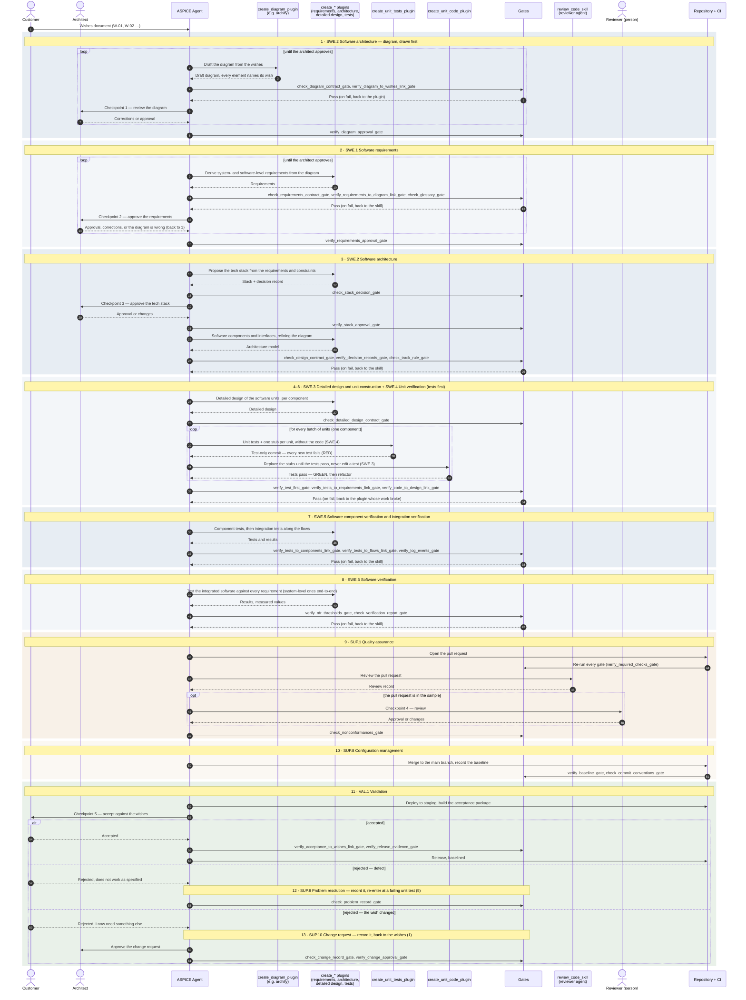
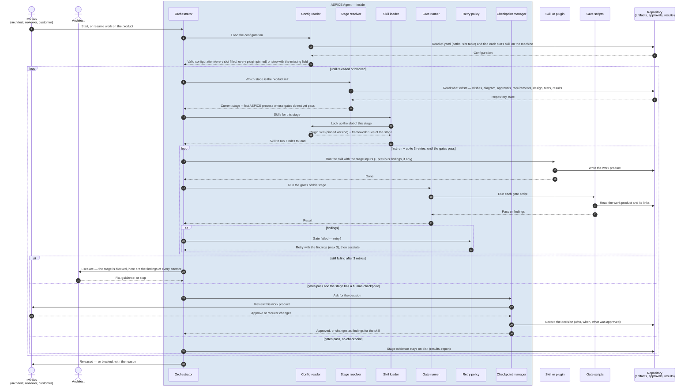

# Quality Framework

> **Status:** working document of the refactor of `main` (9f0eb96), restructured
> on 2026-10-01. Five parts: the principles; why ASPICE; the tale of the bridge;
> every ASPICE base practice with its final version and gate checks; how it is
> implemented. The decision history is in the appendix. The principles are the
> source of truth: every practice they name has a gate.

---

## 1. Principles

The framework enforces a best practice for building software products with AI
agents: a **diagram** of the functionality comes first, **requirements** are
derived from it, and **every requirement is tested**. The principles below say
*why*; every practice in § 4 is the checkable form of one of them, and every
practice has a gate.


The Philosophy states its principles first; every practice in § 3.1 belongs to
exactly one of them (the **Principle** column). Each practice is the concrete,
checkable form of a principle.

**Stated in the Philosophy** — quoted verbatim from
`DOCUMENTATION_Quality-framework_Gentle.ai.md` § 1 on `main` (9f0eb96):

- **Requirements-driven development** — think requirements through thoroughly before generating code _(Phase 1)_
- **Inspectability** — full traceability from requirements to tests and code _(Phase 1)_
- **Testability** — code structured so it can be verified in isolation _(Phase 1 → 4)_
  - Write tests first (TDD)
  - Testing across environments and configurations
  - Reusable test suite across features
- **Modularity** — separation of concerns and clear module boundaries _(Phase 2)_
- **Security** — defensive posture baked into the pipeline _(Phase 2 → 4)_
  - Reusable security test templates
  - Automated security scanning in CI
- **Static analysis** — lint and format rules configured once, applied consistently _(Phase 3)_
- **Documentation and code comments** — explain _why_, not _what_ _(Phase 3)_
- **Version control discipline** — clean commits, meaningful messages, branching strategy _(Phase 3)_
- **Logging** — structured logging derived from the requirement spec _(Phase 3)_
- **Code review (four-eyes principle)** — human verification gate before merging _(Phase 4)_
- **Performance testing** — measure response times, query counts, memory usage _(Phase 5)_
- **Observability** — alerts for unusual patterns, failed authentication, unexpected errors _(Phase 6)_

**Proposed by Claude, pending review** (2026-09-30) — practices already
described in the Philosophy's body had no principle in its list. Wording is
Claude's:

- **Architecture governance** — the system-level frame changes only on its own track, with its own approvers, one change at a time. *Described in Philosophy § 0 (two-track model); practices 1–4.*
- **Acceptance** — an increment ships only when it has been verified against a deployed system and accepted by the Product Owner. *Described in Philosophy § 3.5; practices 32, 33, 36.*
- **Feedback loop** — what production and the team learn flows back into the next iteration as tracked work. *Described in Philosophy § 3.6 C; practices 40, 41, 54.*
- **Framework improvement** — weaknesses found in the framework are recorded and fixed upstream, never worked around. *Not in the Philosophy today — from `AGENTS.md § Standing rules`; practice 47.*

The phase numbers above are the Philosophy's original six phases; they become
V stages during migration.

The table in § 3.1 lists every practice that section names.

**Added to the Philosophy on 2026-09-30** (they were enforced or planned but not
stated as practices — rows 42–47): requirements are derived from the diagram;
diagrams are approved by a human before requirements are derived; tests sit at
the V level paired with the requirement type; the `REFINES` graph is valid; the
requirements overview is generated and current; framework defects are logged,
never worked around. Their rationale must be written into this section during
migration.

**Added on 2026-09-30 to reach ASPICE capability level 1** (rows 48–55): the
minimum practices that close the level-1 gaps no existing row covered —
operating-environment impact of requirements; agreed and baselined
requirements; architecture resource budgets; design ↔ code consistency; one
verification strategy for unit, integration and qualification testing; release
baselines; problems tracked to closure; change requests with recorded analysis.


### What happens to a principle


The rows have two levels of detail. This is not a fourth dimension — it is the
*what* at two resolutions:

```
PRINCIPLE (why, ~16)      →   PRACTICE (what, checkable, 56)    →   GATE (how)
"Logging — structured         #22 start/end/error events +          `verify_log_events_gate`
 logging derived from          an integration test that
 the requirement spec"         asserts them
```

- A **principle** is the quality property the framework is after. It is broad
  and cannot be checked directly.
- A **practice** is the concrete, checkable form of a principle. Every practice
  belongs to exactly one principle; a principle usually has several practices.
- A **gate** checks a practice. Several practices of the same kind may share
  one gate.

Everything else is an **attribute of a practice**, not another level: the V
stage where it is authored and verified, the ASPICE process it serves, its
source in the Philosophy, and its status on `main`.

| Level | What it answers | Count |
|---|---|---|
| Principle | Why | 12 stated + 4 proposed = 16 |
| Practice | What, checkably | 56 |
| Gate | How it is checked | ~7, grouped |
| *Attributes of a practice* | When (stage), ASPICE process, source, status on `main` | — |


---

## 2. Why ASPICE

The framework does not invent its own process model. It adopts **Automotive
SPICE® (ASPICE)**, an established process assessment model published by VDA QMC
and recognised by auditors and customers, and defines *how* its processes are
carried out with agents, diagrams and gates.

**Why ASPICE.**

- **It is already a V.** Its engineering processes go down from requirements to
  units and back up through verification — the shape this framework is built on.
- **It defines the *what*, not the *how*.** ASPICE states processes, outcomes,
  base practices and the work products that serve as evidence; it leaves methods,
  tools and formats to each organisation. Diagram-first, TDD, markers and gates
  are this framework's *how*.
- **It avoids reinventing.** A custom process model would have to be defended
  and explained from scratch; ASPICE gives a shared vocabulary and a recognised
  structure for free.
- **It is assessable.** An assessor judges each base practice from evidence;
  every gate in § 4 produces such evidence.

**Version and source.** Automotive SPICE® Process Assessment Model **4.1** (VDA
QMC, August 2026), <https://vda-qmc.de/wp-content/uploads/2026/09/Automotive-SPICE-PAM-v41.pdf>.
Base-practice titles in § 4 are taken from that text. Version 4.1 has the same
base practices as 4.0, with editorial changes only.

**Scope.** SWE.1–SWE.6 (software engineering), VAL.1 (validation), SUP.1 (quality
assurance), SUP.8 (configuration management), SUP.9 (problem resolution) and
SUP.10 (change requests) — 66 base practices.

**Scope decision — SYS processes out of scope, system-level requirements
verified in SWE.6 (2026-10-02).** The system-level processes SYS.1–SYS.5 are not
adopted: products built with this framework are pure software, so there is no
system architecture, no hardware and no system integration. The software *is*
the whole product. Therefore:

- Requirements keep both levels (SWE.1 BP2: **Level** — system or software). A
  system-level requirement describes the whole product as seen from outside.
- **SWE.6 verifies every requirement of both levels.** A system-level requirement
  is verified by a test of the whole product, usually end-to-end, with its
  marker, exactly like a software-level one. This covers what SYS.5 would verify
  for a pure-software product.
- **Most products have no system-level requirements.** Then there is nothing to
  verify at that level, and the gate passes without any tests — no placeholder
  test is needed. A test that exists but asserts nothing would also pass; that is
  left to the reviewer, as for every other test.
- A product that includes hardware or runs inside a larger system needs the SYS
  processes; that is a scope change, not something this framework covers.

**ASPICE is the floor, not the ceiling.** Where the principles ask for more than
ASPICE, the extra practices stay (§ 4.2).

**Why some principles are not mirrored by ASPICE base practices.** Two reasons:
ASPICE does not prescribe *how* to build, and part of what the principles ask for
lies outside the scope chosen in § 4.

| Principle (practices) | Why no ASPICE base practice mirrors it | Reason |
|---|---|---|
| Security (#16 templates, #29 scanning) | ASPICE covers security in a separate model, the cybersecurity extension, left out of scope | Scope |
| Observability (#37–#39 alerts, dashboards, health checks) | ASPICE stops at validation and delivery and has no operations process. The *specification* part maps (observability requirements, SWE.1); the *deployment* part does not | Scope (operations) |
| Framework improvement (#47) and Feedback loop (#41) | They are process improvement — the PIM.3 process, left out of scope | Scope |
| Testability (#15 ports, #23 environment and configuration) | ASPICE asks for testable designs but does not say how; ports, a composition root and fail-fast configuration are this framework's techniques | ASPICE states *what*, not *how* |
| Architecture governance (#4 architecture-only runs) | A mechanism of this framework's two tracks; ASPICE asks for change control, not a reduced run | This framework's method |

ASPICE is the floor, not the ceiling: it guarantees a well-run engineering
process, but says nothing about specific product qualities (security, operations)
or techniques (TDD, ports). The principles go further, which is why the
Philosophy stays the source of truth and ASPICE a reference, not a limit. If the
scope is extended later, part of this section maps onto ASPICE: security onto the
cybersecurity model, #41 and #47 onto PIM.3.


### How Logging and Observability map to ASPICE

ASPICE has no process called "logging" or "observability" — and it does not
need one. For software, both are **requirements**: the system must emit
diagnosable events, and must make its health and misbehaviour visible. ASPICE
handles them the way it handles every requirement, through the same chain of
processes:

| Step | Logging (#22) | Observability (#37–39) | ASPICE process |
|---|---|---|---|
| Specified | Which events each feature emits, with which fields — the Philosophy says logging is *"derived from the requirement spec"* | Alerts, dashboards and health checks as non-functional requirements | SWE.1 (and system requirements) |
| Designed | Logging is an architectural element: a port the modules write to | Telemetry, alerting and health endpoints in the architecture | SWE.2 |
| Implemented | Start/end/error events in the code | Health endpoint in the code | SWE.3 |
| Verified | An integration test asserts the events | Alerts tested in staging before production | SWE.5 (logging), SWE.6 (observability) |
| Used in operation | Logs are the evidence when something fails | Alerts detect the failure | SUP.9 Problem resolution |

**Consequence for the practices.** For this mapping to be real, logging and
observability must exist **as requirements in the corpus**, not only as coding
rules — otherwise SWE.1 has nothing to trace. Today practice 22 checks the code
and its test; nothing requires a requirement that says *which* events or alerts
a feature needs. **Decided 2026-09-30:** a dedicated
requirement type `NFR-OBS` states which log events and which alerts or health
checks a feature needs; its `MEASUREMENT_METHOD` points at the logging test or
the alert file. That chains it end to end — requirement → test → alert — and
gives SWE.1 something to trace. Recorded as practice 56.


---

## 3. The tale of the bridge


A plain-language view of how the ASPICE processes fit together and how the
ASPICE Agent works, told as the building of a bridge. Every bridge text in this
document — and every explanation the agent gives in bridge terms — uses exactly
the words of the glossary below, one bridge word per framework term.

### The glossary of the tale — decided 2026-10-10

**Roles — who does what**

| Framework term | Bridge term |
|---|---|
| ASPICE Agent (the orchestrator) | foreman |
| Architect (checkpoints 1–3) | chief architect |
| Customer (wishes, checkpoint 5) | the village |
| Reviewer agent (every pull request) | fellow craftsman |
| Person on sampled pull requests (checkpoint 4) | quality auditor |

**ASPICE processes — the professions** (an ASPICE process is a profession of the V)

| Process | Bridge term |
|---|---|
| SWE.1 Software requirements | scribe |
| SWE.2 Software architecture | planner |
| SWE.3 Software detailed design and unit construction | craftsmen |
| SWE.4 Software unit verification | piece tester |
| SWE.5 Component and integration verification | assembler |
| SWE.6 Software verification | bridge tester |
| SUP.1 Quality assurance | quality auditor |
| SUP.8 Configuration management | librarian |
| SUP.9 Problem resolution management | repair book |
| SUP.10 Change request management | change desk |
| VAL.1 Validation | the village crosses |

**The machinery of the framework**

| Framework term | Bridge term |
|---|---|
| Stage | step of the site schedule |
| *agent/stages.yaml* | site schedule |
| Plugin (fills a slot) | crew |
| Framework plugin (*derive_…_plugin*, shipped with the framework) | village crew |
| External plugin (e.g. Archify, installed on the machine) | outside crew |
| Archify | drawing studio |
| Slot | job |
| *qf.yaml* slot table | contract register |
| Framework skill (rules) | rulebook |
| Contract (schema) | standard form |
| Adapter | translator |
| Gate | inspector |
| Finding | defect slip |
| Retry (at most 3) | round of defect slips |
| Escalation | handed to the chief architect |
| Checkpoint, approval | seal |
| Pull request | delivery, at the delivery desk |
| CI run | inspection round |
| Baseline (release tag) | official baseline |

**Work products**

| Framework term | Bridge term |
|---|---|
| Wish (*W-01*) | village wish |
| Requirement (*REQ-0011*) | requirement card |
| Glossary | village dictionary |
| Diagram (stage 1) | big plan |
| Invariants file | rules sheet |
| Diagram-wishes file | wish-links sheet |
| Tech stack | materials |
| Decision record (ADR) | decision note |
| Component | big piece |
| External actor or system | outside party |
| Interface | joint |
| Composition root | assembly sheet |
| Test double | mockup |
| Detailed design | piece plan |
| Unit | beam |
| Calls | connections |
| Structure diagram (stage 4) | piece drawing |
| Sequence diagram | load drawing |
| Range and unit of measure | limits (e.g. *holds 0–2 t*) |
| Unit test | unit test bench |
| Stub (a unit that only returns a default) | empty beam |
| Lint, format and static-analysis tools | workshop standards |
| Environment variables (configuration) | beam settings |
| Code | the beam itself |
| *code_dir* (where code and tests are stored) | warehouse |
| Folder | rack |
| *@unit* / *@sdoc* marker | beam label / card stamp |
| Verification plan | test plan |
| Validation scenario | crossing scenario |
| Component or integration test | assembly test |
| *integration_tests_dir* | assembly yard |
| Flow (an approved sequence diagram, *@flow*) | route |
| Integration order (the plan's integration section) | assembly schedule |
| Software-level test | bridge test |
| *software_tests_dir* | testing ground |
| End-to-end test (*e2e* suite) | full-span test |
| Measurements file | measurement log |
| Verification report | site logbook |
| Alert, dashboard, health-check definitions | alarms and gauges |
| Non-conformance (a fault left unfixed) | fault note |
| Security scan | safety sweep |
| Framework version (pinned submodule) | rulebook edition |
| Release record (*releases_dir*) | baseline entry |
| Validation record (*validation_records_dir*) | crossing log |
| Problem record (an issue labelled *problem*) | crack entry |
| Test marked *@problem[n]* | crack bench |
| Retrospective action (an issue labelled *retro-action*) | lesson card |
| Change request (an issue labelled *change-request*) | work order |
| */approve-change* | the chief architect's signature |

### The bridge, part 1 — the professions of the V

The village needs a **bridge**. To build it without disasters, the professions follow
a path shaped like a **V**: going down they *plan*, at the bottom they *build*,
going up they *test*.

**Going down — planning (left side of the V)**

- **SWE.1 — the scribe.** Writes a **requirement card** for every part of the
  sealed big plan: what it must do (*"the bridge shall carry two carts at
  once"*), how to check it, and how important it is.
- **SWE.2 — the planner.** Draws the **big plan**: pillars, deck, railings, and
  how they connect. Only the big pieces, not every nail.
- **SWE.3 — the craftsmen.** Draw each **piece plan** (*this beam is 3 m long and
  holds 2 t*) and **build the beam itself**.

**At the bottom — building.** Every beam is made.

**Going up — testing (right side of the V).** Each tester verifies the planning
profession directly opposite:

| Tester | What it tests | Against |
|---|---|---|
| SWE.4 — the piece tester | Each beam on its own, on its **unit test bench**: does it hold 2 t? | SWE.3, the piece plans |
| SWE.5 — the assembler | The big pieces together: do pillar and deck fit at their **joints**? | SWE.2, the big plan |
| SWE.6 — the bridge tester | The whole bridge: does it carry two carts? | SWE.1, the requirement cards |

**At the top — the real test.** **VAL.1 — the village crosses.** The testers ask
*"did we build it **right**?"* (verification). VAL.1 asks *"did we build the
**right thing**?"* (validation): real carts, in the rain, on market day, in
**crossing scenarios** written from the village's own wishes.

**The professions that are always there (SUP).** They build nothing, but without them
the work falls apart:

| Profession | Role |
|---|---|
| SUP.1 — the quality auditor | Checks that the professions follow the rules, without being one of them |
| SUP.8 — the librarian | Keeps every version of every card and plan — the **official baseline** — so anyone knows exactly which bridge was built |
| SUP.9 — the repair book | A crack is recorded, its cause investigated, fixed, and closed only once tested |
| SUP.10 — the change desk | When the village changes its mind (*"now wider"*), the change is recorded, its effect studied, and approved **before** anyone touches anything |

```
        SWE.1 scribe ─────────────── SWE.6 bridge tester ── VAL.1 the village crosses
           SWE.2 planner ──────── SWE.5 assembler
              SWE.3 craftsmen ── SWE.4 piece tester
                     (building)

   SUP.1 quality auditor · SUP.8 librarian · SUP.9 repair book · SUP.10 change desk
                        (present the whole time)
```

In this framework: the **diagram** is the planner's big plan, the
**requirements** are the scribe's requirement cards, the **tests** are the unit test benches,
and the **gates** are the inspectors.

### The bridge, part 2 — crews, standard forms and translators

Added 2026-10-03, reworded to the glossary 2026-10-10. A plain-language view of
plugins, contracts, adapters, gates and findings (§ 5).

Every profession is played by a **crew**. The **foreman** (the ASPICE Agent) walks the
**site schedule** and, at every step, hires the crew for that **job**: a
**drawing studio** (e.g. *Archify*) draws the plans, and **village crews** (the
framework's own methods, e.g. *derive_requirements_plugin*) write the cards and
plan the pieces. Any crew can be replaced by another that does the same job; the
**contract register** (*qf.yaml*, the slot table) records which crew does which
job.

**The problem.** Every crew works its own way. If the inspectors had to learn
every crew's drafting style, they would need retraining with every new crew, and
would make mistakes.

**The answer — standard forms.** The village prints its own **standard forms**,
and every piece of work must end up on them. These are the **contracts**:

| Standard form | On the bridge | In the framework |
|---|---|---|
| The requirement card | Number, statement, how to check it, which part of the big plan it comes from | *requirement.v1* |
| The plan sheet | Every pillar and beam numbered, every joint labelled | *diagram.v1* |
| The rules sheet | Rules no drawing can show: *no cart crosses before the railings are on* | *invariants.v1* |
| The defect slip | Which rule, which card, which line, what to fix | *findings.v1* |
| The seal | The chief architect's signature on the exact work approved | *approval.v1* |

**Two ways onto the standard forms:**

- **A crew writes straight onto the village's forms.** When it is hired, it
  receives the **rulebook** of its job (the framework skill, e.g.
  *write_requirements_skill*) together with its own way of working: *work your
  way, but your cards come out on our form.*
- **The drawing studio keeps its own drafting style**, because people need to
  look at the drawings. So the village employs a **translator** (the adapter), who
  copies every pillar and joint from the studio's drawing onto the plan sheet.
  **The village employs the translator, not the studio**: a studio tracing its own
  work could leave out a pillar and nobody would notice.

**The rules sheet.** Some rules cannot be drawn, and the studio's drafting style
has no symbol for them. They are written on a separate **rules sheet**, numbered
INV-1, INV-2, and stapled to the big plan; the translator copies them onto the plan
sheet too.

**The inspectors** (the gates) read only the village's standard forms, never a
crew's own drawings. With the plan sheet in one hand and the requirement cards in the
other, an inspector checks that every card names a part of the plan that exists,
and that every part has at least one card. Every problem goes on a **defect
slip**, handed back to the crew; after three **rounds of defect slips**, the
problem is **handed to the chief architect**.

**The seal** (the approval). When the chief architect approves the work, it is
sealed. If anyone changes a line afterwards, the seal breaks — the recorded hash
no longer matches — and the approval no longer counts.

```
 Drawing studio ──drawing──► Translator ──► Plan sheet ─┐
   (Archify)                  (adapter)   (diagram.v1) │
                     Rules sheet ──────────────┘       ├──► Inspector ──► Defect slips
                    (invariants.v1)                    │     (gate)       (findings.v1)
 Village crew + rulebook ──────► Requirement cards ────┘                      │
 (method plugin) (framework skill)     (requirement.v1)                        ▼
        ▲                                             back to the crew (3 rounds)
        └─────────────────────────────────────────── then the chief architect
```

**In one line:** crews can change, standard forms never do. Whoever produces the
work fits it onto the form, or the village's translator does it for them, and the
inspectors only ever read forms.

### The bridge, part 3 — the steps of the site schedule

Added 2026-10-10. What each step of the site schedule does, in the words of the
glossary: one description per step, kept current with the step's design. Whether
a step is built yet is not part of its description — that lives in
*agent/stages.yaml* (*implemented*) and the CHANGELOG. In each step, the first
mention of a bridge word carries the framework's name in parentheses, e.g.
*drawing studio (plugin Archify)*; the inspectors' gate names and rule IDs are
in square brackets, e.g. *[UNCOVERED_WISH]*.

**How to read a step's label** — *Step 1 · SWE.2, the planner · seal 1*:

| Part | Means |
|---|---|
| *Step 1* | Its place in the site schedule (*agent/stages.yaml*): the order in which the foreman (ASPICE Agent) runs the steps |
| *SWE.2* | The ASPICE process whose base practices the step produces evidence for |
| *the planner* | The profession doing the work, in bridge words |
| *seal 1* | The human approval (checkpoint) that closes the step, if any |

The five seals (checkpoints): **1** the chief architect (architect) approves the
big plan (diagrams) · **2** the chief architect approves the requirement cards
(requirements) · **3** the chief architect approves the materials (tech stack) ·
**4** the quality auditor (person on sampled pull requests) approves a sample of
deliveries (pull requests) · **5** the village (customer) accepts or rejects the
bridge (product). A step without a seal closes when its inspectors (gates)
pass. Steps 12 and 13 are not in the sequence: they run when a crack (defect) is
found or a village wish (wish) changes; a change also needs the chief
architect's approval, recorded with the change rather than as a seal.

**Step 1 — the big plan is drawn** · SWE.2, the planner · seal 1

The foreman (ASPICE Agent) hands the village wishes (wishes *W-01*, …) to the
drawing studio (plugin Archify) together with the rulebook for drawings
(framework skill *draw_diagram_skill*). The studio draws the big plan (diagram)
and staples two sheets to it: the rules sheet (invariants file, *INV-1*, …) and
the wish-links sheet (diagram-wishes file), naming the village wish every pillar
(node) and joint (edge or message) answers. The translator (adapter) copies the
drawing onto the plan sheet (standard form *diagram.v1*), and the inspectors
(gates) check it: every part numbered and labelled, every joint joining parts
that exist, no pillar standing alone [ORPHAN_NODE], every rule naming parts that
exist, and every village wish answered somewhere [UNCOVERED_WISH]. Then the
chief architect (architect) corrects the big plan and puts the seal (checkpoint
1 approval) on it. Once a requirement card (requirement) is written from it, the
seal must be older than that card; if anyone redraws a line, the seal breaks
[APPROVAL_OUTDATED] and the work goes back to this step.

**Step 2 — the requirement cards are written** · SWE.1, the scribe · seal 2

The foreman (ASPICE Agent) hands the sealed big plan (approved diagrams) to a
village crew (framework plugin) with its way of working (method
*derive_requirements_plugin*) and three rulebooks (framework skills): how to
write a requirement card (*write_requirements_skill*), how to keep the village
dictionary (glossary, *define_glossary_terms_skill*), and how to make a
performance requirement measurable (*specify_nfr_measurement_skill*). The crew
writes at least one requirement card (requirement) for every pillar, joint and
rule of the big plan. The inspectors (gates) check the requirement cards
against the big plan in both directions — every card names a part that exists,
every part has a card [UNCOVERED_NODE, UNCOVERED_EDGE] — that every card is
complete and every feature has a card for the events it must record (an
observability requirement), and that every special word is in the village
dictionary, once [check_glossary_gate]. The chief architect (architect) puts the
seal (checkpoint 2 approval) on the requirement cards; from then on, a card
changed after planning has started sends the work back to this step.

**Step 3 — materials and big pieces** · SWE.2, the planner · seal 3

First the materials (tech stack): the village crew (framework plugin
*derive_architecture_plugin*)
proposes steel, not wood, with a decision note (decision record, ADR) of the
options it weighed, and stops. Nothing is planned on materials without the
chief architect's (architect's) seal (checkpoint 3 approval). Then the crew
turns every pillar and joint of the big plan (diagram) into a described big
piece (component): what it carries (responsibility), its budget (memory,
response time, with units), its size, its modes (start-up, normal, degraded),
what it does in parallel (concurrency), and which requirement cards
(requirements) it fulfils. Every joint (interface) names what stands on its far
side and the mockup (test double) a unit test bench (unit test) can use instead
(framework skill *ensure_testability_skill*), and every big piece names its
assembly sheet (composition root), the one place where its real parts are
fitted. Every joint to an outside party (external interface) also names the
attacks the big piece behind it must resist, from the framework's catalog of
five (security templates, *create_security_tests_skill*). The inspectors (gates) check one big piece per pillar and one joint per
line of the big plan, that every requirement card is fulfilled by some big
piece [UNMET_REQUIREMENT], that every load drawing (sequence diagram) shows only
big pieces of the plan [UNKNOWN_PARTICIPANT], and that every big piece has its
assembly sheet and every joint its mockup [check_testability_gate]. If the
materials change after the seal, the seal is withdrawn.

**Step 4 — the piece plans** · SWE.3, the craftsmen · no seal

Once the big pieces (components) pass, the foreman (ASPICE Agent) hands each
big piece to the craftsmen, along with their way of working (method
*derive_detailed_design_plugin*), the rulebook (framework skill
*write_detailed_design_skill*) and the drawing studio (plugin Archify). The
craftsmen split the big piece into beams (units) and write what each beam takes
and gives (inputs and outputs), with its limits (range and unit of measure,
*holds 0 to 5, counted*), the connections (calls) between beams, and the beam
settings (environment variables) the beams will read, each with what it means,
whether it is required and its valid values; then they
ask the drawing studio for two drawings: the piece drawing (structure diagram)
and, once a beam calls another, the load drawing (sequence diagram). The
inspectors (gates) check that every big piece has its piece plan (detailed
design), that every beam comes from its own piece drawing [UNKNOWN_ELEMENT], and
that beam labels are unique on the whole bridge [DUPLICATE_ID]. They also check
that no limits are written upside down [INVALID_RANGE], and that the connections
in the list, the lines in the piece drawing and the load drawing all agree
[UNDRAWN_CALL, UNSHOWN_CALL, UNDECLARED_CALL], and that every beam setting is
written in full, once [DUPLICATE_VARIABLE]. The piece plans are agreed at the
delivery desk (pull request, step 9). A correct piece plan moves the work to
step 5; a broken one goes back with a round of defect slips (findings, retry);
one that stays broken is handed to the chief architect (escalation) after 4
attempts.

**Step 5 — unit test benches and empty beams first** · SWE.4, the piece tester · no seal

The foreman (ASPICE Agent) works one big piece (component) at a time. The piece
tester's crew (plugin) gets the requirement cards (requirements), the piece plan
(detailed design) and the joints (interfaces), but never the beams themselves
(code). In one go (one commit) it saves the test plan (verification plan), a
unit test bench (unit test, *must hold 2 t*) for every acceptance criterion and
every limit, a bench for every attack its joints to an outside party name
(security test, *@security[input-validation]*), and one empty beam (stub) per
beam (unit) of the piece plan: the
right shape, nothing inside, each laid in the warehouse (*code_dir*) in a rack
(folder) named after its big piece. The inspectors (gates) load every bench
against the empty beams, and every new bench must say *does not hold*
[TEST_NOT_FAILING]; every beam of the piece plan must have its empty beam and
its bench [MISSING_STUB, MISSING_UNIT_TEST] — all in [verify_test_first_gate] —
and the test plan must be complete [check_verification_plan_gate]. When every
big piece has its benches, the work moves to step 6; broken work goes back to
the piece tester with a round of defect slips (findings, retry); work that stays
broken is handed to the chief architect (escalation) after 4 attempts.

**Step 6 — the beams themselves** · SWE.3 and SWE.4, the craftsmen · no seal

The craftsmen's crew (plugin) gets the piece plan (detailed design), the unit
test benches (unit tests) and the empty beams (stubs), and replaces each empty
beam with the beam itself (code) until every bench says *holds*, then tidies it
up (refactor). Each beam writes the events its observability requirement card
lists (log events, *emit_log_events_skill*); step 7 checks them. The craftsmen never touch a bench: one they think wrong goes
back to the piece tester as a defect slip (finding). The inspectors (gates)
check that no bench changed together with a beam [TEST_CHANGED_WITH_CODE] and
that no beam came before its bench [CODE_BEFORE_TEST] — both in
[verify_test_first_gate] — that every beam carries its beam label (*@unit*
marker) and every label belongs to a beam of the piece plans, in both
directions, and that every beam and bench lies, at any depth of the warehouse
(*code_dir*), in a rack (folder) named after its big piece
[UNIT_OUTSIDE_COMPONENT] — both in [verify_code_to_design_link_gate] — that
every beam carrying a card stamp (*@sdoc* marker) names a requirement card that
exists, that the workshop standards (lint, format and static-analysis tools)
pass with pinned versions [check_stack_commands_gate], that every beam setting
(environment variable) the beams read is declared, every declared one is read,
and every required one has a passing bench of its own [check_env_config_gate],
that every big piece facing an outside party has a passing bench for every
attack its joint names [verify_security_tests_gate],
and that every bench
has a recorded result against the test plan (verification plan)
[verify_tests_to_requirements_link_gate, check_verification_plan_gate]. Broken
work goes back to the craftsmen with a round of defect slips (findings, retry);
work that stays broken is handed to the chief architect (escalation) after 4
attempts.

**Step 7 — big pieces alone, then joined** · SWE.5, the assembler · no seal

The assembler's crew (plugin *derive_integration_tests_plugin*, with the
rulebooks *verify_integration_skill* and *emit_log_events_skill*) first writes
the assembly schedule (integration section of the test plan): in which order
the big pieces (components) are joined, what must hold before each step, and
which tests run after it. Then, in one go with no beam (one test-only commit,
in the assembly yard, *integration_tests_dir*), it tests each big piece on its
own, through its joints (interfaces) only, with mockups (test doubles) on the
other side (*@component[web-app]*), and the big pieces joined along every route
(flow, an approved sequence diagram) of the big plan (*@flow[login]*), checking
on the way that the events every feature must record (log events) are
written. Then the craftsmen (coder) change the beams until every assembly test
says *holds*, and never touch an assembly test [TEST_CHANGED_WITH_CODE]. The
inspectors (gates) check that the schedule exists once assembly tests do and
joins every big piece [check_verification_plan_gate], that every big piece has
a passing test of its own and every step of the schedule a passing test
[verify_tests_to_components_link_gate], that every route has a passing
assembly test (integration test), every joint between two big pieces is
crossed by a tested route, and no assembly test fails
[verify_tests_to_flows_link_gate], and that every event of every observability
requirement card is named by a passing assembly test carrying the card stamp
(*@sdoc* marker) [verify_log_events_gate]. Broken work goes back to the crew
whose work broke with a round of defect slips (findings, retry); work that
stays broken is handed to the chief architect (escalation) after 4 attempts.

**Step 8 — the whole bridge tested** · SWE.6, the bridge tester · no seal

The bridge tester (crew *derive_software_tests_plugin*) writes the test plan's
(verification plan) page for the whole bridge and, in its own testing ground
(*software_tests_dir*), a bridge test (software-level test) for every
requirement card (requirement), stamped with its card stamp (*@sdoc[REQ-0049]*).
A card about the whole village (system level) is proved by a full-span test
(end-to-end test, the *e2e* suite), walked across the bridge from outside. A
measurable card (non-functional requirement, *opens within 200 ms*) is proved
by its instrument, which writes the value into the measurement log
(measurements file); a card about materials (constraint) is proved by the
materials seal. The bridge tester also hangs the alarms and gauges (alert,
dashboard and health-check definitions), each naming the card it watches. Then
the craftsmen (coder) change the beams until every bridge test holds, and never
touch a bridge test [TEST_CHANGED_WITH_CODE]. The inspectors (gates) check that
the page exists once bridge tests do [check_verification_plan_gate], that
every card has a passing bridge test in the right suite
[verify_software_tests_to_requirements_link_gate], that every measured value
meets its threshold [verify_nfr_thresholds_gate], that every observability
card has its alarm or gauge [check_observability_gate], and that one site
logbook (verification report) lists every beam, big piece, route and card with
its latest result, written from the current results
[check_verification_report_gate]. Keeping the logbook for every official
baseline comes with the release steps [verify_release_evidence_gate].

**Step 9 — the delivery desk** · SUP.1, the quality auditor · seal 4

The foreman (ASPICE Agent) brings the work to the delivery desk as one
delivery (pull request). The inspection round (CI run) runs every inspector
(gate) again, with the inspectors of the site's rulebook edition (framework
version, a pinned submodule) untouched and released
[verify_framework_integrity_gate]; no inspector can be sent home, because the
inspection round is required on the main branch and only a code owner may change
it [verify_required_checks_gate]. A safety sweep (security scan) looks for
leaked secrets and weak materials (vulnerable dependencies)
[scan_security_gate], and the site's notes on the rulebook (framework feedback)
are complete [check_framework_feedback_gate]. A fellow craftsman (reviewer
agent), working from its own account and never the author, reviews the delivery
with a checklist. The quality auditor (person) reviews every delivery that
changes the big plan (architecture) and 1 in N of the rest, chosen by delivery
number so the sample cannot be steered; a sampled delivery waits at the desk
until the auditor's seal is on its latest version [verify_host_settings_gate]. A
remark fixed before the delivery leaves the desk stays in the review; a fault
left unfixed becomes a fault note (non-conformance issue), followed up at the
release. This is where the *agreed* part of SWE.2 and SWE.3 is completed.

**Step 10 — the official baseline** · SUP.8, the librarian · no seal

The accepted delivery (pull request) joins the bridge (is merged). The rules
about deliveries live here: every delivery follows the village's naming of its
records (commit conventions) [check_commit_conventions_gate], nobody can
rewrite or remove the bridge's history (branch protection)
[verify_branch_protection_gate], every card, plan and beam the librarian keeps
(configuration item) is on the shelf [check_config_items_gate], no delivery
changes the big plan and a beam at once (track rule) [check_track_rule_gate],
and a delivery that changes the big plan contains no beams (code)
[verify_architecture_tests_gate]. For a release, the foreman brings one more
delivery: a baseline entry (release record) with its number, what changed and
the rulebook edition. The number is not chosen, it is worked out from the kind
of changes since the last baseline. Only after every inspector and the village
(step 11) have said yes does the librarian stamp the official baseline
(annotated release tag) [verify_baseline_gate] and check that the copy in the
second library (mirror) holds it [verify_backup_gate].

**Step 11 — the village crosses** · VAL.1, the village crosses · seal 5

A crew that knows only the village wishes (wishes), never the requirement
cards or the beams, writes the crossing scenarios (validation scenarios, *a
1-tonne cart crosses on market day*); every village wish has at least one, and
every scenario names a real wish [verify_acceptance_to_wishes_link_gate]. For a
release, the bridge (product) is set up on a site that looks like the real
river (staging): realistic data, the same connections to outside parties
(external systems). The crossings run there, and the crossing log (validation
record) says which bridge was set up and how every crossing went; every wish
the release touches has crossed, and none failed
[verify_release_evidence_gate]. The village accepts or rejects the release,
with a reason (checkpoint 5); the baseline is stamped only after it accepts. A
rejection comes back as a new or changed village wish.

**Step 12 — the repair book** · SUP.9, the repair book · no seal

Runs when a crack (defect) is found, not in the sequence. The crack goes into
the repair book as a crack entry (problem record) — what happens, where, how to
see it — and before anyone repairs it, why it happened, which cards and parts it
touches and how bad it is; a bad crack is announced to whoever else uses the
bridge [check_problem_record_gate]. A crack that cannot wait is repaired only
with the word of one of the few the village trusts with it
[check_urgent_fix_gate]. The tester first builds a crack bench (a failing test
naming the crack), the builder repairs until it passes, and the entry is
closed only with its bench on the bridge and the word of whoever found the
crack [verify_problem_closure_gate]. At every handover the repair book counts
the cracks by part and by how bad they were [report_problem_trends_gate].

**Step 13 — the change desk** · SUP.10, the change desk · no seal

Runs when the village (customer) changes its mind (*now wider*), not in the
sequence. The change is written up as a work order (change request): what, who
asks and why, then the village wishes, plans (diagram elements) and requirement
cards (requirements) it touches, the orders it waits for and its size
[check_change_record_gate]. The chief architect (architect) signs the work
order before anyone touches anything (*/approve-change*)
[verify_change_approval_gate]. Then it re-enters the normal steps where the
change begins — a new or changed village wish — and every delivery that builds
it names the order. Every card the order names exists, and an order that a
crack (problem) caused and that crack name each other [verify_change_trace_gate].
The order is closed only once its deliveries are on the bridge and whoever asked
for it says it is what they wanted; at every handover the open and finished
orders are listed [verify_change_closure_gate].


---

## 4. Base practices, final versions and gates

### 4.1 ASPICE base practices

Every ASPICE 4.1 base practice in scope, the final version of the practice that
fulfils it, and how the gates check it. A *Relies on* line means the check
belongs to another process group and is referenced, not repeated.

| ASPICE process | Base practice | Final version | How the gates check it |
|---|---|---|---|
| SWE.1 | BP1: Specify the software requirements | Requirements are **derived from an approved diagram**: each node, edge and behavioural invariant produces a requirement, and each message in the sequence diagram produces an acceptance criterion.<br><br>Every requirement follows the requirement schema and contains:<br>• **UID** — unique.<br>• **Level, kind and criticality** — as defined in BP2.<br>• **Statement** — one sentence.<br>• **Acceptance criteria** — at least one testable condition that proves the requirement is met, written as **Given** (the starting situation) / **When** (the action or event) / **Then** (the observable result). Example: *Given a user with 4 failed logins, When a 5th login fails, Then the account is locked.* Each criterion becomes at least one test.<br>• **Feasibility** — a short note on its technical feasibility.<br>• **Size** — its relative size on the T-shirt scale S, M, L or XL (see BP3).<br>• **Environment** — its impact on the operating environment, or "none".<br>• **Refines** — for software-level requirements, the UID of the parent system-level requirement.<br><br>A requirement of a non-functional kind also states its **metric**, **threshold** and **measurement method**.<br><br>In addition:<br>• Every requirement names, in its **Derived from** field, the diagram element it comes from.<br>• Every feature with runtime behaviour has a requirement of kind **observability**, stating which events it logs and which alerts or health checks watch it. | **Statement:** Requirement schema complete<br>**Evidence:** The requirement files<br>**Gate:** check_requirements_contract_gate<br>**What it verifies:** Every requirement has a unique UID and all schema fields; a requirement of a non-functional kind also has metric, threshold and measurement method<br>────────────────<br>**Statement:** Derived from an approved diagram<br>**Evidence:** Derived from fields + the approved diagrams<br>**Gate:** verify_requirements_to_diagram_link_gate<br>**What it verifies:** Every requirement names an existing diagram element, and every node, edge and invariant of the diagram has at least one requirement<br>────────────────<br>**Statement:** Observability specified<br>**Evidence:** Requirements of kind observability + the components of the architecture<br>**Gate:** check_requirements_contract_gate<br>**What it verifies:** Every component with runtime behaviour has at least one requirement of kind observability<br>────────────────<br>**Not checkable:** that each acceptance criterion faithfully reflects its diagram message — the architect confirms it at checkpoint 2 |
|  | BP2: Structure the software requirements | Every requirement states three attributes:<br>• **Level** — system or software.<br>• **Kind** — functional; a non-functional category (performance, security, usability, observability, …); a constraint; or an interface.<br>• **Criticality** — high, medium or low: the impact if the requirement is not met.<br><br>Every software-level requirement has a **Refines** field holding the UID of the system-level requirement it comes from (e.g. *Refines: REQ-0012*). System-level requirements have no **Refines** field: they are the roots of the tree.<br><br>System-level requirements come from the **architecture diagrams**; software-level requirements come from the **feature's sequence diagram**.<br><br>Requirements are presented as a tree — system → software — ordered by criticality. | **Statement:** Level, kind and criticality<br>**Evidence:** The requirement files<br>**Gate:** check_requirements_contract_gate<br>**What it verifies:** Every requirement has a valid level, kind and criticality<br>────────────────<br>**Statement:** Tree system → software<br>**Evidence:** Refines fields<br>**Gate:** check_requirements_contract_gate<br>**What it verifies:** Every software-level requirement refines an existing system-level requirement; no self-reference, no cycle; system-level requirements have no Refines<br>────────────────<br>**Statement:** Presented as a tree<br>**Evidence:** The report of the CI run<br>**Gate:** check_verification_report_gate<br>**What it verifies:** The report shows the requirements as a tree, ordered by criticality |
|  | BP3: Analyze the software requirements | Every requirement is analysed before it is agreed:<br>• **Diagram critique** — before requirements are derived, the diagram is checked for unlabelled edges, ambiguous flows and missing error paths.<br>• **Correctness** — its acceptance criteria are testable, and it only uses terms defined once in the glossary.<br>• **Technical feasibility** — its **Feasibility** field records whether it can be implemented, and under what conditions.<br>• **Interdependencies** — its relationship with other requirements is explicit through **Refines**.<br>• **Size** — an estimate of its relative size, on the T-shirt scale S, M, L or XL, as input for project planning. | **Statement:** Diagram critique (structural part)<br>**Evidence:** The diagram source, read through its adapter<br>**Gate:** check_diagram_contract_gate<br>**What it verifies:** No unlabelled edge or message, no dangling endpoint, no orphan node<br>────────────────<br>**Statement:** Correctness of terms<br>**Evidence:** The requirements + the glossary<br>**Gate:** check_glossary_gate<br>**What it verifies:** Every domain term used is defined exactly once in the glossary<br>────────────────<br>**Statement:** Feasibility, size, testable criteria<br>**Evidence:** The requirement files<br>**Gate:** check_requirements_contract_gate<br>**What it verifies:** Every requirement has a feasibility note, a size from S, M, L, XL, and acceptance criteria in Given/When/Then form<br>────────────────<br>**Not checkable:** ambiguous flows, missing error paths and the quality of the feasibility analysis — the architect reviews them at checkpoints 1 and 2 |
|  | BP4: Analyze the impact on the operating environment | Every requirement states, in its **Environment** field, its impact on the operating environment:<br>• **Elements affected** — the hardware, operating system, network or neighbouring systems it touches.<br>• **Impact** — what changes for each one (e.g. *opens port 443 towards the payment gateway*, *needs 200 MB of extra memory*).<br>• **None** — if it touches nothing outside the software, the field says "none" explicitly, so it is clear it was analysed and not forgotten. | **Statement:** Environment impact stated<br>**Evidence:** The Environment field of every requirement<br>**Gate:** check_requirements_contract_gate<br>**What it verifies:** Every requirement has an Environment field naming affected elements and their impact, or none<br>────────────────<br>**Not checkable:** that the impact analysis is right — the architect reviews it at checkpoint 2 |
|  | BP5: Ensure consistency and establish bidirectional traceability | Every software requirement is traceable in both directions:<br>• **To the system requirements** — through its **Refines** field. In the other direction, every system requirement is refined by at least one software requirement.<br>• **To the system architecture** — through its **Derived from** field, which names the diagram element it comes from. In the other direction, every diagram element is covered by at least one requirement.<br>• **Consistency** — no link points to a requirement or element that does not exist.<br><br>A report generated on every CI run shows these links for every requirement, together with the tests and code linked to it and their latest pass/fail. | **Statement:** Requirements ↔ architecture<br>**Evidence:** Derived from fields + the diagram elements<br>**Gate:** verify_requirements_to_diagram_link_gate<br>**What it verifies:** Every requirement names an existing element, and every element is covered by at least one requirement<br>────────────────<br>**Statement:** Software ↔ system requirements<br>**Evidence:** Refines fields<br>**Gate:** check_requirements_contract_gate<br>**What it verifies:** Every software requirement refines an existing system requirement, and every system requirement is refined by at least one software requirement<br>────────────────<br>**Statement:** Report generated<br>**Evidence:** The report of the CI run<br>**Gate:** check_verification_report_gate<br>**What it verifies:** The report exists for the run and shows every requirement's links, tests, code and latest pass/fail |
|  | BP6: Communicate the agreed software requirements and the impact on the operating environment | Requirements are agreed and communicated through the repository:<br>• **Diagram approval** — the diagram is approved by a human before the requirements are derived from it, and that approval is recorded in the repository.<br>• **Approval of the derived requirements** — the architect approves the requirements the agent derived from the diagram, confirming they say what was meant, before any design or code starts. The approval is recorded in the repository.<br>• **Agreement** — a requirement reaches the main branch only through a pull request approved by a reviewer other than its author. Merged means agreed.<br>• **Communication** — the pull request notifies the reviewers, and the report generated on every CI run (BP5) shows anyone the agreed requirements and their **Environment** impact.<br>• **Baseline** — every release tag records which requirements were agreed at that moment. | **Statement:** Diagram approved before derivation<br>**Evidence:** The recorded diagram approval + the first commit of the derived requirements<br>**Gate:** verify_diagram_approval_gate<br>**What it verifies:** The approval exists and is dated before the requirements were derived<br>────────────────<br>**Statement:** Requirements approved before design<br>**Evidence:** The recorded requirements approval + the first design or code commit<br>**Gate:** verify_requirements_approval_gate<br>**What it verifies:** The architect's approval exists and is dated before any design or code commit<br>────────────────<br>**Statement:** Agreed through a reviewed pull request<br>**Evidence:** Branch protection + review records<br>**Gate:** verify_host_settings_gate<br>**What it verifies:** Requirements reach the main branch only through an approved pull request<br>────────────────<br>**Relies on:** SUP.8 BP5 for the release baseline (verify_baseline_gate) — no SWE gate of its own |
| SWE.2 | BP1: Specify the static aspects of the software architecture | The architecture is built **from the approved architecture diagram** (flowchart), and documented in one document that follows the architecture model:<br>• **Components** — each node of the diagram is a software component, with its responsibility.<br>• **Interfaces** — each labelled edge is an interface between components; the edges that cross the system boundary are the external interfaces.<br>• **Relationships** — the edges show how the components depend on and connect to each other.<br>• **Link to the wishes** — every element of the diagram names the wish it comes from (e.g. *wish: W-03*), so every wish can be followed into the architecture and every element can be justified by a wish.<br>• **Diagram as source of truth** — the document never copies or redraws the approved diagram: every component and interface names the diagram element it comes from (e.g. *derived_from: auth-flow#auth-service*), and every node and edge of the diagram is one of them. If prose and diagram disagree, the diagram wins.<br><br>Every component is justified by the software requirements, functional and non-functional, that it serves (see BP4). | **Statement:** Architecture built from the approved diagram<br>**Evidence:** The architecture document + the approved diagram source<br>**Gate:** check_design_contract_gate<br>**What it verifies:** Every diagram node is a documented component with a responsibility, every labelled edge an interface, and the boundary-crossing edges are marked as external<br>────────────────<br>**Statement:** Diagram as source of truth<br>**Evidence:** The derived_from link of every component and interface + the approved diagram source<br>**Gate:** check_design_contract_gate<br>**What it verifies:** Every component and interface comes from an element of the approved diagram, and every node and edge is one of them<br>────────────────<br>**Not checkable:** that the prose agrees with the diagram — the reviewer checks it at the pull request<br>────────────────<br>**Statement:** Linked to the wishes<br>**Evidence:** The wish link of every diagram element + the wishes document<br>**Gate:** verify_diagram_to_wishes_link_gate (new)<br>**What it verifies:** Every diagram element names an existing wish<br>────────────────<br>**Statement:** Components justified by requirements<br>**Evidence:** Derived from fields<br>**Gate:** verify_requirements_to_diagram_link_gate<br>**What it verifies:** Every component serves at least one requirement |
|  | BP2: Specify the dynamic aspects of the software architecture | The run-time behaviour is described **from the approved behaviour diagrams**:<br>• **Behaviour and interaction** — every relevant flow is an approved sequence diagram. Its participants are the components of the architecture diagram, and its messages show how they interact.<br>• **Software modes** — each component lists its modes and the transitions between them (e.g. *start-up → normal → degraded*).<br>• **Concurrency** — each component states what runs in parallel, which resources are shared and how access to them is coordinated (e.g. *sign-ins run in parallel; the failure counter is updated atomically*).<br><br>The document never copies or redraws the sequence diagrams. Modes and concurrency may be declared "not applicable" with a reason (e.g. *a single-threaded script with one mode*). | **Statement:** Behaviour from approved diagrams<br>**Evidence:** Sequence and state diagrams of the architecture<br>**Gate:** check_design_contract_gate<br>**What it verifies:** Every participant of every approved sequence diagram is a node of the architecture diagram, and so a component<br>────────────────<br>**Statement:** Modes and concurrency stated<br>**Evidence:** The modes and concurrency of every component<br>**Gate:** check_design_contract_gate<br>**What it verifies:** Every component states both, or declares each not applicable with a reason, and every transition goes to one of its own modes<br>────────────────<br>**Not checkable:** that the described behaviour is correct — the architect approves it at checkpoint 1 |
|  | BP3: Analyze the software architecture | The architecture is analysed before it is agreed:<br>• **Diagram critique** — the architecture diagram is checked for missing trust boundaries, components with overlapping responsibilities, ambiguous or bidirectional flows, and missing cross-cutting concerns (observability, security).<br>• **Technical aspects** — each component states its **resource budget** (e.g. time, memory, throughput), with value and unit, inside the architecture document.<br>• **Design decisions** — every non-obvious decision is recorded in an ADR with its rationale and the alternatives rejected, and is referenced from the code it affects.<br>• **Tech stack** — the first design decision: language, runtime, frameworks, libraries and data stores with exact versions, one command per verification suite and check, and the scanners, chosen against the alternatives in a decision record and approved by the architect (checkpoint 3) before any component is designed.<br>• **Size** — each component carries a relative size (S, M, L or XL) as input for project planning, as requirements do in SWE.1 BP3. | **Statement:** Diagram critique (structural part)<br>**Evidence:** The diagram source, read through its adapter<br>**Gate:** check_diagram_contract_gate<br>**What it verifies:** No unlabelled edge, no dangling endpoint, no orphan node<br>────────────────<br>**Statement:** Budget and size per component<br>**Evidence:** The architecture document<br>**Gate:** check_design_contract_gate<br>**What it verifies:** Every component has a resource budget with value and unit, and a size from S, M, L, XL<br>────────────────<br>**Statement:** Decisions recorded<br>**Evidence:** ADR files + ADR markers in the code<br>**Gate:** verify_decision_records_gate<br>**What it verifies:** Every ADR marker resolves to an existing ADR file<br>────────────────<br>**Not checkable:** missing trust boundaries, overlapping responsibilities and missing cross-cutting concerns — the architect reviews them at checkpoint 1<br>────────────────<br>**Statement:** Tech stack decided<br>**Evidence:** The stack file + its decision record<br>**Gate:** check_stack_decision_gate<br>**What it verifies:** The stack follows *stack.v1* with exact versions, its decision record exists, and every suite a requirement names has a command<br>────────────────<br>**Statement:** Tech stack approved first<br>**Evidence:** The recorded approval of checkpoint 3 + the first component design<br>**Gate:** verify_stack_approval_gate<br>**What it verifies:** The architect approved the current stack before any component was designed |
|  | BP4: Ensure consistency and establish bidirectional traceability | The architecture and the software requirements are traceable in both directions through the **Derived from** links described in SWE.1 BP5 (every requirement names the diagram element it comes from, every diagram element is covered by at least one requirement, and no link points to something that does not exist). In addition:<br>• **Acceptance criteria** — the architecture states which component meets each software requirement (*meets: [REQ-0011]*), and with it every acceptance criterion of that requirement; since a requirement holds one behaviour (SWE.1), the requirement is the right grain. It is approved before implementation. | **Statement:** Requirements ↔ architecture<br>**Evidence:** Derived from fields + the diagram elements<br>**Gate:** verify_requirements_to_diagram_link_gate<br>**What it verifies:** As in SWE.1 BP5: both directions, no dangling link<br>────────────────<br>**Statement:** Acceptance criteria assigned<br>**Evidence:** The meets list of every component + the software requirements<br>**Gate:** check_design_contract_gate<br>**What it verifies:** Every software requirement, with its acceptance criteria, is met by a component, and no component meets a requirement that does not exist<br>────────────────<br>**Statement:** Approved before implementation<br>**Evidence:** The recorded diagram approval + the first code commit<br>**Gate:** verify_diagram_approval_gate<br>**What it verifies:** The architecture approval is dated before any implementation commit |
|  | BP5: Communicate the agreed software architecture | The architecture is agreed and communicated through the repository:<br>• **Own track** — a pull request changes either the architecture or a feature, never both; architecture changes go on their own branch and are reviewed on their own.<br>• **Diagram approval** — the architecture diagrams are approved by a human before anything is derived from them, and that approval is recorded in the repository (as in SWE.1 BP6).<br>• **Agreement** — the pull request is approved by the architecture's owners. Merged means agreed.<br>• **Communication** — the merged architecture document, with its diagrams, is the reference every feature builds on.<br>• **Baseline** — every release tag records which architecture was agreed at that moment. | **Statement:** Own track<br>**Evidence:** The paths changed by each pull request + its branch<br>**Gate:** check_track_rule_gate<br>**What it verifies:** No pull request changes both architecture and feature paths; architecture changes come from an architecture branch<br>────────────────<br>**Statement:** Diagrams approved<br>**Evidence:** The recorded diagram approvals<br>**Gate:** verify_diagram_approval_gate<br>**What it verifies:** Every architecture diagram has a recorded human approval before anything is derived from it<br>────────────────<br>**Statement:** Approved by the architecture owners<br>**Evidence:** Review records + code owners of the architecture<br>**Gate:** verify_host_settings_gate<br>**What it verifies:** Every architecture pull request is approved by a person among the architecture's owners<br>────────────────<br>**Relies on:** SUP.8 BP5 for the release baseline (verify_baseline_gate) — no SWE gate of its own |
| SWE.3 | BP1: Specify the static aspects of the detailed design | Every component has its own detailed-design document, which every feature that changes the component keeps up to date:<br>• **Units** — the software units the component is made of, each with its responsibility.<br>• **Interfaces** — the interfaces of each unit. For every input and output, its type, its **valid range** and its **unit of measure** (e.g. *temperature: number, 0 to 150, °C*).<br>• **Relationships** — how the units depend on and call each other.<br>• **From the diagrams** — every unit appears in its component's design diagram, drawn at this stage and agreed at the pull request (SWE.3 BP5: reviewer agent plus the sampled person). The document never copies or redraws the diagram: every unit names the node it comes from (e.g. *derived_from: auth-service#check-credentials*), and every node is a unit.<br><br>Inputs and outputs that are not numeric declare range and unit as "not applicable". | **Statement:** Every component has a detailed design<br>**Evidence:** The detailed-design documents + the architecture components<br>**Gate:** check_detailed_design_contract_gate<br>**What it verifies:** Every architecture component has its detailed-design document<br>────────────────<br>**Statement:** Interfaces with range and unit<br>**Evidence:** The unit interfaces<br>**Gate:** check_detailed_design_contract_gate<br>**What it verifies:** Every numeric input and output has type, valid range and unit; non-numeric ones declare not applicable<br>────────────────<br>**Statement:** Units from the design diagram<br>**Evidence:** The derived_from link of every unit + the component's design diagram<br>**Gate:** check_detailed_design_contract_gate<br>**What it verifies:** Every unit comes from a node of its component's design diagram, and every node is a unit |
|  | BP2: Specify the dynamic aspects of the detailed design | The detailed design describes how the units of a component interact:<br>• **Interactions** — every relevant interaction between units is a sequence diagram agreed at the pull request (SWE.3 BP5), consistent with the component's behaviour in the architecture (SWE.2 BP2: the architecture shows how components behave and interact in approved sequence diagrams, including their modes and concurrency).<br>• **Link to requirements** — each message in those diagrams corresponds to an acceptance criterion of a requirement (SWE.1 BP1: requirements are derived from approved diagrams, and each message in a sequence diagram produces an acceptance criterion), so every step of the behaviour traces back to a requirement.<br><br>The document never copies or redraws these diagrams; it names them. | **Statement:** Interactions as sequence diagrams<br>**Evidence:** The detailed-design sequence diagrams<br>**Gate:** check_detailed_design_contract_gate<br>**What it verifies:** Every relevant interaction is a sequence diagram that names only declared units, consistent with the architecture's flows<br>────────────────<br>**Not checkable:** that each message corresponds to the right acceptance criterion — the architect confirms requirements at checkpoint 2 |
|  | BP3: Develop the software units | Every software unit is developed consistently with its detailed design and according to the coding principles:<br>• **Link to the design** — every source file states, with a marker, the unit it implements (e.g. *@unit[parse-csv]*). Every unit in the detailed design is implemented by at least one source file.<br>• **Coding principles** — the lint, format and static-analysis tools the product declares, with pinned versions, pass with zero errors.<br>• **One folder per component** — every file with a unit marker lies, at any depth, in a folder named after the unit's component (e.g. *src/main/java/com/acme/auth_service/Login.java*), so the code's structure mirrors the architecture; the rest of the path follows the stack's own conventions. | **Statement:** Code ↔ design units<br>**Evidence:** Unit markers in the source files + the detailed designs<br>**Gate:** verify_code_to_design_link_gate<br>**What it verifies:** Every source file names an existing unit, and every unit is implemented by at least one source file<br>────────────────<br>**Statement:** Coding principles<br>**Evidence:** The lint, format and static-analysis commands declared with pinned versions<br>**Gate:** check_stack_commands_gate<br>**What it verifies:** Each declared command runs with its pinned version and passes with zero errors<br>────────────────<br>**Statement:** One folder per component<br>**Evidence:** The paths of the files with unit markers + the detailed designs<br>**Gate:** verify_code_to_design_link_gate<br>**What it verifies:** Every file with a unit marker has its unit's component id as a segment of its path |
|  | BP4: Ensure consistency and establish bidirectional traceability | The detailed design, the code and the requirements are traceable to each other:<br>• **Detailed design ↔ architecture** — every detailed design belongs to a component in the architecture, and every component in the architecture has its detailed design.<br>• **Code ↔ detailed design** — the unit markers in the code (SWE.3 BP3: every source file names its unit, and every unit is implemented) link each unit to its code in both directions.<br>• **Code ↔ requirements** — every source file that implements a requirement carries that requirement's marker (e.g. *@sdoc[REQ-0047]*), and no marker names a requirement that does not exist.<br>• **Detailed design ↔ requirements** — there is no separate link. It comes from combining the other links (unit → code → requirement), which avoids the redundancy ASPICE warns against. | **Statement:** Detailed design ↔ architecture<br>**Evidence:** The detailed-design documents + the architecture components<br>**Gate:** check_detailed_design_contract_gate<br>**What it verifies:** Every detailed design belongs to an existing component, and every component has one<br>────────────────<br>**Statement:** Code ↔ units and requirements<br>**Evidence:** Unit and requirement markers in the source files<br>**Gate:** verify_code_to_design_link_gate<br>**What it verifies:** Every unit is linked to its code in both directions, every requirement-implementing file carries an existing requirement marker, and no marker is orphan |
|  | BP5: Communicate the agreed software detailed design and the developed software units | The detailed design and the code are agreed and communicated through the repository:<br>• **Agreement** — every pull request that changes a detailed design or code is reviewed by a **reviewer agent** that is not its author, with the review checklist completed (correctness, style, traceability, logging). A **person** also approves a sample: every architecture pull request, plus a fixed share of feature pull requests chosen by pull-request number (e.g. *1 in 5*). Merged means agreed.<br>• **Communication** — the pull request notifies the reviewers, and the merged documents and code are the reference for everyone.<br>• **Baseline** — every release tag records which detailed design and which code were agreed at that moment. | **Statement:** Reviewed by an agent that is not the author<br>**Evidence:** The pull request's review record<br>**Gate:** verify_host_settings_gate<br>**What it verifies:** Every merged pull request has an approving review from a reviewer agent different from its author, with the checklist completed<br>────────────────<br>**Statement:** Human approval on the sample<br>**Evidence:** Pull-request numbers + human approvals<br>**Gate:** verify_host_settings_gate<br>**What it verifies:** Every architecture pull request and every sampled feature pull request has an approval from a person<br>────────────────<br>**Not checkable:** the quality of the review itself — that is what the human sample is for |
| SWE.4 | BP1: Specify software unit verification measures | Every software unit has its verification measures specified before its code is written:<br>• **Verification plan** — one plan, with a section per level (unit, integration, software, validation). For unit verification it states the techniques, the pass/fail criteria, the entry and exit criteria, and the infrastructure needed (e.g. *test runner, mocks*).<br>• **From the acceptance criteria** — every unit's tests are derived from the acceptance criteria of the requirements it implements (SWE.1 BP1: each criterion is a Given/When/Then condition, derived from a message in the diagram).<br>• **Test first, by an independent tester** — the tester, who never sees the code, commits the unit tests of a batch together with one **stub** per unit (generated from the detailed design: signature and a default return) in one test-only commit, and every new test fails on that commit. The coder then replaces the stubs with the real units until the tests pass, and never edits a test. CI checks the order, the failure and that no test changes together with code. | **Statement:** Defined in the plan<br>**Evidence:** The unit section of the verification plan<br>**Gate:** check_verification_plan_gate<br>**What it verifies:** The section exists with techniques, pass/fail criteria, entry and exit criteria and infrastructure<br>────────────────<br>**Statement:** Test first<br>**Evidence:** The commit history of each pull request + the test results per commit<br>**Gate:** verify_test_first_gate (new)<br>**What it verifies:** Every unit has a stub and a test in a test-only commit; on that commit every new test fails or errors, never passes (red run); no test is committed after the first file of its unit; no test changes together with code; each test is judged at the last test-only commit that changed it<br>────────────────<br>**Not checkable:** that the tests are derived meaningfully from the acceptance criteria — left to the reviewer |
|  | BP2: Select software unit verification measures | The unit tests to run are chosen by documented rules:<br>• **Selection criteria** — the verification plan (SWE.4 BP1: one document in the product, with a section per level: unit, integration, software, validation) states which unit tests run and when (e.g. *every unit test on every pull request*).<br>• **Regression** — when code changes, the existing unit tests run again, so a change cannot silently break what already worked. The plan states which ones (e.g. *all of them*, or *those of the changed component*).<br>• **Coverage of the release** — every unit in the release has at least one selected test, and the tests reach the minimum code coverage the plan declares (e.g. *80 % of lines*). CI checks both. | **Statement:** Selection, regression and coverage defined<br>**Evidence:** The unit section of the verification plan<br>**Gate:** check_verification_plan_gate<br>**What it verifies:** The section states the selection, the regression rule and the minimum code coverage<br>────────────────<br>**Statement:** Every unit in the release has a test<br>**Evidence:** Unit markers in the tests + the units of the release<br>**Gate:** verify_tests_to_requirements_link_gate<br>**What it verifies:** Every unit in the release has at least one selected test<br>────────────────<br>**Statement:** Coverage reached<br>**Evidence:** The coverage result of the declared command<br>**Gate:** check_stack_commands_gate<br>**What it verifies:** The measured code coverage meets the minimum declared in the plan |
|  | BP3: Verify the software units | Every unit test selected by the verification plan runs on every CI run, and its result is recorded:<br>• **Run** — CI runs the unit tests with the test command the product declares.<br>• **Pass** — every selected test passes, and a failing test blocks the merge. The unit's security tests run with them (e.g. *rejects malformed input*).<br>• **Recorded results** — every run stores a machine-readable result for each test (pass or fail, duration, and which test it belongs to; e.g. *a JUnit XML file*), kept for every release. | **Statement:** Unit tests pass and are recorded<br>**Evidence:** The run's result file<br>**Gate:** verify_tests_to_requirements_link_gate<br>**What it verifies:** The tests ran with the declared command, every selected unit test has a result, and it passed<br>────────────────<br>**Statement:** Results kept per release<br>**Evidence:** Artifacts of the release<br>**Gate:** verify_release_evidence_gate<br>**What it verifies:** Every release has its unit-test results stored |
|  | BP4: Ensure consistency and establish bidirectional traceability | Unit tests, units and results are traceable to each other:<br>• **Tests ↔ units** — every unit test names, with a marker, the unit it verifies (e.g. *@unit[parse-csv]*), and every unit in the detailed design has at least one test.<br>• **Results ↔ tests** — every recorded result names the test that produced it (SWE.4 BP3: every run stores a pass/fail result per test), and every selected test has a result in every run.<br>• **Consistency** — no marker names a unit that does not exist. | **Statement:** Tests ↔ units<br>**Evidence:** Unit markers in the tests + the detailed designs<br>**Gate:** verify_code_to_design_link_gate<br>**What it verifies:** Every unit test names an existing unit, and every unit has at least one test<br>────────────────<br>**Statement:** Results ↔ tests<br>**Evidence:** The run's result file<br>**Gate:** verify_tests_to_requirements_link_gate<br>**What it verifies:** Every result belongs to an existing test, and every selected test has a result |
|  | BP5: Summarize and communicate the results | The results of unit verification are summarised and communicated on every CI run:<br>• **Summary** — the report generated on every CI run (SWE.1 BP5: one report showing, for every requirement, its links, tests and code, with the latest pass/fail) includes, per unit, how many tests passed and failed and the code coverage reached.<br>• **Communication** — the summary appears in the pull request's CI run, where the author and reviewers see it, and is kept as an artifact for every release. | **Statement:** Unit summary generated<br>**Evidence:** The report of the CI run<br>**Gate:** check_verification_report_gate<br>**What it verifies:** The report contains, per unit, the passed and failed tests and the coverage reached<br>────────────────<br>**Statement:** Kept for every release<br>**Evidence:** Artifacts of the release<br>**Gate:** verify_release_evidence_gate<br>**What it verifies:** Every release tag has its report stored |
| SWE.5 | BP1: Specify software integration verification measures | Integration tests are specified before components are integrated:<br>• **Integration order** — the integration section of the verification plan (SWE.4 BP1: one document with a section per level) states the order in which components are integrated, and what must be true before each step (e.g. *storage before api; database migrated*).<br>• **From the architecture** — every interface between components, and every approved sequence diagram in the architecture (SWE.2 BP1–BP2: components, interfaces and behaviour diagrams), has at least one integration test.<br>• **Criteria and infrastructure** — each integration test states its technique, its pass/fail criteria, its entry and exit criteria, and the infrastructure it needs (e.g. *test database in a container*). | **Statement:** Defined in the plan<br>**Evidence:** The integration section of the verification plan<br>**Gate:** check_verification_plan_gate<br>**What it verifies:** The section states the integration order with preconditions, techniques, criteria, entry and exit criteria and infrastructure; the order names existing components<br>────────────────<br>**Statement:** Every interface and flow has an integration test<br>**Evidence:** Flow markers in the integration tests + the interfaces and sequence diagrams of the architecture<br>**Gate:** verify_tests_to_flows_link_gate<br>**What it verifies:** Every interface between components and every approved sequence diagram has at least one integration test |
|  | BP2: Specify verification measures for verifying the software component behavior | Every component is verified on its own, against what the architecture says it does:<br>• **Component tests** — each component has tests that exercise it through its own interfaces, as a black box (SWE.2 BP1–BP2: each component's responsibility, interfaces and behaviour diagrams). Every component test names its component with a marker (e.g. *@component[billing]*).<br>• **In the plan** — the integration section of the verification plan (SWE.4 BP1) states, for these tests, their technique, their pass/fail criteria, their entry and exit criteria, and the infrastructure they need (e.g. *a stub for the external payment service*). | **Statement:** Component tests exist<br>**Evidence:** Markers *@component[...]* in the tests + the component list in the architecture<br>**Gate:** verify_tests_to_components_link_gate<br>**What it verifies:** Every component in the architecture has ≥ 1 test with its marker, and no marker names a component that does not exist<br>────────────────<br>**Statement:** Defined in the plan<br>**Evidence:** The integration section of the verification plan<br>**Gate:** check_verification_plan_gate<br>**What it verifies:** The section exists, with technique, criteria, entry/exit and infrastructure filled in<br>────────────────<br>**Not checkable:** that the test is really black-box — left to the reviewer (SWE.3 BP5 checklist) |
|  | BP3: Select verification measures | The integration and component tests to run are chosen by documented rules:<br>• **Selection per step** — for each step of the integration order (SWE.5 BP1: the order in which components are integrated), the integration section of the verification plan states which integration tests run (e.g. *after integrating storage: every storage–api test*).<br>• **Regression** — when a component changes, the integration and component tests involving it run again. The plan states which ones (e.g. *every test of the changed component and its neighbours*).<br>• **Coverage of the release** — every integration step and every component in the release has at least one selected test. | **Statement:** Selection per step and regression<br>**Evidence:** The integration section of the plan<br>**Gate:** check_verification_plan_gate<br>**What it verifies:** Every step of the integration order has its selection, and the regression rule exists<br>────────────────<br>**Statement:** Coverage of the release<br>**Evidence:** Markers *@component[...]* + integration order + the run's results<br>**Gate:** verify_tests_to_components_link_gate<br>**What it verifies:** Every step and every component has ≥ 1 test, and it ran<br>────────────────<br>**Not checkable:** whether the selection is good — left to the reviewer |
|  | BP4: Integrate the software elements and perform the integration verification | The software is integrated step by step and verified at each step:<br>• **Integration** — components are integrated in the order and with the preconditions the verification plan states (SWE.5 BP1: integration order and preconditions per step), through the interfaces the architecture defines.<br>• **Integration tests** — after each step, the selected integration tests run (SWE.5 BP3: selection per step) and must pass. A failing test blocks the merge.<br>• **Logging verified** — for every requirement of kind observability (SWE.1 BP1), an integration test checks that the expected log events are emitted with their required fields (e.g. *start, end and error events carrying the requirement UID*).<br>• **Recorded results** — every run stores a pass/fail result for each integration test, linked to its test (SWE.4 BP3: one machine-readable result per test). | **Statement:** Every integration step verified<br>**Evidence:** The plan's integration order and selections + the integration suite's result file<br>**Gate:** verify_tests_to_components_link_gate<br>**What it verifies:** Every step of the order has at least one passing test among its selection<br>────────────────<br>**Statement:** Integration tests pass and are recorded<br>**Evidence:** The run's result file<br>**Gate:** verify_tests_to_flows_link_gate<br>**What it verifies:** The integration suite wrote its results, and every integration test in them passed<br>────────────────<br>**Statement:** Logging verified<br>**Evidence:** Observability requirements + their tests (event names and required fields)<br>**Gate:** verify_log_events_gate<br>**What it verifies:** Every observability requirement has a passing integration test carrying its *@sdoc* marker and naming each of its events<br>────────────────<br>**Not checkable:** that the test checks the content of the logs meaningfully, beyond their presence — left to the reviewer |
|  | BP5: Perform the software component verification | The component tests run, and their results are recorded:<br>• **Run** — on every CI run, the component tests selected for the release (SWE.5 BP3: selection per integration step) run and must pass. A failing test blocks the merge.<br>• **Recorded results** — each component test's pass/fail result is stored, linked to its test and to its component (SWE.5 BP2: every component test names its component with a marker). | **Statement:** Component tests pass<br>**Evidence:** The run's result file<br>**Gate:** verify_tests_to_components_link_gate<br>**What it verifies:** Every component has a passing component test, and every integration result passed (verify_tests_to_flows_link_gate)<br>────────────────<br>**Statement:** Results linked to the component<br>**Evidence:** The result file + the *@component[...]* markers<br>**Gate:** verify_tests_to_components_link_gate<br>**What it verifies:** Every result belongs to a test marked with an existing component |
|  | BP6: Ensure consistency and establish bidirectional traceability | Integration and component tests are traceable to the architecture, the detailed design and their results:<br>• **Tests ↔ architecture** — every component test names its component (SWE.5 BP2: marker *@component[...]*), and every integration test names, with a marker, the flow it verifies (e.g. *@flow[checkout]*, where *checkout* is an approved sequence diagram). Every component and every approved sequence diagram has at least one test.<br>• **Tests ↔ detailed design** — tests that exercise interactions between units name those units (SWE.4 BP4: marker *@unit[...]*).<br>• **Results ↔ tests** — every recorded result names the test that produced it (SWE.4 BP3: one result per test).<br>• **Consistency** — no marker names a component, flow or unit that does not exist. | **Statement:** Every component and flow has a test<br>**Evidence:** *@component[...]* and *@flow[...]* markers + the components and sequence diagrams of the architecture<br>**Gate:** verify_tests_to_components_link_gate (components) · verify_tests_to_flows_link_gate (flows, new)<br>**What it verifies:** Every component and every approved sequence diagram has ≥ 1 test, and no marker names one that does not exist<br>────────────────<br>**Statement:** Tests linked to units<br>**Evidence:** *@unit[...]* markers in the tests<br>**Gate:** verify_code_to_design_link_gate<br>**What it verifies:** No marker names a unit that does not exist<br>────────────────<br>**Statement:** Results linked to tests<br>**Evidence:** The run's result file<br>**Gate:** verify_tests_to_requirements_link_gate<br>**What it verifies:** Every result belongs to an existing test, and every selected test has a result |
|  | BP7: Summarize and communicate the results | The results of component and integration verification are summarised and communicated **the same way as unit results** (SWE.4 BP5: a summary in the report generated on every CI run, shown in the pull request and kept for every release), extended to these levels:<br>• **Summary** — the generated report includes how many tests passed and failed **per component, per integration step and per flow**.<br>• **Communication** — as in SWE.4 BP5, the summary appears in the pull request's CI run and is kept as an artifact for every release. | **Statement:** Summary generated<br>**Evidence:** The report of the CI run<br>**Gate:** check_verification_report_gate<br>**What it verifies:** The report exists for the run, generated from the current results, with the component, integration-step and flow sections<br>────────────────<br>**Statement:** Kept for every release<br>**Evidence:** Artifacts of the release<br>**Gate:** verify_release_evidence_gate<br>**What it verifies:** Every release tag has its report stored |
| SWE.6 | BP1: Specify verification measures for the software verification | The integrated software is verified against every requirement of both levels (SWE.1 BP2: **Level** — system or software), because the software is the whole product. Tests are specified in advance:<br>• **Functional requirements** — every requirement has at least one software-level test that checks its acceptance criteria (SWE.1 BP1: Given/When/Then conditions), and the test names it with its marker (e.g. *@sdoc[REQ-0047]*).<br>• **Non-functional requirements** — every requirement of a non-functional kind is checked by the instrument its **measurement method** names (e.g. *a performance benchmark*), against its **threshold**.<br>• **System-level requirements** — verified by tests of the whole product from the outside (e.g. *an end-to-end test that places an order and checks that the invoice arrives within one minute*). A product without system-level requirements needs no such tests.<br>• **In the plan** — the software section of the verification plan (SWE.4 BP1: one document with a section per level) states the techniques, the pass/fail criteria, the entry and exit criteria, the order in which tests run, and the environment needed (e.g. *the software deployed in a test environment with sample data*). | **Statement:** Every requirement has its software-level test<br>**Evidence:** *@sdoc[...]* markers in the software-level tests (the folder *software_tests_dir*)<br>**Gate:** verify_software_tests_to_requirements_link_gate<br>**What it verifies:** Every requirement, system or software level, has ≥ 1 passing software-level test with its marker — system-level ones in the *e2e* suite, software-level ones in the *software* suite; a constraint is proved by the materials seal, a measured requirement by its measured value (BP3) — and no marker names a requirement that does not exist<br>────────────────<br>**Statement:** Non-functional requirements have their instrument<br>**Evidence:** The measurement method in the requirement + the named test or benchmark<br>**Gate:** check_requirements_contract_gate<br>**What it verifies:** The instrument named in each measurement method exists<br>────────────────<br>**Statement:** Defined in the plan<br>**Evidence:** The software section of the verification plan<br>**Gate:** check_verification_plan_gate<br>**What it verifies:** The section exists, with techniques, criteria, entry/exit, order and environment filled in<br>────────────────<br>**Not checkable:** that the test really covers every acceptance criterion of the requirement — left to the reviewer |
|  | BP2: Select verification measures | The software-level tests to run are chosen **the same way as unit tests** (SWE.4 BP2: selection criteria, regression and release coverage, documented in the verification plan), applied to this level:<br>• **Selection and regression** — the software section of the verification plan states which software-level tests run and when, and which ones run again after a change (e.g. *all of them before every release*).<br>• **Coverage of the release** — every requirement in the release, system or software level, has at least one selected software-level test. | **Statement:** Selection and regression defined<br>**Evidence:** The software section of the verification plan<br>**Gate:** check_verification_plan_gate<br>**What it verifies:** The section states the selection and the regression rule<br>────────────────<br>**Statement:** Coverage of the release<br>**Evidence:** *@sdoc[...]* markers in the software-level tests + the requirements of the release<br>**Gate:** verify_software_tests_to_requirements_link_gate<br>**What it verifies:** Every requirement in the release has ≥ 1 selected software-level test<br>────────────────<br>**Not checkable:** whether the selection is good — left to the reviewer |
|  | BP3: Verify the integrated software | The software-level tests run, and their results are recorded **the same way as unit tests** (SWE.4 BP3: they run in CI, must pass, and every run stores a pass/fail result per test), applied to the integrated software:<br>• **Functional requirements** — the selected software-level tests run and must pass. A failing test blocks the release.<br>• **Non-functional requirements** — the measured value is recorded next to its threshold (e.g. *p95 latency 180 ms, threshold ≤ 200 ms*). The suite that measures writes the value to a measurements file (e.g. *{requirement: REQ-0047, value: 180, unit: ms}*); a value that does not meet the threshold blocks the release. | **Statement:** Software-level tests pass and are recorded<br>**Evidence:** The run's result file<br>**Gate:** verify_software_tests_to_requirements_link_gate<br>**What it verifies:** Every selected software-level test has a result, and it passed<br>────────────────<br>**Statement:** Thresholds met<br>**Evidence:** The measurements file of the instrument's suite + the threshold in the requirement<br>**Gate:** verify_nfr_thresholds_gate<br>**What it verifies:** Every requirement with a measurement method has a measured value from its instrument's suite, in the threshold's unit, and it meets its threshold |
|  | BP4: Ensure consistency and establish bidirectional traceability | Software-level tests, requirements and results are traceable to each other **the same way as unit tests** (SWE.4 BP4: tests name what they verify with a marker, and results name their test), applied to requirements:<br>• **Tests ↔ requirements** — every software-level test names the requirement it verifies (e.g. *@sdoc[REQ-0047]*), and every requirement, system or software level, has at least one (SWE.6 BP1).<br>• **Results ↔ tests** — every recorded result names the test that produced it.<br>• **Consistency** — no marker names a requirement that does not exist. | **Statement:** Tests linked to requirements in both directions<br>**Evidence:** *@sdoc[...]* markers in the software-level tests + the requirements<br>**Gate:** verify_software_tests_to_requirements_link_gate<br>**What it verifies:** Every requirement has ≥ 1 software-level test, and no marker names a requirement that does not exist<br>────────────────<br>**Statement:** Results linked to tests<br>**Evidence:** The run's result file<br>**Gate:** verify_software_tests_to_requirements_link_gate<br>**What it verifies:** Every result belongs to an existing test, and every selected test has a result |
|  | BP5: Summarize and communicate the results | The results of software verification are summarised and communicated **the same way as unit results** (SWE.4 BP5: a summary in the report generated on every CI run, shown in the pull request and kept for every release), extended to this level:<br>• **Summary** — the generated report includes, **per requirement** (system and software level), its software-level tests and their latest pass/fail, and for non-functional ones, the measured value next to its threshold.<br>• **Communication** — as in SWE.4 BP5, the summary appears in the CI run and is kept as an artifact for every release. | **Statement:** Summary generated<br>**Evidence:** The report of the CI run<br>**Gate:** check_verification_report_gate<br>**What it verifies:** The report exists for the run, with the per-requirement section and the measured values<br>────────────────<br>**Statement:** Kept for every release<br>**Evidence:** Artifacts of the release<br>**Gate:** verify_release_evidence_gate<br>**What it verifies:** Every release tag has its report stored |
| VAL.1 | BP1: Specify validation measures for the product validation | Validation is specified in advance, from the customer's wishes:<br>• **From the wishes** — every wish in the wishes document (the stakeholder requirements) has at least one validation scenario showing, in the customer's terms, that the product serves its intended use. For example, wish *W-03 "cross with loaded carts"* → scenario *"a 1-tonne cart crosses on market day"*. A scenario is a file under the scenarios folder that names its wish with a marker (e.g. *@wish[W-03]*): an automated test, or the written steps of a guided demo or a trial use.<br>• **Written from the wishes only** — the scenarios are written by a crew that reads the wishes, the diagrams and the outside interfaces, never the requirements or the code, so validation does not repeat verification.<br>• **In the plan** — the validation section of the verification plan (SWE.4 BP1: one document with a section per level) states, for each scenario in the order they run, the technique (e.g. *guided demo, acceptance test, trial use*), the pass/fail criteria, the entry criteria and the environment: the product running in conditions close to the customer's (e.g. *staging with realistic data*). | **Statement:** Every wish has its validation scenario<br>**Evidence:** *@wish[...]* markers in the scenarios + the identifiers in the wishes document<br>**Gate:** verify_acceptance_to_wishes_link_gate (new)<br>**What it verifies:** On every pull request, every wish has ≥ 1 scenario, and no marker names a wish that does not exist<br>────────────────<br>**Statement:** Defined in the plan<br>**Evidence:** The validation section of the verification plan<br>**Gate:** check_verification_plan_gate<br>**What it verifies:** Once scenarios exist, the section exists, with technique, criteria, entry criteria and environment for every scenario, and names no scenario that does not exist<br>────────────────<br>**Not checkable:** whether the scenario truly reflects the customer's intended use — the customer decides that at acceptance (checkpoint 5) |
|  | BP2: Select validation measures | The validation scenarios to run are chosen **the same way as unit tests** (SWE.4 BP2: selection criteria, regression and release coverage, documented in the verification plan), applied to validation:<br>• **Selection and regression** — the validation section of the verification plan states which scenarios run before each release, and which ones run again after a change. Every automated scenario runs at every release; the plan chooses among the scenarios run by hand (e.g. *every scenario of a wish touched by the release*).<br>• **Coverage of the release** — every wish affected by the release has at least one scenario with a result. A release that changes what the customer gets (the wishes, the diagrams, the requirements, the design, the stack, the configuration, the observability or the code) affects every wish; one that changes only the framework, the tests or the records affects none. | **Statement:** Selection and regression defined<br>**Evidence:** The validation section of the verification plan<br>**Gate:** check_verification_plan_gate<br>**What it verifies:** The section states the selection and the regression rule<br>────────────────<br>**Statement:** Coverage of the release<br>**Evidence:** *@wish[...]* markers + the wishes affected by the release + the validation record<br>**Gate:** verify_acceptance_to_wishes_link_gate<br>**What it verifies:** At release, every wish affected by the release has ≥ 1 scenario with a result<br>────────────────<br>**Not checkable:** whether the selection among the scenarios run by hand is good — left to the reviewer |
|  | BP3: Perform the validation and evaluate the results | Before every release, the customer validates the product in conditions close to real use:<br>• **Deployment** — the release candidate, with its release record (SUP.8 BP5), is deployed to a staging environment that resembles the customer's (e.g. *realistic data, the same integrations*). The framework never deploys: the product's own pipeline does.<br>• **Run and record** — the selected validation scenarios (VAL.1 BP2) run against that deployment, and one validation record per release names the environment, the deployed commit and every result, pass or fail, with its scenario and technique. The automated results are filled in by a tool; the results of a guided demo or a trial use are entered by the person who ran it. After the deployed commit, nothing changes but the validation record and the decision, so what was validated is what is released.<br>• **Customer's decision** — the customer evaluates the results and records their decision, **accept** or **reject** with a reason (checkpoint 5), bound by hash to the release record and the validation record. A rejection closes the release pull request and goes back as a new or amended wish. | **Statement:** Deployed and run<br>**Evidence:** The validation record of the release<br>**Gate:** verify_release_evidence_gate<br>**What it verifies:** The record exists, its deployed commit is in the release's history with nothing but the record and the decision changed since, every automated scenario has a result and none failed<br>────────────────<br>**Statement:** Customer's decision recorded<br>**Evidence:** The checkpoint 5 approval of the release<br>**Gate:** verify_release_evidence_gate<br>**What it verifies:** The release has a current decision from a person in the customer role, and it is accept<br>────────────────<br>**Not checkable:** that the deployment was really made, and the hand results really observed — the customer's decision covers the record; the customer's judgement itself — that is what the decision is for |
|  | BP4: Ensure consistency and establish bidirectional traceability | Validation scenarios, wishes and results are traceable to each other **the same way as unit tests** (SWE.4 BP4: what is verified is named with a marker, and results name their test), applied to the wishes:<br>• **Scenarios ↔ wishes** — every scenario names its wish (VAL.1 BP1: marker *@wish[W-03]*), and every wish has at least one scenario.<br>• **Results ↔ scenarios** — every recorded result names the scenario that produced it (VAL.1 BP3: results recorded next to their scenario).<br>• **Consistency** — no marker names a wish that does not exist, and no result names a scenario that does not exist. | **Statement:** Scenarios linked to wishes in both directions<br>**Evidence:** *@wish[...]* markers + the identifiers in the wishes document<br>**Gate:** verify_acceptance_to_wishes_link_gate<br>**What it verifies:** Every wish has ≥ 1 scenario, and no marker names a wish that does not exist<br>────────────────<br>**Statement:** Results linked to scenarios<br>**Evidence:** The validation record of the release<br>**Gate:** verify_release_evidence_gate<br>**What it verifies:** Every result belongs to an existing scenario, and every automated scenario has a result |
|  | BP5: Summarize and communicate the results | The validation results are summarised and communicated **the same way as unit results** (SWE.4 BP5: a summary in the generated report, shown and kept for every release), extended to validation:<br>• **Summary** — while a release is proposed, the report includes, **per wish**, its scenarios and their pass/fail, and the customer's decision.<br>• **Communication** — the summary is delivered to the customer together with the decision request (checkpoint 5), and the validation record is kept in the release. | **Statement:** Summary generated<br>**Evidence:** The verification report of the release pull request<br>**Gate:** check_verification_report_gate<br>**What it verifies:** The report exists for the current tree, generated with the per-wish section and the customer's decision<br>────────────────<br>**Statement:** Kept for every release<br>**Evidence:** Release tags + validation records<br>**Gate:** verify_release_evidence_gate<br>**What it verifies:** Every release tag holds its validation record |
| SUP.1 | BP1: Ensure independence of quality assurance | Quality assurance is independent of whoever does the work:<br>• **Gates, not agents** — the rules are checked by deterministic scripts that no agent can influence.<br>• **Gates cannot be touched** — they live in the framework, a pinned, read-only submodule; a product can only change the framework version through its own pull request.<br>• **Gates cannot be switched off** — every gate is a required check of the main branch, and any change to the product's CI file needs a person's approval.<br>• **Independent review** — every pull request is reviewed by an agent that is not its author, and a person approves a sample (operating model: option C). | **Statement:** Gates intact<br>**Evidence:** The framework submodule's SHA and its working tree<br>**Gate:** verify_framework_integrity_gate<br>**What it verifies:** The framework matches the pinned SHA, with no local changes<br>────────────────<br>**Statement:** Gates cannot be switched off<br>**Evidence:** Branch protection + the code owners of the CI file<br>**Gate:** verify_required_checks_gate<br>**What it verifies:** Every product gate is a required check, and the CI file requires a person's approval to change<br>────────────────<br>**Not checkable:** conflicts of interest between people — left to the organisation |
|  | BP2: Define the criteria for quality assurance | The quality criteria are written down, complete and published:<br>• **The rulebook** — every practice, its evidence and its gate are published in the framework's practice table, versioned with the framework.<br>• **Complete** — every practice has a gate, and every gate belongs to a practice. The framework checks this before every framework release.<br>• **Known to the product** — a product uses exactly the rulebook of the framework version it pins. | **Statement:** Rulebook complete<br>**Evidence:** The practice table + the gate scripts in the framework<br>**Gate:** Framework test (rulebook completeness) — runs in the framework's CI, not the product's<br>**What it verifies:** Every practice names an existing gate, and every gate script belongs to a practice<br>────────────────<br>**Statement:** Product uses a known rulebook<br>**Evidence:** The pinned framework SHA<br>**Gate:** verify_framework_integrity_gate<br>**What it verifies:** The product runs the rulebook of a released framework version |
|  | BP3: Assure quality of the work products | Every work product is checked against its criteria by the gates defined for it in the engineering and validation processes (SWE.1–SWE.6, VAL.1: requirements, architecture, detailed design, code, tests and validation results). SUP.1 adds no check of its own here; it relies on those gates being intact and required (BP1). | **No gate of its own:** relies on the SWE and VAL gates, kept intact and required by BP1 |
|  | BP4: Assure quality of the process activities | Every process step that matters is checked by the gates defined for it in the engineering and validation processes — for example, the diagram approved before requirements are derived (SWE.1 BP6), the test committed before the code (SWE.4 BP1), the customer's decision before a release (VAL.1 BP3). SUP.1 adds no check of its own here. | **No gate of its own:** relies on the SWE and VAL gates, kept intact and required by BP1 |
|  | BP5: Summarize and communicate quality assurance activities and results | The results of quality assurance are summarised and communicated:<br>• **Per run** — every CI run shows which gates passed and which failed.<br>• **Trends per release** — the release report counts the faults opened and closed since the previous release, by gate and by type (e.g. *4 failures of the requirement gate, 1 escalated fault*), so repeated weaknesses become visible. | **Statement:** Trends in the release report<br>**Evidence:** The fault issues opened and closed since the previous release<br>**Gate:** report_quality_trends_gate<br>**What it verifies:** The release report contains the trend section, generated from the tracker<br>────────────────<br>**Not checkable:** whether anyone acts on the trends — left to the organisation |
|  | BP6: Ensure the resolution of non-conformances | Every fault found by quality assurance is fixed:<br>• **Found by a gate** — a failing gate blocks the merge until the fault is fixed.<br>• **Found outside a gate** — a fault found by the reviewer or a person is recorded as an issue labelled *non-conformance* whose *nonconformance* block (*nonconformance.v1*) names the pull request it was found in, and is closed only once the block names the merged pull request that fixed it (*fixed_by*). | **Statement:** Failing gates block<br>**Evidence:** Branch protection<br>**Gate:** verify_required_checks_gate<br>**What it verifies:** Every gate is a required check, so no merge happens with a red gate<br>────────────────<br>**Statement:** Faults outside gates closed with their fix<br>**Evidence:** Non-conformance issues + their links<br>**Gate:** check_nonconformances_gate<br>**What it verifies:** At release, every closed non-conformance issue links the pull request that fixed it |
|  | BP7: Escalate non-conformances | No fault is forgotten:<br>• **Limit** — the product declares how long a non-conformance may stay open (*qf.yaml escalate_after_days*, e.g. *30*).<br>• **Escalation** — a non-conformance older than the limit must be escalated: labelled *escalated* and assigned to a person who can decide.<br>• **Checked at release** — a release cannot go out while an over-age non-conformance is not escalated. | **Statement:** Over-age faults escalated<br>**Evidence:** Non-conformance issues: age, label, owner<br>**Gate:** check_escalations_gate<br>**What it verifies:** At release, every non-conformance older than the limit is labelled escalated and has an owner<br>────────────────<br>**Not checkable:** that the escalation leads to a decision — left to the organisation |
| SUP.8 | BP1: Identify the configuration items | The work products under configuration management are declared:<br>• **The list** — the framework declares which work products are configuration items: the wishes, the diagrams, the requirements, the architecture and detailed designs, the verification plan, the code, the tests, the product configuration and the framework version.<br>• **Extensions** — a product may add its own items to the list, never remove the framework's. | **Statement:** Every declared item is under version control<br>**Evidence:** The list of configuration items + the repository<br>**Gate:** check_config_items_gate<br>**What it verifies:** Every declared item exists and is tracked by git — none is missing, untracked or ignored |
|  | BP2: Define the configuration item properties | Every configuration item has a status, given by where it is:<br>• **In work** — it exists only on a branch.<br>• **Agreed** — it has been merged into the main branch (after the approvals of SWE.1 BP6 and SWE.2 BP5, where they apply).<br>• **Released** — it is contained in a release tag.<br>• **Superseded** — a later version replaced it; git keeps the history. | **No gate of its own:** the status is derived from git, which records exactly where every item is |
|  | BP3: Establish the configuration management | Configuration management uses git:<br>• **Repository** — every configuration item lives in the product's git repository.<br>• **Parallel work** — every change is made on its own branch; conflicts between parallel changes are resolved when merging, and architecture changes travel on their own branch (SWE.2 BP5).<br>• **Main branch** — the main branch is the only source of what is agreed. | **Statement:** The main branch is protected<br>**Evidence:** The host's branch-protection settings<br>**Gate:** verify_required_checks_gate<br>**What it verifies:** The main branch accepts changes only through reviewed pull requests, with the gates as a required check |
|  | BP4: Control the modifications | No configuration item changes without control:<br>• **Through a pull request** — every change reaches the main branch only through a reviewed pull request; nobody pushes to it directly.<br>• **History cannot be rewritten** — force-pushing to the main branch and deleting it are forbidden, so every past state stays recoverable.<br>• **Conventional commits** — every commit message follows Conventional Commits and names the requirement or issue it serves (e.g. *feat(parser): reject empty files REQ-0047*), and every feature branch is named after its requirement (e.g. *feature/REQ-0047-empty-files*); architecture branches are *arch/slug*. | **Statement:** Changes are controlled<br>**Evidence:** The host's branch-protection settings<br>**Gate:** verify_branch_protection_gate<br>**What it verifies:** Force-push and deletion are disabled on the main branch<br>────────────────<br>**Statement:** Commit and branch conventions<br>**Evidence:** Commit messages of the pull request + its branch name<br>**Gate:** check_commit_conventions_gate<br>**What it verifies:** Every non-merge commit is a Conventional Commit naming a requirement or issue, and the branch follows the naming convention |
|  | BP5: Establish baselines | Baselines are recorded as git tags:<br>• **Release baseline** — every release is an annotated tag on the main branch (e.g. *v1.4.0*), recording what was delivered.<br>• **Internal baseline** — every merge into the main branch is an agreed state that can be referenced. | **Statement:** Every release has its baseline<br>**Evidence:** Release tags<br>**Gate:** verify_baseline_gate<br>**What it verifies:** Every release is an annotated tag that points to a commit on the main branch |
|  | BP6: Summarize and communicate the configuration status | The configuration status is communicated with every release:<br>• **What changed** — the release record lists the configuration items changed since the previous release.<br>• **What is pinned** — it states the framework version the release was built with. | **Statement:** Status in the release record<br>**Evidence:** The release record<br>**Gate:** verify_baseline_gate<br>**What it verifies:** The release record lists exactly the items changed since the previous release, and the pinned framework version |
|  | BP7: Ensure completeness and consistency | Every baseline is complete and consistent:<br>• **Complete** — the release tag contains every declared configuration item (BP1).<br>• **Consistent** — the framework version is pinned in the tag (the framework commit), so the release can be rebuilt exactly. | **Statement:** The baseline is complete<br>**Evidence:** The release tag + the list of configuration items<br>**Gate:** verify_baseline_gate<br>**What it verifies:** Every declared item is present in the tag, and the framework commit is recorded |
|  | BP8: Verify the availability of backup and recovery mechanisms | The configuration is backed up and recoverable:<br>• **Mirror** — the product declares a second repository (e.g. *on another host*) that mirrors the main one.<br>• **Checked at release** — a release is complete only when its tag is also present in the mirror, which shows the backup works and can be fetched from. | **Statement:** Backup available<br>**Evidence:** The declared mirror + the release tag<br>**Gate:** verify_backup_gate<br>**What it verifies:** At release, the mirror contains the release tag<br>────────────────<br>**Not checkable:** a full restore of the host — left to the organisation's recovery procedure |
| SUP.9 | BP1: Identify and record the problems | Every problem in the product is recorded:<br>• **One issue per problem** — labelled *problem*, distinct from the *non-conformance* issues of SUP.1, which are about rules not followed.<br>• **Template** — the issue body holds one *problem* block (a fenced YAML block, *problem.v1*) stating what happens, where, and how to reproduce it (e.g. *steps, input, expected and actual result*).<br>• **Status** — every problem carries a status: open, under analysis, fixed or closed. | **Statement:** Problems recorded completely<br>**Evidence:** Issues labelled problem<br>**Gate:** check_problem_record_gate<br>**What it verifies:** At release, every problem — and on every pull request, every problem a test names — has its block, the template fields filled in and a status |
|  | BP2: Determine the causes and the impacts of the problems | Every problem is analysed before it is fixed:<br>• **Cause** — why it happened (e.g. *a missing range check in the parser*).<br>• **Impact** — which requirements and components it affects, by their identifiers.<br>• **Severity** — low, medium, high or critical. | **Statement:** Problems analysed<br>**Evidence:** Issues labelled problem<br>**Gate:** check_problem_record_gate<br>**What it verifies:** Every problem past the open status, or named by a test (being fixed), states its cause, the requirements and components it affects, and a severity — on every pull request, so before the fix merges |
|  | BP3: Authorize urgent resolution actions | Urgent fixes are authorized:<br>• **When** — a problem of severity critical may be fixed outside the normal pace.<br>• **Authorization** — a person the product declares as authorized (*qf.yaml urgent_approvers*) comments */authorize-urgent-fix* on the problem issue before the fix is merged. | **Statement:** Urgent fixes authorized<br>**Evidence:** Critical problem issues + their fixing pull requests<br>**Gate:** check_urgent_fix_gate<br>**What it verifies:** Every fix of a critical problem — on its pull request, and after its merge — has the command from a declared authorized person, given before the fix reached the main branch |
|  | BP4: Raise alert notifications | Problems that affect others are announced:<br>• **Affected parties** — a problem of severity high or critical names who else is affected (e.g. *the customer, the teams using this component*).<br>• **Notification** — the issue records that they were notified. | **Statement:** Affected parties notified<br>**Evidence:** Issues labelled problem with severity high or critical<br>**Gate:** check_problem_record_gate<br>**What it verifies:** At release, every such problem names its affected parties and records their notification<br>────────────────<br>**Not checkable:** that the notification reached the right people — left to the organisation |
|  | BP5: Initiate problem resolution | Every problem is resolved for good:<br>• **Fix with proof** — the fixing pull request includes a test that reproduces the problem and now passes; the test names the problem with a marker (e.g. *@problem[123]*), so the same failure cannot come back unnoticed.<br>• **Or a change** — if fixing it needs a change of requirements or design, the problem links the change request that will carry it (SUP.10). | **Statement:** Fixed with a test, or handed to a change<br>**Evidence:** Problem issues + fixing pull requests + *@problem[...]* markers<br>**Gate:** verify_problem_closure_gate<br>**What it verifies:** Every fixed problem has a merged pull request with a test that names it, or a linked change request |
|  | BP6: Track the problems to closure | Every problem is tracked to closure:<br>• **Closed with evidence** — a problem is closed only when its fix and its test are linked (BP5).<br>• **Confirmed** — the person who reported it (the issue's author) comments */confirm-fixed* on the issue after the fix reached the main branch.<br>• **Checked at release** — a release cannot go out with a problem closed without that evidence. | **Statement:** Closed with evidence and confirmation<br>**Evidence:** Closed problem issues<br>**Gate:** verify_problem_closure_gate<br>**What it verifies:** At release, every closed problem links its fix and test and has the reporter's confirmation |
|  | BP7: Report the status of problem resolution activities | Problem resolution is reported with every release:<br>• **Status** — the release report lists the problems opened, fixed and still open since the previous release.<br>• **Trends** — counted by severity and by component (e.g. *3 problems in the parser, 2 of them high*), so a recurring weak spot becomes visible. | **Statement:** Trends in the release report<br>**Evidence:** Problem issues since the previous release<br>**Gate:** report_problem_trends_gate<br>**What it verifies:** The release report contains the problem section, generated from the tracker<br>────────────────<br>**Not checkable:** whether anyone acts on the trends — left to the organisation |
| SUP.10 | BP1: Identify and record the change requests | Every change request is recorded:<br>• **Scope** — a change request asks for something different from what was agreed: a new or amended wish, diagram or requirement. A defect is not a change request; it is a problem (SUP.9).<br>• **One issue per change** — labelled *change-request*, its body one *change_request* block (*change_request.v1*) stating what is asked, who asks for it (the initiator) and why.<br>• **Status** — every change request carries a status: requested, analysed, approved, implemented or closed. | **Statement:** Change requests recorded completely<br>**Evidence:** Issues labelled change request<br>**Gate:** check_change_record_gate<br>**What it verifies:** At release every change request, and on every pull request every change request its commits name, has its block with what, initiator, reason and a status |
|  | BP2: Analyze and assess the change requests | Every change request is analysed before it is approved:<br>• **Affected items** — the wishes, diagram elements and requirements it changes, by their identifiers.<br>• **Dependencies** — the other change requests it depends on, if any.<br>• **Size** — its relative size on the T-shirt scale S, M, L or XL, as for requirements (SWE.1 BP3). | **Statement:** Change requests analysed<br>**Evidence:** Issues labelled change request<br>**Gate:** check_change_record_gate<br>**What it verifies:** At release, every change request past the requested status lists its affected items and its size, and every dependency names an existing change request |
|  | BP3: Approve the change requests before implementation | No change is built before it is approved:<br>• **Signed first** — a person the product declares as approving changes (*qf.yaml change_approvers*) comments */approve-change* on the change request before the first commit that names it.<br>• **Then the normal route** — the change enters as a new or amended wish and follows the same path as everything else: the amended diagram (checkpoint 1) and the derived requirements (checkpoint 2) are approved as usual.<br>• **Named by its commits** — every pull request that implements a change request names it (*#n*) in its commits, as every commit names its requirement or issue (SUP.8 BP4). | **Statement:** Approved before implementation<br>**Evidence:** Change requests + their comments + the commits that name them<br>**Gate:** verify_change_approval_gate<br>**What it verifies:** Every change request a commit names has */approve-change* from a declared approver, given before the first commit that names it |
|  | BP4: Establish bidirectional traceability | Every change request is traceable in both directions:<br>• **To what it changes** — it lists the affected wishes, diagram elements and requirements (BP2), and every one of them exists.<br>• **To its implementation** — every pull request that implements it links it.<br>• **To its origin** — if it came from a problem (SUP.9 BP5: a problem whose fix needs a change), the change request and the problem link each other. | **Statement:** Change requests linked in both directions<br>**Evidence:** Change requests + the implementing pull requests + problem issues<br>**Gate:** verify_change_trace_gate<br>**What it verifies:** Every affected item named exists, every implementing pull request links the change request, and problem and change request link each other where one caused the other |
|  | BP5: Confirm the implementation of the change requests | Every change is confirmed before it is closed:<br>• **Confirmation** — the initiator (the issue's author) comments */confirm-change* on the change request after its last implementing commit reached the main branch.<br>• **With evidence** — the implementing pull requests are merged and linked. | **Statement:** Confirmed before closure<br>**Evidence:** Closed change requests<br>**Gate:** verify_change_closure_gate<br>**What it verifies:** At release, every closed change request has its merged pull requests linked and the initiator's confirmation |
|  | BP6: Track the change requests to closure | Every change request is tracked to closure:<br>• **Status kept** — its status is kept up to date on the issue, from requested to closed.<br>• **Reported** — the release report lists the change requests implemented in the release and those still open.<br>• **Checked at release** — a release cannot go out with a change request closed without its confirmation (BP5). | **Statement:** Tracked and reported<br>**Evidence:** Change requests + the release report<br>**Gate:** verify_change_closure_gate<br>**What it verifies:** The release report contains the change-request section, and no change request is closed without its confirmation |

### 4.2 Practices required by principles beyond ASPICE


Practices that serve no ASPICE base practice in scope but are required by a
principle of the Philosophy (Appendix A.3). They are mandatory like every other
practice. Their gates belong to their own group, *gates/principles/*,
so they do not mix with SWE, VAL or SUP. Proposed 2026-10-01; wording is
Claude's and pending review.

| Practice | Principle | Final version | How the gates check it |
|---|---|---|---|
| #4 Architecture-only verification | Architecture governance | An architecture pull request runs only the gates that apply to architecture work (requirements, diagrams, architecture design):<br>• **Chosen by the branch** — the reduced set is selected by the architecture branch, never by the author.<br>• **No code** — an architecture pull request changes no implementation or test files.<br>• **Labelled** — the run's report states that it was an architecture-only run, so it is never read as a full verification. | **Statement:** Architecture runs are reduced and labelled<br>**Evidence:** The branch + the paths changed + the run report<br>**Gate:** verify_architecture_tests_gate<br>**What it verifies:** An architecture branch changes no implementation or test files, and its report is labelled architecture-only |
| #15 Ports and composition root | Testability | Every component can be tested in isolation:<br>• **Ports** — components reach each other only through the interfaces declared in the architecture.<br>• **Composition root** — concrete implementations are chosen in one declared place per entry point.<br>• **Test doubles** — every interface has at least one real implementation and at least one test double (e.g. *a stub of the payment service*). | **Statement:** Testable design declared<br>**Evidence:** The architecture document<br>**Gate:** check_testability_gate<br>**What it verifies:** Every entry point declares one composition root, and every interface lists a real implementation and a test double<br>────────────────<br>**Not checkable:** that the code really respects the ports instead of importing concrete implementations — left to the reviewer |
| #16 Security test templates | Security · reusable test templates | Security is tested with shared templates:<br>• **Templates** — the framework keeps a catalog of five security test templates — *authentication*, *authorization*, *input-validation*, *stored-data*, *outbound-calls* — each saying what its tests must show.<br>• **Named** — every external interface of the architecture names the templates its boundary needs (*security_templates*).<br>• **Applied** — the component at the product's end of such an interface has, for each, a unit test written first and passing, naming the template with a marker (e.g. *@security[input-validation]*). | **Statement:** Every external interface names its templates<br>**Evidence:** The architecture's interface blocks<br>**Gate:** check_design_contract_gate<br>**What it verifies:** An interface with *external: true* names at least one catalog template<br>────────────────<br>**Statement:** Trust-boundary components have security tests<br>**Evidence:** *security_templates* + *@security* and *@unit* markers in the tests + the unit suite's results<br>**Gate:** verify_security_tests_gate<br>**What it verifies:** Each such component has a passing test for each template named, and every marker names a catalog template |
| #29 Security scanning | Security · automated scanning | Every pull request is scanned for security issues:<br>• **What** — a secret scanner and a dependency scanner, declared by the product with pinned versions.<br>• **Threshold** — no critical or high finding may be merged. | **Statement:** Scans pass<br>**Evidence:** The scanners' result files<br>**Gate:** scan_security_gate<br>**What it verifies:** Both scanners ran on the pull request, and their results contain no critical or high finding |
| #23 Environment and configuration | Testability · across environments and configurations | Every configuration value is declared and validated:<br>• **Declared** — every environment variable the code reads is declared, with a description, whether it is required, an example and its valid values, in the product's list of environment variables; and every declared variable is read somewhere. The stack declares how the code reads one (its read patterns).<br>• **Validated** — for every required variable, a unit test checks that the software stops at start-up when it is missing or invalid; the tester writes it first, like every unit test, and it names the variable (e.g. *@env[DATABASE_URL]*). | **Statement:** Variables declared both ways<br>**Evidence:** The code, read with the stack's read patterns + the list of environment variables<br>**Gate:** check_env_config_gate<br>**What it verifies:** Every variable the code reads is declared, and every declared variable is read<br>────────────────<br>**Statement:** Required variables validated<br>**Evidence:** The tests' environment markers + the unit suite's results<br>**Gate:** check_env_config_gate<br>**What it verifies:** Every required variable is named by at least one passing unit test<br>────────────────<br>**Not checkable:** a read whose variable name is computed at run time — left to the reviewer |
| #37–#39 Alerts, dashboards, health checks | Observability | What the observability requirements specify is deployed with every release:<br>• **Definitions in the repository** — alerts, dashboards and health checks live as files, each naming the observability requirement it serves.<br>• **Deployed** — at release, they are deployed with the command the product declares. | **Statement:** Observability deployed<br>**Evidence:** The observability definition files + the deployment record of the release<br>**Gate:** check_observability_gate<br>**What it verifies:** Every observability requirement has at least one definition naming it, and the release deployed them successfully<br>────────────────<br>**Not checkable:** that the alerts fire correctly in production — left to the organisation |
| #41 Retrospective action items | Feedback loop | Lessons learned are followed up:<br>• **Recorded** — after every release, retrospective action items are issues labelled *retro-action*, each with an owner and a due date.<br>• **Followed up** — at the next release, every overdue item is closed or rescheduled. | **Statement:** Retro actions followed up<br>**Evidence:** Issues labelled retro-action<br>**Gate:** check_retro_actions_gate<br>**What it verifies:** At release, no retro action is past its due date without being closed or rescheduled |
| #47 Framework feedback | Framework improvement | Framework weaknesses are reported, never worked around:<br>• **Logged** — every weakness found in the framework is recorded in the product's framework feedback log.<br>• **Version bumps accounted for** — every update of the framework version records its findings, or states that there were none. | **Statement:** Feedback log complete<br>**Evidence:** The framework feedback log + the framework version history<br>**Gate:** check_framework_feedback_gate<br>**What it verifies:** Every entry is complete, and every framework version bump has its findings or a no-findings line |

---

## 5. How it is implemented

### Levels — what is what

Decided 2026-10-02. The framework uses the ASPICE 4.1 names for the levels a
product is built and verified at. From the lowest to the highest:

| Level | What it is (ASPICE 4.1) | Built in | Verified in | Marker in tests |
|---|---|---|---|---|
| Software unit | The smallest piece of the design, decided not to be split further (e.g. *a function or class that parses a CSV file*) | SWE.3 | SWE.4 | *@unit[parse-csv]* |
| Software component | A part of the architecture; components can nest (e.g. *billing*) | SWE.2 | SWE.5 — component verification | *@component[billing]* |
| Integrated software | The components assembled and talking to each other along the diagram's flows | SWE.5 | SWE.5 — integration verification | *@flow[...]* |
| Software | The complete, integrated software, checked against the software requirements | SWE.1 | SWE.6 | *@sdoc[REQ-0047]* |
| System | The whole product as seen from outside; for a pure-software product, the software itself (hardware and other systems are out of scope) | SWE.1 (Level: system) | SWE.6 — the SYS processes are out of scope | *@sdoc[REQ-0012]* |

**Software is the highest level the framework builds.** System-level
requirements are verified in SWE.6, because the software is the whole product;
the SYS processes are out of scope (§ 2, *Scope decision*).

**The requirement classification keeps both levels.** A requirement's **Level**
(SWE.1 BP2: system or software) says what it describes, not which process
verifies it:

- **System** — what the whole product must do as seen from outside, close to the
  wishes (e.g. *an invoice is sent to the customer within one minute of an order*).
- **Software** — what the software must do to fulfil it, refining a system-level
  requirement (e.g. *the billing component creates the invoice from the order*;
  *Refines: REQ-0012*).

### The ASPICE Agent — the flow

Decided 2026-10-02. The framework is not only a set of rules: it acts as an
agent, the **ASPICE Agent**, that moves the product through the V. At every stage it triggers the
right skill or tool, runs the gates on what that skill produced, and calls a
person in at the five human checkpoints. A failing gate sends the work back to
the skill that produced it. There is one stage per ASPICE process; SWE.2 appears
twice because the diagram is drawn before the requirements (diagram first), and
stages 4 and 5 interleave under TDD — the failing unit test (SWE.4) comes before
the unit is constructed (SWE.3).

**Retry policy — decided 2026-10-02.** When a gate fails, the ASPICE Agent sends
the findings back to the skill that produced the work and runs it again, **up to
3 retries**. If the gates still fail after the third retry, the agent stops the
stage and **escalates to the architect** with the findings of every attempt. The
architect fixes the work, gives guidance for another attempt, or stops.

Legend: rectangles — the agent triggers a skill or tool; circles — the agent
calls a person (checkpoint); diamonds — gates; dotted arrows — back to an
earlier step.

```mermaid
flowchart TD
  start(["Customer writes the wishes<br/>W-01, W-02 …"]):::human

  subgraph P1["1 · SWE.2 Software architecture — diagram, drawn first"]
    d1["Agent triggers create_diagram_plugin<br/>(e.g. archify)<br/>draft diagram from the wishes"]:::agent
    g1{"check_diagram_contract_gate<br/>verify_diagram_to_wishes_link_gate"}:::gate
    h1(("Checkpoint 1<br/>Architect reviews<br/>the diagram")):::human
    d1 --> g1
    g1 -- pass --> h1
    g1 -. fail .-> d1
    h1 -. "changes requested" .-> d1
  end

  subgraph P2["2 · SWE.1 Software requirements"]
    r1["Agent triggers create_requirements_plugin<br/>derive system- and software-level<br/>requirements from the approved diagram"]:::agent
    g2{"check_requirements_contract_gate<br/>verify_requirements_to_diagram_link_gate<br/>check_glossary_gate"}:::gate
    h2(("Checkpoint 2<br/>Architect approves<br/>the requirements")):::human
    r1 --> g2
    g2 -- pass --> h2
    g2 -. fail .-> r1
    h2 -. "wording wrong" .-> r1
  end

  subgraph P3["3 · SWE.2 Software architecture"]
    t1["Agent triggers create_architecture_plugin<br/>propose the tech stack from the requirements,<br/>respecting the constraint requirements"]:::agent
    gt{"check_stack_decision_gate"}:::gate
    h3(("Checkpoint 3<br/>Architect approves<br/>the tech stack")):::human
    t1 --> gt
    gt -- pass --> h3
    gt -. fail .-> t1
    h3 -. "changes requested" .-> t1
    h3 -- approved --> a1
    a1["Agent triggers create_architecture_plugin<br/>software components and their interfaces,<br/>refining the diagram"]:::agent
    g3{"check_design_contract_gate<br/>verify_decision_records_gate · check_track_rule_gate"}:::gate
    a1 --> g3
    g3 -. fail .-> a1
  end

  subgraph P4["4 · SWE.3 Software detailed design (BP1–BP2)"]
    s1["Agent triggers create_detailed_design_plugin<br/>detailed design of the software units,<br/>per software component"]:::agent
    g4a{"check_detailed_design_contract_gate"}:::gate
    s1 --> g4a
    g4a -. fail .-> s1
  end

  subgraph P5["5 · SWE.4 Software unit verification — unit tests first"]
    u1["create_unit_tests_plugin<br/>unit tests + one stub per unit,<br/>written first, without the code"]:::agent
    g5r{"verify_test_first_gate<br/>red run · check_verification_plan_gate"}:::gate
    u1 --> g5r
    g5r -. fail .-> u1
  end

  subgraph P6["6 · SWE.3 unit construction (BP3) + SWE.4 Software unit verification"]
    c1["create_unit_code_plugin<br/>replace the stubs with the units,<br/>only to turn the unit tests green"]:::agent
    g4b{"verify_code_to_design_link_gate"}:::gate
    g5{"verify_test_first_gate<br/>verify_tests_to_requirements_link_gate"}:::gate
    c1 --> g4b
    g4b -. fail .-> c1
    g5 -. "fail: a test is wrong" .-> u1
  end

  subgraph P7["7 · SWE.5 Software component verification and integration verification"]
    i1["Agent triggers create_integration_tests_plugin<br/>software component tests, then<br/>integration tests along the flows"]:::agent
    g6{"verify_tests_to_components_link_gate<br/>verify_tests_to_flows_link_gate · verify_log_events_gate"}:::gate
    i1 --> g6
    g6 -. fail .-> i1
  end

  subgraph P8["8 · SWE.6 Software verification"]
    v1["Agent triggers create_software_tests_plugin<br/>tests of the integrated software,<br/>one or more per requirement,<br/>system-level ones end-to-end"]:::agent
    g7{"verify_nfr_thresholds_gate<br/>check_verification_report_gate"}:::gate
    v1 --> g7
    g7 -. fail .-> v1
  end

  subgraph P9["9 · SUP.1 Quality assurance"]
    q1["Agent opens the pull request<br/>CI re-runs every gate<br/>reviewer agent reviews"]:::agent
    g8{"verify_required_checks_gate<br/>check_nonconformances_gate"}:::gate
    h4(("Checkpoint 4<br/>Person reviews<br/>if the PR is sampled")):::human
    q1 --> g8
    g8 -. fail .-> q1
    g8 -- pass --> h4
  end

  subgraph P10["10 · SUP.8 Configuration management"]
    m1["Agent merges to the main branch<br/>and records the baseline"]:::agent
    g9{"verify_baseline_gate<br/>check_commit_conventions_gate"}:::gate
    m1 --> g9
  end

  subgraph P11["11 · VAL.1 Validation"]
    x1["Agent prepares the acceptance package<br/>staging deploy, wish to test evidence"]:::agent
    h5(("Checkpoint 5<br/>Customer accepts<br/>or rejects")):::human
    g10{"verify_acceptance_to_wishes_link_gate<br/>verify_release_evidence_gate"}:::gate
    x1 --> h5
    h5 -- accepted --> g10
  end

  subgraph P12["12 · SUP.9 Problem resolution management"]
    pr["Agent records the problem<br/>reproduce it with a failing test"]:::agent
    g11{"check_problem_record_gate<br/>verify_problem_closure_gate"}:::gate
    pr --> g11
  end

  subgraph P13["13 · SUP.10 Change request management"]
    ch["Agent records the change request<br/>architect approves it"]:::agent
    g12{"check_change_record_gate<br/>verify_change_approval_gate"}:::gate
    ch --> g12
  end

  rel(["Release — baselined"]):::done

  start --> d1
  h1 -- approved --> r1
  h2 -. "diagram is wrong" .-> d1
  h2 -- approved --> t1
  g3 -- pass --> s1
  g4a -- pass --> u1
  g5r -- "RED" --> c1
  g4b -- "GREEN" --> g5
  g5 -- pass --> i1
  g6 -- pass --> v1
  g7 -- pass --> q1
  h4 -- "approved / not sampled" --> m1
  g9 -- pass --> x1
  g10 -- pass --> rel
  h5 -. "rejected: defect" .-> pr
  h5 -. "rejected: wish changed" .-> ch
  g11 -. "fix re-enters at the failing test" .-> u1
  g12 -. "updated wishes" .-> start

  classDef agent fill:#dbe7f3,stroke:#3b6e9e,stroke-width:2px,color:#1d2430
  classDef human fill:#f6e3c8,stroke:#b5761f,stroke-width:2px,color:#1d2430
  classDef gate fill:#e2efe0,stroke:#4f8a4a,stroke-width:2px,color:#1d2430
  classDef done fill:#1d2430,stroke:#1d2430,color:#ffffff
```



| Stage (ASPICE process) | Agent triggers | Gates run on the output | Person called in |
|---|---|---|---|
| 1 Diagram (SWE.2 Software architecture, drawn first) | create_diagram_plugin drafts the diagram from the wishes | check_diagram_contract_gate, verify_diagram_to_wishes_link_gate, verify_diagram_approval_gate | Architect corrects and approves — iterate until approved |
| 2 Requirements (SWE.1 Software requirements) | create_requirements_plugin derives the system- and software-level requirements from the diagram | check_requirements_contract_gate, verify_requirements_to_diagram_link_gate, check_glossary_gate, verify_requirements_approval_gate | Architect approves the requirements |
| 3 Architecture (SWE.2 Software architecture) | create_architecture_plugin first proposes the tech stack, then refines the diagram into software components and their interfaces | check_stack_decision_gate, verify_stack_approval_gate, check_design_contract_gate, verify_decision_records_gate, check_track_rule_gate; principle: check_testability_gate, verify_architecture_tests_gate | Architect approves the tech stack |
| 4 Detailed design (SWE.3 Software detailed design and unit construction — BP1, BP2) | create_detailed_design_plugin writes the detailed design of the software units per component | check_detailed_design_contract_gate | — |
| 5 Unit tests first (SWE.4 Software unit verification — BP1) | create_unit_tests_plugin writes, without seeing the code, the unit section of the verification plan, the unit tests (security tests of trust-boundary components included) and one stub per unit, in one test-only commit per component | verify_test_first_gate (red run: every new test fails; every unit has a stub and a test), check_verification_plan_gate | — |
| 6 Unit construction (SWE.3 BP3 + SWE.4 BP2–BP5) | create_unit_code_plugin replaces the stubs with the units until the tests pass, never editing a test | verify_test_first_gate (again: tests unchanged, none after its unit's code), verify_tests_to_requirements_link_gate, verify_code_to_design_link_gate, check_stack_commands_gate; principle: verify_security_tests_gate, check_env_config_gate | — |
| 7 Component + integration verification (SWE.5 Software component verification and integration verification) | create_integration_tests_plugin writes the integration section of the verification plan, the component tests and the integration tests along the approved flows, in a test-only commit; then create_unit_code_plugin changes the code until they pass, never editing a test | check_verification_plan_gate, verify_test_first_gate (no integration test changed with code), verify_tests_to_components_link_gate, verify_tests_to_flows_link_gate, verify_log_events_gate | — |
| 8 Software verification (SWE.6 Software verification) | create_software_tests_plugin writes the software section of the verification plan, a software-level test per requirement (system-level ones end-to-end), the measurements of the measured ones and the observability definitions, in a test-only commit; then create_unit_code_plugin changes the code until they pass, never editing a test | check_verification_plan_gate, verify_test_first_gate, verify_software_tests_to_requirements_link_gate, verify_nfr_thresholds_gate, check_verification_report_gate; principle: check_observability_gate | — |
| 9 Quality assurance (SUP.1 Quality assurance) | Opens the PR; CI re-runs every gate; review_pull_request_plugin reviews from its own account with the checklist | verify_framework_integrity_gate, verify_required_checks_gate, verify_host_settings_gate; principle: scan_security_gate, check_framework_feedback_gate (check_nonconformances_gate, check_escalations_gate, report_quality_trends_gate, check_retro_actions_gate run at release, step 11) | A person, on every architecture PR and 1 in N others |
| 10 Configuration management (SUP.8 Configuration management) | Merges to the main branch; for a release, opens the release pull request with the release record (write_release_tool), and CI tags the merge | check_commit_conventions_gate, verify_branch_protection_gate, check_config_items_gate, check_track_rule_gate, verify_architecture_tests_gate; at release: verify_baseline_gate, verify_backup_gate | — |
| 11 Validation (VAL.1 Validation) | create_validation_scenarios_plugin writes, from the wishes only, the validation scenarios and the validation section of the verification plan; for a release, after the deployment to staging, write_validation_record_tool records the deployed commit and the results, and the customer decides | verify_acceptance_to_wishes_link_gate, verify_release_evidence_gate; at release, for SUP.1: check_nonconformances_gate, check_escalations_gate, report_quality_trends_gate, check_retro_actions_gate | Customer accepts or rejects the release |
| 12 Problem resolution (SUP.9 Problem resolution management) | On a defect: records and analyses the problem as an issue; create_unit_tests_plugin reproduces it with a failing test marked *@problem[n]*, then create_unit_code_plugin fixes it; its gates run on every pull request once the flow is done | check_problem_record_gate, check_urgent_fix_gate, verify_problem_closure_gate; at release: report_problem_trends_gate | — |
| 13 Change request (SUP.10 Change request management) | On a changed wish: records and analyses the change request as an issue; once the architect approves it, the change re-enters the flow at stage 1, and every pull request that builds it names it; its gates run on every pull request once the flow is done | check_change_record_gate, verify_change_approval_gate, verify_change_trace_gate; at release: verify_change_closure_gate | Architect approves the change (*/approve-change*) |

*Principle* gates come from practices the principles require beyond ASPICE (§ 4.2).

### The tech stack — decided 2026-10-04

Before any code is written, the product's tech stack — language, frameworks,
runtime, key libraries, data stores, and the tools that verify the code — is
known, so every plugin generates code for it.

**When.** The stack is the **first decision of SWE.2 architecture** (stage 3),
after the requirements are approved and before the components are designed:

- **Not before the requirements.** The choice depends on what they state —
  performance, security, platform, operating environment. On the bridge: wood or
  stone depends on the load (two carts), the lifespan (50 years) and what is at
  hand (no quarry nearby), and those are written on the wish cards.
- **Not after the architecture.** The components and their interfaces already
  depend on the stack; a web service in Python and an embedded module in C are
  different architectures.

**Given stacks are requirements.** When part of the stack is not a choice (*the
company only runs Java*, *it must use the existing PostgreSQL*), it enters at
SWE.1 as a requirement of kind **constraint**. The stack proposal may not
contradict a constraint; it decides only what is still open.

**Who.** The agent proposes the stack, through *create_architecture_plugin*, with
a decision record naming the alternatives considered and why this one fits the
requirements. The architect approves it at **checkpoint 3**, recorded like every
other approval (*approval.v1*). Checkpoints are numbered in the order they occur:
1 diagram, 2 requirements, 3 tech stack, 4 sampled pull request, 5 acceptance.

**Where it lives.** In its own work product, contract *stack.v1* — not in
*qf.yaml*, which is human-owned framework configuration (paths, slots) and must
be valid before the agent starts, when no stack exists yet. *stack.v1* holds the
stack and, for every verification suite, the command that runs it with the tool
and its exact version.

**Requirements name suites, the stack names commands.** A requirement says how it
is verified by naming a **verification suite** from a fixed vocabulary (e.g.
*unit*, *integration*, *software*, *bench*, *security*, *e2e*), never a tool. On
the bridge, the card says *load test*; only after the architect chooses stone
does the toolkit say which jack and which sensors. The requirement does not
change whichever stack wins.

**Gates.**

| Gate | What it verifies |
|---|---|
| check_stack_decision_gate | The stack follows *stack.v1* with exact versions; a decision record with alternatives exists; every suite named by a requirement has a command (rule UNKNOWN_INSTRUMENT, moved here from SWE.1) |
| verify_stack_approval_gate | Checkpoint 3 is recorded, on the current stack content, before the first component design |

**Not checkable:** that the stack really respects every constraint requirement
and fits the non-functional requirements — the architect confirms it at
checkpoint 3.

**Applied to what is built — 2026-10-04.** *qf.v1* has no *stack* section; the
new contract *stack.v1* holds language, runtime, frameworks, libraries, data
stores, one command per suite (*unit* always), the coding-principle checks
(*lint*, *format*, optional *static-analysis*) and the path of the decision
record, every version exact; *approval.v1* has five checkpoints; in
*requirement.v1* and *specify_nfr_measurement_skill* the instrument is a suite
from the fixed vocabulary, and UNKNOWN_INSTRUMENT belongs to
check_stack_decision_gate. A framework test keeps the suite vocabulary of
*requirement.v1* and *stack.v1* identical.

**Constraints derive from wishes — decided 2026-10-04.** A constraint given by
the customer (*must run on Java 21*) comes from a wish, not from a diagram
element. Its *derived_from* names that wish as *W-&lt;n&gt;* — the wish IDs the
diagram is already linked to. Only kind *constraint* may do so (enforced by
*requirement.v1*); every other kind derives from a diagram element, so the
coverage check stays intact. *verify_requirements_to_diagram_link_gate* also
checks that the wish exists (UNKNOWN_WISH). The bare *W-&lt;n&gt;* form, not
*wish#W-&lt;n&gt;*, cannot be mistaken for a reference into a diagram named *wish*.
Chosen over attaching every constraint to a diagram element, which gives
product-wide constraints an artificial home and hides where they came from.

#### Sequence — who calls whom

The same stages as messages in time: the ASPICE Agent calls a plugin, runs the
gates on its output, and calls a person at each checkpoint. A failing gate sends
the work back to the plugin that produced it (up to 3 retries, then the
architect).



#### Sequence — every plugin and skill

The same sequence in detail: every plugin and framework skill the ASPICE Agent
calls at each stage. Plugins produce the work; framework skills are the rules
the agent loads alongside them. Archify and Gentle-AI are example plugins: each
stage names its plugin in the slot table, so either can be swapped.

```mermaid
sequenceDiagram
  autonumber
  box rgb(246,227,200) People
    actor C as Customer
    actor A as Architect
    actor R as Reviewer (person)
  end
  participant AG as ASPICE Agent
  box rgb(219,231,243) Plugins
    participant ARC as create_diagram_plugin<br/>(archify)
    participant SPEC as create_requirements_plugin<br/>(gentle-ai/sdd-spec)
    participant ARCH as create_architecture_plugin<br/>(gentle-ai/sdd-design)
    participant DDS as create_detailed_design_plugin<br/>(gentle-ai/sdd-design)
    participant TST as create_unit_tests_plugin<br/>(gentle-ai/sdd-apply)
    participant APP as create_unit_code_plugin<br/>(gentle-ai/sdd-apply)
    participant INT as create_integration_tests_plugin<br/>(gentle-ai/sdd-verify)
    participant SWT as create_software_tests_plugin<br/>(gentle-ai/sdd-verify)
  end
  box rgb(232,236,242) Framework skills — the rules loaded alongside
    participant RQA as write_requirements_skill
    participant GLO as define_glossary_terms_skill
    participant NFR as specify_nfr_measurement_skill
    participant DA as write_design_skill
    participant TD as ensure_testability_skill
    participant STT as create_security_tests_skill
    participant ADR as record_decisions_skill
    participant TDD as enforce_test_first_skill
    participant LOG as emit_log_events_skill
    participant ENV as validate_env_config_skill
    participant VSE as run_verification_suites_skill
    participant OBS as configure_observability_skill
    participant CRV as review_code_skill
    participant SAG as prepare_acceptance_skill
    participant FF as report_framework_feedback_skill
  end
  box rgb(226,239,224) Checks
    participant G as Gates
    participant CI as Repository + CI
  end

  C->>AG: Wishes document (W-01, W-02 …)

  rect rgba(59,110,158,0.12)
  Note over C,CI: 1 · SWE.2 Software architecture — diagram, drawn first
  loop until the architect approves
    AG->>ARC: Draft the diagram from the wishes
    ARC-->>AG: Draft diagram, every element names its wish
    AG->>G: check_diagram_contract_gate, verify_diagram_to_wishes_link_gate
    G-->>AG: Pass (on fail, back to create_diagram_plugin)
    AG->>A: Checkpoint 1 — review the diagram
    A-->>AG: Corrections or approval
  end
  AG->>G: verify_diagram_approval_gate
  end

  rect rgba(59,110,158,0.06)
  Note over C,CI: 2 · SWE.1 Software requirements
  loop until the architect approves
    AG->>RQA: Load the requirement rules (fields, level, kind, criticality)
    AG->>GLO: Load the glossary rules
    AG->>NFR: Load the rules for non-functional requirements
    AG->>SPEC: Derive system- and software-level requirements from the diagram
    SPEC-->>AG: Requirements + glossary entries
    AG->>G: check_requirements_contract_gate, verify_requirements_to_diagram_link_gate, check_glossary_gate
    G-->>AG: Pass (on fail, back to create_requirements_plugin)
    AG->>A: Checkpoint 2 — approve the requirements
    A-->>AG: Approval, corrections, or the diagram is wrong (back to 1)
  end
  AG->>G: verify_requirements_approval_gate
  end

  rect rgba(59,110,158,0.12)
  Note over C,CI: 3 · SWE.2 Software architecture
  AG->>DA: Load the design document rules
  AG->>TD: Load the testability rules (ports, composition root)
  AG->>ADR: Load the decision record rules
  AG->>ARCH: Propose the tech stack from the requirements and constraints
  ARCH-->>AG: Stack + decision record
  AG->>G: check_stack_decision_gate
  AG->>A: Checkpoint 3 — approve the tech stack
  A-->>AG: Approval or changes
  AG->>G: verify_stack_approval_gate
  AG->>ARCH: Software components and interfaces, refining the diagram
  ARCH-->>AG: Architecture model + decision records
  AG->>G: check_design_contract_gate, verify_decision_records_gate, check_track_rule_gate, check_testability_gate
  G-->>AG: Pass (on fail, back to create_architecture_plugin)
  end

  rect rgba(59,110,158,0.06)
  Note over C,CI: 4–6 · SWE.3 Detailed design and unit construction + SWE.4 Unit verification (tests first)
  AG->>DA: Load the design document rules
  AG->>STT: Load the security test templates
  AG->>DDS: Detailed design of the software units, per component
  DDS-->>AG: Detailed design
  AG->>G: check_detailed_design_contract_gate
  AG->>TDD: Load the TDD rules (RED, GREEN, REFACTOR)
  AG->>LOG: Load the logging rules
  AG->>ENV: Load the configuration rules
  loop for every batch of units (one component)
    AG->>TST: Without the code: unit tests + one stub per unit, one commit (SWE.4)
    AG->>G: Red run on that commit — every new test fails (RED)
    AG->>APP: Replace the stubs until the tests pass, never edit a test (SWE.3)
    APP-->>AG: Tests pass — GREEN, then refactor
  end
  AG->>G: verify_test_first_gate, verify_tests_to_requirements_link_gate, verify_code_to_design_link_gate, verify_security_tests_gate, check_env_config_gate
  G-->>AG: Pass (on fail, back to the plugin whose work broke)
  end

  rect rgba(59,110,158,0.12)
  Note over C,CI: 7 · SWE.5 Software component verification and integration verification
  AG->>VSE: Load the verification rules (suites per level)
  AG->>INT: Component tests, then integration tests along the flows
  INT-->>AG: Tests and results
  AG->>G: verify_tests_to_components_link_gate, verify_tests_to_flows_link_gate, verify_log_events_gate
  G-->>AG: Pass (on fail, back to create_integration_tests_plugin)
  end

  rect rgba(59,110,158,0.06)
  Note over C,CI: 8 · SWE.6 Software verification
  AG->>VSE: Load the verification rules (software level)
  AG->>OBS: Load the observability rules (alerts, dashboards, health checks)
  AG->>SWT: Test the integrated software against every requirement (system-level ones end-to-end)
  SWT-->>AG: Results, measured values
  AG->>G: verify_nfr_thresholds_gate, check_verification_report_gate, check_observability_gate
  G-->>AG: Pass (on fail, back to create_software_tests_plugin)
  end

  rect rgba(181,118,31,0.10)
  Note over C,CI: 9 · SUP.1 Quality assurance
  AG->>CI: Open the pull request
  CI->>G: Re-run every gate (verify_required_checks_gate, scan_security_gate)
  AG->>CRV: Reviewer agent reviews with the review checklist
  CRV-->>AG: Review record
  opt the pull request is in the sample
    AG->>R: Checkpoint 4 — review
    R-->>AG: Approval or changes
  end
  AG->>FF: Record any framework weakness found
  AG->>G: check_nonconformances_gate, check_framework_feedback_gate
  end

  rect rgba(181,118,31,0.05)
  Note over C,CI: 10 · SUP.8 Configuration management
  AG->>CI: Merge to the main branch, record the baseline
  CI->>G: verify_baseline_gate, check_commit_conventions_gate
  end

  rect rgba(79,138,74,0.12)
  Note over C,CI: 11 · VAL.1 Validation
  AG->>SAG: Load the acceptance rules (staging, end-to-end, acceptance)
  AG->>CI: Deploy to staging, build the acceptance package
  AG->>C: Checkpoint 5 — accept against the wishes
  alt accepted
    C-->>AG: Accepted
    AG->>G: verify_acceptance_to_wishes_link_gate, verify_release_evidence_gate
    AG->>CI: Release, baselined
  else rejected — defect
    C-->>AG: Rejected, does not work as specified
    Note over AG,G: 12 · SUP.9 Problem resolution — record it, re-enter at a failing unit test (5)
    AG->>G: check_problem_record_gate
  else rejected — the wish changed
    C-->>AG: Rejected, I now need something else
    Note over AG,G: 13 · SUP.10 Change request — record it, back to the wishes (1)
    AG->>A: Approve the change request
    AG->>G: check_change_record_gate, verify_change_approval_gate
  end
  end
```



#### Inside the ASPICE Agent

How the agent itself works: it reads the configuration, works out the current
stage from what is on disk, loads the plugin and rules for that stage, runs the
plugin, runs the gates, retries or escalates on failure, records the human
decision, and moves on. Working out the stage from the repository means the
agent can resume at any time without a state file of its own.



### Slots and plugins — one configuration for every plugin

Decided 2026-10-02. Every stage of the ASPICE Agent is a **slot**, and every
external skill set — the diagram plugin (e.g. *Archify*) and the method provider
(e.g. *Gentle-AI*) alike — is a **plugin** that fills one or more slots. There
is no special case: a diagram plugin fills one slot, a method provider usually
fills several. Two questions, two places, the same for every plugin:

| Question | Where | Example |
|---|---|---|
| Which skill fills which stage? | The **slot table** in *qf.yaml* | *create_requirements_plugin: gentle-ai/sdd-spec* |
| Where is it installed? | On the machine: the conventional skill folders, or an *environment.yaml* that is never committed | *~/.claude/skills/archify/SKILL.md* |

Example slot table, one entry per ASPICE stage:

```yaml
slots:
  create_diagram_plugin:               archify               # 1 · SWE.2, drawn first
  create_requirements_plugin:          gentle-ai/sdd-spec    # 2 · SWE.1
  create_architecture_plugin:          gentle-ai/sdd-design  # 3 · SWE.2
  create_detailed_design_plugin:       gentle-ai/sdd-design  # 4 · SWE.3
  create_unit_tests_plugin:            gentle-ai/sdd-apply   # 5 · SWE.4, tests and stubs first
  create_unit_code_plugin:             gentle-ai/sdd-apply   # 6 · SWE.3 BP3, then the units
  create_integration_tests_plugin:     gentle-ai/sdd-verify  # 7 · SWE.5
  create_software_tests_plugin:        gentle-ai/sdd-verify  # 8 · SWE.6
```

Rules:

- **One table, read by the skill loader.** The ASPICE Agent finds the skill for
  every stage in the same table.
- **Every slot can be run.** A slot names a method shipped with the framework,
  or a skill the agent finds on the machine; versions are not tracked.

**Checked against the real tools — 2026-10-04.**

- **Plugin versions are not tracked — decided 2026-10-05.** Only the work product
  counts: the gates prove it correct, whatever tool or version produced it. A
  first design pinned plugins in *skills-lock.json* (the lockfile of vercel-labs'
  *npx skills*), then in *qf.yaml* with commits and hashes; both were dropped as
  machinery that proves nothing the gates do not already prove.
- **Plugins are tools on the person's machine — decided 2026-10-05.** They may be
  installed for one project, one user or system-wide, or wherever an agent host
  keeps its skills, and never belong to the product. The person installs them;
  the framework never does. The agent needs only to know where each one is, to
  load and run it: an *environment.yaml* (contract *environment.v1*, never
  committed) declares skill folders and individual plugin paths —
  *&lt;product&gt;/.qf/environment.yaml* for a project-scoped setup, else
  *~/.config/quality-framework/environment.yaml* for a per-user one; without it,
  the conventional folders (*.agents/skills*, *.claude/skills*, under the product
  and under *~*) are searched. A skill found nowhere is PLUGIN_NOT_INSTALLED,
  naming where it was looked for; an invalid file is INVALID_ENVIRONMENT. The
  gates use no plugin, so CI needs none.
- **Gentle-AI has retired SDD.** Its main branch ships ODD (Organic-Driven
  Development) as its only workflow; *sdd-spec*, *sdd-design*, *sdd-apply* and
  *sdd-verify* no longer exist. The *gentle-ai/sdd-…* slots in this document
  illustrate the slot model and are not current skills. The framework writes its
  own methods instead (§ *Method skills — the schema*); the example's
  requirements slot uses *quality-framework/derive_requirements_plugin*, and a
  stand-in plugin (*examples/example-method*) fills the stages whose method is
  not written yet.
- **The framework's own rules are not slots.** The framework skills (e.g.
  *write_requirements_skill*, *enforce_test_first_skill*) are loaded alongside the
  plugin at their stage; they belong to the framework and are not swapped.
- **The table is checked before anything runs.** A pipeline precondition (not a
  gate) verifies that every stage names a skill, that every named plugin is
  pinned, and that each skill exists in the installed plugin.
- **sdd-method.yaml is retired.** Main's separate method-provider contract is
  folded into the slot table; its check, *check-sdd-chain.sh*, becomes the
  precondition above.

### How plugins and framework skills work together

Decided 2026-10-03. A plugin and the framework skills of a stage are **loaded
together** into the ASPICE Agent's context; both are instructions to the same
agent, which then does the work. They do not hand work to each other.

| | Plugin (e.g. *create_requirements_plugin: gentle-ai/sdd-spec*) | Framework skill (e.g. *write_requirements_skill*) |
|---|---|---|
| Brings | The **method** — how to work the stage out (what to explore, what to ask, in which order) | The **contract** — what the work product must look like and which rules it follows |
| Example | *Explore the scope, list the scenarios, clarify open questions* | *Every requirement has a UID, Level, Kind, Criticality, Size, Derived from, and acceptance criteria in Given / When / Then* |
| Swappable | Yes — through the slot table | No — it belongs to the framework |

**One stage, step by step** (SWE.1 as the example):

1. The skill loader reads the slot table: *create_requirements_plugin:
   gentle-ai/sdd-spec*, plus the framework skills of the stage —
   *write_requirements_skill*, *define_glossary_terms_skill*,
   *specify_nfr_measurement_skill*.
2. The agent loads all of them, with the approved diagram as input.
3. It follows the plugin's method and writes the result **in the framework's
   format**, directly to disk (the requirement files).
4. The gates check the files: *check_requirements_contract_gate*,
   *verify_requirements_to_diagram_link_gate*, *check_glossary_gate*.
5. On findings: up to 3 retries, then the architect. On pass: checkpoint 2.

**When they disagree, the framework wins.** If a plugin has its own format (e.g.
its own specification layout), the gates accept only the framework's contract, so
the plugin's format never reaches the main branch.

**Why this way.** Only the work product on disk counts. The gates check the
result, so they never need to prove that a plugin was invoked — the weak point of
main, where the provider skill ran first, wrote nothing to disk, and
*requirements-authoring* ran afterwards as a separate step no gate could see.

**Consequence.** The framework skills are rewritten from step-by-step procedures
("do this, then this") into contracts and rules ("a requirement looks like
this"), so they can be loaded next to any plugin.

### Operating model — humans, agents and gates

Decided 2026-10-01. People write the wishes, draw the diagrams and accept the
result; agents with skills do the engineering in between; gates — deterministic
scripts, never agents — check that the rules were followed. The architect cannot
read every detail, so the gates are the architect's eyes: they do not prove the
product is right, they close the doors through which hidden defects get in.

| Role | ASPICE | Who | Produces |
|---|---|---|---|
| Customer — writes the wishes | before SWE.1 | Person | Unstructured wishes; they say nothing about the solution |
| Diagram drafter — proposes a draft diagram from the wishes | input to SWE.2 | Agent + create_diagram_plugin (e.g. archify) | A draft diagram for the architect to correct |
| Architect — corrects and approves the diagrams | SWE.2, input to SWE.1 | Person | The approved diagrams |
| Scribe — derives the requirements | SWE.1 | Agent + skill | Requirements derived from the diagrams |
| Craftsmen — detailed design and code | SWE.3 | Agent + skill | Detailed design and code |
| Piece tester | SWE.4 | Agent + skill | Unit tests, written first |
| Assembler | SWE.5 | Agent + skill | Component and integration tests |
| Bridge inspector | SWE.6 | Agent + skill | Software-level tests |
| Quality inspector | SUP.1 | Gates | Pass or fail on every rule |
| Reviewer | SWE.3 BP5, SUP.1 | Reviewer agent on every pull request + a person on a sample | Review record |
| Customer — accepts the result | VAL.1 | Person | Accept or reject |

**Review (four-eyes) — decided 2026-10-01, option C.** A reviewer agent, different
from the author, reviews every pull request with its own skill and checklist. A
person reviews a sample: every architecture pull request, plus a fixed share of
feature pull requests declared by the product (e.g. *1 in 5*). The sample is
chosen deterministically (e.g. by pull-request number) so a gate can verify that
every sampled pull request has a human approval. Reason: an agent reviewing
another agent is not independent; the human sample keeps the independence
ASPICE SUP.1 BP1 asks for.

**From wishes to diagram — decided 2026-10-01, option B.** An agent reads the
customer's wishes and proposes a draft diagram with the diagram plugin; the
architect corrects it, iterates, and approves it (checkpoint 1). The wishes are
kept in the repository as the source document of the diagram (e.g.
*docs/architecture/intent/<slug>.md*), so the chain starts at the customer and not
in mid-air. This settles the direction of the open item `intent-to-diagram` in
`OPEN_ACTIONS.md`.

**The wishes document is the stakeholder requirements — decided 2026-10-01.**
ASPICE validates the product against the *stakeholder requirements* (VAL.1). The
customer's wishes document plays that role: every wish in it carries an
identifier, so validation can trace back to it.

**Wish link — decided 2026-10-01.** Every diagram element names the wish (or
wishes) it comes from (e.g. *wish: W-03*). This closes the chain end to end —
wish → diagram → requirement → test → code — so a gate can tell which wishes a
release affects, and every wish is either served by the diagram or visibly not.

**The full flow.**

```
Customer: wishes ──► Agent: draft diagram ──► Architect: corrects + approves (1)
   ──► Agent: derives requirements ──► Architect: approves requirements (2)
   ──► Agents: design, code, tests (SWE.3–SWE.6) ──► Gates check every rule
   ──► Reviewer agent on every PR + person on the sample (3)
   ──► Customer: acceptance (4)
```

**Human checkpoints — decided 2026-10-01.** Four points where a person decides,
each recorded on disk so a gate can verify it happened:

| # | Checkpoint | Who | What they decide |
|---|---|---|---|
| 1 | Diagram approval | Architect | "This is the shape I want" — before any requirement is derived |
| 2 | Approval of the derived requirements | Architect | "These requirements say what I meant" — before any design or code; the last point where the architect can still read everything, because requirements are plain text |
| 3 | Human review on the sample | A person | Whether the design and the tests make sense |
| 4 | Acceptance | Customer | "This is what I needed" (VAL.1) |


### Keeping concerns separate

Decided 2026-10-01. The implementation keeps three separations visible:

1. **SWE, VAL and SUP never mix.** Every gate belongs to exactly one process
   group, and its name and location say which: e.g. *gates/swe/*,
   *gates/val/*, *gates/sup/*. A SUP gate may read the results
   other gates produced, but never repeats their checks. Shared code lives in
   *lib/*, which belongs to no group.
2. **Framework tests and product gates never mix.** Framework tests check that
   the framework is correct (the rulebook is complete, every gate does what it
   claims); they run in the framework's CI. Product gates check that the product
   follows the rules; they run in the product's CI.
3. **No extra machinery.** Everything runs on a pull request or a release, which
   already exist — no scheduled jobs and no daily exports.

**SUP.1, pragmatic approach (agreed 2026-10-01).** SUP.1 defines only what makes
quality assurance trustworthy, and references the rest: gate integrity
(framework pinned and unmodified; every gate a required check; human approval on
changes to the CI file), the rulebook's completeness (a framework test),
trends in the release report (from the fault issues opened and closed since the
previous release), and escalation checked at release (an open fault older than
the declared limit must be escalated). BP3 and BP4 are references to the SWE and
VAL gates.

**SUP gates (own, decided 2026-10-01):** verify_framework_integrity_gate,
verify_required_checks_gate, report_quality_trends_gate, check_nonconformances_gate, check_escalations_gate —
plus one framework test (rulebook completeness) — for SUP.1; check_config_items_gate,
verify_branch_protection_gate, verify_baseline_gate, verify_backup_gate for SUP.8; check_problem_record_gate,
check_urgent_fix_gate, verify_problem_closure_gate, report_problem_trends_gate for SUP.9; check_change_record_gate,
verify_change_approval_gate, verify_change_trace_gate, verify_change_closure_gate for SUP.10. SUP no longer uses any SWE or VAL
gate.

**Gates that still serve more than one group** — to split when the gates are
implemented: check_verification_report_gate (SWE.4–SWE.6, VAL.1), verify_release_evidence_gate
(SWE.5–SWE.6, VAL.1).


### The rule that holds it together

> **Every row must have its "who checks it" column filled.**

This turns "the philosophy is the source of truth" into something a script can
verify:

- The table lives in `gates/practices.yaml` — one entry per practice, pointing
  at its stages, contract, plugin and gate.
- A framework test fails if any practice has no gate, or names a gate that does
  not exist.
- This document renders the same table: the Philosophy explains each row, Under
  the hood explains the columns.

A gap between philosophy and enforcement is closed by **adding the check**, never
by weakening the practice.

**No advisory level — decided 2026-10-01.** Every practice is mandatory: its
gate blocks. A `mandatory` / `advisory` attribute was considered (to state
desired principles such as a screaming architecture without failing a gate) and
rejected: the risk of practices eroding into warnings outweighed the benefit. A
desired property that cannot be a hard gate may still be encouraged by
**defaults** — what the scaffold and the default plugins produce — but it is not
a practice and the framework claims nothing about it.


### What a practice is

> **A practice is a checkable rule that produces or governs a work product, and
> that leaves evidence a gate can verify.**

Practices come in two kinds:

| Kind | What it does | Example | Evidence it leaves |
|---|---|---|---|
| **Produces an artifact** | Creates or changes a work product | Requirement schema, verification plan, generated report | The artifact itself |
| **Governs an activity** | Constrains *how* or *when* something is done | Reviewed merge, escalation of non-conformances, test before code | A record: the pull-request approval, the escalation label, the commit order |

The defining property is the **evidence**, not the artifact. A rule that leaves
no evidence cannot have a gate, and so breaks the rule that every practice has
its gate. That is why a diagram approval typed only in chat (practice 43) cannot
be checked until the approval is recorded on disk.

This matches ASPICE's vocabulary: ASPICE 4.1 speaks of **work products** and
**information items**, and an assessor judges each base practice from that
evidence.

The full chain therefore reads:

```
PRINCIPLE → PRACTICE (rule) → EVIDENCE (work product or record) → GATE (checks the evidence)
```

A practice may serve several base practices at once, and a base practice may
need several practices. The relation is many-to-many because ASPICE splits its
base practices by **activity** (specify, select, perform, trace, communicate)
while a practice is organised by **work product**. Reuse keeps the framework
small, but a practice that serves many base practices needs a gate that checks
every aspect those base practices require — otherwise one gap in the work
product leaves all of them uncovered.


### Naming convention — skills, plugins, gates

Decided 2026-10-03; replaces the gate naming of 2026-10-01. **Updated 2026-10-04:**
only underscores, no hyphens, so a name is also a valid Python module name and is
spelled the same in the document, the file name, the findings and the code.

Every agent, plugin, skill, gate, adapter and tool is named **action_what_kind**,
words separated by underscores. The name is read by position: the **first word is
the action** — always one verb —, the **last word is the kind**, and everything in
between is the **what** (e.g. *verify · requirements to diagram link · gate*).
Contracts are nouns, named **what_contract**.

| Part | Meaning | Examples |
|---|---|---|
| **action** | What it does | create, write, define, review, check, verify, report, scan |
| **what** | The work product it acts on | diagram, requirements, requirements_to_diagram_link |
| **kind** | agent (the orchestrator), plugin (fills a slot and produces the work), skill (framework rules), gate (deterministic check), adapter (translates a tool's format into a contract), tool (deterministic helper) | agent, plugin, skill, gate, adapter, tool |

**The name is the file name — and the directory.** Each kind has its top-level
directory, and each entity's file carries its name: *agent/run_aspice_agent.md*,
*agent/resolve_stage_tool.py*, *gates/swe/check_requirements_contract_gate.py*,
*adapters/read_archify_diagram_adapter.py*, *tools/emit_findings_tool.py*,
*contracts/requirement_contract.v1.schema.json*. A skill is the exception: it is
a directory with the standard *SKILL.md* inside (*skills/swe/write_requirements_skill/SKILL.md*),
so any Agent Skills host can load it.

Examples: *create_diagram_plugin*, *write_requirements_skill*,
*verify_requirements_to_diagram_link_gate*.

**Gate actions:**

- **check** — the content of one work product against its contract (e.g.
  *check_requirements_contract_gate*).
- **verify** — a link between two work products, an approval or a recorded result
  (e.g. *verify_tests_to_requirements_link_gate*, *verify_diagram_approval_gate*).
- **report** and **scan** — produce evidence (e.g. *report_quality_trends_gate*,
  *scan_security_gate*).

**Framework skills** (main's names → new names): requirements-authoring →
write_requirements_skill · domain-glossary → define_glossary_terms_skill ·
nfr-measurability → specify_nfr_measurement_skill · design-artifacts →
write_design_skill · testability-discipline → ensure_testability_skill ·
security-test-templates → create_security_tests_skill · adr-discipline →
record_decisions_skill · tdd-cycle-enforcement → enforce_test_first_skill ·
(new, 2026-10-10) construct_units_skill ·
structured-logging → emit_log_events_skill · env-config-awareness →
validate_env_config_skill · verification-suite-execution →
run_verification_suites_skill · production-observability →
configure_observability_skill · code-review-gate → review_code_skill ·
system-acceptance-gate → prepare_acceptance_skill · framework-feedback →
report_framework_feedback_skill.

**Gates** (old names → new names, for the gates of § 4):

| Old gate name (2026-10-01) | New name | Old gate name (2026-10-01) | New name |
|---|---|---|---|
| diagram_contract-gate | check_diagram_contract_gate | diagram_wish_link-gate | verify_diagram_to_wishes_link_gate |
| diagram_approval-gate | verify_diagram_approval_gate | requirement_contract-gate | check_requirements_contract_gate |
| diagram_req_link-gate | verify_requirements_to_diagram_link_gate | glossary-gate | check_glossary_gate |
| requirement_approval-gate | verify_requirements_approval_gate | design_contract-gate | check_design_contract_gate |
| adr-gate | verify_decision_records_gate | track_rule-gate | check_track_rule_gate |
| testability-gate | check_testability_gate | architecture_only-gate | verify_architecture_tests_gate |
| code_link-gate | verify_code_to_design_link_gate | env_config-gate | check_env_config_gate |
| test_first-gate | verify_test_first_gate | req_test_link-gate | verify_tests_to_requirements_link_gate |
| plan_contract-gate | check_verification_plan_gate | security_tests-gate | verify_security_tests_gate |
| component_test_link-gate | verify_tests_to_components_link_gate | flow_test_link-gate | verify_tests_to_flows_link_gate |
| logging-gate | verify_log_events_gate | nfr_thresholds-gate | verify_nfr_thresholds_gate |
| report-gate | check_verification_report_gate | release_evidence-gate | verify_release_evidence_gate |
| observability-gate | check_observability_gate | host_settings-gate | verify_host_settings_gate |
| stack_commands-gate | check_stack_commands_gate | issue_workflow-gate | verify_issue_workflow_gate |
| required_checks-gate | verify_required_checks_gate | nonconformance-gate | check_nonconformances_gate |
| escalation-gate | check_escalations_gate | quality_trends-gate | report_quality_trends_gate |
| framework_integrity-gate | verify_framework_integrity_gate | security_scan-gate | scan_security_gate |
| retro_actions-gate | check_retro_actions_gate | framework_feedback-gate | check_framework_feedback_gate |
| baseline-gate | verify_baseline_gate | commit_conventions-gate | check_commit_conventions_gate |
| branch_protection-gate | verify_branch_protection_gate | config_items-gate | check_config_items_gate |
| backup-gate | verify_backup_gate | wish_validation_link-gate | verify_acceptance_to_wishes_link_gate |
| problem_record-gate | check_problem_record_gate | problem_closure-gate | verify_problem_closure_gate |
| urgent_fix-gate | check_urgent_fix_gate | problem_trends-gate | report_problem_trends_gate |
| change_record-gate | check_change_record_gate | change_approval-gate | verify_change_approval_gate |
| change_trace-gate | verify_change_trace_gate | change_closure-gate | verify_change_closure_gate |

Known inconsistency: *check_design_contract_gate* is used for two work products
(the architecture model and the detailed design). **Resolved 2026-10-09:** the
detailed design has its own gate, *check_detailed_design_contract_gate*, run at
stage 4 (*Detailed design stage — decisions*, item 7). The gate counts below
date from 2026-10-01 and are not recounted.

### How the other pieces fit

| Piece | Role in the table |
|---|---|
| Gates | The "who checks it" column. As many as the rows need; small, sharing `lib/` |
| Slots and plugins | The "who writes it" column. One plugin may fill several rows |
| Contracts | The "artifact" column — the schema the gate checks against |
| Manifest | Orders the gates by each row's V stage |


### Implementation big picture — decided 2026-10-01

**How base practices relate to gates.** Many-to-many: 66 base practices in scope
are checked by 41 gates (40 product gates + 1 framework test); a few gates do
most of the work (verify_tests_to_requirements_link_gate serves 10 base practices, check_verification_plan_gate
9, check_design_contract_gate 7). Three base practices have no gate of their own because
they only reference others (SUP.1 BP3, SUP.1 BP4, SUP.8 BP2).

**How many gates.**

| Source | Gates | Reused from main | New |
|---|---|---|---|
| ASPICE — SWE, VAL, SUP (§ 4.1) | 41 | 15 | 26 |
| Splitting the gates still shared by SWE and VAL (plan_contract, release_evidence, report) | +3 | — | +3 |
| Principle-only practices (§ 4.2) | +8 | 2 | 6 |
| Commit conventions (SUP.8 BP4) | +1 | 1 | — |
| **Total** | **≈ 53** | **≈ 18** | **≈ 35** |

**Gate is not script.** Gates that read the same source share one script, with
one function per gate — e.g. every SUP.9 and SUP.10 gate reads the issue tracker.
The expected implementation is about 12–15 scripts, grouped by data source
(requirement corpus, diagrams, git history, issue tracker, test results), each in
the folder of its process group.

**Reused from main.** check_requirements_contract_gate (check-uid-uniqueness,
check-nfr-fields, check-relations, lib/corpus.sh); verify_code_to_design_link_gate,
verify_tests_to_requirements_link_gate, verify_log_events_gate, check_verification_report_gate (parts of check-traceability);
check_design_contract_gate and verify_decision_records_gate (check-design-review); check_diagram_contract_gate
(check-mermaid / check-diagram); check_glossary_gate (check-glossary, extended to detect
undefined terms); verify_host_settings_gate, verify_branch_protection_gate,
verify_required_checks_gate (check-branch-protection); check_track_rule_gate and
verify_architecture_tests_gate (the wrapper's no-implementation assertion);
check_config_items_gate (the pattern of check-docs-layout); check_commit_conventions_gate
(check-commit-message, check-commit-range, check-branch-name);
check_framework_feedback_gate (check-framework-feedback); the rulebook framework test
(the pattern of test_scripts_index).

**Scripts on main — fate decided.**

| Script | Fate |
|---|---|
| check-commit-message, check-commit-range, check-branch-name | Kept — one gate, check_commit_conventions_gate (SUP.8 BP4) |
| check-framework-feedback | Kept — check_framework_feedback_gate (principle-only) |
| check-sdd-chain | Reshaped into a **pipeline precondition**: every plugin declared in the product configuration exists and targets the right contract version |
| check-integration-consistency | Reshaped into a **pipeline precondition**: the product configuration is valid and complete; deprecations.yaml is dropped |
| check-module-structure | Dropped 2026-10-01 with practice 19; revived 2026-10-10 as a flexible rule of verify_code_to_design_link_gate (UNIT_OUTSIDE_COMPONENT): only the component segment of the path is fixed |
| check-architecture-exists | Dropped — a feature cannot pass verify_requirements_to_diagram_link_gate or check_design_contract_gate without an architecture to link to |

**Pipeline preconditions are not gates.** They check that the framework can run
(plugins and configuration), not that the product follows a practice; they run
first, and if they fail nothing else runs.

### Work packages — decided 2026-10-03

Four work packages. The contracts come first because they are the interface
between the other three: built without them, the agent, the skills and the gates
would each invent their own version and drift apart.

| WP | What | Content | Nature | Done when |
|---|---|---|---|---|
| **WP0 — Contracts** | The shared interface | The requirement, diagram, design (architecture and detailed design) and verification-plan contracts; the markers; the test-result file; *qf.yaml* (paths + slot table); the approval record of a checkpoint; the **gate findings format** (gate, rule, file, line, message), which the retry loop feeds back to the plugin | Schemas + valid and invalid examples | Every contract has a schema and examples, and a framework test validates them |
| **WP1 — ASPICE Agent** | The agent itself | **Scripts:** config reader with the pipeline preconditions, stage resolver, skill loader, gate runner, retry counter, checkpoint recorder. **LLM:** the orchestrator — a framework command that calls these scripts, runs the plugin and reacts to findings | Deterministic scripts + one command | Every script has framework tests; the stage resolver returns the right stage on example repositories |
| **WP2 — Framework skills** | The rules loaded with the plugins | The framework skills rewritten from step-by-step procedures into contracts and rules, under their new names (e.g. *write_requirements_skill*); the skills of main that are dropped are removed | Text | Every skill names its contract and the gates that enforce it; a sample run on an example product passes its gates |
| **WP3 — Framework gates** | The architect's eyes | About 53 gates (about 18 reused from main) in about 12–15 scripts grouped by data source, under *gates/swe*, *val*, *sup* and *principles*; the CI workflow that runs them | Deterministic scripts | Every gate has a passing and a failing example in the framework tests; shellcheck is clean |

**The agent is not one big prompt.** Everything that must give the same answer
every time — which stage the product is in, which skill fills it, whether a gate
passed, how many retries are left, whether an approval is recorded — is a script.
Only the orchestration (running the plugin, reacting to findings) is done by the
LLM. Otherwise the part deciding where the product stands could guess, which is
exactly what the gates exist to prevent.

**The gates are useful without the agent.** They run in CI on every pull request
and protect the main branch no matter who wrote the change — a person, the
ASPICE Agent or any other AI. They are the safest part to deliver first.

### Implementation strategy — decided 2026-10-03

1. **Contracts first (WP0).** Nothing else starts until the contracts the first
   slice needs are fixed.
2. **One stage end to end — SWE.1.** Before multiplying anything by 12 stages,
   prove the whole loop on one: the requirement contract;
   *write_requirements_skill*, *define_glossary_terms_skill* and
   *specify_nfr_measurement_skill*; their gates
   (*check_requirements_contract_gate*,
   *verify_requirements_to_diagram_link_gate*, *check_glossary_gate*); and a
   minimal ASPICE Agent that runs only this stage — config reader, stage
   resolver, skill loader, gate runner, 3 retries then the architect, and the
   record of checkpoint 2. The input is an approved diagram from an example
   product. Done when a plugin produces requirements that pass the gates, a
   broken requirement is caught and fixed by a retry, and a stuck one reaches
   the architect.
3. **Then stage by stage, following the V.** SWE.2 (diagram, drawn first), SWE.2
   (architecture), SWE.3 + SWE.4, SWE.5, SWE.6, then SUP.1, SUP.8, VAL.1, SUP.9,
   SUP.10. Each stage adds its piece of every work package: the contract, the
   skills, the gates and the agent's entry for that stage.
4. **Gates go live as they land.** Each gate is added to CI as soon as it is
   ready, without waiting for the agent.
5. **In parallel after the slice.** Once SWE.1 works end to end, WP1, WP2 and WP3
   can progress in parallel, stage by stage, because the contracts hold them
   together.
6. **The framework's own bar.** Framework tests (pytest), shellcheck and the
   changelog, as today. The result ships as the next major version; main's
   scripts are retired as their replacements land (*Scripts on main — fate
   decided*, above).

### Where the refactoring is built — decided 2026-10-03, updated 2026-10-04

The next major version is built as a **self-contained tree** under *Refactoring/*
in main's repository. At the cutover, everything outside *Refactoring/* is deleted
and its content moves to the repository root.

- **Nothing inside depends on anything outside.** The tree has its own
  documentation (this document) and changelog under *docs/*, its tests and test
  dependencies under *tests/*, and its CI workflow. Every path written inside it is relative to its own root — e.g.
  *contracts/requirement_contract.v1.schema.json*, never *Refactoring/contracts/…* — so
  nothing needs rewriting at the cutover.
- **Proven, not assumed.** CI copies *Refactoring/* alone into an empty directory
  and runs its suite there; any file that reaches outside the tree fails.
- **Two transitional pieces live outside**, because a host only reads them at the
  repository root: the CI workflow that runs the tree's suite
  (*.github/workflows/refactoring-ci.yml*), deleted at the cutover; the tree's own
  workflow (*.github/workflows/framework-ci.yml* inside it) takes over.
- **Main keeps working until then**, with its own changelog at the root. The
  tree's changelog started as a copy of main's, so the history survives the
  cutover; an entry that changes main before then is added to both.

### Implementation language — decided 2026-10-04

The gates, the diagram adapters and the ASPICE Agent's scripts are written in
**Python 3**. The contracts are YAML and JSON Schema, which Python reads and
validates natively (*PyYAML*, *jsonschema*). Python runs where the gates run — the
product's CI and the machine running the agent — not in the product: nothing
Python ships with it. It adds no requirement over main, whose bash gates already
called *python3* and *yq*; it drops *yq*. The framework's own bar for this code
is pytest and ruff (lint and format) in place of shellcheck. Main's gates are ported as
logic, not reused as code.

### The SWE.1 slice — files — planned 2026-10-04

| File | Work package | Does |
|---|---|---|
| *tools/read_yaml_blocks_tool.py* | WP3 | Reads the fenced YAML blocks of requirement and glossary files, with their line numbers |
| *tools/validate_contract_tool.py* | WP3 | Loads a contract and validates a record against it |
| *tools/emit_findings_tool.py* | WP3 | Builds and prints a gate result in *findings.v1* |
| *adapters/read_archify_diagram_adapter.py* | WP3 | Archify JSON + invariants file → element list in *diagram.v1* |
| *gates/swe/check_requirements_contract_gate.py* | WP3 | The requirement contract across all requirement files |
| *gates/swe/check_glossary_gate.py* | WP3 | Terms defined once, marked, used, no alias |
| *gates/swe/verify_requirements_to_diagram_link_gate.py* | WP3 | Requirements ↔ diagram elements and wishes |
| *agent/stages.yaml* | WP1 | The stage manifest: per stage the process, slot, skills, gates (built, after the checkpoint, and planned), checkpoint and what it approves |
| *agent/read_stages_tool.py* | WP1 | Reads the manifest for the other agent tools |
| *agent/read_config_tool.py* | WP1 | Reads *qf.yaml* and the machine's *environment.yaml*; runs the pipeline preconditions — every slot's skill found |
| *agent/resolve_stage_tool.py* | WP1 | The first stage not done — implemented gates passing and checkpoint approval matching the files; planned gates listed as not run |
| *agent/load_skills_tool.py* | WP1 | The slot's plugin plus the stage's framework skills |
| *agent/run_gates_tool.py* | WP1 | Runs the stage's gates and collects their findings |
| *agent/count_retries_tool.py* | WP1 | Counts attempts: 3 retries, then the architect |
| *agent/record_checkpoint_tool.py* | WP1 | Writes the checkpoint decision as *approval.v1* |
| *agent/run_aspice_agent.md* | WP1 | The orchestrator: the only LLM part; holds ODD's common steps — Authorize, Classify, Track before write, Close |
| *examples/login-product/* | All | The example product: an approved diagram, wishes, glossary, configuration |
| *tests/unit/test_&lt;name&gt;.py*, *tests/scenarios/test_swe1_slice.py* | All | One test file per gate, adapter and tool; the slice's three outcomes — pass, fixed by a retry, escalated |
| *templates/github/quality_gates.yml* | WP3 | The product's CI: the gates of every stage reached, the framework from the product's pinned submodule, run again on every review, the host read with *QF_HOST_TOKEN*; no plugin needed |
| *contracts/diagram_wishes_contract.v1.schema.json* | WP0 | Diagram stage: which wishes each diagram element realises |
| *skills/swe/draw_diagram_skill/SKILL.md* | WP2 | Diagram stage: the rules a diagram follows, each naming its gate rule or checkpoint 1 |
| *tools/read_approvals_tool.py* | WP3 | Which files an approval covers and whether the latest decision still counts — shared by gates and agent |
| *gates/swe/check_diagram_contract_gate.py* | WP3 | Diagram stage: every diagram read faithfully, connected, no orphan node, invariants on existing elements |
| *gates/swe/verify_diagram_to_wishes_link_gate.py* | WP3 | Diagram stage: every behaviour wish realised; links name existing elements and wishes |
| *gates/swe/verify_diagram_approval_gate.py* | WP3 | Diagram stage: once requirements exist, a current checkpoint-1 approval dated before them |
| *gates/swe/verify_requirements_approval_gate.py* | WP3 | Requirements stage: once the stack or architecture exists, a current checkpoint-2 approval dated before them |
| *contracts/component_…*, *interface_…*, *decision_contract.v1.schema.json* | WP0 | Architecture stage: components, interfaces, decision records |
| *skills/swe/choose_stack_skill*, *write_design_skill*, *record_decisions_skill* | WP2 | Architecture stage: the rules of the stack, the design and the decision records |
| *plugins/swe/derive_architecture_plugin/SKILL.md* | WP2 | Architecture stage: the method — stack first, checkpoint 3, then the design |
| *tools/check_approval_order_tool.py* | WP3 | Approved before derived, from git history — shared by the approval gates |
| *gates/swe/check_stack_decision_gate.py* | WP3 | Architecture stage: the stack follows stack.v1, has its decision record and a command for every suite named |
| *gates/swe/verify_decision_records_gate.py* | WP3 | Architecture stage: decision records well-formed, named after their ID, the choice among the options |
| *gates/swe/verify_stack_approval_gate.py* | WP3 | Architecture stage, after checkpoint 3: the stack approved before the first architecture file |
| *gates/swe/check_design_contract_gate.py* | WP3 | Architecture stage, after checkpoint 3: one component per node, one interface per edge, every software requirement met |
| *tests/scenarios/test_swe2_architecture.py* | All | The architecture stage on the example product, through checkpoint 3 |
| *contracts/unit_contract.v1.schema.json* | WP0 | Detailed design stage: one unit, its inputs and outputs with range and unit of measure |
| *gates/swe/check_testability_gate.py* | WP3 | Architecture stage, after checkpoint 3: a composition root per component, a real implementation and a test double per interface |
| *skills/swe/ensure_testability_skill* | WP2 | Architecture stage: a composition root per component, a real implementation and a test double per interface |
| *skills/swe/write_detailed_design_skill* | WP2 | Detailed design stage: units from the component's design diagram, calls inside the component, calls and interactions that agree |
| *plugins/swe/derive_detailed_design_plugin/SKILL.md* | WP2 | Detailed design stage: the method — units, inputs and outputs, calls, then the diagrams from the diagram plugin |
| *skills/swe/enforce_test_first_skill* | WP2 | Unit tests stage, again at unit construction: the verification plan, a stub and tests per unit in one test-only commit, the red run, no test changed later |
| *skills/swe/construct_units_skill* | WP2 | Unit construction stage: unit markers both ways, the component folder, requirement markers |
| *skills/swe/run_verification_suites_skill* | WP2 | Unit construction stage: the declared checks and suites with pinned tools, JUnit XML results, Cobertura XML coverage |
| *plugins/swe/derive_unit_tests_plugin/SKILL.md* | WP2 | Unit tests stage: the method — without the code, the test list per unit, stubs, tests, the red run, one commit per component |
| *plugins/swe/derive_unit_code_plugin/SKILL.md* | WP2 | Unit construction stage: the method — replace each stub in place until its tests pass, refactor, run the checks; never edit a test |
| *tools/read_commit_range_tool.py* | WP3 | The pull request's commits (base..HEAD, decision 9) and the files each changes |
| *tools/read_unit_markers_tool.py* | WP3 | Code and test files under *code_dir* (decision 14), their *@unit* and *@sdoc* markers, the detailed design's units |
| *tools/read_test_results_tool.py* | WP3 | JUnit XML results, each tied to its test file (decision 11) |
| *tools/read_coverage_tool.py* | WP3 | Cobertura XML coverage, the report's root rates (decision 16) |
| *tools/run_stack_commands_tool.py* | WP3 | The stack's checks and suites, each after its *version_command*, once per tree under *.qf/runs/* (decision 13) |
| *gates/swe/check_verification_plan_gate.py* | WP3 | Unit tests stage: one verification plan block, complete |
| *gates/swe/verify_test_first_gate.py* | WP3 | Unit tests stage, again at unit construction: a stub and a test per unit, test-only commits, the red run, no code before its test, no test changed with code |
| *gates/swe/verify_code_to_design_link_gate.py* | WP3 | Unit construction stage: unit markers both ways, the component folder, requirement markers |
| *gates/swe/check_stack_commands_gate.py* | WP3 | Unit construction stage: pinned tool versions, clean checks, unit results and coverage against the plan |
| *gates/swe/verify_tests_to_requirements_link_gate.py* | WP3 | Unit construction stage: every result tied to a test file, every test passing, every unit tested |
| *contracts/env_variable_contract.v1.schema.json* | WP0 | One environment variable the code reads: description, required, example, valid values (principle #23) |
| *skills/swe/validate_env_config_skill* | WP2 | Detailed design, unit tests and unit construction stages: variables declared with the design, read only as declared, each required one tested first |
| *gates/swe/check_env_config_gate.py* | WP3 | Unit construction stage: every variable read is declared and every declared one read, every required one named by a passing test |
| *skills/swe/create_security_tests_skill* | WP2 | Architecture, unit tests and unit construction stages: the catalog of five security test templates, named on external interfaces, tested first on the boundary component (principle #16) |
| *gates/swe/verify_security_tests_gate.py* | WP3 | Unit construction stage: every template an external interface names has a passing test of the component behind it; every marker names a catalog template |
| *skills/swe/verify_integration_skill* | WP2 | Integration verification stage: the plan's integration section, *@component* and *@flow* tests, interfaces crossed by tested flows, every step tested, tests never changed with code |
| *skills/swe/emit_log_events_skill* | WP2 | Unit construction and integration verification stages: the observability requirement's events emitted with event, requirement and correlation_id, and named by a passing integration test |
| *plugins/swe/derive_integration_tests_plugin/SKILL.md* | WP2 | Integration verification stage: the method — the plan's integration section, component tests, integration tests per flow, one test-only commit; the coder follows |
| *tools/read_integration_tool.py* | WP3 | The architecture's components and interfaces, the approved flows, and one run of the integration suite |
| *gates/swe/verify_tests_to_components_link_gate.py* | WP3 | Integration verification stage: a passing component test per component, every step of the order tested |
| *gates/swe/verify_tests_to_flows_link_gate.py* | WP3 | Integration verification stage: a passing integration test per approved flow, every interface crossed, no failing result |
| *gates/swe/verify_log_events_gate.py* | WP3 | Integration verification stage: every event of every observability requirement named by a passing integration test with its *@sdoc* |
| *contracts/measurements_contract.v1.schema.json* | WP0 | The values a suite measured for non-functional requirements: requirement, value, unit (SWE.6 BP3) |
| *skills/swe/verify_software_skill* | WP2 | Software verification stage: the plan's software section, a passing *@sdoc* test per requirement in the right suite, measured values against thresholds, tests never changed with code, the report |
| *skills/swe/configure_observability_skill* | WP2 | Software verification stage: every observability requirement watched by an alert, dashboard or health-check definition naming it |
| *plugins/swe/derive_software_tests_plugin/SKILL.md* | WP2 | Software verification stage: the method — the plan's software section, software-level and end-to-end tests, measurements, observability definitions, one test-only commit; the coder follows |
| *tools/read_software_tool.py* | WP3 | What proves each requirement (seal, measurement, *e2e* or *software* test), thresholds, the measurements of a run |
| *tools/write_verification_report_tool.py* | WP3 | The verification report of the current tree: unit, component, flow, integration-step and requirement results, with a digest of every suite run |
| *gates/swe/verify_software_tests_to_requirements_link_gate.py* | WP3 | Software verification stage: a passing *@sdoc* test per requirement in its suite, no unknown marker, no failing software-level test |
| *gates/swe/verify_nfr_thresholds_gate.py* | WP3 | Software verification stage: a measured value per non-functional requirement, in its unit, meeting its threshold |
| *gates/swe/check_observability_gate.py* | WP3 | Software verification stage: every observability requirement named by an alert, dashboard or health-check definition |
| *gates/swe/check_verification_report_gate.py* | WP3 | Software verification stage: the report exists for the current tree, written from its suite runs |
| *tests/scenarios/test_swe6_software_verification.py* | All | Stage 8 on the Python product: tests, measurements, definitions and the report to stage 9; a missed threshold, a loosened end-to-end test, a missing software section and a missing report caught |
| *skills/sup/review_code_skill* | WP2 | Quality assurance stage: every delivery a pull request, a reviewer agent's approval of the head with the checklist, a person on the sample, faults left unfixed as non-conformance issues |
| *skills/sup/report_framework_feedback_skill* | WP2 | Quality assurance stage: every framework weakness a complete entry, every framework bump accounted for (principle #47) |
| *plugins/sup/derive_review_plugin/SKILL.md* | WP2 | Quality assurance stage: the reviewer agent's method — read, judge the checklist, post from its own account |
| *templates/FRAMEWORK_FEEDBACK.md* | WP2 | The framework feedback log a product copies: the entry template, severities and classes |
| *tools/read_host_tool.py* | WP3 | The code host: pull requests and their reviews, branch protection, release tags; the delivery of the current branch; a recorded host for tests |
| *tools/post_review_tool.py* | WP3 | The reviewer agent's review of the current head, with the checklist in its fixed form |
| *gates/sup/verify_framework_integrity_gate.py* | WP3 | Quality assurance stage: the framework a pinned submodule, unchanged, at a released commit |
| *gates/sup/verify_required_checks_gate.py* | WP3 | Quality assurance stage: the default branch protected, the gates a required check, code owners for the CI file, the framework pin and the architecture |
| *gates/sup/scan_security_gate.py* | WP3 | Quality assurance stage: both scanners ran, no critical or high finding (principle #29) |
| *gates/sup/check_framework_feedback_gate.py* | WP3 | Quality assurance stage: complete feedback entries, every framework bump named (principle #47) |
| *gates/sup/verify_host_settings_gate.py* | WP3 | Quality assurance stage: a pull request, the reviewer agent's approval of its head with the checklist, a person's on the sample |
| *tests/consistency/test_rulebook.py* | All | The rulebook is complete (SUP.1 BP2): every gate script belongs to a practice, every gate a practice names is built or planned |
| *tests/scenarios/test_sup1_quality_assurance.py* | All | Stage 9 on the Python product with a recorded host: no pull request, the reviewer agent's approval, a sampled pull request waiting for a person, a push after the approvals |
| *contracts/release_contract.v1.schema.json* | WP0 | Configuration management stage: one release record — version, configuration items changed since the previous release, framework version (SUP.8 BP5–BP7) |
| *skills/sup/record_baseline_skill* | WP2 | Configuration management stage: commit and branch conventions, the main branch's history kept, every configuration item under git, the two tracks apart, a release proposed as a pull request with a computed version, tagged and mirrored |
| *tools/write_release_tool.py* | WP3 | The next release's record: the version computed from the commits since the last release tag, the configuration items changed, the pinned framework release; the records not yet tagged |
| *templates/github/release.yml* | WP3 | The product's release workflow: after the release pull request's merge, tag the merge commit and check the baseline and the mirror |
| *gates/sup/check_commit_conventions_gate.py* | WP3 | Configuration management stage: every commit a Conventional Commit naming a requirement or issue, the branch named by convention |
| *gates/sup/verify_branch_protection_gate.py* | WP3 | Configuration management stage: no force-push, no deletion on the main branch |
| *gates/sup/check_config_items_gate.py* | WP3 | Configuration management stage: every configuration item exists and is tracked by git |
| *gates/sup/check_track_rule_gate.py* | WP3 | Configuration management stage: an architecture pull request changes no feature-track work product and comes from an *arch/* branch |
| *gates/sup/verify_architecture_tests_gate.py* | WP3 | Configuration management stage: an architecture pull request contains no code (principle #4) |
| *gates/sup/verify_baseline_gate.py* | WP3 | Configuration management stage: every release record complete with its computed version; every release tag annotated, on main, holding its record and every item |
| *gates/sup/verify_backup_gate.py* | WP3 | Configuration management stage: every release tag in the mirror |
| *tests/scenarios/test_sup8_configuration_management.py* | All | Stage 10 on the Python product with a recorded host and a local mirror: a delivery by convention, a commit off it, a release proposed, tagged after its merge and mirrored |
| *contracts/validation_contract.v1.schema.json* | WP0 | Validation stage: one validation record — the environment, the deployed commit, every scenario's technique and result (VAL.1 BP3, BP4) |
| *skills/val/validate_release_skill* | WP2 | Validation stage: every wish a scenario listed in the plan; a release validated on a staging deployment of exactly what is released, every automated scenario and affected wish with a result, none failed, accepted by the customer before its merge |
| *plugins/val/derive_validation_scenarios_plugin/SKILL.md* | WP2 | Validation stage: the village crew's method — scenarios from the wishes, the diagrams and the outside interfaces only, and the plan's validation section |
| *tools/write_validation_record_tool.py* | WP3 | The proposed release's validation record: the deployed commit and the automated results of the validation suite, keeping the results entered by hand; the scenarios and the wishes a release affects |
| *gates/val/verify_acceptance_to_wishes_link_gate.py* | WP3 | Validation stage: every wish a scenario, every marker a real wish; at release, every affected wish a scenario with a result |
| *gates/val/verify_release_evidence_gate.py* | WP3 | Validation stage: every release tag its validation record; the proposed release validated on exactly what is released, every automated scenario run, none failed, accepted by the customer |
| *tests/scenarios/test_val1_validation.py* | All | Stage 11 on the Python product with a recorded host: a wish without a scenario, a release validated on staging waiting for the customer with CI red, accepted and tagged with its record, rejected, and changed after its deployment |
| *contracts/problem_contract.v1.schema.json* | WP0 | Problem resolution stage: one problem — the template, its analysis, its alert and its change request (SUP.9 BP1, BP2, BP4, BP5) |
| *contracts/nonconformance_contract.v1.schema.json* | WP0 | Quality assurance at release: one fault left open — where it was found, what fixed it (SUP.1 BP6) |
| *contracts/retro_action_contract.v1.schema.json* | WP0 | Quality assurance at release: one retrospective action — owner and due date (principle #41) |
| *skills/sup/resolve_problems_skill* | WP2 | Problem resolution stage: a problem recorded, analysed before its fix, announced, authorized when critical, reproduced first, closed with its test and its reporter's word |
| *skills/sup/track_nonconformances_skill* | WP2 | Quality assurance: every fault left open an issue closed only with its fix, escalated in time, counted per release; every lesson card followed up |
| *gates/sup/check_problem_record_gate.py* | WP3 | Problem resolution stage: every problem a test names recorded and analysed before its fix; at release every problem, and the alert of a bad one |
| *gates/sup/check_urgent_fix_gate.py* | WP3 | Problem resolution stage: a critical fix authorized by an urgent approver before it reaches the main branch |
| *gates/sup/verify_problem_closure_gate.py* | WP3 | Problem resolution stage: every marker a problem; at release, fixed with a test on the main branch or a change request, and confirmed by the reporter |
| *gates/sup/report_problem_trends_gate.py* | WP3 | Problem resolution stage: the release report counts the problems by severity and component |
| *gates/sup/check_nonconformances_gate.py* | WP3 | Quality assurance at release: every closed fault note names the merged fix |
| *gates/sup/check_escalations_gate.py* | WP3 | Quality assurance at release: every old open fault note escalated and assigned |
| *gates/sup/report_quality_trends_gate.py* | WP3 | Quality assurance at release: the release report counts the fault notes |
| *gates/sup/check_retro_actions_gate.py* | WP3 | Quality assurance at release: no lesson card past its due date |
| *tests/scenarios/test_sup9_problem_resolution.py* | All | Stage 12 on the Python product with a recorded host: a crack nobody analysed, an analysed crack reproduced first and fixed, a critical one waiting for its authorization, a bench naming no problem |
| *contracts/change_request_contract.v1.schema.json* | WP0 | Change request stage: one change request — what, initiator, reason, status, then its analysis and its problem (SUP.10 BP1, BP2, BP4) |
| *skills/sup/manage_changes_skill* | WP2 | Change request stage: a change recorded, analysed, signed before it is built, traced, and closed with its initiator's word |
| *gates/sup/check_change_record_gate.py* | WP3 | Change request stage: every change its commits name recorded and analysed; at release every change, and its dependencies |
| *gates/sup/verify_change_approval_gate.py* | WP3 | Change request stage: every change a commit builds signed by an approver before that commit |
| *gates/sup/verify_change_trace_gate.py* | WP3 | Change request stage: every affected item exists; a change and its problem name each other |
| *gates/sup/verify_change_closure_gate.py* | WP3 | Change request stage: at release, every closed change built on the main branch and confirmed by its initiator; the report lists the changes |
| *tests/scenarios/test_sup10_change_request.py* | All | Stage 13 on the Python product with a recorded host: a change built unsigned, signed before it was built, and naming an unknown requirement |
| *gates/swe/check_detailed_design_contract_gate.py* | WP3 | Detailed design stage: per component its units, design diagrams, calls and interactions, all consistent |
| *tests/scenarios/test_swe3_detailed_design.py* | All | The detailed design stage on the example product, from a passing architecture to stage 5 |
| *tests/scenarios/test_swe4_unit_verification.py* | All | Stages 5 and 6 on a small Python product (decision 3): tests first, then the units, to stage 7; a test green on its stub fixed by a retry; wrong code escalated; a loosened test caught |

**Slice result — 2026-10-04.** The three outcomes the strategy asks for are
shown by *tests/scenarios/test_swe1_slice.py* on a copy of the example product:
requirements that pass the gates move on after checkpoint 2; a broken
requirement is caught and fixed by a retry; a stuck one reaches the architect
after the first run and 3 retries, with the findings of every attempt. What the
slice does not yet prove: the LLM itself (the scenario scripts the plugin's
output), the stage-1 gates and verify_requirements_approval_gate (reported as not
run), and a real method plugin (a stand-in fills the method slots).

**Diagram stage — implemented 2026-10-05.** Stage 1 runs its three gates;
*tests/scenarios/test_swe1_slice.py* also shows that changing an approved diagram
sends the product back to stage 1. *verify_requirements_approval_gate* stays
planned: until a design stage exists, it could only pass without checking.

**Architecture stage — implemented 2026-10-05.** Stage 3 runs its four gates,
two of them only after checkpoint 3. *tests/scenarios/test_swe2_architecture.py*
continues from approved requirements on a copy of the example product: the
stack is written and waits for checkpoint 3; once approved, a design that
passes the gates moves the product to stage 4 (not built yet); a broken design
is fixed by a retry; changes requested at checkpoint 3 keep the product waiting
with no component; and a stack changed after its approval withdraws it. The
example product itself stays at the start of SWE.1 — its requirements and its
architecture are what the scenarios' scripted plugin outputs
(*tests/scenarios/plugin_outputs/requirements/*, *…/architecture/*) produce, and
its architecture slot names the framework plugin *derive_architecture_plugin*. Not yet
proven: the LLM itself, threat tables (not gated), and check_track_rule_gate
(planned; needs pull-request data).

**Requirements approval gate — implemented 2026-10-05.** With a design stage in
place, *verify_requirements_approval_gate* checks BP6's "requirements approved
before design": once the stack or an architecture file exists, the latest
checkpoint-2 decision approves the current requirements and glossary, dated
before the first of those files appeared (*tools/check_approval_order_tool.py*,
as for checkpoints 1 and 3). It runs with stage 2's gates, so a requirement
edited after the design started sends the product back to stage 2. Code is not
yet among the derived files: it joins them when stage 4 exists. No SWE stage up to 3 has a planned gate left except check_track_rule_gate and
verify_architecture_tests_gate, which both need pull-request data (SUP.8).

**Testability gate — implemented 2026-10-09.** *check_testability_gate* runs at
stage 3 after checkpoint 3, next to check_design_contract_gate: every component
declares its composition root and every interface its real implementation and
test double (architecture stage, item 9). On an empty architecture both gates
fail closed, so the stage reports NO_ARCHITECTURE once per gate.

**Detailed design stage — implemented 2026-10-09.** Stage 4 runs
*check_detailed_design_contract_gate*; the agent loads
*derive_detailed_design_plugin* with *write_detailed_design_skill*, and the
diagram plugin through *also_slots*. It has no checkpoint: the design is agreed
at the pull request. *tests/scenarios/test_swe3_detailed_design.py* continues
from a passing architecture on a copy of the example product: both plugins are
loaded; a passing design moves the product to stage 5 (not built yet); a broken
one (a range upside down, a call missing from the sequence diagram) is fixed by
a retry; one that stays broken reaches the architect after the first run and 3
retries. The example product's detailed design slot names the framework plugin;
the product itself still stays at the start of SWE.1. Detailed-design files
count among the files *verify_requirements_approval_gate* checks. Not yet proven:
the LLM itself, and the diagram plugin drawing real design diagrams (the
scenario scripts them).

**One file per gate — decided 2026-10-04.** Replaces the 2026-10-01 grouping of
gates into 12–15 scripts by data source: every gate is visible by name in the
tree, and the code gates share lives in *tools/*.

Not in the slice: verify_requirements_approval_gate (the stage table lists it; the
slice only records checkpoint 2), and the wishes contract, which the link gate
needs for UNKNOWN_WISH.

### SWE.1 slice — implementation decisions — decided 2026-10-04

Eight decisions taken before implementing the gates and the minimal agent:

1. **Observability at SWE.1 is per feature.** There are no components yet, so
   check_requirements_contract_gate requires at least one requirement of kind
   observability derived from an element of every sequence diagram (one feature).
   Components are checked once they exist, at SWE.2.
2. **The refines tree has one level.** A software requirement may refine only a
   system requirement, which has no parent; cycles and self-references cannot
   occur. SELF_REFINES and REFINES_CYCLE are replaced by PARENT_NOT_SYSTEM.
3. **Wishes have a contract.** *wish_contract.v1*: one ```yaml wish block per wish
   (*id* W-&lt;n&gt;, *statement*, *source* — who asked) in *qf.yaml paths.wishes_file*.
4. **One gate command.** *python gates/&lt;group&gt;/&lt;gate&gt;.py --root &lt;product&gt;*
   prints *findings.v1* on stdout. Exit 0 pass, 1 fail — a missing or invalid
   *qf.yaml* is a finding too, so the gate fails closed —, 2 wrong usage.
5. **An unreadable diagram fails the link gate once.** One DIAGRAM_UNREADABLE
   finding per diagram the adapter cannot read, and its coverage is skipped; the
   adapter's detailed problems belong to check_diagram_contract_gate (stage 1).
6. **One stage manifest.** *agent/stages.yaml* lists, per stage, the ASPICE
   process, the slot, the framework skills, the gates and the checkpoint; the
   agent's tools read it. It is the *manifest* of *How the other pieces fit*
   (gates ordered by stage). The rulebook *gates/practices.yaml* — practice →
   gate, proving every practice has a check — stays a separate file.
7. **Retries are logged.** Every attempt is written to *.qf/attempts/&lt;stage&gt;/* in
   the product (ignored by git), so the agent can resume and the escalation
   carries the findings of every attempt.
8. **Approval files are dated.** *&lt;approvals_dir&gt;/&lt;date&gt;-checkpoint-&lt;n&gt;-&lt;subject&gt;.yaml*;
   the latest one for a checkpoint and subject counts.

### WP0 for the SWE.1 slice — decided 2026-10-03

The SWE.1 slice needs eight contracts: six of WP0's, plus the invariants file and
*stack.v1* — a SWE.2 work product, built early because SWE.1 requirements name
the suites it must provide. The design, verification-plan,
marker and test-result contracts come with the stages that use them. Each
contract is one JSON Schema under *contracts/*, with valid and invalid
examples; *tests/schema/test_contracts.py* checks that every valid
example passes and every invalid one fails for the reason it names.

| Contract | What it describes | Stored as | Key decisions |
|---|---|---|---|
| **requirement.v1** | One requirement (SWE.1 BP1–BP4) | A fenced *yaml requirement* block in a Markdown file, one file per feature | **Markdown + YAML block**, chosen over main's column-0 fields and pure YAML: the schema checks the block directly, so the contract cannot drift from a custom parser, and the prose stays readable at checkpoint 2.<br>• **UID** untyped — *REQ-0047*; level and kind are fields.<br>• **Kind** — functional, constraint, interface, or a non-functional category: performance, security, usability, reliability, maintainability, portability, compatibility, observability.<br>• **Non-functional kinds** add *metric*, *threshold* (with an operator) and *measurement_method* (*instrument*, *window*, *sample*, kept from main).<br>• **Observability** also adds *events* and *watched_by*.<br>• **Refines** — one parent UID, required for software level, forbidden for system level.<br>• **Derived from** — a diagram element, or for kind constraint only a wish *W-&lt;n&gt;* (since 2026-10-04).<br>• **Environment** — "none" or a list of element + impact. |
| **diagram.v1** | The elements of one diagram | JSON produced by the framework's diagram adapter | Gates read the element list, never a diagram tool's format. **Element kinds:** node, edge, message, invariant. **Reference:** *&lt;diagram&gt;#&lt;id&gt;* (e.g. *login#INV-1*). **Types:** Archify's — architecture, sequence, workflow, dataflow, lifecycle. **IDs** come from the diagram source; invariants from the invariants file. Fixes main's gap: *DERIVED_FROM* named only the element kind, so no gate could check the link |
| **invariants.v1** | The behavioural invariants of one diagram | *&lt;diagram&gt;.invariants.yaml* next to the diagram, reviewed with it at checkpoint 1 | **Decided 2026-10-03 (option A):** Archify cannot express an invariant (a rule across the flow, e.g. *no session opens before the credentials are verified*), so the framework keeps them in its own file. Each entry: *id* (*INV-&lt;n&gt;*), *statement*, *constrains* (the element IDs it spans). The adapter merges them into the element list, so a forgotten invariant shows up as uncovered. An issue asking Archify to support invariants was filed upstream on 2026-10-09 ([tt-a1i/archify#782](https://github.com/tt-a1i/archify/issues/782)); if it lands, the adapter reads them from there and the file goes away |
| **glossary_term.v1** | One glossary entry | A fenced *yaml glossary_term* block in the glossary | Same mechanism as requirements; *term*, *definition* (one line), optional *examples* and *aliases*. Not in the WP0 list above; added because *check_glossary_gate* reads it |
| **qf.v1** | The framework configuration | *qf.yaml* | *paths* (requirements, glossary, diagrams, approvals) and *slots* (all seven plugin stages required, no others). The tech stack is not here since 2026-10-04: it is *stack.v1* |
| **stack.v1** | The product's tech stack | A YAML work product of SWE.2, approved at checkpoint 3 | See *The tech stack* (§ 5) |
| **approval.v1** | One checkpoint decision | One YAML file under the approvals path | Checkpoint 1–5 with the role it needs (architect for 1–3, reviewer for 4, customer for 5); *approved* or *changes-requested* (which requires a comment, fed back as findings); **SHA-256 of every file approved**, so an approval is bound to the exact content |
| **findings.v1** | A gate's result | JSON on the gate's stdout | *gate*, *result* (pass / fail) and *findings*: each with *gate*, *rule* (UPPER_SNAKE_CASE), *file*, *line* (or null for the whole file) and *message*. Pass has no findings; fail has at least one |

**One record per schema.** A schema checks one record; rules across records (a
unique UID, a Refines target that exists, no cycle, every element covered) stay
gate rules.

**YAML is read as JSON.** Timestamps are not converted to dates, so every value
is checked as the JSON value it would be.

**The framework owns the diagram adapters — decided 2026-10-03.** One adapter
per diagram tool, written and tested in the framework like a gate, so the
element list the gates read is guaranteed. A plugin never ships its own adapter.
The first adapter reads **Archify's JSON IR** (*tt-a1i/archify*), not Mermaid:
Archify writes a JSON spec per diagram (architecture, sequence, workflow,
dataflow, lifecycle) and renders HTML from it, so the adapter is a field mapping,
not a text parser. Components and participants always carry an ID; connections
and messages carry one only optionally, so check_diagram_contract_gate must
require it. Archify has no invariant element.

**What the adapter reports — decided 2026-10-04.** The adapter only translates:
an element it cannot translate faithfully is left out and reported, never
invented, in the findings shape, so *check_diagram_contract_gate* passes the
problems on unchanged. Rule IDs: MISSING_ID, MISSING_LABEL, MISSING_ENDPOINT,
DUPLICATE_ID, EMPTY_DIAGRAM, UNREADABLE_DIAGRAM, UNSUPPORTED_DIAGRAM_TYPE,
INVALID_DIAGRAM_ID, INVALID_INVARIANTS, INVARIANTS_FOR_OTHER_DIAGRAM. On
Archify's own *web-app.architecture.json* example it reports three connections
without a label — exactly the unlabelled edges SWE.1 BP3 asks to catch.

**Two measurement rules carried over from main — decided 2026-10-03.** A
*threshold* must contain a number (operator, number, unit or counted noun, e.g.
*&lt;= 200 ms*, *== 0 findings*), and *measurement_method.instrument* must name a
verification suite (e.g. *bench*), not prose. Main enforced both through
*nfr-measurability*, where the instrument named a suite in *build-pipeline.yaml*.
(Until 2026-10-04 the instrument named a command in *qf.yaml*; see *The tech
stack*.)

### Acceptance criteria state their case — decided 2026-10-05

Every acceptance criterion states its **case**: *happy* (the intended behaviour),
*edge* (a boundary or unusual input) or *error* (a failure and how it is handled).
Edge and error cases are a known blind spot of LLMs, and a size budget must never
become a reason to leave them out, so they are checked rather than hoped for:
check_requirements_contract_gate requires a happy case in every requirement
(MISSING_HAPPY_CASE) and an edge or error case in every requirement of
criticality high (MISSING_ERROR_CASE). Criticality stands in for the method's
"full" depth because it is recorded and deterministic. Not checkable: that a
label is honest — the architect confirms it at checkpoint 2.

### Architecture stage — decisions — decided 2026-10-05

Stage 3 (SWE.2 Software architecture) produces the tech stack, approved at
checkpoint 3, and the component architecture derived from the approved
architecture diagram.

1. **Format.** The architecture is Markdown with fenced YAML blocks, like the
   requirements: one ```yaml component block per component (*component.v1*:
   the node it comes from, responsibility, resource budget with value and unit,
   the requirements it meets; external actors marked) and one ```yaml interface
   block per interface (*interface.v1*: the edge it comes from, from and to,
   external or internal, protocol, data), in *qf.yaml paths.architecture_dir*.
2. **Decision records.** One Markdown file per decision in
   *paths.decisions_dir*, *NNNN-&lt;slug&gt;.md*, with one ```yaml decision block
   (*decision.v1*: *ADR-NNNN*, status, context, at least two options with pros
   and cons, the choice, consequences). The stack's *decision_record* points at
   one of them.
3. **Scope.** Static architecture, budgets, decision records and the tech stack
   now. The dynamic aspects (modes, concurrency) were an optional part of the
   contract, not gated (gated since 2026-10-09, item 8); the track rule (an architecture change in its own
   pull request) needs pull-request data from the host and comes with SUP.8.
4. **Principle gates later.** check_testability_gate and
   verify_architecture_tests_gate need code, which exists only from stage 4.
5. **The method — decided 2026-10-05.** *derive_architecture_plugin*: the stack
   first, stopped for checkpoint 3, then components, interfaces and decisions.
   Of Gentle-AI 2.3.0's *sdd-design* it reuses only what adds value: the threat
   matrix, as a threat table for every external interface (each threat
   applicable with mitigation and test, or N/A with the reason); following the
   product's existing patterns; and a migration for every change. Its data flow,
   file changes and testing strategy belong to the diagrams, the detailed
   design and the verification plan.
6. **A checkpoint inside the stage — decided 2026-10-05.** Checkpoint 3 sits in
   the middle of stage 3: the stack is approved before any component is designed.
   *agent/stages.yaml* therefore splits the stage's gates. *gates*
   (check_stack_decision_gate, verify_decision_records_gate) run always;
   *gates_after_checkpoint* (verify_stack_approval_gate,
   check_design_contract_gate) run only while the checkpoint-3 approval is
   current. Without the split, NO_ARCHITECTURE would fail the stage before the
   stack could ever be approved. The resolver walks the stage as: stack missing →
   *gates_failing*; stack written → *awaiting_checkpoint*; stack approved, no
   components → *gates_failing*; architecture complete → done, on to stage 4.
   *run_gates_tool --stage* runs the gates the stage has reached. Stage 3 is
   implemented; check_track_rule_gate stays planned.
7. **The final version matched to the gate — decided 2026-10-09.** SWE.2's
   final version claimed three checks of check_design_contract_gate that nothing
   ran. *Embedded unchanged* is replaced by the *derived_from* links the gate
   already checks: an Archify spec copied into Markdown cannot be compared
   meaningfully, and a link to the approved element can (the same rule now holds
   for SWE.2 BP2 and SWE.3 BP1/BP2). *Size* is now a field of *component.v1*
   (S, M, L, XL, required for a component, absent for an external). *Every
   acceptance criterion assigned* is met at the requirement's grain: a component
   *meets* a software requirement and with it all its criteria, and a requirement
   holds one behaviour; UNMET_REQUIREMENT checks it.
8. **BP2 gated — decided 2026-10-09.** Item 3 left the dynamic aspects ungated
   while the final version claimed check_design_contract_gate checks them, and
   the principles allow no parked practice. Two rules now run. Every participant
   of a sequence diagram is a node of an architecture diagram
   (UNKNOWN_PARTICIPANT) — compared diagram to diagram, so a missing component
   stays one finding (UNCOVERED_NODE). Every component states its *modes* (each
   with the modes it moves to; UNKNOWN_MODE otherwise) and its *concurrency*, or
   declares each *not_applicable* with the reason; an external states neither.
   Modes are data in the component, not a state diagram: a component exists
   only from stage 3, and a diagram would have to be drawn and approved at
   stage 1. The example's login diagram now names the software
   components (*web-app*, *auth-service*) instead of *user* and *auth*, and its
   checkpoint-1 approval is re-recorded over the changed files.
9. **Testability, principle #15 — decided 2026-10-09 (D5–D7, all option A).**
   *D5:* an interface declares what fills its *to* end in *interface.v1*
   *implementations*: the *real* one and a *double* (*kind* stub, fake,
   in-memory or mock, and a *name*); the interface already is the port, so no
   separate port block. *D6:* every component declares one *composition_root*
   in *component.v1*, the one place its concrete implementations are wired; a
   component is what gets started, so it is the entry point; externals have
   none. *D7:* every interface needs both, external ones included — they are
   where an isolated test cannot reach the real thing. The fields are optional
   in the schema and required by *check_testability_gate* (stage 3, after
   checkpoint 3), so the principle stays its own gate. *Components reach each
   other only through these interfaces* needs code and stays with the reviewer.

### Detailed design stage — decisions — decided 2026-10-09

Stage 4 (SWE.3 Software detailed design and unit construction) produces, per
component, its detailed design and the units' code.

1. **Who agrees the design diagrams — option B.** SWE.3 BP1 and BP2 asked for
   units and interactions in *approved* diagrams, but none of the five
   checkpoints approves a detailed design: 1 is the diagram, 2 the requirements,
   3 the stack, 4 a sampled pull request, 5 acceptance. A gate checking that
   approval could only fail always or pass without checking. The plugin draws
   one design diagram per component at stage 4; the gate checks it is consistent
   with the units and the architecture; and it is agreed like all other
   craftsmen's work, at the pull request (SWE.3 BP5: reviewer agent plus the
   sampled person). BP1 and BP2 say *agreed at the pull request* instead of
   *approved*. Rejected: A — the units drawn into the stage-1 diagrams, so the
   architect draws every unit before any requirement exists; C — a sixth
   checkpoint, which puts the architect on every component change and breaks the
   operating model.
2. **Format.** Markdown with fenced YAML blocks, like the architecture: one file
   per component, *&lt;component-id&gt;.md* in *qf.yaml paths.detailed_design_dir*,
   one ```yaml unit block per unit (*unit.v1*: the design-diagram node it comes
   from as *&lt;component-id&gt;#&lt;node&gt;*, name, responsibility, inputs, outputs,
   and the units of the same component it calls). The component's design
   diagram is an Archify spec next to it, read by the existing adapter, so its
   ID is the component's ID.
3. **Range and unit.** Every input and output has a name, a type in the
   product's language, a range and a unit of measure. A range *{min, max}* marks
   a numeric value and needs a real unit (e.g. *count*, *ms*); a range *not
   applicable* needs the unit *not applicable*. The schema checks the pairing;
   that *min ≤ max* and that a value declared not numeric really is not are a
   gate rule and the reviewer's call.
4. **No requirement link on a unit.** As SWE.3 BP4 says, design ↔ requirements
   comes from unit → code → requirement; a unit names no requirement.
5. **No extra human review for detailed designs — decided 2026-10-09.** A
   detailed design travels with its code in one feature pull request, so it
   gets what every feature pull request gets: the reviewer agent always, and a
   person when the pull request is in the sample (*Review (four-eyes)*,
   2026-10-01). Rejected: a person on every detailed design (the architect
   becomes a bottleneck on every component change), and dropping the sample
   for feature pull requests (agents reviewing agents are not independent; the
   sample keeps the independence SUP.1 BP1 asks for).
6. **Code in stage 5, not 4 — option B, decided 2026-10-09.** Test first
   (SWE.4 BP1) must come between the detailed design (SWE.3 BP1–BP2) and the
   code (SWE.3 BP3), so no split along process lines keeps the order. Stage 4
   writes and checks the detailed design only; stage 5 (*create_unit_tests_and_code_plugin*)
   writes, unit by unit, the failing test and then the code that makes it pass,
   and carries SWE.3 BP3 and the code half of SWE.3 BP4 with all of SWE.4. A
   stage is a step of the agent, a process is what ASPICE asks to achieve; they
   already differ for SWE.2, split into stages 1 and 3 around SWE.1. Rejected:
   A — design and code in stage 4, which builds the unit before its test. The
   stage table, the flow diagram and *agent/stages.yaml* say so; the sequence
   diagrams already did.
   **Verified against ASPICE — 2026-10-10.** Automotive SPICE PAM 4.0, § 3.3.4
   *Why a PRM and PAM are not a lifecycle model or development process
   blueprint*: a PRM/PAM *"neither predefines, nor discourages, any order in
   which PRM processes or Base Practices are to be performed. Ultimately, in
   Automotive SPICE consistency must be fulfilled as required by the
   traceability/consistency Base Practices"*; the life cycle is the project's
   own (*MAN.3 BP2 "Define project life cycle"*). So the stages' order — diagram
   (SWE.2) before requirements (SWE.1), unit test (SWE.4) before code (SWE.3) —
   is ours to choose, and the obligation is that every BP's evidence exists and
   is consistent. Read from the VDA's published PAM 4.0
   (vda-qmc.de, *Automotive-SPICE-PAM-v40.pdf*); the 4.1 text of § 3.3.4 is
   still to be checked.
7. **Its own gate — decided 2026-10-09.** The detailed design is checked by
   *check_detailed_design_contract_gate*, not by extending
   *check_design_contract_gate*. One gate for both levels would run at stage 3,
   where no detailed design exists yet, and need stage-aware logic hidden inside
   it; two gates keep each stage's gates its own, name the level in every
   finding, and follow one file per gate. SWE.3 BP1, BP2 and BP4 name the new
   gate.
8. **Diagram files — D1 option A, decided 2026-10-09.** Per component, in
   *paths.detailed_design_dir*: *&lt;component-id&gt;.md* (the units),
   *&lt;component-id&gt;.architecture.json* (one node per unit) and
   *&lt;component-id&gt;.sequence.json* (every relevant interaction in one
   diagram). Both diagrams take the component's ID, which *unit.v1*'s
   *derived_from* already uses, and the existing adapter reads them. Rejected:
   B — a folder per component with several sequence diagrams, which needs a
   recursive adapter and a new *derived_from* form.
9. **Who draws them — D2 option A, decided 2026-10-09.** The plugin of the
   *create_diagram_plugin* slot (Archify), under *draw_diagram_skill*, as at
   stage 1; stage 4 loads both next to the method, and the method asks for the
   diagrams. Rejected: B — the method writing Archify JSON itself, duplicating
   the diagram plugin.
   **Refined in phase 2:** stage 4 loads the diagram plugin but not
   *draw_diagram_skill*, whose wishes file, invariants and checkpoint-1 approval
   belong to stage 1. The structural rules that do apply (readable, every
   element identified and labelled, no dangling message) are restated in
   *write_detailed_design_skill*, with the stage-4 gate behind them.
10. **Unit IDs unique in the product — D3 option A, decided 2026-10-09.** Code
    and tests name a unit as *@unit[&lt;id&gt;]*, so an ID names one unit
    anywhere; DUPLICATE_ID runs across all components. Rejected: B — unique per
    component, with qualified markers *@unit[&lt;component&gt;/&lt;id&gt;]*.
11. **Interactions — D4 option A, decided 2026-10-09.** Every participant of a
    component's sequence diagram is one of its units (UNKNOWN_PARTICIPANT); every
    *calls* entry appears as a message between those units, and every message
    between units is a declared call (UNSHOWN_CALL, UNDECLARED_CALL), so the
    static and dynamic views agree. Consistency with the architecture's flows
    stays with the pull-request review. Rejected: B — participants only; C — each
    message also mapped to an architecture flow, which needs a new link.
12. **Testability is an architecture rule — found 2026-10-09.** Principle #15
    takes the architecture document as evidence (one composition root per entry
    point, a real implementation and a test double per interface), so
    *ensure_testability_skill* and *check_testability_gate* belong to stage 3,
    not stage 4 (built: architecture stage, item 9). The architecture stage's
    item 4 (*principle gates need code*) was wrong for both gates it named:
    *verify_architecture_tests_gate* (principle #4, an architecture branch
    changes no code) needs the pull request's branch and paths, like
    check_track_rule_gate, and comes with SUP.8.
13. **A second plugin at stage 4 — D8 option A, decided 2026-10-09.** The agent
    loads one plugin per stage, its slot. *agent/stages.yaml* gains
    *also_slots*: stage 4 lists *create_diagram_plugin*, so the agent loads
    Archify next to the method and the preconditions check it is installed
    before the work starts. Rejected: B — the method asking for the diagram
    plugin with nothing in the manifest, unchecked until it fails.
14. **What the method takes from Gentle-AI — D9 option A, decided 2026-10-09.**
    Read against the local Gentle-AI checkout (*sdd-design* v2.0). Only its
    *read the existing code and patterns before designing*. Its data flow is our
    sequence diagram, its interfaces are the unit inputs and outputs, its testing
    strategy is SWE.4's plan, its threat matrix is stage 3, its file changes are
    stage 5. Rejected: B — also a testing-strategy table per unit, which would
    write SWE.4's plan twice; C — nothing.
15. **When a sequence diagram is needed — D10 option A, decided 2026-10-09.**
    Only once a unit of the component calls another; a component of one unit
    has no interaction to draw. Rejected: B — always, which forces an empty
    diagram.
16. **The structure diagram's edges are calls — D11 option A, decided
    2026-10-09.** Every edge of *&lt;component-id&gt;.architecture.json* is a
    declared call and every call is an edge (UNDRAWN_CALL, UNDECLARED_EDGE), as
    D4 does for the sequence diagram, so the drawing cannot show a call the
    units deny. Rejected: B — edges ignored; C — a structure diagram without
    edges.

### Unit construction and verification stages — decisions — decided 2026-10-10

Stages 5 and 6 (SWE.4 Software unit verification, then SWE.3 BP3 unit
construction with the rest of SWE.4) are the first stages that write code and
run the product's own commands. Items 1–6 were decided while they were still one
stage 5; item 7 split it.

1. **Where code and tests live — D1 option A.** *qf.v1* gains *code_dir*, the
   one directory the gates search for *@unit* markers; *stack.v1* gains a
   test-file pattern per language (e.g. *\*\*/\*Test.java*), which tells a test
   from code. Rejected: B — no paths, the whole repository scanned (picks up
   docs and fixtures); C — a fixed layout *src/&lt;component&gt;/tests*, which
   turns the folder default of SWE.3 BP3 into a rule.
   The folder layout this left open is decided in item 6.
2. **Test first, proven by an independent tester and a red run — D2, decided
   2026-10-10.** TDD's own proof that a test *bites* is the red step: the test
   fails while the code is missing (Kent Beck, *Canon TDD*, 2023). Mutation
   testing is an addition on top of TDD, not part of it, and was rejected as too
   heavy. ASPICE itself does not require the order (PAM 4.0 § 3.3.4); it comes
   from principle #7. Two plugins work in turn, per batch of units (one
   component at a time) — since item 7, as two stages:
   - **The tester** (slot *create_unit_tests_plugin*) sees the
     requirements, the detailed design (inputs, outputs, ranges, calls), the
     interfaces and the verification plan — never the code (*code_dir* is not
     given). In **one test-only commit** it writes: the unit section of the
     verification plan (first batch only); one unit test per acceptance
     criterion and one per range limit (min, max, just outside), each with
     *@unit[x]*; and **one stub per unit** of the detailed design, generated from
     the detailed design only (signature and a default return), with
     *@unit[x]*.
   - **The coder** (slot *create_unit_code_plugin*, replacing
     *create_unit_tests_and_code_plugin*) sees the detailed design, the tests and
     the stubs, replaces each stub with the real unit until every test passes,
     then refactors. It never edits a test: a test it thinks wrong goes back to
     the tester as a finding.

   The gates:
   - **On the test commit** — a **red run**: the commit is checked out, the
     unit suite runs with the declared command, and every new test must fail
     or error, never pass, and the suite must compile and write its results
     (the stubs make it compile) [TEST_NOT_FAILING, RED_RUN_WITHOUT_RESULTS;
     item 15]; this also catches a stub that does more
     than return a default. Every unit of the detailed design has a stub and a
     test [MISSING_STUB, MISSING_UNIT_TEST]. One checkout and one run
     per batch, not per unit.
   - **On the head** — no commit changes a test together with code
     [TEST_CHANGED_WITH_CODE]; the test of a unit is committed
     no later than the first file with its *@unit* [CODE_BEFORE_TEST], both in *verify_test_first_gate*; plus the links,
     results, coverage, workshop standards and configuration as planned.

   **Units stay as designed.** The number of stubs is the number of units in
   the detailed design, not the tester's choice. The coder may split a unit
   into several files, all carrying the same *@unit[x]*; a new unit with its
   own inputs and outputs is a design change, back to stage 4, after which the
   tester adds its stub and tests (*verify_code_to_design_link_gate* rejects an
   undeclared *@unit*).
   **Not checkable:** that a test asserts the right thing — the reviewer agent
   on every pull request, a person on the sampled ones.
   Rejected: A — one plugin, test commit then code commit, the gate replaying
   every test commit (the same agent knows the code it will write, nothing
   stops a test being weakened later, one checkout per unit); B — order only,
   *failed first* not checked; C — order read from commit messages, on the
   plugin's word; mutation testing (heavy, outside TDD); content-only checks
   (assertions present, criterion markers), which never see a test fail.
3. **Product commands in the framework's CI — D3 option B.** The gates' tests
   use small Python fixture products run with pytest; the Java 21 example
   product is not run in CI. The gates only run commands the product declares,
   so proving them with pytest proves them for any stack. Rejected: A — a JDK
   and a build tool in the framework CI; C — switching the example to Python,
   which breaks W-03 and its approved stack.
4. **Result formats — D4 option A.** One fixed format each: JUnit XML for test
   results, Cobertura XML for coverage; *stack.v1* states where each suite
   writes them. A translator per tool can join later, as for Archify (JaCoCo
   needs a conversion step today). Rejected: B — a translator per tool format
   from the start.
5. **The verification plan — D5 option A.** A Markdown file with a fenced
   *yaml verification_plan* block (*verification_plan.v1*); *qf.v1* gains its
   path. The tester writes it before the first test; it is agreed at the pull
   request; only the unit section is required for now. Rejected: B — a plain
   YAML file, unlike the requirements and detailed designs.
6. **One folder per component, as a flexible rule — D6 option C, decided
   2026-10-10.** Every file with *@unit[x]* — code, stub or test — has the id
   of x's component as one segment of its path under *code_dir*, at any depth;
   a hyphen in the id may be written as an underscore, for languages that do
   not allow hyphens (*auth-service* → *auth_service*). Everything else about
   the path belongs to the stack: *src/main/java/com/acme/auth_service/Login.java*
   and *src/auth_service/login.py* both pass, *src/utils/Login.java* fails
   (UNIT_OUTSIDE_COMPONENT, in *verify_code_to_design_link_gate*, which already
   maps file → unit → component). The tester puts each stub in its component's
   folder, so the coder, who replaces stubs in place, starts there too. The
   code tree mirrors the architecture (screaming architecture), and path-based
   tools — code owners per component, dependency rules, test scope per
   component — work. **This reverses part of the 2026-10-01 decision** that
   dropped #19 (Appendix A, SWE.3 BP3): that decision was right about the rigid
   *src/&lt;module&gt;/tests/* layout, which fights the stacks' own layouts
   (Java keeps tests in *src/test/java*); the flexible rule fixes only the
   component segment. Rejected: A — the coder writes the layout, unchecked;
   B — the tester writes it, unchecked; D — no default at all.
7. **Two stages, not two turns in one — D7 option A, decided 2026-10-10.** The
   tester and the coder are two stages of *agent/stages.yaml*, each with its
   own slot, gates and retry counter: **5 Unit tests first** (SWE.4 BP1,
   *create_unit_tests_plugin*) and **6 Unit construction** (SWE.3 BP3 and
   SWE.4 BP2–BP5, *create_unit_code_plugin*). The later stages move one up:
   7 SWE.5, 8 SWE.6, 9 SUP.1, 10 SUP.8, 11 VAL.1, 12 SUP.9, 13 SUP.10 — 13 in
   all; the checkpoints keep their numbers. The tester writes every component's
   tests before the coder starts, one test-only commit per component, each with
   its own red run. *verify_test_first_gate* finds the test commits in the
   history rather than at the head, so it keeps holding — and keeps checking
   that no test changed with code — at stage 6 and when the pull request
   re-runs every gate. Rejected: B — one stage with a list of turns, which needs a new
   manifest field next to *gates_after_checkpoint* and new logic in the
   agent's read, resolve, run-gates, load-skills and retry tools; it would let
   tests and code alternate per component, which buys little; C — the order
   written only in the rulebooks, which nothing tests.
8. **The rulebooks of stages 5 and 6 — D8 option A, decided 2026-10-10.**
   *enforce_test_first_skill* (stage 5, loaded again at 6: the verification
   plan, tests and stubs, the test-only commit, the red run, no test changed
   later), *construct_units_skill* (stage 6, new: unit markers both ways, the
   component folder, requirement markers, stubs replaced in place) and
   *run_verification_suites_skill* (stage 6: the declared commands with their
   pinned tools, JUnit XML results, Cobertura XML coverage, every test passing,
   every unit tested). *validate_env_config_skill*, *emit_log_events_skill* and
   *create_security_tests_skill* wait for their own decisions: their gates need
   contract fields not designed yet — the environment read pattern and example
   file, the log events, the security templates and trust-boundary marks.
   Rejected: B — the unit rules inside *run_verification_suites_skill*, which
   mixes how to build with how to run; C — all six now, deciding the three
   contract gaps inside one much larger phase.

Items 9–17 settle how the gates of stages 5 and 6 work (phase 4).

9. **The gates read the pull request's commits — D9 option A.** The history
   gates (*verify_test_first_gate*) read only the commits not yet on the main
   branch, *base..head*; CI passes the base, and outside CI it is the merge base
   with the main branch. Older commits were proven when their pull request
   merged, under branch protection. So the cost stays bounded, and a product
   that adopts the framework with code already written is not failed forever
   by CODE_BEFORE_TEST. Rejected: B — the whole history on every run.
10. **A test-only commit is found from its files — D10 option A.** The first
    commit in the range that adds a test marked *@unit[x]* is x's test commit;
    the tests of one component share one such commit, which holds only tests,
    stubs and the verification plan (CODE_IN_TEST_COMMIT). Rejected: B — from
    commit messages such as *test(auth-service): …*, on the plugin's word.
11. **A result is tied to its test file by its path — D11 option A.** A JUnit
    *testcase* belongs to the file its *file* attribute names; without one,
    its *classname* is read as a path (*com.acme.auth_service.CountFailuresTest*
    → *…/com/acme/auth_service/CountFailuresTest.java*), dropping trailing parts
    until a test file matches (a test class inside a module). A result that
    matches no test file is UNMAPPED_RESULT. This works as it is for Maven
    Surefire and pytest (whose default *xunit2* format writes only *classname*
    and *name*, verified in pytest's junitxml source); other runners are
    configured to write a file attribute or a path-like classname, and
    *run_verification_suites_skill* gives the hint. The exact link lets the red
    run check exactly the new tests of a test-only commit, also when a later
    commit adds tests to a unit that already has passing ones. Rejected: B —
    every test name contains its unit ID, which ties results to units rather
    than files, so the red run cannot tell a new test of a unit from an old
    one, and forces a naming rule with hyphens that languages do not allow.
12. **A tool's version is read from the tool — D12 option A.** Every command of
    *stack.v1* gains *version_command* (e.g. *ruff --version*); its output must
    contain the pinned version (TOOL_VERSION_MISMATCH). Rejected: B — trusting
    the declaration, with the rule moved to Not checkable.
13. **Each command runs once per tree — D13 option A.** A shared run tool runs
    each declared command once per tree, keeping its exit status, output,
    results and coverage under *.qf/runs/&lt;tree-hash&gt;/* (ignored by git), and
    *check_stack_commands_gate* and *verify_tests_to_requirements_link_gate*
    both read from it. Rejected: B — each gate runs what it needs, the unit
    suite twice.
14. **Code files are named by the stack — D14 option A.** *stack.v1* gains
    *code_files*, globs relative to *paths.code_dir* like *test_files* (e.g.
    *\*\*/\*.java*); a file matching *code_files* and not *test_files* is code
    and needs a unit marker (MISSING_UNIT_MARKER). Rejected: B — every file
    under *code_dir*, which catches configuration, resources and build output.
15. **Red means fails or errors — D15 option B.** On the test-only commit a new
    test counts as red when its result is a failure or an error; only a pass is
    TEST_NOT_FAILING. A stub returns *0*, *false*, empty or *null*, so a test
    that errors on it — a null pointer — is a normal red. A suite that does not
    compile writes no results: RED_RUN_WITHOUT_RESULTS. Rejected: A — a failure
    only, which would make every null-returning stub a finding.
16. **Coverage is measured over the whole report — D16 option A.** The minimum
    of the verification plan applies to Cobertura's root *line-rate* or
    *branch-rate*, by the plan's metric (COVERAGE_BELOW_MINIMUM). Per component
    and per unit arrive with the verification report (SWE.4 BP5). Rejected: B —
    per component (Cobertura packages) now.
17. **Environment, logging and security come after the core — D17 option A.**
    After phase 6, three short rounds, each deciding its contract fields first,
    then its rulebook and gate: *validate_env_config_skill* /
    *check_env_config_gate*, *emit_log_events_skill* /
    *verify_log_events_gate*, *create_security_tests_skill* /
    *verify_security_tests_gate*. Rejected: B — before phase 4, holding the core
    test-first path back for three gates it does not need.
18. **A test is judged at the last test-only commit that changed it — found
    while building, 2026-10-10.** Judging every test-only commit would keep a
    test fixed on a retry failing forever, through the commit that first got it
    wrong. So the red run checks each test at the last test-only commit that
    added or changed it: a test fixed in a later test-only commit is judged as
    fixed, and one loosened in a later test-only commit is judged as loosened —
    it then runs against the real code and passes, which is TEST_NOT_FAILING.
    Only those commits are checked out, and each red run is kept under its
    commit's SHA. A commit that mixes tests and code stays a finding until it
    is rewritten.

Items 19–23 settle the environment configuration round (decision 17), principle
#23.

19. **The read patterns belong to the stack — D18 option A.** *stack.v1* gains
    *env_read_patterns*: regular expressions with one capture group
    for the variable's name, e.g. `System\.getenv\("([A-Z0-9_]+)"\)` or
    `os\.environ\[["']([A-Z0-9_]+)["']\]`, applied to the code files. How code
    reads its environment depends on the language and its libraries, so it sits
    with *test_files* and *code_files*. Rejected: B — in *qf.yaml*.
20. **The variables are declared as records — D19 option B.** A contract
    *env_variable.v1*: one fenced *yaml env_variable* block per
    variable — name, description, required, example and valid values — in one
    Markdown file whose path *qf.v1* gains as *env_variables_file*.
    The configuration test needs *required* and *valid values*, which a comment
    in *.env.example* cannot carry reliably, and every other work product has
    the same form. A product may still keep a *.env.example* for its tools; the
    framework does not read it. Rejected: A — *.env.example* with descriptions
    as comments; C — B plus a generated *.env.example*.
21. **Each required variable has its own test, written first — D20 option A.**
    The tester writes, at stage 5 like every unit test, a test per required
    variable showing the software stops at start-up when it is missing or
    invalid, marked *@env[&lt;NAME&gt;]*; the gate needs a passing test
    naming each required variable (UNTESTED_VARIABLE). Rejected:
    B — one configuration test per product written by the coder at stage 6,
    which breaks test first.
22. **Declared and read, both ways — D21 option A.** A variable the code reads
    but no record declares is UNDECLARED_VARIABLE; a record no
    code reads is UNUSED_VARIABLE, as stale as a unit nothing
    implements. A read whose name is computed at run time (*os.environ[name]*)
    matches no pattern and is left to the reviewer. Rejected: B — only read →
    declared, as #23 first said.
23. **The variables are declared with the detailed design — D22 option A.** A
    variable is a design choice — what a component needs from where it runs —
    so the detailed design stage (4) writes the records, next to the units, and
    they are agreed at the pull request with them; its gate checks their form
    (UNREADABLE_BLOCK, SCHEMA_VIOLATION, DUPLICATE_VARIABLE). The tester then
    tests what was designed, at stage 5, and the coder reads only declared
    variables at stage 6; a variable the coder finds missing goes back to stage
    4, like a new unit. Rejected: B — the tester declares them at stage 5, with
    their tests; C — the architecture stage (3), sealed at checkpoint 3.

Items 24–29 settle the security round (decision 17), principle #16.

24. **A trust boundary is where an external interface arrives — D23 option A.**
    A component crosses a trust boundary when it is the product's end of an
    interface marked *external: true*, a field the architecture already has and
    *check_design_contract_gate* already checks against the components' roles
    (EXTERNAL_MISMATCH). No new mark. A boundary inside the product (e.g.
    between tenants) is not found this way; the architect reviews missing trust
    boundaries at checkpoint 1. Rejected: B — a *trust_boundary* flag on
    *component.v1*; C — A plus an optional flag for inner boundaries.
25. **The external interface names its templates — D24 option A.** *interface.v1*
    gains *security_templates*: one or more templates of the catalog, each
    once, required when *external* is true (SCHEMA_VIOLATION). The architect
    picks them at stage 3 from the threats of the interface, and they are
    approved with the architecture. Rejected: B — inferred from the
    direction, which cannot tell stored data; C — all five on every boundary.
26. **The framework keeps a catalog of five — D25 option A.** *authentication*,
    *authorization*, *input-validation*, *stored-data* and *outbound-calls*,
    the enum of *security_templates*; *create_security_tests_skill* says what
    the tests of each must show. A template is a checklist, not code, so the
    framework stays free of any language. This rewords #16: the framework keeps
    the templates, not the product. Rejected: B — template code files kept by
    the product and imported by the tests; C — code templates per language
    shipped by the framework.
27. **The tester writes them first — D26 option A.** Security tests are unit
    tests of the boundary component's units, written by the tester at stage 5
    in the same test-only commits, red on the stubs, and run in the unit suite
    (SWE.4 BP3: the unit's security tests run with them). Rejected: B — a
    separate *security* suite at stage 6.
28. **Checked per component — D27 option A.** For each boundary component and
    each template its external interfaces name, at least one test file with an
    *@unit* marker of one of its units names the template as
    *@security[&lt;template&gt;]* and has a passing result (MISSING_SECURITY_TEST);
    every marker names a catalog template (UNKNOWN_TEMPLATE). Rejected: B — per
    interface, which needs a marker naming the interface.
29. **Names — D28, confirmed.** The field *security_templates*, the marker
    *@security[&lt;template&gt;]*, the five template IDs, the rules
    UNKNOWN_TEMPLATE and MISSING_SECURITY_TEST; *verify_security_tests_gate*
    runs at stage 6, *create_security_tests_skill* is loaded at stages 3, 5
    and 6.

### Change request stage — decisions — decided 2026-10-12

Stage 13 (SUP.10 Change request management) is the change desk: it runs when
the customer changes their mind, not in the flow. Only real forks were asked
(D62–D63); the rest follow from earlier decisions and are recorded here as
defaults, each with its reason.

1. **Commits name the change they build — D62 option A.** A pull request
   implements change request *#n* when one of its commits names *#n* and *#n*
   is an issue labelled *change-request*; every commit already names its
   requirement or issue (SUP.8 BP4). What the change touches comes from the
   change request's own list of affected items (BP2). Rejected: B — a
   *changed_by* field on every wish, diagram element and requirement, which
   grows three contracts, keeps a second copy of that list, and piles up on
   long-lived records.
2. **The architect signs the change — D63 option B.** A person in *qf.yaml
   change_approvers* comments */approve-change* on the change request before
   the first commit that names it; the change then follows checkpoints 1 and 2
   as any other work. Rejected: A — the approvals of checkpoints 1 and 2 as the
   approval, which cover whole folders by hash and cannot say which change
   they approved.
3. **Change requests are host issues — default, from D57.** An issue labelled
   *change-request* whose body holds one *change_request* block
   (*change_request.v1*): what, initiator, reason and status (requested,
   analysed, approved, implemented, closed); from the analysis on, the
   affected wishes, diagram elements and requirements by identifier, the
   change requests it depends on, and its size (S, M, L or XL, as SWE.1 BP3).
4. **When the rules run — default, from D58 B and decision 4 of the problem
   resolution stage.** On every pull request: every change request a commit
   names has its record, its analysis, existing affected items, links to its
   problem, and its approval before that commit. At release: every change
   request, its closure and the report's section.
5. **The change re-enters at stage 1 — default, from BP3.** Once approved, the
   change is a new or amended wish; the resolver finds stage 1 due again on
   its own.
6. **A problem and its change name each other — default, from BP4 and
   decision 9 of the problem resolution stage.** The problem's
   *change_request* names the change request, and the change request's
   *problem* names the problem.
7. **Who confirms — default, from the host.** As for problems, the host knows
   no customer role: */confirm-change* counts from the issue's author, given
   after the last main-branch commit that names the change.
8. **The report — default, from BP6.** While a release is proposed, the
   verification report lists the change requests the release implements —
   named by a commit since the previous release — and those still open.
9. **No crew — default, as stage 10.** The agent records and analyses a
   change request with *manage_changes_skill*; the work itself is done by the
   crews of the stages it re-enters.
10. **Names — D64, confirmed.** The label *change-request*; the schema
    *change_request.v1* (*what*, *initiator*, *reason*, *status*, *affected*
    with *wishes*, *elements* and *requirements*, *depends_on*, *size*,
    *problem*); the *qf.v1* field *change_approvers*; the commands
    */approve-change* and */confirm-change*; the rulebook
    *manage_changes_skill*; the rule IDs INCOMPLETE_CHANGE_RECORD,
    MISSING_CHANGE_ANALYSIS, UNKNOWN_DEPENDENCY, UNAPPROVED_CHANGE,
    UNKNOWN_AFFECTED_ITEM, UNLINKED_PROBLEM, CLOSED_WITHOUT_IMPLEMENTATION,
    MISSING_CHANGE_CONFIRMATION and MISSING_CHANGE_SECTION; the bridge words
    *work order* and *the chief architect's signature*.

### Problem resolution stage — decisions — decided 2026-10-12

Stage 12 (SUP.9 Problem resolution management) is the repair book: it runs
when a defect is found, not in the flow. This round also builds the four SUP.1
gates that read the same issues at release. Only real forks were asked
(D57–D59); the rest follow from earlier decisions and are recorded here as
defaults, each with its reason.

1. **Problems are host issues — D57 option A.** A problem is an issue labelled
   *problem* whose body holds one fenced *problem* block (*problem.v1*), so
   the template is checked like any other record. Non-conformances (SUP.1) and
   retrospective actions are issues the same way, with a *nonconformance* and
   a *retro_action* block. Rejected: B — files in the repository, which make
   whoever finds a crack open a pull request to report it, and split a
   problem's status between the file and its fix.
2. **The fixing pull request is checked too — D58 option B.** On every pull
   request, every problem a test names with *@problem[n]* exists, is
   analysed (cause, impact, severity) and, if critical, authorized; so
   "analysed before it is fixed" (BP2) and "authorized before the merge" (BP3)
   are checked before. At release, every problem is checked for its record,
   its alert, its closure and its confirmation. Rejected: A — at release only,
   which finds a missing "before" after the fix is already on the main branch.
3. **The SUP.1 release gates are built in this round — D59 option A.**
   *check_nonconformances_gate*, *check_escalations_gate*,
   *report_quality_trends_gate* and *check_retro_actions_gate* read the same
   issues with the same host reader, at release (stage 11). Rejected: B — a
   round of their own, which builds the issue reader twice or bends it later.
4. **An event stage's gates run once the flow is done — default, from D58 B.**
   The resolver walks only the flow, so the gates of an event stage would
   never run in CI. Once every flow stage is done, the resolver runs the gates
   of every built event stage; without problems they find nothing.
5. **A crack is reproduced first — default, from SWE.4 BP1 (test first).** The
   tester (*create_unit_tests_plugin*) writes a test of the level where the
   crack shows, marked *@problem[n]*, in a test-only commit where it fails;
   the coder (*create_unit_code_plugin*) then fixes the code. The test-first
   rules of *verify_test_first_gate* apply as at stage 5; a failing crack bench
   is caught by the suites' gates, not run again here.
6. **The vocabulary — default, from the BP rows.** Status: open,
   under-analysis, fixed, closed. Severity: low, medium, high, critical.
7. **"Before the merge" and "after the fix" — default, from BP3 and BP6.** A
   problem is fixed on the main branch from the first main-branch commit that
   holds its *@problem[n]* test. */authorize-urgent-fix* counts when given
   before that commit (or, on the fixing pull request, before now);
   */confirm-fixed* counts when given after it.
8. **Who confirms — default, from the host.** The host knows no customer
   role, so */confirm-fixed* counts from the issue's author — the person who
   reported the crack, the customer included when they reported it.
9. **Closed without a test — default, from BP5.** A problem whose fix needs a
   change of requirements or design names its change request
   (*change_request*); closure accepts that instead of a test. The change desk
   itself is step 13.
10. **The trends — default, from SUP.1 BP5 and SUP.9 BP7.** While a release is
    proposed, *write_verification_report_tool* adds two sections: the problems
    opened, fixed and still open since the previous release, by severity and
    by component; and the non-conformances opened, closed and escalated since
    then. *report_problem_trends_gate* and *report_quality_trends_gate*
    require their section in the report of the current tree.
11. **Escalation and rescheduling — default, from SUP.1 BP7 and principle
    #41.** A non-conformance's age counts from its issue's creation to the
    check. A retrospective action is rescheduled by moving its *due* date.
12. **Names — D60 and D61, confirmed.** The labels *problem*,
    *non-conformance*, *escalated* and *retro-action*; the schemas
    *problem.v1* (*what*, *where*, *reproduce*, *expected*, *actual*,
    *status*, *cause*, *impact* with *requirements* and *components*,
    *severity*, *affected_parties*, *notified*, *change_request*),
    *nonconformance.v1* (*found_in*, *fixed_by*) and *retro_action.v1*
    (*owner*, *due*); the *qf.v1* fields *urgent_approvers* and
    *escalate_after_days*; the marker *@problem[n]*; the host reader's
    *issues* with *Issue*; the rulebooks *resolve_problems_skill* (stage 12)
    and *track_nonconformances_skill* (stage 9, where the reviewer records
    non-conformances); the commands */authorize-urgent-fix* and
    */confirm-fixed*; the rule IDs INCOMPLETE_PROBLEM_RECORD,
    MISSING_ANALYSIS, MISSING_ALERT, UNAUTHORIZED_URGENT_FIX, UNKNOWN_PROBLEM,
    MISSING_PROBLEM_TEST, CLOSED_WITHOUT_FIX, MISSING_CONFIRMATION,
    MISSING_TREND_SECTION, NONCONFORMANCE_WITHOUT_FIX,
    UNESCALATED_NONCONFORMANCE and OVERDUE_RETRO_ACTION; the bridge words
    *crack entry*, *crack bench* and *lesson card*. Stage 12 has no crew of its
    own: the tester and the coder work in turn.

### Validation stage — decisions — decided 2026-10-12

Stage 11 (VAL.1 Validation) is the village crossing: the customer checks, on
a staging deployment, that the product serves what they wished for, and
accepts or rejects the release (seal 5). Only real forks were asked
(D53–D55); the rest follow from earlier decisions and are recorded here as
defaults, each with its reason.

1. **Seal 5 is an approval file — D53 option A.** The customer's decision is
   checkpoint 5, recorded by *record_checkpoint_tool* in the approvals folder
   with the role *customer* and committed to the release pull request. It
   covers, by hash, the release record and the validation record of the
   proposed release, so a changed record withdraws it. Rejected: B — a review
   on the code host like seal 4, which needs the customer to hold a host
   account and use the pull request page; the doc's own row already names an
   acceptance file.
2. **One validation record per release — D54 option B.** The record names the
   environment, the deployed commit and, per scenario, the technique and the
   result (pass or fail, with a note). *write_validation_record_tool* fills in
   the automated results from the *validation* suite; the person who ran a
   guided demo or a trial use enters its result. Rejected: A — automated
   scenarios only, which leaves out the guided demo and the trial use that
   VAL.1 BP1 names.
3. **A crew of its own writes the scenarios — D55 option A.** The method
   *derive_validation_scenarios_plugin* fills the new slot
   *create_validation_scenarios_plugin*. It reads the wishes, the diagrams
   and the outside interfaces of the architecture (where a scenario reaches
   the product), never the requirements or the code, so validation does not
   repeat verification. Rejected: B — the bridge tester again, which checks
   the right thing with the eyes that checked it was built right; C — the
   agent, which would write the customer's test for its own work.
4. **The framework never deploys — default, from the decision that the
   framework is tool-agnostic.** The product's own pipeline deploys to
   staging; the framework only reads which commit was deployed, from the
   validation record.
5. **What a scenario is — default, from VAL.1 BP1 and BP4.** A file under
   *validation_scenarios_dir* that names at least one wish with
   *@wish[W-n]*; its repository path identifies it. A file matching the
   stack's *validation_test_files* is an automated scenario run by the
   *validation* suite; any other is written steps run by a person. A file
   naming no wish is a helper, not a scenario. *validation_test_files* is
   optional: a product validated only by hand declares none.
6. **The scenarios arrive with the deliveries — default, changed from the
   one shown with the cards ("stage 11 gates run only on a release pull
   request").** The scenarios and the verification plan are configuration
   items, and the release record lists the items changed since the last
   release (decision 1 of the configuration management stage); scenarios
   written on the release pull request after the record would make it stale.
   So the specification rules of *verify_acceptance_to_wishes_link_gate*
   (every wish has a scenario, no marker names an unknown wish) run on every
   pull request, as VAL.1 BP1 asks ("specified in advance"), and the crew
   writes the scenarios of a delivery in its own pull request. Only the
   release rules wait for a proposed release: the coverage of the release and
   everything of *verify_release_evidence_gate* — except that every release
   tag holds its validation record (BP5), checked always.
7. **Which wishes a release affects — default, from VAL.1 BP2.** The trace
   from code to wish runs through units, components and requirements; at the
   grain of configuration items, a change to code touches every wish. So a
   release that changes any item of what the customer gets — the wishes, the
   diagrams, the requirements and glossary, the architecture and its
   decisions, the stack, the detailed design, the code, the configuration
   variables or the observability definitions — affects every wish, and one
   that changes only the framework pin, the tests, the plan, the approvals or
   the records affects none. Every automated scenario runs at every release,
   since running it costs no one's time; among the scenarios run by hand the
   plan's selection chooses, and every affected wish needs at least one
   scenario with a result.
8. **What was validated is what is released — default, from VAL.1 BP3.** The
   deployed commit must be in the release pull request's history and contain
   the release record, and after it nothing may change but the validation
   record and the checkpoint 5 approval. A fix after the deployment means a
   new deployment and a new record.
9. **The release's own evidence is not a configuration change — default,
   from decision 1 of the configuration management stage.** The validation
   records, like the release records, are evidence of a baseline, not items
   of it: *validation_records_dir* is not a configuration item. Checkpoint 5
   approvals live in the approvals folder, which is an item, but they are left
   out when the changed items are computed, since they are written after the
   release record.
10. **Seal 5 blocks the merge — default, from rule R12 of
    *record_baseline_skill*.** A recorded checkpoint does not fail CI (the
    resolver only waits for it), so *verify_release_evidence_gate* checks the
    decision itself while a release is proposed: none yet, or one that no
    longer matches the records, or one not given in the customer role, is
    MISSING_CUSTOMER_DECISION; a rejection is RELEASE_REJECTED. The resolver
    shows *awaiting_checkpoint* while MISSING_CUSTOMER_DECISION is the only
    finding, as for seal 4. Checkpoint 5 is due only while a release is
    proposed; a delivery passes stage 11 without it.
11. **A failed scenario blocks the release — default, from G11 ("the
    acceptance results exist and pass").** The customer is asked only about a
    release whose recorded results all pass; a failure is fixed, deployed and
    run again, or the release is dropped.
12. **The per-wish summary — default, from VAL.1 BP5.** While a release is
    proposed, *write_verification_report_tool* adds the validation section to
    the verification report: per wish, its scenarios and their results, and
    the customer's decision. *check_verification_report_gate* already
    requires the report for the current tree.
13. **The SUP.1 release gates stay planned — default, scope.**
    *check_nonconformances_gate*, *check_escalations_gate*,
    *report_quality_trends_gate* and *check_retro_actions_gate* (SUP.1 BP5–BP7
    and the retrospective) run at release too, but read the tracker's issues,
    not the validation; they are a round of their own and stay listed as not
    run.
14. **Names — D56, confirmed.** The *qf.v1* paths *validation_scenarios_dir*
    and *validation_records_dir*; the schema *validation.v1* (*version*,
    *environment* with *name* and *commit*, *results* with *scenario*,
    *technique*, *result* and *note*) in *validation_contract.v1.schema.json*;
    the *validation* section of *verification_plan.v1* (per scenario its
    technique, pass/fail criteria, entry criteria and environment, plus the
    selection and the regression rule); the suite *validation* and the
    stack's *validation_test_files*; the slot
    *create_validation_scenarios_plugin*, the method
    *derive_validation_scenarios_plugin* and the rulebook
    *validate_release_skill*; the tool *write_validation_record_tool* (with
    *--environment* and *--commit*); the rule IDs MISSING_SCENARIO,
    UNKNOWN_WISH (reused), UNCOVERED_WISH, MISSING_VALIDATION_RECORD,
    WRONG_DEPLOYED_COMMIT, MISSING_RESULT, UNKNOWN_SCENARIO, FAILED_SCENARIO,
    MISSING_CUSTOMER_DECISION, RELEASE_REJECTED, MISSING_VALIDATION_SECTION
    and UNSELECTED_SCENARIO; the bridge word *crossing log* for the
    validation record. UNSELECTED_SCENARIO is a scenario the plan's
    validation section does not list; MISSING_RESULT an automated scenario
    without a result; UNCOVERED_WISH an affected wish without one.
15. **The scenarios folder is required once it exists — default, found while
    building.** *validation_scenarios_dir* is a configuration item, but the
    only one written after stage 10 (the flow reaches stage 11 after it), so
    *check_config_items_gate* would hold a first delivery at stage 10 for a
    folder only stage 11 fills. It requires the folder once it exists;
    MISSING_SCENARIO requires the scenarios themselves at stage 11, and
    *verify_baseline_gate* requires the folder in every release tag.
16. **UNVALIDATED_WISH, not UNCOVERED_WISH — renamed 2026-10-12, confirmed.**
    Item 14 named the release-coverage rule UNCOVERED_WISH, which stage 1
    already uses for a wish no diagram realises
    (*verify_diagram_to_wishes_link_gate*). One rule ID, one meaning: the
    stage 11 rule is UNVALIDATED_WISH — a wish the release affects with no
    scenario result in its validation record.

### Configuration management stage — decisions — decided 2026-10-11

Stage 10 (SUP.8 Configuration management) is the librarian: the delivery
joins the main branch, and a release is recorded as the official baseline.
Only real forks were asked (D50–D51); the rest follow from earlier decisions
and are recorded here as defaults, each with its reason.

1. **A release is a pull request — D50 option A.** A release pull request
   adds a release record: the version, the configuration items changed since
   the previous release, and the framework version. The release gates run on
   it, and the village accepts it there (seal 5, step 11). After the merge,
   CI tags the merge commit with an annotated tag and checks the tag and the
   mirror again. Rejected: B — tag first and check on the tag push, which
   publishes a baseline before it is checked, and leaves the acceptance no
   pull request to sit on.
2. **The version number is computed — D51 option A.** The version follows
   SemVer from the Conventional Commits since the previous release tag: a
   breaking change (*!* or *BREAKING CHANGE:*) is major, *feat* is minor,
   anything else is patch. The release gate rejects any other number. The
   first release is *1.0.0*. Rejected: B — a person chooses the number,
   which lets a breaking change ship as a patch unnoticed.
3. **What runs on every pull request — default, from the BP text and the
   step 10 text.** *check_commit_conventions_gate* (every non-merge commit
   is a Conventional Commit naming a requirement or issue, and the branch
   is named after its requirement or is *arch/slug*; main's three scripts
   ported as one gate), *verify_branch_protection_gate* (no force-push and
   no deletion on main; the pull request and review part is already
   *verify_required_checks_gate*'s), *check_config_items_gate*,
   *check_track_rule_gate* (architecture and feature paths never in one pull
   request; architecture changes from an *arch/* branch) and
   *verify_architecture_tests_gate* (an architecture pull request contains
   no code). The last two were left for this stage because they need
   pull-request data (architecture stage, detailed design stage).
4. **The configuration items — default, from SUP.8 BP1.** The framework's
   list is every path declared in *qf.v1* plus the framework pin
   (*framework_dir*). A product may add items in *qf.v1*, never remove the
   framework's. *check_config_items_gate* requires every item to exist and
   be tracked by git — none missing, untracked or ignored.
5. **What runs at release — default, from SUP.8 BP5–BP8.**
   *verify_baseline_gate* requires the release record complete, its version
   the computed one and higher than the last tag, every configuration item
   present, and, after the merge, the annotated tag on a commit of the main
   branch. *verify_backup_gate* requires the release tag in the mirror the
   product declares in *qf.v1*.
6. **No plugin versions in the release — default, from the qf.v1 decision
   that plugin versions are not tracked.** The gates prove the output, not
   the crew that wrote it, so SUP.8 BP6 and BP7 keep only the framework
   version; the plugin versions are dropped from both rows.
7. **Names — D52, confirmed.** The release record
   *releases/<version>.yaml* (the *qf.v1* field *releases_dir*, the schema
   *release.v1* with *version*, *changed* and *framework*); the *qf.v1* fields
   *config_items* and *mirror*; the release branch *release/v<version>*; the
   tool *write_release_tool*; the rulebook *record_baseline_skill*; the CI
   template *templates/github/release.yml*; the rule IDs NOT_CONVENTIONAL,
   MISSING_REQUIREMENT_TOKEN, BAD_BRANCH_NAME, FORCE_PUSH_ALLOWED,
   DELETION_ALLOWED, MISSING_CONFIG_ITEM, UNTRACKED_CONFIG_ITEM, MIXED_TRACKS,
   ARCHITECTURE_OFF_BRANCH, CODE_IN_ARCHITECTURE_PR,
   INCOMPLETE_RELEASE_RECORD, WRONG_VERSION, TAG_NOT_ANNOTATED,
   TAG_NOT_ON_MAIN and TAG_NOT_IN_MIRROR.

### Quality assurance stage — decisions — decided 2026-10-11

Stage 9 (SUP.1 Quality assurance) is the delivery desk: the work arrives as
one pull request, CI re-runs every gate, a reviewer agent reviews it, and a
person reviews a sample. Only real forks were asked (D46–D48); the rest
follow from earlier decisions and are recorded here as defaults, each with
its reason.

1. **The reviewer agent works on the person's machine — D46 option B.** The
   foreman (ASPICE Agent) opens the pull request, then starts the reviewer
   from the slot *review_pull_request_plugin* with the rulebook
   *review_code_skill*. The reviewer posts its review from its own account
   with *post_review_tool*, which writes the checklist (correctness, style,
   traceability, logging) in a fixed form. Rejected: A — a review job in CI,
   which ties the framework to one agent vendor, needs an API key and a cost
   per pull request, and breaks *CI needs no plugin*. The gate proves the
   review came from a declared reviewer account that is not the author, with
   the checklist complete; the person's sample carries the independence.
2. **The sampled person's approval blocks the merge — D47 option A.** CI also
   runs when a review is submitted or dismissed. On a sampled pull request
   *verify_host_settings_gate* fails until a person approves the current head
   (MISSING_PERSON_APPROVAL); the agent sees this as waiting for seal 4.
   Rejected: B — checking after merge, which lets unreviewed work reach main.
3. **Non-conformances are only the faults left unfixed — D48 option B.** A
   reviewer's finding fixed in the same pull request lives in the review
   record. A finding deferred, or found after merge, is an issue labelled
   *non-conformance* (SUP.1 BP6). Rejected: A — an issue per remark, which
   buries the trends in noise.
4. **GitHub, behind one host tool — default, from the 2026-07-30 GitHub-native
   decision.** *read_host_tool* reads pull requests, reviews, branch
   protection and framework tags through the GitHub API, with a read-only
   token from *QF_HOST_TOKEN* (in CI a repository secret; on the person's
   machine e.g. *export QF_HOST_TOKEN=$(gh auth token)*). Tests use a recorded
   host (*QF_HOST_FILE*); a host that cannot be read fails the gate closed.
5. **The framework is a pinned submodule — default, from SUP.1 BP1.** *qf.v1*
   gains *framework_dir* (e.g. *.framework*); the product's CI checks out the
   submodule instead of reading a repository variable, which an admin could
   change without a pull request. *verify_framework_integrity_gate* requires
   the submodule (FRAMEWORK_NOT_PINNED), its working tree unchanged and at the
   recorded commit (FRAMEWORK_MODIFIED), and that commit tagged as a framework
   release (FRAMEWORK_NOT_RELEASED, SUP.1 BP2).
6. **Gates cannot be switched off — default, from SUP.1 BP1 and BP6.** *qf.v1*
   gains *ci_file*. *verify_required_checks_gate* reads the main branch's
   protection and requires: pull requests with reviews (BRANCH_NOT_PROTECTED),
   the CI job that runs the gates as a required check (CHECK_NOT_REQUIRED),
   code-owner review required and enforced for admins too
   (PROTECTION_BYPASSABLE), and a code owner for the CI file, the submodule
   and the architecture folder (UNOWNED_PATH).
7. **Who reviewed, and the sample — default, from the 2026-10-01 operating
   model (option C).** *qf.v1* gains *review*: *agents* (the reviewer
   accounts) and *sample_every* (the N of *1 in N*). An approver that is
   neither a declared agent, a bot nor the author counts as a person. GitHub
   forbids approving one's own pull request, so the reviewer agent always has
   its own account. *verify_host_settings_gate* requires a pull request
   (NO_PULL_REQUEST; on main, MERGED_WITHOUT_PULL_REQUEST), an approval of
   the current head by a declared agent (MISSING_AGENT_REVIEW) with the
   checklist complete (INCOMPLETE_CHECKLIST), and on every architecture pull
   request and every pull request whose number is a multiple of N, a person's
   approval of the current head (MISSING_PERSON_APPROVAL). Seal 4 is that
   review on GitHub, not a file: a file the agent can write cannot prove a
   person approved.
8. **Security scans every pull request — default, from principle #29.**
   *stack.v1* gains *security_scans*: a *secrets* and a *dependencies*
   scanner, each with a pinned version and SARIF results. *scan_security_gate*
   requires both results (SCAN_NOT_RUN) and no critical or high finding
   (SECURITY_FINDING): a result whose rule's *security-severity* is 7.0 or
   more, or any result without one — a found secret has no score and always
   blocks.
9. **Framework feedback — default, from principle #47.** *qf.v1* gains
   *framework_feedback_file*. *check_framework_feedback_gate* keeps main's
   two checks: every entry complete (INCOMPLETE_FEEDBACK_ENTRY), and a
   submodule bump in the pull request accounted for with findings or a
   no-findings line (UNACCOUNTED_FRAMEWORK_BUMP).
10. **What waits for the release — default, from the BP text.**
    *check_nonconformances_gate*, *check_escalations_gate*,
    *report_quality_trends_gate* and *check_retro_actions_gate* read the
    issue tracker *at release*, so they join the release step (11). The
    rulebook-completeness test runs in the framework's CI: every gate script
    belongs to a practice, and every gate a practice names is a script or a
    planned gate of a stage.
11. **Names — D49, confirmed.** The slot
    *review_pull_request_plugin* and its method *derive_review_plugin*; the
    rulebook *review_code_skill*; the tools *read_host_tool* and
    *post_review_tool*; the *qf.v1* fields *framework_dir*, *ci_file*,
    *framework_feedback_file*, *review.agents*, *review.sample_every*; the
    *stack.v1* field *security_scans*; the token *QF_HOST_TOKEN*; the rule IDs
    above.

### Software verification stage — decisions — decided 2026-10-11

Stage 8 (SWE.6 Software verification) tests the integrated software against
every requirement of both levels, checks every measured value against its
threshold, writes the one verification report, and checks the observability
definitions (principle #37–#39). Only real forks were asked (D42–D45); the
rest follow from earlier decisions and are recorded here as defaults, each
with its reason.

1. **Two crews in turn — default, from D29.** The bridge tester
   (*create_software_tests_plugin*) writes the software section of the plan,
   the software-level tests and the observability definitions in test-only
   commits; then the coder (*create_unit_code_plugin*, *also_slots*) changes
   the code until they pass and never touches a test (TEST_CHANGED_WITH_CODE,
   TEST_NOT_COMMITTED, as at stage 7). No red run: the code exists.
2. **Their own folder — default, from D30.** *qf.v1* gains
   *software_tests_dir* and *stack.v1* *software_test_files* (globs relative
   to it). The unit and integration gates never read them.
3. **What proves a requirement — default.** Constraints need no software test:
   the materials seal (checkpoint 3) and the stack gates prove them. A
   requirement with a *measurement_method* (a non-functional one) is proved by
   its measured value meeting its threshold (item 6), measured by the suite
   its *instrument* names. Every other requirement needs a passing software
   test that names it with *@sdoc[&lt;REQ-UID&gt;]* (UNVERIFIED_REQUIREMENT);
   a marker naming no requirement is UNKNOWN_REQUIREMENT; a failing result is
   FAILED_TEST, as for unit tests. Every requirement of the corpus counts
   (SWE.6 BP2 *coverage of the release*) until SUP.8 defines a release.
4. **Which suite runs them — D43 option A.** A system-level requirement's test
   must pass in the stack's *e2e* suite, a software-level one in the
   *software* suite. A missing suite or one without results is MISSING_RESULTS.
   Rejected: B — any passing software test, *from outside* left to the
   reviewer, which lets a unit-sized test pass as system proof.
5. **A new gate — default, from D40.**
   *verify_software_tests_to_requirements_link_gate* judges the software
   level; *verify_tests_to_requirements_link_gate* stays on the unit suite,
   which runs at stage 6 before any software test exists. SWE.6 BP1–BP4 name
   the new gate.
6. **Measured values in a measurements file — D42 option B.** A suite that
   measures writes JSON files (*measurements.v1*: per entry the requirement,
   the value and its unit) to the path its stack entry names as
   *measurements*; the run keeps them with its results.
   *verify_nfr_thresholds_gate* requires, for every requirement with a
   *measurement_method*, a measurement from its instrument's suite in the
   threshold's unit (MISSING_MEASUREMENT), and every such value meeting the
   threshold (THRESHOLD_NOT_MET). Rejected: A — a JUnit property, which
   pytest's default format does not support and each tool writes differently.
7. **The plan's software section — default, from D35.**
   *verification_plan.v1* gains an optional *software* section: techniques,
   pass/fail, entry and exit criteria, infrastructure (the environment),
   selection, regression and the *order* of suites.
   *check_verification_plan_gate* requires it once software tests exist
   (MISSING_SOFTWARE_SECTION).
8. **One report, written by a tool — default.**
   *write_verification_report_tool* runs every declared suite (kept once per
   tree) and writes *report.md* and *report.json* under
   *.qf/runs/&lt;tree-hash&gt;/*: per unit-test file, per component, flow and
   integration step, and per requirement its software tests, their latest
   result and, for measured ones, the value next to its threshold.
   *check_verification_report_gate* requires the report for the current tree
   (MISSING_REPORT) and every kept suite result it was written from unchanged
   (STALE_REPORT). It closes SWE.4 BP5, SWE.5 BP7 and SWE.6 BP5; that it is
   *kept for every release* is *verify_release_evidence_gate*'s, which waits
   for the release steps (it needs release tags).
9. **Observability definitions now, deployment later — D44 option A.** *qf.v1*
   gains *observability_dir*; every alert, dashboard or health-check
   definition there names the observability requirement it serves with
   *@sdoc[&lt;REQ-UID&gt;]*. *check_observability_gate* requires one per
   observability requirement (UNOBSERVED_REQUIREMENT) and no marker naming
   an unknown requirement (UNKNOWN_REQUIREMENT). That the release deployed
   them joins the gate at the release step. Rejected: B — the whole gate at
   release, where a missing alarm, a design gap, shows up late.
10. **Names — D45, confirmed.** The method *derive_software_tests_plugin*; the
    rulebooks *verify_software_skill* and *configure_observability_skill*
    (with *specify_nfr_measurement_skill*, loaded again); the gate
    *verify_software_tests_to_requirements_link_gate*; UNVERIFIED_REQUIREMENT,
    UNKNOWN_REQUIREMENT, MISSING_MEASUREMENT, THRESHOLD_NOT_MET,
    MISSING_SOFTWARE_SECTION, MISSING_REPORT, STALE_REPORT,
    UNOBSERVED_REQUIREMENT.

### Integration verification stage — decisions — decided 2026-10-10

Stage 7 (SWE.5 Software component verification and integration verification)
tests the components alone and joined, and verifies the log events (principle
#22, the logging round of unit stage decision 17). BP7, the summary, comes with
*check_verification_report_gate* at stage 8. All recommendations taken (D29–D41).

1. **One stage, two crews in turn — D29 option A.** The assembler
   (*create_integration_tests_plugin*) writes the component and integration
   tests in test-only commits; then the coder (*create_unit_code_plugin*,
   *also_slots*) changes the code until they pass and never touches a test —
   *verify_test_first_gate* reports TEST_CHANGED_WITH_CODE for integration
   tests too. There is no red run: the code exists, and the proof that tests
   bite was made at unit level. Rejected: B — the assembler alone, a failing
   test escalated; C — two stages, tests then fixes.
2. **Their own folder — D30 option A.** *qf.v1* gains *integration_tests_dir*
   and *stack.v1* *integration_test_files* (globs relative to it). The unit
   gates search only *code_dir*, so they never treat an integration test as a
   unit test (no red run, no rack). Rejected: B — inside *code_dir* by a name
   pattern; C — inside each component's rack.
3. **One suite — D31 option A.** Component and integration tests both run in
   the stack's *integration* suite and are told apart by their markers.
   Rejected: B — a new *component* suite kind, which changes the suite
   vocabulary requirements share.
4. **Markers — D32 option A.** A component test names its component as
   *@component[&lt;id&gt;]*, an integration test its flow as
   *@flow[&lt;sequence-diagram-id&gt;]*. Rejected: B — also *@interface*.
5. **Interfaces are tested through the flows — D33 option A.** An interface
   between two components of role component counts as tested when a passing
   *@flow* test's sequence diagram has a message between its two ends, in
   either direction (UNTESTED_INTERFACE). Rejected: B — an *@interface*
   marker; C — left to the reviewer.
6. **The flows are the approved sequence diagrams — D34 option A.** Every
   sequence diagram under *diagrams_dir* (stage 1, sealed at checkpoint 1)
   needs a passing *@flow* test (MISSING_FLOW_TEST). The detailed-design
   sequences of stage 4 stay inside one component and are covered by unit
   tests. Rejected: B — both.
7. **The plan gains its integration section — D35 option A.**
   *verification_plan.v1* gains *integration*: techniques, pass/fail
   criteria, entry and exit criteria, infrastructure, regression, and the
   *order*: steps, each with its *components*, *preconditions* and
   *selection* — the flows and components whose tests run after it. The
   assembler writes it; *check_verification_plan_gate* requires it once the
   product has integration tests, and checks that the order names existing
   components, every component of role component in some step. Rejected: B —
   optional.
8. **Step by step, in one run — D36 option A.** The integration suite runs
   once; every step of the order needs at least one passing test among its
   selection (UNTESTED_STEP). SWE.5 BP4's statement *ran grouped by step, in
   the order the plan declares* is reworded to that. Rejected: B — one suite
   run per step with results per step.
9. **Log events are referenced by a passing test — D37 option A.** For every
   requirement of kind observability, a passing integration test carries its
   *@sdoc[&lt;REQ-UID&gt;]* and names every event of its *events* literally
   (UNTESTED_EVENT), as SWE.5 BP4 states. Rejected: B — real emission read
   from a captured log file, which binds every product to one log format;
   C — the marker only.
10. **Every event carries three fields — D38 option A.** *emit_log_events_skill*
    states them: the event name, the requirement UID and a correlation ID; the
    reviewer checks them. Rejected: B — *events* as objects with their own
    fields in *requirement.v1*.
11. **The logging rulebook at stages 6 and 7 — D39 option A.** The coder emits
    the events at stage 6; the assembler asserts them and the coder fixes them
    at stage 7. Rejected: B — stage 7 only.
12. **The new gates judge the integration results — D40 option A.** Each new
    gate counts only passing tests, and *verify_tests_to_flows_link_gate*
    reports every failing or erroring integration result
    (FAILED_INTEGRATION_TEST) and a run without results (MISSING_RESULTS).
    *verify_tests_to_requirements_link_gate* stays on the unit suite; SWE.5
    BP4 and BP5 name the new gates. Rejected: B — a level switch in
    *verify_tests_to_requirements_link_gate*, which runs at stage 6 before any
    integration test exists.
13. **Names — D41, confirmed.** *integration_tests_dir*,
    *integration_test_files*, the plan's *integration.order*; *@component*,
    *@flow*; MISSING_COMPONENT_TEST, UNKNOWN_COMPONENT, MISSING_FLOW_TEST,
    UNKNOWN_FLOW, UNTESTED_INTERFACE, UNTESTED_EVENT, FAILED_INTEGRATION_TEST,
    UNTESTED_STEP; the new rulebook *verify_integration_skill*; the slots
    *create_integration_tests_plugin*, with *create_unit_code_plugin* in turn.

### Diagrams link to wishes in their own file — decided 2026-10-05

*verify_diagram_to_wishes_link_gate* needs to know which diagram elements realise
which wish, and Archify's JSON has no field for it. The link lives in a small file
next to each diagram, *&lt;diagram&gt;.wishes.yaml* (contract *diagram_wishes.v1*):
each element ID with the wishes it realises. It sits on the diagram side because
whoever changes the diagram keeps the link correct, it holds one concern like
every other contract, and checkpoint 1 approves it together with the diagram and
its invariants. Rejected: in the wishes file (design links in the customer's
words), in the invariants file (two concerns), in a display field of Archify's
JSON (unchecked, fragile), and matching words automatically (a guess).

### Findings of the first real run — decided 2026-10-05

The agent was run for real on a copy of the example product, following the
orchestrator by hand with the SWE.1 method loaded: the preconditions stopped it
on plugins that were pinned but not installed; after installing them it wrote 11
requirements in six tasks, the gates passed on the first attempt, and the
architect approved them at checkpoint 2. Five findings, and what was decided:

| # | Finding | Decision |
|---|---|---|
| 1 | Nothing said how to install a plugin | The precondition names the install command; the example's README has an install section (since 2026-10-05: where the skill was looked for, and the environment file that can declare its location; see *Plugins are tools on the person's machine*) |
| 2 | The question round (3–5) and a one-question-at-a-time habit disagreed | One round in one message, each question with the assumption used if it is skipped |
| 3 | A new domain term ("session") can be left unmarked without any gate noticing | Accepted: the method's terms step and checkpoint 2 check it; a heuristic gate would guess |
| 4 | A security wish could not be a requirement's origin | Behaviour wishes enter through the diagram — an invariant or element — and only constraints derive from a wish directly |
| 5 | A requirement joined two behaviours | One behaviour per requirement: a rule in *write_requirements_skill*, confirmed at checkpoint 2 |

### Method skills — the schema — decided 2026-10-05

**Why the framework writes its own methods.** Gentle-AI retired its SDD skills in
v4.0.0, so no provider supplies a method for the ASPICE stages any more. The
framework writes one method skill per stage, learning from Gentle-AI 2.3.0's SDD
skills and from OpenSpec, and following ODD.

**Terms.** At every stage the agent reads two kinds of instructions, and the gates
check the result:

| Term | Says | Example (SWE.1) |
|---|---|---|
| Work product | What was produced | *docs/requirements/login.md* |
| Contract | Which fields and values | *requirement_contract.v1* |
| Rules skill | What a correct work product looks like | *write_requirements_skill* |
| Method skill | How to work the content out | the requirements method |
| Gate | Whether it is correct | *check_requirements_contract_gate* |

The rules are fixed — owned by the framework, versioned, and tied to the gates by
a test. The method is swappable through the slot, so a team can bring its own.

**Best of three sources.**

| Source | Brings |
|---|---|
| Gentle-AI 2.3.0 (*sdd-explore*, *sdd-propose*, *sdd-spec*) | The question round, edge cases, deltas, size budgets |
| OpenSpec | Behaviour, not implementation; depth by risk (lite or full); deltas against a source of truth |
| The framework | Gates as evidence, the ASPICE stages, files on disk, the ODD frame |

Left out on purpose: Gentle-AI's sub-agent roles and its persistence (Engram,
OpenSpec folders), and OpenSpec's tool and its "no phase gates" principle — the
framework's gates are hard because ASPICE needs evidence that a stage is done
before the next depends on it.

**The standard — decided 2026-10-05.** Every method skill in the framework follows
this schema; *tests/consistency/test_plugins.py* enforces it, and
*plugins/README.md* is the skeleton to copy.

*Where and how it is named.* *plugins/&lt;group&gt;/&lt;name&gt;/SKILL.md*, the group being
the ASPICE process group (*swe*, *sup*, *val*); *&lt;name&gt;* is *action_what_plugin*
(e.g. *derive_requirements_plugin*), the same in the directory, the front matter
and the title.

*Front matter* — what any Agent Skills host reads: *name* (the plugin's name) and
*description* (one line: what it produces from what).

*Title and header.*

```
# plugin: derive_requirements_plugin

**Stage:** 2 · SWE.1 Software requirements
**Fills slot:** create_requirements_plugin
**Loaded with:** write_requirements_skill, define_glossary_terms_skill, specify_nfr_measurement_skill
```

- **Stage** — the stage number and process, as in *agent/stages.yaml*.
- **Fills slot** — the *qf.yaml* slot of that stage.
- **Loaded with** — the stage's rules skills, exactly as *agent/stages.yaml* lists
  them.

*Seven sections, in this order, with these names:*

| Section | Must contain |
|---|---|
| Goal | From which inputs to which work product; behaviour, not implementation; one line on what is not this method's job (the form, the checks, the approval) |
| Explore | What to read before writing: the inputs, the existing work product, earlier findings |
| Ask | The question areas of this stage; one round in one message — 3–5 questions, each with the assumption used if it is skipped; never invent an answer |
| Depth | When the work is lite and when it is full, by risk |
| Steps | The work task by task, edge and error cases included; which gates are the evidence that a task is done |
| Changes | How an existing work product grows — add, modify, remove, rename — instead of being rewritten |
| Done | The stage's gates pass; the size budgets; the rule that completeness wins over a budget; the report and the next step |

*What the test checks.* The location and the name; the front matter; the title;
the header fields; Stage, Fills slot and Loaded with agree with
*agent/stages.yaml*; the seven sections exist in this order; Done states that
completeness wins over a budget. The test also checks itself on a valid and an
invalid sample, so the standard is enforced even before the first method exists.

**ODD across method and orchestrator.** Steps 2, 3, 6 and 7 of ODD are in every
method (Explore, Ask, Steps, Done). Steps 1, 4 and 5 — Authorize, Classify, Track
before write — are the same at every stage, so the orchestrator does them once:
read-only requests change nothing and work starts only on the stage that is due;
small work is done directly; substantial work gets a feature document on disk
before the first write, which is what a resumed session reads first.

**No provider-specific tools.** No Engram, OpenSpec, skill registry or provider
CLI: everything the framework needs lives in files in the product.

**Methods shipped with the framework are built in — decided 2026-10-05.** A slot
names one as *quality-framework/&lt;method&gt;* (e.g.
*quality-framework/derive_requirements_plugin*). The preconditions resolve it from
the framework's *plugins/* directory; nothing needs installing. An unknown name is UNKNOWN_FRAMEWORK_PLUGIN. Only external plugins are
pinned, in *qf.yaml*'s plugins section.

**The feature document is temporary — decided 2026-10-05.** For substantial work
the orchestrator writes *.qf/tasks/&lt;feature&gt;.md* in the product, ignored by git
like the attempts log: a working document for resuming, not a deliverable. The
evidence that counts — requirements, approvals, gate results — is committed
elsewhere.

### WP2 for the SWE.1 slice — decided 2026-10-03

The three SWE.1 framework skills are written as contracts and rules, not
procedures.

| Skill | Contract | Gates | Replaces (main) |
|---|---|---|---|
| *write_requirements_skill* | requirement.v1 | check_requirements_contract_gate, verify_requirements_to_diagram_link_gate, check_glossary_gate | requirements-authoring |
| *define_glossary_terms_skill* | glossary_term.v1 | check_glossary_gate | domain-glossary |
| *specify_nfr_measurement_skill* | requirement.v1 (non-functional fields) | check_requirements_contract_gate, check_stack_decision_gate | nfr-measurability |

**Where they live.** *skills/&lt;group&gt;/&lt;name&gt;/SKILL.md*,
next to *gates/&lt;group&gt;/*. Main's *skills/* stays until the
cutover, so main's flow keeps working; each new skill names the main skill it
replaces.

**Template.** Front matter (*name*, *description* — what any Agent Skills host
reads; required since 2026-10-05), a header (*Stage*, *Loaded with*, *Contract*,
*Gates*, *Replaces*) and six sections: *What it governs*, *Inputs*, *Contract*, *Rules*, *Not
checkable*, *Example*. There is no procedure: the plugin brings the method.

**Every rule says what checks it.** Each row of the *Rules* table names either a
gate from the header with its rule ID, or a human checkpoint. The rule IDs are the
interface with WP3: each gate emits them in its findings.

| Gate | Rule IDs |
|---|---|
| check_requirements_contract_gate | NO_REQUIREMENTS, UNREADABLE_REQUIREMENT, SCHEMA_VIOLATION, DUPLICATE_UID, UNKNOWN_PARENT, PARENT_NOT_SYSTEM, UNREFINED_SYSTEM_REQUIREMENT, MISSING_HAPPY_CASE, MISSING_ERROR_CASE, MISSING_OBSERVABILITY |
| check_stack_decision_gate | UNKNOWN_INSTRUMENT |
| verify_requirements_to_diagram_link_gate | UNKNOWN_DIAGRAM, UNKNOWN_ELEMENT, UNKNOWN_WISH, UNCOVERED_ELEMENT, DIAGRAM_UNREADABLE |
| check_glossary_gate | MISSING_GLOSSARY, SCHEMA_VIOLATION, DUPLICATE_TERM, UNDEFINED_TERM, UNMARKED_TERM, ALIAS_USED, UNUSED_TERM |

**Framework test.** *tests/consistency/test_skills.py* checks
the name, header and sections, that the contract exists, that every rule names a
declared gate with a valid rule ID or a checkpoint, and that every example in a
skill validates against its contract — so a skill cannot drift from its schema.

**Domain terms are marked — decided 2026-10-03.** In a requirement's statement
and acceptance criteria, every domain term is written between underscores:
*_lockout_*, *_account block_*. That is how *check_glossary_gate* finds them, so
an undefined term is detected deterministically (main never could: practice #8
covered duplicates and unused entries only). Underscores, not asterisks: a YAML
value that starts with an asterisk is read as an alias and breaks the file. The
gate also flags a glossary term written without its marks (UNMARKED_TERM), which
catches a forgotten mark on a term the glossary already has.


---

## Appendix A — Decision history

How the decisions in § 4 were reached, kept for reference.

### A.1 The decision table

Every base practice with our earlier practices, their principles, the greenfield
alternative, the verdict and the decision taken. Practice numbers (#) refer to
Appendix B.

| ASPICE process | BP | Our practices | Principles | Greenfield | Verdict | Decision | Final&nbsp;version&nbsp;&nbsp;&nbsp;&nbsp;&nbsp;&nbsp;&nbsp;&nbsp;&nbsp;&nbsp;&nbsp;&nbsp;&nbsp;&nbsp;&nbsp;&nbsp;&nbsp;&nbsp;&nbsp;&nbsp;&nbsp;&nbsp;&nbsp;&nbsp;&nbsp;&nbsp;&nbsp;&nbsp;&nbsp;&nbsp;&nbsp;&nbsp;&nbsp;&nbsp;&nbsp;&nbsp;&nbsp;&nbsp;&nbsp;&nbsp;&nbsp;&nbsp;&nbsp;&nbsp;&nbsp;&nbsp;&nbsp;&nbsp;&nbsp;&nbsp;&nbsp;&nbsp;&nbsp;&nbsp;&nbsp;&nbsp;&nbsp;&nbsp;&nbsp;&nbsp;&nbsp;&nbsp;&nbsp;&nbsp;&nbsp;&nbsp;&nbsp;&nbsp;&nbsp;&nbsp; | How the gates check it |
|---|---|---|---|---|---|---|---|---|
| SWE.1 | BP1: Specify the software requirements | #5 Unique typed UID<br>#6 Statement + testable AC<br>#9 NFR metric, threshold, method<br>#42 REQs derived from the diagram<br>#56 `NFR-OBS` requirement | Requirements-driven | G1 Requirement schema<br>G2 Trace links | ⚠️ Ours heavier — 5 vs 2 | **Merge #5 + #6 + #9 → requirement schema** (2026-09-30): contract `requirement.v1` + template `REQ-template.md` + one gate `check_requirements_contract_gate`, replacing `check-uid-uniqueness.sh` and `check-nfr-fields.sh` and adding the statement/AC check. #42 and #56 stay separate. **R1 resolved (2026-10-01): #45 folded into the schema** as the `REFINES` field; its checks (parent exists, no self-reference, no cycle) move into `check_requirements_contract_gate`, and `check-relations.sh` is retired. | Requirements are **derived from an approved diagram**: each node, edge and behavioural invariant produces a requirement, and each message in the sequence diagram produces an acceptance criterion.<br><br>Every requirement follows the requirement schema and contains:<br>• **UID** — unique.<br>• **Level, kind and criticality** — as defined in BP2.<br>• **Statement** — one sentence.<br>• **Acceptance criteria** — at least one testable condition that proves the requirement is met, written as **Given** (the starting situation) / **When** (the action or event) / **Then** (the observable result). Example: *Given a user with 4 failed logins, When a 5th login fails, Then the account is locked.* Each criterion becomes at least one test.<br>• **Feasibility** — a short note on its technical feasibility.<br>• **Size** — its relative size on the T-shirt scale S, M, L or XL (see BP3).<br>• **Environment** — its impact on the operating environment, or "none".<br>• **Refines** — for software-level requirements, the UID of the parent system-level requirement.<br><br>A requirement of a non-functional kind also states its **metric**, **threshold** and **measurement method**.<br><br>In addition:<br>• Every requirement names, in its **Derived from** field, the diagram element it comes from.<br>• Every feature with runtime behaviour has a requirement of kind **observability**, stating which events it logs and which alerts or health checks watch it. | **Statement:** Requirement schema complete<br>**Evidence:** The requirement files<br>**Gate:** check_requirements_contract_gate<br>**What it verifies:** Every requirement has a unique UID and all schema fields; a requirement of a non-functional kind also has metric, threshold and measurement method<br>────────────────<br>**Statement:** Derived from an approved diagram<br>**Evidence:** Derived from fields + the approved diagrams<br>**Gate:** verify_requirements_to_diagram_link_gate<br>**What it verifies:** Every requirement names an existing diagram element, and every node, edge and invariant of the diagram has at least one requirement<br>────────────────<br>**Statement:** Observability specified<br>**Evidence:** Requirements of kind observability + the components of the architecture<br>**Gate:** check_requirements_contract_gate<br>**What it verifies:** Every component with runtime behaviour has at least one requirement of kind observability<br>────────────────<br>**Not checkable:** that each acceptance criterion faithfully reflects its diagram message — the architect confirms it at checkpoint 2 |
|  | BP2: Structure the software requirements | #45 `REFINES` graph valid<br>#46 Requirements overview current | Requirements-driven | G1 Requirement schema | 🟡 Partial | **Add `PRIORITY` to the requirement schema** (2026-09-30): a required field in `requirement.v1` and `REQ-template.md`, checked by `check_requirements_contract_gate`; allowed values to be fixed in the contract. #45 folded into the schema (R1, 2026-10-01). **R2 resolved (2026-10-01): #46 merged with #10 into the generated report (G10).** Closes the 🟡. **Revised 2026-10-01:** structure by **level** (system, function — no module level), expressed by the requirement type, with `REFINES` linking function → system; `PRIORITY` becomes **`CRITICALITY`** (`high` / `medium` / `low`, impact if not met), not a release scope — requirements are inherent to the product. Replaces the earlier `GROUP` / `VARIANTS` proposal. **Classification model decided 2026-10-01:** three independent attributes — **`LEVEL`** (`system` / `software`, the ASPICE levels SYS.2 / SWE.1), **`KIND`** (`functional`, or a non-functional category such as performance, security, usability, observability; plus constraint, interface), **`CRITICALITY`** (`high` / `medium` / `low`). The UID no longer encodes level or kind. Resolves the open point on non-functional levels. | Every requirement states three attributes:<br>• **Level** — system or software.<br>• **Kind** — functional; a non-functional category (performance, security, usability, observability, …); a constraint; or an interface.<br>• **Criticality** — high, medium or low: the impact if the requirement is not met.<br><br>Every software-level requirement has a **Refines** field holding the UID of the system-level requirement it comes from (e.g. *Refines: REQ-0012*). System-level requirements have no **Refines** field: they are the roots of the tree.<br><br>System-level requirements come from the **architecture diagrams**; software-level requirements come from the **feature's sequence diagram**.<br><br>Requirements are presented as a tree — system → software — ordered by criticality. | **Statement:** Level, kind and criticality<br>**Evidence:** The requirement files<br>**Gate:** check_requirements_contract_gate<br>**What it verifies:** Every requirement has a valid level, kind and criticality<br>────────────────<br>**Statement:** Tree system → software<br>**Evidence:** Refines fields<br>**Gate:** check_requirements_contract_gate<br>**What it verifies:** Every software-level requirement refines an existing system-level requirement; no self-reference, no cycle; system-level requirements have no Refines<br>────────────────<br>**Statement:** Presented as a tree<br>**Evidence:** The report of the CI run<br>**Gate:** check_verification_report_gate<br>**What it verifies:** The report shows the requirements as a tree, ordered by criticality |
|  | BP3: Analyze the software requirements | #6 Statement + testable AC<br>#8 Glossary: each term defined once<br>#45 `REFINES` graph valid | Requirements-driven | G1 Requirement schema<br>G3 Reviewed merge + tag | 🟡 Partial | **Add a `FEASIBILITY` note to the requirement schema** (2026-09-30): a required field in `requirement.v1` and `REQ-template.md`, checked by `check_requirements_contract_gate`. #6, #8 and #45 stay. Open: the base practice also asks to support project **estimates** — not covered by this decision. **Estimates closed 2026-10-01:** a required **Size** field (T-shirt scale S / M / L / XL) in the requirement schema, as input for project planning. | Every requirement is analysed before it is agreed:<br>• **Diagram critique** — before requirements are derived, the diagram is checked for unlabelled edges, ambiguous flows and missing error paths.<br>• **Correctness** — its acceptance criteria are testable, and it only uses terms defined once in the glossary.<br>• **Technical feasibility** — its **Feasibility** field records whether it can be implemented, and under what conditions.<br>• **Interdependencies** — its relationship with other requirements is explicit through **Refines**.<br>• **Size** — an estimate of its relative size, on the T-shirt scale S, M, L or XL, as input for project planning. | **Statement:** Diagram critique (structural part)<br>**Evidence:** The diagram source, read through its adapter<br>**Gate:** check_diagram_contract_gate<br>**What it verifies:** No unlabelled edge or message, no dangling endpoint, no orphan node<br>────────────────<br>**Statement:** Correctness of terms<br>**Evidence:** The requirements + the glossary<br>**Gate:** check_glossary_gate<br>**What it verifies:** Every domain term used is defined exactly once in the glossary<br>────────────────<br>**Statement:** Feasibility, size, testable criteria<br>**Evidence:** The requirement files<br>**Gate:** check_requirements_contract_gate<br>**What it verifies:** Every requirement has a feasibility note, a size from S, M, L, XL, and acceptance criteria in Given/When/Then form<br>────────────────<br>**Not checkable:** ambiguous flows, missing error paths and the quality of the feasibility analysis — the architect reviews them at checkpoints 1 and 2 |
|  | BP4: Analyze the impact on the operating environment | #48 `ENVIRONMENT` impact field | Requirements-driven | G1 Requirement schema | Equivalent | **Fold #48 into the requirement schema** (2026-09-30): `ENVIRONMENT` becomes a required field of `requirement.v1` and `REQ-template.md`, checked by `check_requirements_contract_gate`; #48 stops being a separate practice. | Every requirement states, in its **Environment** field, its impact on the operating environment:<br>• **Elements affected** — the hardware, operating system, network or neighbouring systems it touches.<br>• **Impact** — what changes for each one (e.g. *opens port 443 towards the payment gateway*, *needs 200 MB of extra memory*).<br>• **None** — if it touches nothing outside the software, the field says "none" explicitly, so it is clear it was analysed and not forgotten. | **Statement:** Environment impact stated<br>**Evidence:** The Environment field of every requirement<br>**Gate:** check_requirements_contract_gate<br>**What it verifies:** Every requirement has an Environment field naming affected elements and their impact, or none<br>────────────────<br>**Not checkable:** that the impact analysis is right — the architect reviews it at checkpoint 2 |
|  | BP5: Ensure consistency and establish bidirectional traceability | #10 Traceability matrix<br>#42 REQs derived from the diagram | Inspectability, Requirements-driven | G2 Trace links<br>G10 Generated report | Equivalent | **Keep #10 and #42** (2026-09-30). **R2 resolved (2026-10-01): #10 and #46 merged into one generated report (G10)** — per requirement and level, coverage and latest pass/fail, regenerated every CI run; #42 stays. | Every software requirement is traceable in both directions:<br>• **To the system requirements** — through its **Refines** field. In the other direction, every system requirement is refined by at least one software requirement.<br>• **To the system architecture** — through its **Derived from** field, which names the diagram element it comes from. In the other direction, every diagram element is covered by at least one requirement.<br>• **Consistency** — no link points to a requirement or element that does not exist.<br><br>A report generated on every CI run shows these links for every requirement, together with the tests and code linked to it and their latest pass/fail. | **Statement:** Requirements ↔ architecture<br>**Evidence:** Derived from fields + the diagram elements<br>**Gate:** verify_requirements_to_diagram_link_gate<br>**What it verifies:** Every requirement names an existing element, and every element is covered by at least one requirement<br>────────────────<br>**Statement:** Software ↔ system requirements<br>**Evidence:** Refines fields<br>**Gate:** check_requirements_contract_gate<br>**What it verifies:** Every software requirement refines an existing system requirement, and every system requirement is refined by at least one software requirement<br>────────────────<br>**Statement:** Report generated<br>**Evidence:** The report of the CI run<br>**Gate:** check_verification_report_gate<br>**What it verifies:** The report exists for the run and shows every requirement's links, tests, code and latest pass/fail |
|  | BP6: Communicate the agreed software requirements and the impact on the operating environment | #49 REQs agreed via PR + baseline | Requirements-driven | G3 Reviewed merge + tag | Equivalent | **Keep #49** (2026-09-30). **Human checkpoint added 2026-10-01:** the architect approves the derived requirements before design starts. | Requirements are agreed and communicated through the repository:<br>• **Diagram approval** — the diagram is approved by a human before the requirements are derived from it, and that approval is recorded in the repository.<br>• **Approval of the derived requirements** — the architect approves the requirements the agent derived from the diagram, confirming they say what was meant, before any design or code starts. The approval is recorded in the repository.<br>• **Agreement** — a requirement reaches the main branch only through a pull request approved by a reviewer other than its author. Merged means agreed.<br>• **Communication** — the pull request notifies the reviewers, and the report generated on every CI run (BP5) shows anyone the agreed requirements and their **Environment** impact.<br>• **Baseline** — every release tag records which requirements were agreed at that moment. | **Statement:** Diagram approved before derivation<br>**Evidence:** The recorded diagram approval + the first commit of the derived requirements<br>**Gate:** verify_diagram_approval_gate<br>**What it verifies:** The approval exists and is dated before the requirements were derived<br>────────────────<br>**Statement:** Requirements approved before design<br>**Evidence:** The recorded requirements approval + the first design or code commit<br>**Gate:** verify_requirements_approval_gate<br>**What it verifies:** The architect's approval exists and is dated before any design or code commit<br>────────────────<br>**Statement:** Agreed through a reviewed pull request<br>**Evidence:** Branch protection + review records<br>**Gate:** verify_host_settings_gate<br>**What it verifies:** Requirements reach the main branch only through an approved pull request<br>────────────────<br>**Relies on:** SUP.8 BP5 for the release baseline (verify_baseline_gate) — no SWE gate of its own |
| SWE.2 | BP1: Specify the static aspects of the software architecture | #11 Diagram-first design<br>#12 Module boundaries<br>#14 Module interfaces | Documentation, Modularity | G4 Architecture model | ⚠️ Ours heavier — 3 vs 1 | **Merge #11 + #12 + #14 → architecture model** (2026-09-30): contract `architecture.v1` + template (from today's `templates/docs/architecture/README.md` canonical shape) + one gate `check_design_contract_gate`, replacing the section checks of `check-design-review.sh`. Diagram-first stays inside the model: its diagrams remain the source of truth. The merge also applies where #11 and #14 appear in SWE.2 BP2, SWE.3 BP1 and SWE.3 BP2. | The architecture is built **from the approved architecture diagram** (flowchart), and documented in one document that follows the architecture model:<br>• **Components** — each node of the diagram is a software component, with its responsibility.<br>• **Interfaces** — each labelled edge is an interface between components; the edges that cross the system boundary are the external interfaces.<br>• **Relationships** — the edges show how the components depend on and connect to each other.<br>• **Link to the wishes** — every element of the diagram names the wish it comes from (e.g. *wish: W-03*), so every wish can be followed into the architecture and every element can be justified by a wish.<br>• **Diagram as source of truth** — the document never copies or redraws the approved diagram: every component and interface names the diagram element it comes from (e.g. *derived_from: auth-flow#auth-service*), and every node and edge of the diagram is one of them. If prose and diagram disagree, the diagram wins.<br><br>Every component is justified by the software requirements, functional and non-functional, that it serves (see BP4). | **Statement:** Architecture built from the approved diagram<br>**Evidence:** The architecture document + the approved diagram source<br>**Gate:** check_design_contract_gate<br>**What it verifies:** Every diagram node is a documented component with a responsibility, every labelled edge an interface, and the boundary-crossing edges are marked as external<br>────────────────<br>**Statement:** Diagram as source of truth<br>**Evidence:** The derived_from link of every component and interface + the approved diagram source<br>**Gate:** check_design_contract_gate<br>**What it verifies:** Every component and interface comes from an element of the approved diagram, and every node and edge is one of them<br>────────────────<br>**Not checkable:** that the prose agrees with the diagram — the reviewer checks it at the pull request<br>────────────────<br>**Statement:** Linked to the wishes<br>**Evidence:** The wish link of every diagram element + the wishes document<br>**Gate:** verify_diagram_to_wishes_link_gate (new)<br>**What it verifies:** Every diagram element names an existing wish<br>────────────────<br>**Statement:** Components justified by requirements<br>**Evidence:** Derived from fields<br>**Gate:** verify_requirements_to_diagram_link_gate<br>**What it verifies:** Every component serves at least one requirement |
|  | BP2: Specify the dynamic aspects of the software architecture | #11 Diagram-first design<br>#50 Resource budgets + dynamic behaviour | Documentation, Modularity | G4 Architecture model | 🟡 Partial | **Add `MODES` and `CONCURRENCY` to the architecture model** (2026-09-30): two required sections of `architecture.v1` and the architecture template, checked by `check_design_contract_gate`; each may state "not applicable" with a reason, so the gate checks the question was answered. #11 and #50 stay. Closes the 🟡. | The run-time behaviour is described **from the approved behaviour diagrams**:<br>• **Behaviour and interaction** — every relevant flow is an approved sequence diagram. Its participants are the components of the architecture diagram, and its messages show how they interact.<br>• **Software modes** — each component lists its modes and the transitions between them (e.g. *start-up → normal → degraded*).<br>• **Concurrency** — each component states what runs in parallel, which resources are shared and how access to them is coordinated (e.g. *sign-ins run in parallel; the failure counter is updated atomically*).<br><br>The document never copies or redraws the sequence diagrams. Modes and concurrency may be declared "not applicable" with a reason (e.g. *a single-threaded script with one mode*). | **Statement:** Behaviour from approved diagrams<br>**Evidence:** Sequence and state diagrams of the architecture<br>**Gate:** check_design_contract_gate<br>**What it verifies:** Every participant of every approved sequence diagram is a node of the architecture diagram, and so a component<br>────────────────<br>**Statement:** Modes and concurrency stated<br>**Evidence:** The modes and concurrency of every component<br>**Gate:** check_design_contract_gate<br>**What it verifies:** Every component states both, or declares each not applicable with a reason, and every transition goes to one of its own modes<br>────────────────<br>**Not checkable:** that the described behaviour is correct — the architect approves it at checkpoint 1 |
|  | BP3: Analyze the software architecture | #21 Why-comments + ADRs<br>#50 Resource budgets + dynamic behaviour | Documentation, Modularity | G4 Architecture model | Equivalent | **Keep #21 and #50** (2026-09-30). Open, as in SWE.1 BP3: support for project **estimates** is not covered. **R3 resolved (2026-10-01): #50 folded into the architecture document** (resource budget per component); estimates closed with a Size per component. | The architecture is analysed before it is agreed:<br>• **Diagram critique** — the architecture diagram is checked for missing trust boundaries, components with overlapping responsibilities, ambiguous or bidirectional flows, and missing cross-cutting concerns (observability, security).<br>• **Technical aspects** — each component states its **resource budget** (e.g. time, memory, throughput), with value and unit, inside the architecture document.<br>• **Design decisions** — every non-obvious decision is recorded in an ADR with its rationale and the alternatives rejected, and is referenced from the code it affects.<br>• **Tech stack** — the first design decision: language, runtime, frameworks, libraries and data stores with exact versions, one command per verification suite and check, and the scanners, chosen against the alternatives in a decision record and approved by the architect (checkpoint 3) before any component is designed.<br>• **Size** — each component carries a relative size (S, M, L or XL) as input for project planning, as requirements do in SWE.1 BP3. | **Statement:** Diagram critique (structural part)<br>**Evidence:** The diagram source, read through its adapter<br>**Gate:** check_diagram_contract_gate<br>**What it verifies:** No unlabelled edge, no dangling endpoint, no orphan node<br>────────────────<br>**Statement:** Budget and size per component<br>**Evidence:** The architecture document<br>**Gate:** check_design_contract_gate<br>**What it verifies:** Every component has a resource budget with value and unit, and a size from S, M, L, XL<br>────────────────<br>**Statement:** Decisions recorded<br>**Evidence:** ADR files + ADR markers in the code<br>**Gate:** verify_decision_records_gate<br>**What it verifies:** Every ADR marker resolves to an existing ADR file<br>────────────────<br>**Not checkable:** missing trust boundaries, overlapping responsibilities and missing cross-cutting concerns — the architect reviews them at checkpoint 1<br>────────────────<br>**Statement:** Tech stack decided<br>**Evidence:** The stack file + its decision record<br>**Gate:** check_stack_decision_gate<br>**What it verifies:** The stack follows *stack.v1* with exact versions, its decision record exists, and every suite a requirement names has a command<br>────────────────<br>**Statement:** Tech stack approved first<br>**Evidence:** The recorded approval of checkpoint 3 + the first component design<br>**Gate:** verify_stack_approval_gate<br>**What it verifies:** The architect approved the current stack before any component was designed |
|  | BP4: Ensure consistency and establish bidirectional traceability | #17 Design covers every REQ/AC + sign-off<br>#42 REQs derived from the diagram | Code review, Requirements-driven | G2 Trace links | Equivalent | **Keep #17 and #42** (2026-09-30): #42 traces requirements to architecture elements, #17 traces the architecture back to every requirement and acceptance criterion. | The architecture and the software requirements are traceable in both directions through the **Derived from** links described in SWE.1 BP5 (every requirement names the diagram element it comes from, every diagram element is covered by at least one requirement, and no link points to something that does not exist). In addition:<br>• **Acceptance criteria** — the architecture states which component meets each software requirement (*meets: [REQ-0011]*), and with it every acceptance criterion of that requirement; since a requirement holds one behaviour (SWE.1), the requirement is the right grain. It is approved before implementation. | **Statement:** Requirements ↔ architecture<br>**Evidence:** Derived from fields + the diagram elements<br>**Gate:** verify_requirements_to_diagram_link_gate<br>**What it verifies:** As in SWE.1 BP5: both directions, no dangling link<br>────────────────<br>**Statement:** Acceptance criteria assigned<br>**Evidence:** The meets list of every component + the software requirements<br>**Gate:** check_design_contract_gate<br>**What it verifies:** Every software requirement, with its acceptance criteria, is met by a component, and no component meets a requirement that does not exist<br>────────────────<br>**Statement:** Approved before implementation<br>**Evidence:** The recorded diagram approval + the first code commit<br>**Gate:** verify_diagram_approval_gate<br>**What it verifies:** The architecture approval is dated before any implementation commit |
|  | BP5: Communicate the agreed software architecture | #1 Two tracks never share a PR<br>#2 CODEOWNERS approve architecture<br>#43 Human diagram approval | Architecture governance, Requirements-driven | G3 Reviewed merge + tag | ⚠️ Ours heavier — 3 vs 1 | **Keep #1, #2 and #43** (2026-09-30): heavier than ASPICE requires, kept deliberately as the framework's essence (two tracks, diagram-first). Open: #43 must record its approval on disk to be checkable. | The architecture is agreed and communicated through the repository:<br>• **Own track** — a pull request changes either the architecture or a feature, never both; architecture changes go on their own branch and are reviewed on their own.<br>• **Diagram approval** — the architecture diagrams are approved by a human before anything is derived from them, and that approval is recorded in the repository (as in SWE.1 BP6).<br>• **Agreement** — the pull request is approved by the architecture's owners. Merged means agreed.<br>• **Communication** — the merged architecture document, with its diagrams, is the reference every feature builds on.<br>• **Baseline** — every release tag records which architecture was agreed at that moment. | **Statement:** Own track<br>**Evidence:** The paths changed by each pull request + its branch<br>**Gate:** check_track_rule_gate<br>**What it verifies:** No pull request changes both architecture and feature paths; architecture changes come from an architecture branch<br>────────────────<br>**Statement:** Diagrams approved<br>**Evidence:** The recorded diagram approvals<br>**Gate:** verify_diagram_approval_gate<br>**What it verifies:** Every architecture diagram has a recorded human approval before anything is derived from it<br>────────────────<br>**Statement:** Approved by the architecture owners<br>**Evidence:** Review records + code owners of the architecture<br>**Gate:** verify_host_settings_gate<br>**What it verifies:** Every architecture pull request is approved by a person among the architecture's owners<br>────────────────<br>**Relies on:** SUP.8 BP5 for the release baseline (verify_baseline_gate) — no SWE gate of its own |
| SWE.3 | BP1: Specify the static aspects of the detailed design | #13 Processing flow with REQ links<br>#14 Module interfaces | Modularity | G5 Detailed design | 🟡 Partial | **Adopt G5 detailed design with ranges and units** (2026-09-30): per component, its units and their interfaces, each input and output with its **valid value range** and **physical or measurement unit**; a language-agnostic design document in the same format as the architecture model, checked by `check_detailed_design_contract_gate`. Closes the 🟡. #13 is superseded by G5 (see SWE.3 BP2). Open: whether #14 is superseded by G5 or stays at module level inside the architecture model. **R4 resolved (2026-10-01): one detailed design per component**; a feature amends the documents of the components it touches. **#14 superseded (2026-10-01):** component interfaces live in the architecture (SWE.2 BP1), unit interfaces in this detailed design. | Every component has its own detailed-design document, which every feature that changes the component keeps up to date:<br>• **Units** — the software units the component is made of, each with its responsibility.<br>• **Interfaces** — the interfaces of each unit. For every input and output, its type, its **valid range** and its **unit of measure** (e.g. *temperature: number, 0 to 150, °C*).<br>• **Relationships** — how the units depend on and call each other.<br>• **From the diagrams** — every unit appears in its component's design diagram, drawn at this stage and agreed at the pull request (SWE.3 BP5: reviewer agent plus the sampled person). The document never copies or redraws the diagram: every unit names the node it comes from (e.g. *derived_from: auth-service#check-credentials*), and every node is a unit.<br><br>Inputs and outputs that are not numeric declare range and unit as "not applicable". | **Statement:** Every component has a detailed design<br>**Evidence:** The detailed-design documents + the architecture components<br>**Gate:** check_detailed_design_contract_gate<br>**What it verifies:** Every architecture component has its detailed-design document<br>────────────────<br>**Statement:** Interfaces with range and unit<br>**Evidence:** The unit interfaces<br>**Gate:** check_detailed_design_contract_gate<br>**What it verifies:** Every numeric input and output has type, valid range and unit; non-numeric ones declare not applicable<br>────────────────<br>**Statement:** Units from the design diagram<br>**Evidence:** The derived_from link of every unit + the component's design diagram<br>**Gate:** check_detailed_design_contract_gate<br>**What it verifies:** Every unit comes from a node of its component's design diagram, and every node is a unit |
|  | BP2: Specify the dynamic aspects of the detailed design | #11 Diagram-first design<br>#13 Processing flow with REQ links | Documentation, Modularity | G5 Detailed design | Equivalent | **G5 covers static and dynamic; #13 superseded** (2026-09-30): the detailed design document holds both the units' interfaces (BP1) and their interactions (BP2); #13 stops being a practice. #11 stays inside the architecture model. **R5 resolved (2026-10-01):** no extra field — each sequence-diagram message already produces an acceptance criterion (SWE.1 BP1), so the requirement link of the behaviour is kept. | The detailed design describes how the units of a component interact:<br>• **Interactions** — every relevant interaction between units is a sequence diagram agreed at the pull request (SWE.3 BP5), consistent with the component's behaviour in the architecture (SWE.2 BP2: the architecture shows how components behave and interact in approved sequence diagrams, including their modes and concurrency).<br>• **Link to requirements** — each message in those diagrams corresponds to an acceptance criterion of a requirement (SWE.1 BP1: requirements are derived from approved diagrams, and each message in a sequence diagram produces an acceptance criterion), so every step of the behaviour traces back to a requirement.<br><br>The document never copies or redraws these diagrams; it names them. | **Statement:** Interactions as sequence diagrams<br>**Evidence:** The detailed-design sequence diagrams<br>**Gate:** check_detailed_design_contract_gate<br>**What it verifies:** Every relevant interaction is a sequence diagram that names only declared units, consistent with the architecture's flows<br>────────────────<br>**Not checkable:** that each message corresponds to the right acceptance criterion — the architect confirms requirements at checkpoint 2 |
|  | BP3: Develop the software units | #7 Failing test first<br>#18 Code passes the tests<br>#19 Module-as-directory<br>#22 Structured logging + asserting test<br>#25 Lint + format pass | Logging, Modularity, Static analysis, Testability | G6 Code ↔ design links<br>G7 Coding principles as tools | ⚠️ Ours heavier — 5 vs 2 | **Adopt G6; #19 dropped; screaming architecture encouraged by defaults** (2026-10-01): every source file carries an `@unit[<unit-id>]` marker checked in both directions by `verify_code_to_design_link_gate`; no directory layout is enforced, so `check-module-structure.sh` is retired. The scaffold and the default TDD plugin create and use one folder per module, as a default — not a practice, nothing is checked. **Adopt G7 for #25** (2026-10-01): lint, format and static analysis declared in `stack` with pinned versions, required to pass (`check_stack_commands_gate`). **Move #7, #18, #22** out of this row (2026-10-01): they stay practices, where they already appear — #7 in SWE.4 BP1, #18 in SWE.4 BP3, #22 in SWE.5 BP4 (with #56 in SWE.1). | Every software unit is developed consistently with its detailed design and according to the coding principles:<br>• **Link to the design** — every source file states, with a marker, the unit it implements (e.g. *@unit[parse-csv]*). Every unit in the detailed design is implemented by at least one source file.<br>• **Coding principles** — the lint, format and static-analysis tools the product declares, with pinned versions, pass with zero errors.<br><br>By default, the scaffold creates one folder per component, so the code's structure mirrors the architecture. It is a default, not a rule: nothing checks it. | **Statement:** Code ↔ design units<br>**Evidence:** Unit markers in the source files + the detailed designs<br>**Gate:** verify_code_to_design_link_gate<br>**What it verifies:** Every source file names an existing unit, and every unit is implemented by at least one source file<br>────────────────<br>**Statement:** Coding principles<br>**Evidence:** The lint, format and static-analysis commands declared with pinned versions<br>**Gate:** check_stack_commands_gate<br>**What it verifies:** Each declared command runs with its pinned version and passes with zero errors<br>────────────────<br>**Not checkable:** the default folder layout — a default, not a rule |
|  | BP4: Ensure consistency and establish bidirectional traceability | #20 `@sdoc` markers, no orphans<br>#51 Design ↔ code consistency | Inspectability, Modularity | G6 Code ↔ design links | Equivalent | **Keep #20; #51 superseded by G6** (2026-10-01): #20 links code → requirement, G6 links code → design unit, both checked in both directions by `verify_code_to_design_link_gate`; #51 (modules and ports ↔ code) stops being a practice, as G6 covers the same at unit level. | The detailed design, the code and the requirements are traceable to each other:<br>• **Detailed design ↔ architecture** — every detailed design belongs to a component in the architecture, and every component in the architecture has its detailed design.<br>• **Code ↔ detailed design** — the unit markers in the code (SWE.3 BP3: every source file names its unit, and every unit is implemented) link each unit to its code in both directions.<br>• **Code ↔ requirements** — every source file that implements a requirement carries that requirement's marker (e.g. *@sdoc[REQ-0047]*), and no marker names a requirement that does not exist.<br>• **Detailed design ↔ requirements** — there is no separate link. It comes from combining the other links (unit → code → requirement), which avoids the redundancy ASPICE warns against. | **Statement:** Detailed design ↔ architecture<br>**Evidence:** The detailed-design documents + the architecture components<br>**Gate:** check_detailed_design_contract_gate<br>**What it verifies:** Every detailed design belongs to an existing component, and every component has one<br>────────────────<br>**Statement:** Code ↔ units and requirements<br>**Evidence:** Unit and requirement markers in the source files<br>**Gate:** verify_code_to_design_link_gate<br>**What it verifies:** Every unit is linked to its code in both directions, every requirement-implementing file carries an existing requirement marker, and no marker is orphan |
|  | BP5: Communicate the agreed software detailed design and the developed software units | #30 Four-eyes review + checklist | Code review | G3 Reviewed merge + tag | Equivalent | **Keep #30** (2026-10-01): review by a non-author plus a completed checklist — slightly stricter than G3. **Reviewer revised 2026-10-01 (operating model, option C):** reviewer agent on every pull request + human approval on a deterministic sample. | The detailed design and the code are agreed and communicated through the repository:<br>• **Agreement** — every pull request that changes a detailed design or code is reviewed by a **reviewer agent** that is not its author, with the review checklist completed (correctness, style, traceability, logging). A **person** also approves a sample: every architecture pull request, plus a fixed share of feature pull requests chosen by pull-request number (e.g. *1 in 5*). Merged means agreed.<br>• **Communication** — the pull request notifies the reviewers, and the merged documents and code are the reference for everyone.<br>• **Baseline** — every release tag records which detailed design and which code were agreed at that moment. | **Statement:** Reviewed by an agent that is not the author<br>**Evidence:** The pull request's review record<br>**Gate:** verify_host_settings_gate<br>**What it verifies:** Every merged pull request has an approving review from a reviewer agent different from its author, with the checklist completed<br>────────────────<br>**Statement:** Human approval on the sample<br>**Evidence:** Pull-request numbers + human approvals<br>**Gate:** verify_host_settings_gate<br>**What it verifies:** Every architecture pull request and every sampled feature pull request has an approval from a person<br>────────────────<br>**Not checkable:** the quality of the review itself — that is what the human sample is for |
| SWE.4 | BP1: Specify software unit verification measures | #7 Failing test first<br>#52 Verification strategy | Testability | G8 Verification plan | Equivalent | **Adopt G8 verification plan** (2026-10-01): #52 extended with a section per level — unit, integration, software, validation. **#7 test first, option A** (2026-10-01): CI checks that the test commit comes before the code commit and that the test fails on that commit. | Every software unit has its verification measures specified before its code is written:<br>• **Verification plan** — one plan, with a section per level (unit, integration, software, validation). For unit verification it states the techniques, the pass/fail criteria, the entry and exit criteria, and the infrastructure needed (e.g. *test runner, mocks*).<br>• **From the acceptance criteria** — every unit's tests are derived from the acceptance criteria of the requirements it implements (SWE.1 BP1: each criterion is a Given/When/Then condition, derived from a message in the diagram).<br>• **Test first** — the test is committed before the code it verifies, and it fails on that commit. The code that makes it pass comes in a later commit. CI checks both the order and the failure. | **Statement:** Defined in the plan<br>**Evidence:** The unit section of the verification plan<br>**Gate:** check_verification_plan_gate<br>**What it verifies:** The section exists with techniques, pass/fail criteria, entry and exit criteria and infrastructure<br>────────────────<br>**Statement:** Test first<br>**Evidence:** The commit history of each pull request + the test results per commit<br>**Gate:** verify_test_first_gate (new)<br>**What it verifies:** For every new unit test, the test commit comes before the code commit, and the test fails on its own commit<br>────────────────<br>**Not checkable:** that the tests are derived meaningfully from the acceptance criteria — left to the reviewer |
|  | BP2: Select software unit verification measures | #26 Test evidence + coverage threshold<br>#52 Verification strategy | Testability | G8 Verification plan | Equivalent | **Selection, regression and coverage in the G8 plan** (2026-10-01): the unit section of the verification plan states which tests run, the regression rule and the minimum code coverage (from #26); CI also checks that every unit in the release has at least one selected test. | The unit tests to run are chosen by documented rules:<br>• **Selection criteria** — the verification plan (SWE.4 BP1: one document in the product, with a section per level: unit, integration, software, validation) states which unit tests run and when (e.g. *every unit test on every pull request*).<br>• **Regression** — when code changes, the existing unit tests run again, so a change cannot silently break what already worked. The plan states which ones (e.g. *all of them*, or *those of the changed component*).<br>• **Coverage of the release** — every unit in the release has at least one selected test, and the tests reach the minimum code coverage the plan declares (e.g. *80 % of lines*). CI checks both. | **Statement:** Selection, regression and coverage defined<br>**Evidence:** The unit section of the verification plan<br>**Gate:** check_verification_plan_gate<br>**What it verifies:** The section states the selection, the regression rule and the minimum code coverage<br>────────────────<br>**Statement:** Every unit in the release has a test<br>**Evidence:** Unit markers in the tests + the units of the release<br>**Gate:** verify_tests_to_requirements_link_gate<br>**What it verifies:** Every unit in the release has at least one selected test<br>────────────────<br>**Statement:** Coverage reached<br>**Evidence:** The coverage result of the declared command<br>**Gate:** check_stack_commands_gate<br>**What it verifies:** The measured code coverage meets the minimum declared in the plan |
|  | BP3: Verify the software units | #18 Code passes the tests<br>#26 Test evidence + coverage threshold<br>#27 Unit + security tests pass | Testability | G9 Recorded results | ⚠️ Ours heavier — 3 vs 1 | **Adopt G9 recorded results** (2026-10-01): merges #18, #27 and the evidence part of #26; the coverage threshold went to BP2. | Every unit test selected by the verification plan runs on every CI run, and its result is recorded:<br>• **Run** — CI runs the unit tests with the test command the product declares.<br>• **Pass** — every selected test passes, and a failing test blocks the merge. The unit's security tests run with them (e.g. *rejects malformed input*).<br>• **Recorded results** — every run stores a machine-readable result for each test (pass or fail, duration, and which test it belongs to; e.g. *a JUnit XML file*), kept for every release. | **Statement:** Unit tests pass and are recorded<br>**Evidence:** The run's result file<br>**Gate:** verify_tests_to_requirements_link_gate<br>**What it verifies:** The tests ran with the declared command, every selected unit test has a result, and it passed<br>────────────────<br>**Statement:** Results kept per release<br>**Evidence:** Artifacts of the release<br>**Gate:** verify_release_evidence_gate<br>**What it verifies:** Every release has its unit-test results stored |
|  | BP4: Ensure consistency and establish bidirectional traceability | #10 Traceability matrix<br>#20 `@sdoc` markers, no orphans | Inspectability | G9 Recorded results | 🟡 Partial | **Tests carry the unit marker; G9 links results to tests** (2026-10-01): closes the 🟡 (results ↔ measures). | Unit tests, units and results are traceable to each other:<br>• **Tests ↔ units** — every unit test names, with a marker, the unit it verifies (e.g. *@unit[parse-csv]*), and every unit in the detailed design has at least one test.<br>• **Results ↔ tests** — every recorded result names the test that produced it (SWE.4 BP3: every run stores a pass/fail result per test), and every selected test has a result in every run.<br>• **Consistency** — no marker names a unit that does not exist. | **Statement:** Tests ↔ units<br>**Evidence:** Unit markers in the tests + the detailed designs<br>**Gate:** verify_code_to_design_link_gate<br>**What it verifies:** Every unit test names an existing unit, and every unit has at least one test<br>────────────────<br>**Statement:** Results ↔ tests<br>**Evidence:** The run's result file<br>**Gate:** verify_tests_to_requirements_link_gate<br>**What it verifies:** Every result belongs to an existing test, and every selected test has a result |
|  | BP5: Summarize and communicate the results | #10 Traceability matrix<br>#26 Test evidence + coverage threshold | Inspectability, Testability | G10 Generated report | Equivalent | **Unit summary in the generated report (G10)** (2026-10-01): no new practice. | The results of unit verification are summarised and communicated on every CI run:<br>• **Summary** — the report generated on every CI run (SWE.1 BP5: one report showing, for every requirement, its links, tests and code, with the latest pass/fail) includes, per unit, how many tests passed and failed and the code coverage reached.<br>• **Communication** — the summary appears in the pull request's CI run, where the author and reviewers see it, and is kept as an artifact for every release. | **Statement:** Unit summary generated<br>**Evidence:** The report of the CI run<br>**Gate:** check_verification_report_gate<br>**What it verifies:** The report contains, per unit, the passed and failed tests and the coverage reached<br>────────────────<br>**Statement:** Kept for every release<br>**Evidence:** Artifacts of the release<br>**Gate:** verify_release_evidence_gate<br>**What it verifies:** Every release tag has its report stored |
| SWE.5 | BP1: Specify software integration verification measures | #28 Integration test per interaction<br>#52 Verification strategy | Testability | G8 Verification plan | Equivalent | **Integration section of the G8 plan + #28, derived from the architecture diagrams** (2026-10-01). | Integration tests are specified before components are integrated:<br>• **Integration order** — the integration section of the verification plan (SWE.4 BP1: one document with a section per level) states the order in which components are integrated, and what must be true before each step (e.g. *storage before api; database migrated*).<br>• **From the architecture** — every interface between components, and every approved sequence diagram in the architecture (SWE.2 BP1–BP2: components, interfaces and behaviour diagrams), has at least one integration test.<br>• **Criteria and infrastructure** — each integration test states its technique, its pass/fail criteria, its entry and exit criteria, and the infrastructure it needs (e.g. *test database in a container*). | **Statement:** Defined in the plan<br>**Evidence:** The integration section of the verification plan<br>**Gate:** check_verification_plan_gate<br>**What it verifies:** The section states the integration order with preconditions, techniques, criteria, entry and exit criteria and infrastructure; the order names existing components<br>────────────────<br>**Statement:** Every interface and flow has an integration test<br>**Evidence:** Flow markers in the integration tests + the interfaces and sequence diagrams of the architecture<br>**Gate:** verify_tests_to_flows_link_gate<br>**What it verifies:** Every interface between components and every approved sequence diagram has at least one integration test |
|  | BP2: Specify verification measures for verifying the software component behavior | #28 Integration test per interaction<br>#44 Test at the paired V level | Inspectability, Testability | G8 Verification plan | Equivalent | **Component tests in the integration section of the G8 plan** (2026-10-01), marked with the component they verify; gates: verify_tests_to_components_link_gate, check_verification_plan_gate, verify_tests_to_requirements_link_gate. **#44 moved to SWE.6** (software requirements are verified there). | Every component is verified on its own, against what the architecture says it does:<br>• **Component tests** — each component has tests that exercise it through its own interfaces, as a black box (SWE.2 BP1–BP2: each component's responsibility, interfaces and behaviour diagrams). Every component test names its component with a marker (e.g. *@component[billing]*).<br>• **In the plan** — the integration section of the verification plan (SWE.4 BP1) states, for these tests, their technique, their pass/fail criteria, their entry and exit criteria, and the infrastructure they need (e.g. *a stub for the external payment service*). | **Statement:** Component tests exist<br>**Evidence:** Markers *@component[...]* in the tests + the component list in the architecture<br>**Gate:** verify_tests_to_components_link_gate<br>**What it verifies:** Every component in the architecture has ≥ 1 test with its marker, and no marker names a component that does not exist<br>────────────────<br>**Statement:** Defined in the plan<br>**Evidence:** The integration section of the verification plan<br>**Gate:** check_verification_plan_gate<br>**What it verifies:** The section exists, with technique, criteria, entry/exit and infrastructure filled in<br>────────────────<br>**Not checkable:** that the test is really black-box — left to the reviewer (SWE.3 BP5 checklist) |
|  | BP3: Select verification measures | #52 Verification strategy | Testability | G8 Verification plan | Equivalent | **Selection per integration step in the G8 plan** (2026-10-01): selection, regression and release coverage for integration and component tests. | The integration and component tests to run are chosen by documented rules:<br>• **Selection per step** — for each step of the integration order (SWE.5 BP1: the order in which components are integrated), the integration section of the verification plan states which integration tests run (e.g. *after integrating storage: every storage–api test*).<br>• **Regression** — when a component changes, the integration and component tests involving it run again. The plan states which ones (e.g. *every test of the changed component and its neighbours*).<br>• **Coverage of the release** — every integration step and every component in the release has at least one selected test. | **Statement:** Selection per step and regression<br>**Evidence:** The integration section of the plan<br>**Gate:** check_verification_plan_gate<br>**What it verifies:** Every step of the integration order has its selection, and the regression rule exists<br>────────────────<br>**Statement:** Coverage of the release<br>**Evidence:** Markers *@component[...]* + integration order + the run's results<br>**Gate:** verify_tests_to_components_link_gate<br>**What it verifies:** Every step and every component has ≥ 1 test, and it ran<br>────────────────<br>**Not checkable:** whether the selection is good — left to the reviewer |
|  | BP4: Integrate the software elements and perform the integration verification | #18 Code passes the tests<br>#22 Structured logging + asserting test<br>#28 Integration test per interaction | Logging, Testability | G9 Recorded results | ⚠️ Ours heavier — 3 vs 1 | **Adopt G9 for integration results; keep #22 as the verification of observability requirements** (2026-10-01): #18 and #28 merge into G9. | The software is integrated step by step and verified at each step:<br>• **Integration** — components are integrated in the order and with the preconditions the verification plan states (SWE.5 BP1: integration order and preconditions per step), through the interfaces the architecture defines.<br>• **Integration tests** — after each step, the selected integration tests run (SWE.5 BP3: selection per step) and must pass. A failing test blocks the merge.<br>• **Logging verified** — for every requirement of kind observability (SWE.1 BP1), an integration test checks that the expected log events are emitted with their required fields (e.g. *start, end and error events carrying the requirement UID*).<br>• **Recorded results** — every run stores a pass/fail result for each integration test, linked to its test (SWE.4 BP3: one machine-readable result per test). | **Statement:** Every integration step verified<br>**Evidence:** The plan's integration order and selections + the integration suite's result file<br>**Gate:** verify_tests_to_components_link_gate<br>**What it verifies:** Every step of the order has at least one passing test among its selection<br>────────────────<br>**Statement:** Integration tests pass and are recorded<br>**Evidence:** The run's result file<br>**Gate:** verify_tests_to_flows_link_gate<br>**What it verifies:** The integration suite wrote its results, and every integration test in them passed<br>────────────────<br>**Statement:** Logging verified<br>**Evidence:** Observability requirements + their tests (event names and required fields)<br>**Gate:** verify_log_events_gate<br>**What it verifies:** Every observability requirement has a passing integration test carrying its *@sdoc* marker and naming each of its events<br>────────────────<br>**Not checkable:** that the test checks the content of the logs meaningfully, beyond their presence — left to the reviewer |
|  | BP5: Perform the software component verification | #26 Test evidence + coverage threshold<br>#27 Unit + security tests pass<br>#28 Integration test per interaction | Testability | G9 Recorded results | ⚠️ Ours heavier — 3 vs 1 | **Adopt G9 for component results** (2026-10-01): merges the execution part of #26, #27, #28. "Executed" removed from BP2 to avoid duplication. | The component tests run, and their results are recorded:<br>• **Run** — on every CI run, the component tests selected for the release (SWE.5 BP3: selection per integration step) run and must pass. A failing test blocks the merge.<br>• **Recorded results** — each component test's pass/fail result is stored, linked to its test and to its component (SWE.5 BP2: every component test names its component with a marker). | **Statement:** Component tests pass<br>**Evidence:** The run's result file<br>**Gate:** verify_tests_to_components_link_gate<br>**What it verifies:** Every component has a passing component test, and every integration result passed (verify_tests_to_flows_link_gate)<br>────────────────<br>**Statement:** Results linked to the component<br>**Evidence:** The result file + the *@component[...]* markers<br>**Gate:** verify_tests_to_components_link_gate<br>**What it verifies:** Every result belongs to a test marked with an existing component |
|  | BP6: Ensure consistency and establish bidirectional traceability | #20 `@sdoc` markers, no orphans<br>#42 REQs derived from the diagram<br>#44 Test at the paired V level | Inspectability, Requirements-driven | G9 Recorded results | 🟡 Partial | **Component and flow markers in tests; unit markers for unit interactions; G9 links results to tests** (2026-10-01): adds the *@flow[...]* marker and verify_tests_to_flows_link_gate; closes the 🟡. | Integration and component tests are traceable to the architecture, the detailed design and their results:<br>• **Tests ↔ architecture** — every component test names its component (SWE.5 BP2: marker *@component[...]*), and every integration test names, with a marker, the flow it verifies (e.g. *@flow[checkout]*, where *checkout* is an approved sequence diagram). Every component and every approved sequence diagram has at least one test.<br>• **Tests ↔ detailed design** — tests that exercise interactions between units name those units (SWE.4 BP4: marker *@unit[...]*).<br>• **Results ↔ tests** — every recorded result names the test that produced it (SWE.4 BP3: one result per test).<br>• **Consistency** — no marker names a component, flow or unit that does not exist. | **Statement:** Every component and flow has a test<br>**Evidence:** *@component[...]* and *@flow[...]* markers + the components and sequence diagrams of the architecture<br>**Gate:** verify_tests_to_components_link_gate (components) · verify_tests_to_flows_link_gate (flows, new)<br>**What it verifies:** Every component and every approved sequence diagram has ≥ 1 test, and no marker names one that does not exist<br>────────────────<br>**Statement:** Tests linked to units<br>**Evidence:** *@unit[...]* markers in the tests<br>**Gate:** verify_code_to_design_link_gate<br>**What it verifies:** No marker names a unit that does not exist<br>────────────────<br>**Statement:** Results linked to tests<br>**Evidence:** The run's result file<br>**Gate:** verify_tests_to_requirements_link_gate<br>**What it verifies:** Every result belongs to an existing test, and every selected test has a result |
|  | BP7: Summarize and communicate the results | #10 Traceability matrix<br>#26 Test evidence + coverage threshold | Inspectability, Testability | G10 Generated report | Equivalent | **Component and integration summary in the generated report (G10), as in SWE.4 BP5** (2026-10-01): no new practice. | The results of component and integration verification are summarised and communicated **the same way as unit results** (SWE.4 BP5: a summary in the report generated on every CI run, shown in the pull request and kept for every release), extended to these levels:<br>• **Summary** — the generated report includes how many tests passed and failed **per component, per integration step and per flow**.<br>• **Communication** — as in SWE.4 BP5, the summary appears in the pull request's CI run and is kept as an artifact for every release. | **Statement:** Summary generated<br>**Evidence:** The report of the CI run<br>**Gate:** check_verification_report_gate<br>**What it verifies:** The report exists for the run, generated from the current results, with the component, integration-step and flow sections<br>────────────────<br>**Statement:** Kept for every release<br>**Evidence:** Artifacts of the release<br>**Gate:** verify_release_evidence_gate<br>**What it verifies:** Every release tag has its report stored |
| SWE.6 | BP1: Specify verification measures for the software verification | #34 Performance benchmarks<br>#35 NFR thresholds pass<br>#44 Test at the paired V level<br>#52 Verification strategy | Inspectability, Performance, Testability | G8 Verification plan | ⚠️ Ours heavier — 4 vs 1 | **Software section of the G8 plan; #34, #35, #44 as its pieces** (2026-10-01): functional requirements verified through their acceptance criteria, non-functional ones through their measurement method and threshold. Extended 2026-10-02 to system-level requirements (§ 2, *Scope decision*). | The integrated software is verified against every requirement of both levels (SWE.1 BP2: **Level** — system or software), because the software is the whole product. Tests are specified in advance:<br>• **Functional requirements** — every requirement has at least one software-level test that checks its acceptance criteria (SWE.1 BP1: Given/When/Then conditions), and the test names it with its marker (e.g. *@sdoc[REQ-0047]*).<br>• **Non-functional requirements** — every requirement of a non-functional kind is checked by the instrument its **measurement method** names (e.g. *a performance benchmark*), against its **threshold**.<br>• **System-level requirements** — verified by tests of the whole product from the outside (e.g. *an end-to-end test that places an order and checks that the invoice arrives within one minute*). A product without system-level requirements needs no such tests.<br>• **In the plan** — the software section of the verification plan (SWE.4 BP1: one document with a section per level) states the techniques, the pass/fail criteria, the entry and exit criteria, the order in which tests run, and the environment needed (e.g. *the software deployed in a test environment with sample data*). | **Statement:** Every requirement has its software-level test<br>**Evidence:** *@sdoc[...]* markers in the software-level tests (level declared by folder or file name)<br>**Gate:** verify_tests_to_requirements_link_gate<br>**What it verifies:** Every requirement, system or software level, has ≥ 1 software-level test with its marker, and no marker names a requirement that does not exist<br>────────────────<br>**Statement:** Non-functional requirements have their instrument<br>**Evidence:** The measurement method in the requirement + the named test or benchmark<br>**Gate:** check_requirements_contract_gate<br>**What it verifies:** The instrument named in each measurement method exists<br>────────────────<br>**Statement:** Defined in the plan<br>**Evidence:** The software section of the verification plan<br>**Gate:** check_verification_plan_gate<br>**What it verifies:** The section exists, with techniques, criteria, entry/exit, order and environment filled in<br>────────────────<br>**Not checkable:** that the test really covers every acceptance criterion of the requirement — left to the reviewer |
|  | BP2: Select verification measures | #52 Verification strategy | Testability | G8 Verification plan | Equivalent | **Selection, regression and release coverage in the software section of the G8 plan, as in SWE.4 BP2** (2026-10-01). | The software-level tests to run are chosen **the same way as unit tests** (SWE.4 BP2: selection criteria, regression and release coverage, documented in the verification plan), applied to this level:<br>• **Selection and regression** — the software section of the verification plan states which software-level tests run and when, and which ones run again after a change (e.g. *all of them before every release*).<br>• **Coverage of the release** — every requirement in the release, system or software level, has at least one selected software-level test. | **Statement:** Selection and regression defined<br>**Evidence:** The software section of the verification plan<br>**Gate:** check_verification_plan_gate<br>**What it verifies:** The section states the selection and the regression rule<br>────────────────<br>**Statement:** Coverage of the release<br>**Evidence:** *@sdoc[...]* markers in the software-level tests + the requirements of the release<br>**Gate:** verify_tests_to_requirements_link_gate<br>**What it verifies:** Every requirement in the release has ≥ 1 selected software-level test<br>────────────────<br>**Not checkable:** whether the selection is good — left to the reviewer |
|  | BP3: Verify the integrated software | #35 NFR thresholds pass<br>#44 Test at the paired V level | Inspectability, Performance | G9 Recorded results | Equivalent | **Adopt G9 for software-level results, as in SWE.4 BP3; #35 records the measured value of each non-functional requirement** (2026-10-01). | The software-level tests run, and their results are recorded **the same way as unit tests** (SWE.4 BP3: they run in CI, must pass, and every run stores a pass/fail result per test), applied to the integrated software:<br>• **Functional requirements** — the selected software-level tests run and must pass. A failing test blocks the release.<br>• **Non-functional requirements** — the measured value is recorded next to its threshold (e.g. *p95 latency 180 ms, threshold ≤ 200 ms*). If it does not meet the threshold, the test fails. | **Statement:** Software-level tests pass and are recorded<br>**Evidence:** The run's result file<br>**Gate:** verify_tests_to_requirements_link_gate<br>**What it verifies:** Every selected software-level test has a result, and it passed<br>────────────────<br>**Statement:** Thresholds met<br>**Evidence:** The measured value in the result + the threshold in the requirement<br>**Gate:** verify_nfr_thresholds_gate<br>**What it verifies:** Every non-functional requirement has a measured value, and it meets its threshold |
|  | BP4: Ensure consistency and establish bidirectional traceability | #10 Traceability matrix<br>#44 Test at the paired V level | Inspectability | G9 Recorded results | 🟡 Partial | **Requirement markers in software-level tests; G9 links results to tests, as in SWE.4 BP4** (2026-10-01): closes the 🟡. | Software-level tests, requirements and results are traceable to each other **the same way as unit tests** (SWE.4 BP4: tests name what they verify with a marker, and results name their test), applied to requirements:<br>• **Tests ↔ requirements** — every software-level test names the requirement it verifies (e.g. *@sdoc[REQ-0047]*), and every requirement, system or software level, has at least one (SWE.6 BP1).<br>• **Results ↔ tests** — every recorded result names the test that produced it.<br>• **Consistency** — no marker names a requirement that does not exist. | **Statement:** Tests linked to requirements in both directions<br>**Evidence:** *@sdoc[...]* markers in the software-level tests + the requirements<br>**Gate:** verify_tests_to_requirements_link_gate<br>**What it verifies:** Every requirement has ≥ 1 software-level test, and no marker names a requirement that does not exist<br>────────────────<br>**Statement:** Results linked to tests<br>**Evidence:** The run's result file<br>**Gate:** verify_tests_to_requirements_link_gate<br>**What it verifies:** Every result belongs to an existing test, and every selected test has a result |
|  | BP5: Summarize and communicate the results | #10 Traceability matrix<br>#35 NFR thresholds pass | Inspectability, Performance | G10 Generated report | Equivalent | **Software-level summary in the generated report (G10), as in SWE.4 BP5** (2026-10-01): no new practice. | The results of software verification are summarised and communicated **the same way as unit results** (SWE.4 BP5: a summary in the report generated on every CI run, shown in the pull request and kept for every release), extended to this level:<br>• **Summary** — the generated report includes, **per requirement** (system and software level), its software-level tests and their latest pass/fail, and for non-functional ones, the measured value next to its threshold.<br>• **Communication** — as in SWE.4 BP5, the summary appears in the CI run and is kept as an artifact for every release. | **Statement:** Summary generated<br>**Evidence:** The report of the CI run<br>**Gate:** check_verification_report_gate<br>**What it verifies:** The report exists for the run, with the per-requirement section and the measured values<br>────────────────<br>**Statement:** Kept for every release<br>**Evidence:** Artifacts of the release<br>**Gate:** verify_release_evidence_gate<br>**What it verifies:** Every release tag has its report stored |
| VAL.1 | BP1: Specify validation measures for the product validation | #33 E2E per AC on staging<br>#36 PO acceptance recorded | Acceptance | G8 Verification plan<br>G11 Validation run | 🟡 Partial | **Validation specified from the wishes document (the stakeholder requirements), in the validation section of the G8 plan** (2026-10-01): wishes carry identifiers; scenarios carry *@wish[...]*; adds verify_acceptance_to_wishes_link_gate. Closes the 🟡. | Validation is specified in advance, from the customer's wishes:<br>• **From the wishes** — every wish in the wishes document (the stakeholder requirements) has at least one validation scenario showing, in the customer's terms, that the product serves its intended use. For example, wish *W-03 "cross with loaded carts"* → scenario *"a 1-tonne cart crosses on market day"*. Each scenario names its wish with a marker (e.g. *@wish[W-03]*).<br>• **In the plan** — the validation section of the verification plan (SWE.4 BP1: one document with a section per level) states, for each scenario, the technique (e.g. *guided demo, acceptance test, trial use*), the pass/fail criteria, the entry criteria, the order, and the environment: the product running in conditions close to the customer's (e.g. *staging with realistic data*). | **Statement:** Every wish has its validation scenario<br>**Evidence:** *@wish[...]* markers in the scenarios + the identifiers in the wishes document<br>**Gate:** verify_acceptance_to_wishes_link_gate (new)<br>**What it verifies:** Every wish has ≥ 1 scenario, and no marker names a wish that does not exist<br>────────────────<br>**Statement:** Defined in the plan<br>**Evidence:** The validation section of the verification plan<br>**Gate:** check_verification_plan_gate<br>**What it verifies:** The section exists, with technique, criteria, entry criteria, order and environment for every scenario<br>────────────────<br>**Not checkable:** whether the scenario truly reflects the customer's intended use — the customer decides that at acceptance (checkpoint 5) |
|  | BP2: Select validation measures | #52 Verification strategy | Testability | G8 Verification plan | 🟡 Partial | **Selection, regression and release coverage in the validation section of the G8 plan, as in SWE.4 BP2** (2026-10-01): coverage measured against the wishes. Closes the 🟡. | The validation scenarios to run are chosen **the same way as unit tests** (SWE.4 BP2: selection criteria, regression and release coverage, documented in the verification plan), applied to validation:<br>• **Selection and regression** — the validation section of the verification plan states which scenarios run before each release, and which ones run again after a change (e.g. *every scenario of a wish touched by the release*).<br>• **Coverage of the release** — every wish affected by the release has at least one selected scenario. | **Statement:** Selection and regression defined<br>**Evidence:** The validation section of the verification plan<br>**Gate:** check_verification_plan_gate<br>**What it verifies:** The section states the selection and the regression rule<br>────────────────<br>**Statement:** Coverage of the release<br>**Evidence:** *@wish[...]* markers + the wishes affected by the release<br>**Gate:** verify_acceptance_to_wishes_link_gate<br>**What it verifies:** Every wish affected by the release has ≥ 1 selected scenario<br>────────────────<br>**Not checkable:** whether the selection is good — left to the reviewer |
|  | BP3: Perform the validation and evaluate the results | #32 Staging deploy<br>#33 E2E per AC on staging<br>#36 PO acceptance recorded | Acceptance | G11 Validation run | ⚠️ Ours heavier — 3 vs 1 | **Adopt G11 validation run** (2026-10-01): merges #32, #33, #36 — deploy, run the scenarios, customer's decision (checkpoint 5). | Before every release, the customer validates the product in conditions close to real use:<br>• **Deployment** — the release candidate is deployed to a staging environment that resembles the customer's (e.g. *realistic data, the same integrations*).<br>• **Run and record** — the selected validation scenarios (VAL.1 BP2: chosen by wish) run against that deployment, and every result, pass or fail, is recorded next to its scenario and its wish.<br>• **Customer's decision** — the customer evaluates the results and records their decision, **accept** or **reject** with a reason (checkpoint 5). A rejection goes back as a new or amended wish. | **Statement:** Deployed and run<br>**Evidence:** The staging deployment record + the results of the scenarios<br>**Gate:** verify_release_evidence_gate<br>**What it verifies:** The release candidate was deployed, and every selected scenario has a recorded result<br>────────────────<br>**Statement:** Customer's decision recorded<br>**Evidence:** The acceptance file of the release<br>**Gate:** verify_release_evidence_gate<br>**What it verifies:** The release has a decision from the customer, and it is accept<br>────────────────<br>**Not checkable:** the customer's judgement itself — that is what the decision is for |
|  | BP4: Ensure consistency and establish bidirectional traceability | #10 Traceability matrix<br>#36 PO acceptance recorded | Acceptance, Inspectability | G11 Validation run | 🟡 Partial | **Wish markers in scenarios; results named by scenario, as in SWE.4 BP4** (2026-10-01). Closes the 🟡. | Validation scenarios, wishes and results are traceable to each other **the same way as unit tests** (SWE.4 BP4: what is verified is named with a marker, and results name their test), applied to the wishes:<br>• **Scenarios ↔ wishes** — every scenario names its wish (VAL.1 BP1: marker *@wish[W-03]*), and every wish has at least one scenario.<br>• **Results ↔ scenarios** — every recorded result names the scenario that produced it (VAL.1 BP3: results recorded next to their scenario).<br>• **Consistency** — no marker names a wish that does not exist. | **Statement:** Scenarios linked to wishes in both directions<br>**Evidence:** *@wish[...]* markers + the identifiers in the wishes document<br>**Gate:** verify_acceptance_to_wishes_link_gate<br>**What it verifies:** Every wish has ≥ 1 scenario, and no marker names a wish that does not exist<br>────────────────<br>**Statement:** Results linked to scenarios<br>**Evidence:** The validation results of the release<br>**Gate:** verify_release_evidence_gate<br>**What it verifies:** Every result belongs to an existing scenario, and every selected scenario has a result |
|  | BP5: Summarize and communicate the results | #10 Traceability matrix<br>#36 PO acceptance recorded | Acceptance, Inspectability | G10 Generated report | Equivalent | **Validation summary in the generated report (G10), as in SWE.4 BP5** (2026-10-01): delivered to the customer with the decision request. | The validation results are summarised and communicated **the same way as unit results** (SWE.4 BP5: a summary in the generated report, shown and kept for every release), extended to validation:<br>• **Summary** — the release report includes, **per wish**, its scenarios and their pass/fail, and the customer's decision.<br>• **Communication** — the summary is delivered to the customer together with the decision request (checkpoint 5), and kept as an artifact of the release. | **Statement:** Summary generated<br>**Evidence:** The release report<br>**Gate:** check_verification_report_gate<br>**What it verifies:** The report exists for the release, with the per-wish section and the customer's decision<br>────────────────<br>**Statement:** Kept for every release<br>**Evidence:** Artifacts of the release<br>**Gate:** verify_release_evidence_gate<br>**What it verifies:** Every release tag has its validation report stored |
| SUP.1 | BP1: Ensure independence of quality assurance | #30 Four-eyes review + checklist<br>#31 Protected merge | Code review, Version control | G14 CI gates + independent review | Equivalent | **SUP.1 pragmatic approach** (2026-10-01): gate integrity, required checks and human approval on CI changes; review independence from the operating model (option C). | Quality assurance is independent of whoever does the work:<br>• **Gates, not agents** — the rules are checked by deterministic scripts that no agent can influence.<br>• **Gates cannot be touched** — they live in the framework, a pinned, read-only submodule; a product can only change the framework version through its own pull request.<br>• **Gates cannot be switched off** — every gate is a required check of the main branch, and any change to the product's CI file needs a person's approval.<br>• **Independent review** — every pull request is reviewed by an agent that is not its author, and a person approves a sample (operating model: option C). | **Statement:** Gates intact<br>**Evidence:** The framework submodule's SHA and its working tree<br>**Gate:** verify_framework_integrity_gate<br>**What it verifies:** The framework matches the pinned SHA, with no local changes<br>────────────────<br>**Statement:** Gates cannot be switched off<br>**Evidence:** Branch protection + the code owners of the CI file<br>**Gate:** verify_required_checks_gate<br>**What it verifies:** Every product gate is a required check, and the CI file requires a person's approval to change<br>────────────────<br>**Not checkable:** conflicts of interest between people — left to the organisation |
|  | BP2: Define the criteria for quality assurance | — | — | G14 CI gates + independent review | 🟡 Partial | **SUP.1 pragmatic approach** (2026-10-01): the rulebook's completeness is a framework test, not a product gate. | The quality criteria are written down, complete and published:<br>• **The rulebook** — every practice, its evidence and its gate are published in the framework's practice table, versioned with the framework.<br>• **Complete** — every practice has a gate, and every gate belongs to a practice. The framework checks this before every framework release.<br>• **Known to the product** — a product uses exactly the rulebook of the framework version it pins. | **Statement:** Rulebook complete<br>**Evidence:** The practice table + the gate scripts in the framework<br>**Gate:** Framework test (rulebook completeness) — runs in the framework's CI, not the product's<br>**What it verifies:** Every practice names an existing gate, and every gate script belongs to a practice<br>────────────────<br>**Statement:** Product uses a known rulebook<br>**Evidence:** The pinned framework SHA<br>**Gate:** verify_framework_integrity_gate<br>**What it verifies:** The product runs the rulebook of a released framework version |
|  | BP3: Assure quality of the work products | #17 Design covers every REQ/AC + sign-off<br>#30 Four-eyes review + checklist | Code review | G14 CI gates + independent review | Equivalent | **SUP.1 pragmatic approach** (2026-10-01): reference only — the work products are checked by the SWE and VAL gates. | Every work product is checked against its criteria by the gates defined for it in the engineering and validation processes (SWE.1–SWE.6, VAL.1: requirements, architecture, detailed design, code, tests and validation results). SUP.1 adds no check of its own here; it relies on those gates being intact and required (BP1). | **No gate of its own:** relies on the SWE and VAL gates, kept intact and required by BP1 |
|  | BP4: Assure quality of the process activities | #1 Two tracks never share a PR<br>#7 Failing test first<br>#24 Conventional Commits + REQ | Architecture governance, Testability, Version control | G14 CI gates + independent review | 🟡 Partial | **SUP.1 pragmatic approach** (2026-10-01): reference only — the process steps are checked by the SWE and VAL gates. | Every process step that matters is checked by the gates defined for it in the engineering and validation processes — for example, the diagram approved before requirements are derived (SWE.1 BP6), the test committed before the code (SWE.4 BP1), the customer's decision before a release (VAL.1 BP3). SUP.1 adds no check of its own here. | **No gate of its own:** relies on the SWE and VAL gates, kept intact and required by BP1 |
|  | BP5: Summarize and communicate quality assurance activities and results | #10 Traceability matrix | Inspectability | G13 Trend report | 🟡 Partial | **SUP.1 pragmatic approach** (2026-10-01): summary per run and quality trends in the release report — no scheduled jobs. | The results of quality assurance are summarised and communicated:<br>• **Per run** — every CI run shows which gates passed and which failed.<br>• **Trends per release** — the release report counts the faults opened and closed since the previous release, by gate and by type (e.g. *4 failures of the requirement gate, 1 escalated fault*), so repeated weaknesses become visible. | **Statement:** Trends in the release report<br>**Evidence:** The fault issues opened and closed since the previous release<br>**Gate:** report_quality_trends_gate<br>**What it verifies:** The release report contains the trend section, generated from the tracker<br>────────────────<br>**Not checkable:** whether anyone acts on the trends — left to the organisation |
|  | BP6: Ensure the resolution of non-conformances | #31 Protected merge<br>#54 Problem tracked to closure | Feedback loop, Version control | G12 Issue workflow<br>G14 CI gates + independent review | Equivalent | **SUP.1 pragmatic approach** (2026-10-01): a failing gate blocks; faults found outside a gate are tracked as labelled issues. | Every fault found by quality assurance is fixed:<br>• **Found by a gate** — a failing gate blocks the merge until the fault is fixed.<br>• **Found outside a gate** — a fault found by the reviewer or a person is recorded as an issue labelled *non-conformance*, and is closed only with a link to the pull request that fixes it. | **Statement:** Failing gates block<br>**Evidence:** Branch protection<br>**Gate:** verify_required_checks_gate<br>**What it verifies:** Every gate is a required check, so no merge happens with a red gate<br>────────────────<br>**Statement:** Faults outside gates closed with their fix<br>**Evidence:** Non-conformance issues + their links<br>**Gate:** check_nonconformances_gate<br>**What it verifies:** At release, every closed non-conformance issue links the pull request that fixed it |
|  | BP7: Escalate non-conformances | — | — | G15 Escalation rule | ❌ Gap | **SUP.1 pragmatic approach** (2026-10-01): escalation checked at release — no daily job. | No fault is forgotten:<br>• **Limit** — the product declares how long a non-conformance may stay open (e.g. *30 days*).<br>• **Escalation** — a non-conformance older than the limit must be escalated: labelled *escalated* and assigned to a person who can decide.<br>• **Checked at release** — a release cannot go out while an over-age non-conformance is not escalated. | **Statement:** Over-age faults escalated<br>**Evidence:** Non-conformance issues: age, label, owner<br>**Gate:** check_escalations_gate<br>**What it verifies:** At release, every non-conformance older than the limit is labelled escalated and has an owner<br>────────────────<br>**Not checkable:** that the escalation leads to a decision — left to the organisation |
| SUP.8 | BP1: Identify the configuration items | #53 Release baseline tag | Version control | G16 Configuration plan | 🟡 Partial | **SUP.8 pragmatic approach** (2026-10-01): the framework declares the default list of configuration items; the product may extend it. | The work products under configuration management are declared:<br>• **The list** — the framework declares which work products are configuration items: the wishes, the diagrams, the requirements, the architecture and detailed designs, the verification plan, the code, the tests, the product configuration, the plugin lockfile and the framework version.<br>• **Extensions** — a product may add its own items to the list, never remove the framework's. | **Statement:** Every declared item is under version control<br>**Evidence:** The list of configuration items + the repository<br>**Gate:** check_config_items_gate<br>**What it verifies:** Every declared item exists and is tracked by git — none is missing, untracked or ignored |
|  | BP2: Define the configuration item properties | — | — | G16 Configuration plan | ❌ Gap | **SUP.8 pragmatic approach** (2026-10-01): the status of an item is derived from where it is in git — no extra field. | Every configuration item has a status, given by where it is:<br>• **In work** — it exists only on a branch.<br>• **Agreed** — it has been merged into the main branch (after the approvals of SWE.1 BP6 and SWE.2 BP5, where they apply).<br>• **Released** — it is contained in a release tag.<br>• **Superseded** — a later version replaced it; git keeps the history. | **No gate of its own:** the status is derived from git, which records exactly where every item is |
|  | BP3: Establish the configuration management | #3 One open architecture PR<br>#24 Conventional Commits + REQ<br>#31 Protected merge | Architecture governance, Version control | G3 Reviewed merge + tag | ⚠️ Ours heavier — 3 vs 1 | **SUP.8 pragmatic approach** (2026-10-01): git with branches and pull requests is the configuration management system. | Configuration management uses git:<br>• **Repository** — every configuration item lives in the product's git repository.<br>• **Parallel work** — every change is made on its own branch; conflicts between parallel changes are resolved when merging, and architecture changes travel on their own branch (SWE.2 BP5).<br>• **Main branch** — the main branch is the only source of what is agreed. | **Statement:** The main branch is protected<br>**Evidence:** The host's branch-protection settings<br>**Gate:** verify_branch_protection_gate<br>**What it verifies:** The main branch accepts changes only through pull requests |
|  | BP4: Control the modifications | #31 Protected merge<br>#55 PR records change analysis | Version control | G3 Reviewed merge + tag | Equivalent | **SUP.8 pragmatic approach** (2026-10-01): modifications only through reviewed pull requests; no force-push, no deletion. **Commit conventions added 2026-10-01:** reuses check-commit-message, check-commit-range and check-branch-name as check_commit_conventions_gate. | No configuration item changes without control:<br>• **Through a pull request** — every change reaches the main branch only through a reviewed pull request; nobody pushes to it directly.<br>• **History cannot be rewritten** — force-pushing to the main branch and deleting it are forbidden, so every past state stays recoverable.<br>• **Conventional commits** — every commit message follows Conventional Commits and names the requirement or issue it serves (e.g. *feat(parser): reject empty files REQ-0047*), and every feature branch is named after its requirement (e.g. *feature/REQ-0047-empty-files*); architecture branches are *arch/slug*. | **Statement:** Changes are controlled<br>**Evidence:** The host's branch-protection settings<br>**Gate:** verify_branch_protection_gate<br>**What it verifies:** Pull requests and reviews are required, force-push and deletion are disabled on the main branch<br>────────────────<br>**Statement:** Commit and branch conventions<br>**Evidence:** Commit messages of the pull request + its branch name<br>**Gate:** check_commit_conventions_gate<br>**What it verifies:** Every non-merge commit is a Conventional Commit naming a requirement or issue, and the branch follows the naming convention |
|  | BP5: Establish baselines | #49 REQs agreed via PR + baseline<br>#53 Release baseline tag | Requirements-driven, Version control | G3 Reviewed merge + tag | Equivalent | **SUP.8 pragmatic approach** (2026-10-01): every release is an annotated tag on the main branch. | Baselines are recorded as git tags:<br>• **Release baseline** — every release is an annotated tag on the main branch (e.g. *v1.4.0*), recording what was delivered.<br>• **Internal baseline** — every merge into the main branch is an agreed state that can be referenced. | **Statement:** Every release has its baseline<br>**Evidence:** Release tags<br>**Gate:** verify_baseline_gate<br>**What it verifies:** Every release is an annotated tag that points to a commit on the main branch |
|  | BP6: Summarize and communicate the configuration status | #10 Traceability matrix<br>#46 Requirements overview current | Inspectability, Requirements-driven | G10 Generated report<br>G16 Configuration plan | 🟡 Partial | **SUP.8 pragmatic approach** (2026-10-01): the release report states what changed and which versions are pinned. | The configuration status is communicated with every release:<br>• **What changed** — the release report lists the configuration items changed since the previous release.<br>• **What is pinned** — it states the framework version and the plugin versions the release was built with. | **Statement:** Status in the release report<br>**Evidence:** The release report<br>**Gate:** verify_baseline_gate<br>**What it verifies:** The release report contains the list of changed items and the pinned framework and plugin versions |
|  | BP7: Ensure completeness and consistency | #53 Release baseline tag | Version control | G16 Configuration plan | Equivalent | **SUP.8 pragmatic approach** (2026-10-01): a release tag must contain every declared configuration item. | Every baseline is complete and consistent:<br>• **Complete** — the release tag contains every declared configuration item (BP1).<br>• **Consistent** — the framework version and the plugin versions are pinned in the tag (the framework commit and the plugin lockfile), so the release can be rebuilt exactly. | **Statement:** The baseline is complete<br>**Evidence:** The release tag + the list of configuration items<br>**Gate:** verify_baseline_gate<br>**What it verifies:** Every declared item is present in the tag, and the framework commit and the plugin lockfile are pinned |
|  | BP8: Verify the availability of backup and recovery mechanisms | — | — | G16 Configuration plan | ❌ Gap | **SUP.8 pragmatic approach** (2026-10-01): a declared mirror repository; the release gate checks the release reached it. | The configuration is backed up and recoverable:<br>• **Mirror** — the product declares a second repository (e.g. *on another host*) that mirrors the main one.<br>• **Checked at release** — a release is complete only when its tag is also present in the mirror, which shows the backup works and can be fetched from. | **Statement:** Backup available<br>**Evidence:** The declared mirror + the release tag<br>**Gate:** verify_backup_gate<br>**What it verifies:** At release, the mirror contains the release tag<br>────────────────<br>**Not checkable:** a full restore of the host — left to the organisation's recovery procedure |
| SUP.9 | BP1: Identify and record the problems | #40 Prod feedback → `origin:prod`<br>#54 Problem tracked to closure | Feedback loop | G12 Issue workflow | Equivalent | **SUP.9 pragmatic approach** (2026-10-01): problems are issues labelled *problem*, written from a template; checked at release. | Every problem in the product is recorded:<br>• **One issue per problem** — labelled *problem*, distinct from the *non-conformance* issues of SUP.1, which are about rules not followed.<br>• **Template** — the issue states what happens, where, and how to reproduce it (e.g. *steps, input, expected and actual result*).<br>• **Status** — every problem carries a status: open, under analysis, fixed or closed. | **Statement:** Problems recorded completely<br>**Evidence:** Issues labelled problem<br>**Gate:** check_problem_record_gate<br>**What it verifies:** At release, every problem has the template fields filled in and a status |
|  | BP2: Determine the causes and the impacts of the problems | #54 Problem tracked to closure | Feedback loop | G12 Issue workflow | 🟡 Partial | **SUP.9 pragmatic approach** (2026-10-01): cause, impact and severity are fields of the problem issue. | Every problem is analysed before it is fixed:<br>• **Cause** — why it happened (e.g. *a missing range check in the parser*).<br>• **Impact** — which requirements and components it affects, by their identifiers.<br>• **Severity** — low, medium, high or critical. | **Statement:** Problems analysed<br>**Evidence:** Issues labelled problem<br>**Gate:** check_problem_record_gate<br>**What it verifies:** At release, every problem past the open status states its cause, the requirements and components it affects, and a severity |
|  | BP3: Authorize urgent resolution actions | — | — | G15 Escalation rule | ❌ Gap | **SUP.9 pragmatic approach** (2026-10-01): a critical problem's urgent fix needs a recorded authorization. | Urgent fixes are authorized:<br>• **When** — a problem of severity critical may be fixed outside the normal pace.<br>• **Authorization** — a person the product declares as authorized approves the urgent action on the problem issue before the fix is merged. | **Statement:** Urgent fixes authorized<br>**Evidence:** Critical problem issues + their fixing pull requests<br>**Gate:** check_urgent_fix_gate<br>**What it verifies:** Every merged fix of a critical problem has an approval recorded on the issue by a declared authorized person, before the merge |
|  | BP4: Raise alert notifications | #37 Alerts | Observability | G15 Escalation rule | 🟡 Partial | **SUP.9 pragmatic approach** (2026-10-01): high and critical problems name the affected parties and record that they were notified. | Problems that affect others are announced:<br>• **Affected parties** — a problem of severity high or critical names who else is affected (e.g. *the customer, the teams using this component*).<br>• **Notification** — the issue records that they were notified. | **Statement:** Affected parties notified<br>**Evidence:** Issues labelled problem with severity high or critical<br>**Gate:** check_problem_record_gate<br>**What it verifies:** At release, every such problem names its affected parties and records their notification<br>────────────────<br>**Not checkable:** that the notification reached the right people — left to the organisation |
|  | BP5: Initiate problem resolution | #54 Problem tracked to closure | Feedback loop | G12 Issue workflow | Equivalent | **SUP.9 pragmatic approach** (2026-10-01): a problem is resolved by a pull request with a test that proves the fix, or by a change request. | Every problem is resolved for good:<br>• **Fix with proof** — the fixing pull request includes a test that reproduces the problem and now passes; the test names the problem with a marker (e.g. *@problem[123]*), so the same failure cannot come back unnoticed.<br>• **Or a change** — if fixing it needs a change of requirements or design, the problem links the change request that will carry it (SUP.10). | **Statement:** Fixed with a test, or handed to a change<br>**Evidence:** Problem issues + fixing pull requests + *@problem[...]* markers<br>**Gate:** verify_problem_closure_gate<br>**What it verifies:** Every fixed problem has a merged pull request with a test that names it, or a linked change request |
|  | BP6: Track the problems to closure | #54 Problem tracked to closure | Feedback loop | G12 Issue workflow | Equivalent | **SUP.9 pragmatic approach** (2026-10-01): a problem is closed only with its fix, its test and the reporter's confirmation; checked at release. | Every problem is tracked to closure:<br>• **Closed with evidence** — a problem is closed only when its fix and its test are linked (BP5).<br>• **Confirmed** — the person who reported it, or the customer, confirms on the issue that it is solved.<br>• **Checked at release** — a release cannot go out with a problem closed without that evidence. | **Statement:** Closed with evidence and confirmation<br>**Evidence:** Closed problem issues<br>**Gate:** verify_problem_closure_gate<br>**What it verifies:** At release, every closed problem links its fix and test and has the reporter's confirmation |
|  | BP7: Report the status of problem resolution activities | — | — | G13 Trend report | ❌ Gap | **SUP.9 pragmatic approach** (2026-10-01): problem trends in the release report — no scheduled jobs. | Problem resolution is reported with every release:<br>• **Status** — the release report lists the problems opened, fixed and still open since the previous release.<br>• **Trends** — counted by severity and by component (e.g. *3 problems in the parser, 2 of them high*), so a recurring weak spot becomes visible. | **Statement:** Trends in the release report<br>**Evidence:** Problem issues since the previous release<br>**Gate:** report_problem_trends_gate<br>**What it verifies:** The release report contains the problem section, generated from the tracker<br>────────────────<br>**Not checkable:** whether anyone acts on the trends — left to the organisation |
| SUP.10 | BP1: Identify and record the change requests | #24 Conventional Commits + REQ<br>#55 PR records change analysis | Version control | G12 Issue workflow | Equivalent | **SUP.10 pragmatic approach** (2026-10-01): change requests are issues labelled *change request*, written from a template; checked at release. | Every change request is recorded:<br>• **Scope** — a change request asks for something different from what was agreed: a new or amended wish, diagram or requirement. A defect is not a change request; it is a problem (SUP.9).<br>• **One issue per change** — labelled *change request*, stating what is asked, who asks for it (the initiator) and why.<br>• **Status** — every change request carries a status: requested, analysed, approved, implemented or closed. | **Statement:** Change requests recorded completely<br>**Evidence:** Issues labelled change request<br>**Gate:** check_change_record_gate<br>**What it verifies:** At release, every change request has what, initiator, reason and a status |
|  | BP2: Analyze and assess the change requests | #55 PR records change analysis | Version control | G12 Issue workflow | Equivalent | **SUP.10 pragmatic approach** (2026-10-01): affected items, dependencies and size are fields of the change request. | Every change request is analysed before it is approved:<br>• **Affected items** — the wishes, diagram elements and requirements it changes, by their identifiers.<br>• **Dependencies** — the other change requests it depends on, if any.<br>• **Size** — its relative size on the T-shirt scale S, M, L or XL, as for requirements (SWE.1 BP3). | **Statement:** Change requests analysed<br>**Evidence:** Issues labelled change request<br>**Gate:** check_change_record_gate<br>**What it verifies:** At release, every change request past the requested status lists its affected items and its size, and every dependency names an existing change request |
|  | BP3: Approve the change requests before implementation | #43 Human diagram approval<br>#49 REQs agreed via PR + baseline | Requirements-driven | G12 Issue workflow | 🟡 Partial | **SUP.10 pragmatic approach** (2026-10-01): approval before implementation comes from checkpoints 1 and 2. | No change is built before it is approved:<br>• **Through the normal route** — a change enters as a new or amended wish and follows the same path as everything else: the architect approves the amended diagram (checkpoint 1) and the derived requirements (checkpoint 2). Those two approvals are the approval of the change.<br>• **Before the code** — every pull request that implements a change request links it, and the approvals are recorded before that pull request's first commit. | **Statement:** Approved before implementation<br>**Evidence:** Change requests + the approvals of checkpoints 1 and 2 + the implementing pull requests<br>**Gate:** verify_change_approval_gate<br>**What it verifies:** Every merged pull request that implements a change request links it, and the change's approvals are dated before the pull request's first commit |
|  | BP4: Establish bidirectional traceability | #54 Problem tracked to closure<br>#55 PR records change analysis | Feedback loop, Version control | G12 Issue workflow | Equivalent | **SUP.10 pragmatic approach** (2026-10-01): links between the change request, its affected items, its pull requests and its originating problem. | Every change request is traceable in both directions:<br>• **To what it changes** — it lists the affected wishes, diagram elements and requirements (BP2), and every one of them exists.<br>• **To its implementation** — every pull request that implements it links it.<br>• **To its origin** — if it came from a problem (SUP.9 BP5: a problem whose fix needs a change), the change request and the problem link each other. | **Statement:** Change requests linked in both directions<br>**Evidence:** Change requests + the implementing pull requests + problem issues<br>**Gate:** verify_change_trace_gate<br>**What it verifies:** Every affected item named exists, every implementing pull request links the change request, and problem and change request link each other where one caused the other |
|  | BP5: Confirm the implementation of the change requests | #30 Four-eyes review + checklist<br>#31 Protected merge | Code review, Version control | G14 CI gates + independent review | Equivalent | **SUP.10 pragmatic approach** (2026-10-01): the initiator confirms the implementation before closure. | Every change is confirmed before it is closed:<br>• **Confirmation** — the initiator, or the customer, confirms on the change request that the change was implemented as requested.<br>• **With evidence** — the implementing pull requests are merged and linked. | **Statement:** Confirmed before closure<br>**Evidence:** Closed change requests<br>**Gate:** verify_change_closure_gate<br>**What it verifies:** At release, every closed change request has its merged pull requests linked and the initiator's confirmation |
|  | BP6: Track the change requests to closure | #55 PR records change analysis | Version control | G12 Issue workflow | Equivalent | **SUP.10 pragmatic approach** (2026-10-01): status kept on the issue and reported with every release. | Every change request is tracked to closure:<br>• **Status kept** — its status is kept up to date on the issue, from requested to closed.<br>• **Reported** — the release report lists the change requests implemented in the release and those still open.<br>• **Checked at release** — a release cannot go out with a change request closed without its confirmation (BP5). | **Statement:** Tracked and reported<br>**Evidence:** Change requests + the release report<br>**Gate:** verify_change_closure_gate<br>**What it verifies:** The release report contains the change-request section, and no change request is closed without its confirmation |

#### Summary

| Verdict | Base practices |
|---|---|
| Equivalent | 33 |
| Ours heavier | 10 |
| Partial | 18 |
| Gap | 5 |

| **Total** | **66** |

#### Review of earlier decisions against the precise definitions

On 2026-09-30 the greenfield practices were first written as one-line
definitions, and 13 decisions were taken against them. Once they were defined
precisely (rule, evidence, gate), each decision was re-checked. Rows affected
carry **⟲ Review Rn** in the Decision column; the decision itself is not changed
until it is re-taken.

| # | Decisions affected | What the precise definition revealed | To decide |
|---|---|---|---|
| R1 ✅ | SWE.1 BP1 (merge into schema) · SWE.1 BP2 (keep #45) | G1 includes a `PARENT` field, which is what #45's `REFINES` graph checks. BP2 kept #45 as a separate practice. **Resolved 2026-10-01:** #45 folded into the schema; the field keeps the name `REFINES`. | Resolved |
| R2 ✅ | SWE.1 BP2 (keep #46) · SWE.1 BP5 (keep #10) | G10 merges the traceability matrix (#10) and the requirements overview (#46) into one generated report. Both were kept as separate practices. | **Resolved 2026-10-01:** #10 + #46 merged into one generated report (G10). |
| R3 ✅ | SWE.2 BP3 (keep #50) | SWE.2 BP1 put the architecture into one model (G4), and G4 contains the resource budgets. #50 (budgets + dynamic behaviour) was kept as a separate practice — as #48 was before it was folded into the requirement schema. | **Resolved 2026-10-01:** #50 folded into the architecture document. |
| R4 ✅ | SWE.3 BP1 (adopt G5) | G5 is organised **per component**. Today's design documents are **per feature** (the feature track writes `docs/design/<feature>.md`). Adopting G5 changes what the feature track produces. | **Resolved 2026-10-01:** per component; a feature amends the documents of the components it touches. |
| R5 ✅ | SWE.3 BP2 (#13 superseded) | #13 linked **every flow step to a requirement**. G5's unit interactions carry no requirement link, and G2 links requirements only to architecture elements. Superseding #13 loses the requirement traceability of the dynamic behaviour. | **Resolved 2026-10-01:** no extra field — each message produces an acceptance criterion (SWE.1 BP1), which keeps the link. |
| — ✅ | SWE.3 BP1 (open #14) | Unchanged: whether #14 is superseded by G5 or stays at module level inside the architecture model. | **Resolved 2026-10-01:** #14 superseded — component interfaces in the architecture, unit interfaces in the detailed design. |

**Still valid after the review:** SWE.1 BP3 (`FEASIBILITY`), SWE.1 BP4 (fold
#48), SWE.1 BP6 (keep #49), SWE.2 BP1 (architecture model), SWE.2 BP2
(`MODES`, `CONCURRENCY`), SWE.2 BP4 (keep #17 and #42), SWE.2 BP5 (keep #1, #2,
#43). SWE.1 BP1 and BP2 stay valid in substance; only their overlap (R1, R2)
needs settling.

#### Reading the comparison

- **Size.** Greenfield covers all 66 base practices with **16** practices. Ours
  uses **47** practices on them (plus 9 justified only by principles) and still
  leaves 23 base practices partial or uncovered.
- **"Ours heavier" is mostly granularity, not extra work.** In most of the 10
  rows we split what greenfield treats as one artifact into several practices:
  the requirement schema (#5, #6, #9, #56 ≈ G1), the architecture model (#11,
  #12, #14 ≈ G4), the recorded test results (#18, #26, #27, #28 ≈ G9). These
  are merge candidates.
- **Real ceremony beyond ASPICE.** A few practices demand more than ASPICE asks:
  diagram approval tokens (#43), one open architecture PR at a time (#3),
  test-first as a process rule (#7), a dedicated `NFR-OBS` type (#56, where an
  ordinary NFR would satisfy ASPICE). Each needs a decision. The diagram-first
  chain (#42, #43) is not ASPICE-driven but is the framework's essence — keep it
  deliberately, not by default.
- **Where greenfield is richer.** Our weight sits on the left leg of the V
  (requirements, diagrams, architecture). Greenfield puts it on what we lack:
  recorded results linked to tests (G9), validation in the verification plan
  (G8), an issue workflow for problems and change requests (G12), trends
  (G13), escalation (G15) and a configuration plan (G16).


### A.2 Greenfield practices


**Question.** If the framework were designed from scratch against the same 66
base practices, what would it need? Comparing that minimal *greenfield* set
with our practices shows where ours is heavier than ASPICE requires, and where
greenfield needs something we lack.

**The greenfield set** — 16 practices, designed by Claude on 2026-09-30
against the ASPICE 4.1 text only, ignoring § 3.1. Each is defined as a practice
(rule + evidence + gate, § 1 "What a practice is"). The **Relationship** line
says how it compares with our practices; it is an analysis, not a decision.

##### G1 Requirement schema

*Serves:* SWE.1 BP1–BP4

| | |
|---|---|
| **Rule** | Every requirement is one block in a requirement file following the contract `requirement.v1`, with: `UID` (typed, unique), `STATEMENT` (one sentence), `ACCEPTANCE_CRITERIA` (at least one Given/When/Then), `PRIORITY` (from a fixed value set), `FEASIBILITY` (note), `ENVIRONMENT` (impact, or "none"), optional `REFINES` (parent requirements); NFR types add `METRIC`, `THRESHOLD`, `MEASUREMENT_METHOD` (`INSTRUMENT`, `WINDOW`, `SAMPLE`). |
| **Evidence** | The requirement files; the contract file. |
| **Gate** | `check_requirements_contract_gate`: reads every block; fails on a missing required field, a malformed value (UID pattern, threshold pattern, priority outside the set), a duplicate UID, a `REFINES` parent that does not exist, a self-reference, a cycle; fails closed on an unreadable corpus. |
| **Relationship to ours** | Replaces #5, #6, #9, #48 and #45 (`REFINES` graph, folded in by R1). Does not include #8 (glossary). |

##### G2 Trace links

*Serves:* SWE.1 BP5, SWE.2 BP4

| | |
|---|---|
| **Rule** | Every requirement names the architecture element(s) it derives from (`DERIVED_FROM: <element-id>`); every architecture element lists the requirements that cover it. |
| **Evidence** | Fields in the requirement files and in the architecture model. |
| **Gate** | `verify_trace_links_gate`: both directions — every requirement points to an existing element; every element is covered by at least one requirement; the two sides agree (element A lists R exactly when R names A). |
| **Relationship to ours** | Equals #42 (requirement → diagram element) plus the requirement side of #17 (design covers every requirement). #17 also demands acceptance-criterion coverage and sign-off, which G2 does not. |

##### G3 Reviewed merge + tag

*Serves:* SWE.1 BP3, BP6 · SWE.2 BP5 · SWE.3 BP5 · SUP.8 BP3–BP5

| | |
|---|---|
| **Rule** | `main` is protected; every change reaches it through a pull request approved by someone other than its author; every release is an annotated tag on `main`. |
| **Evidence** | Host branch-protection settings; pull-request approval records; tags. |
| **Gate** | `verify_host_settings_gate`: protection is active with required review and CI (host API); every commit merged in the range comes from a pull request approved by a non-author; every release has a tag. |
| **Relationship to ours** | Covers #31 and #49; covers #30 minus its checklist; weaker than #53 (a tag only, not a tag that pins framework and plugins). #1, #2, #43 add rules on top of it. |

##### G4 Architecture model

*Serves:* SWE.2 BP1–BP3

| | |
|---|---|
| **Rule** | One architecture document per concern following `architecture.v1`: components (id, responsibility); interfaces, external and between components; relationships; dynamic behaviour (sequence or state diagrams, `MODES`, `CONCURRENCY`); a resource budget per component (value + unit); design decisions with rationale (ADR references). |
| **Evidence** | The architecture documents, their diagram sources, the ADR files. |
| **Gate** | `check_design_contract_gate` (architecture scope): every required section present and non-empty, or "not applicable" with a reason; every component appears in a diagram; every ADR reference resolves; every budget has a number and a unit. |
| **Relationship to ours** | Replaces #11, #12, #14 and #50. Uses #21 for rationale. |

##### G5 Detailed design

*Serves:* SWE.3 BP1–BP2

| | |
|---|---|
| **Rule** | One detailed-design document **per component** following `design.v1`: its units (id, responsibility); each unit interface with every input and output's type, valid value range and physical or measurement unit; the interactions between units (a sequence diagram per relevant interaction). |
| **Evidence** | The detailed-design documents. |
| **Gate** | `check_detailed_design_contract_gate`: every architecture component has a detailed design; every unit belongs to a declared component; every numeric input and output has type, range and unit (non-numeric: "not applicable" with a reason); interaction diagrams name only declared units. |
| **Relationship to ours** | Replaces #13. At unit level, where #14 is at module level. **Organised per component — today's design documents are per feature.** |

##### G6 Code ↔ design links

*Serves:* SWE.3 BP3–BP4

| | |
|---|---|
| **Rule** | Every source file declares the design unit it implements with a marker, e.g. `@unit[<unit-id>]`, alongside the requirement marker `@sdoc[<UID>]`. |
| **Evidence** | The markers in the source files. |
| **Gate** | `verify_code_to_design_link_gate`: both directions — every unit in the detailed design has at least one source file carrying its marker; every non-test source file carries a marker naming an existing unit; orphan markers fail. **No directory layout is required.** |
| **Relationship to ours** | Coexists with #20 (requirement markers). Extends #51 (modules and ports) down to units. **Does not include #19**: module-as-directory is a separate layout rule. |

##### G7 Coding principles as tools

*Serves:* SWE.3 BP3 (and static verification in SWE.4)

| | |
|---|---|
| **Rule** | The product declares in `stack` its lint, format and static-analysis commands, with pinned tool versions; each must pass with zero errors. |
| **Evidence** | The `stack` entries in `qf.yaml`; the pinned versions; the CI log. |
| **Gate** | `check_stack_commands_gate`: runs each declared command and requires exit 0; fails on a missing declaration or an unpinned version. |
| **Relationship to ours** | Equals #25, plus static analysis. |

##### G8 Verification plan

*Serves:* SWE.4 BP1–BP2 · SWE.5 BP1–BP3 · SWE.6 BP1–BP2 · VAL.1 BP1–BP2

| | |
|---|---|
| **Rule** | One verification plan following `verification-plan.v1`, with a section per level — unit, integration, software, validation — each stating techniques, pass/fail criteria, entry/exit criteria, infrastructure and regression-selection criteria; the integration section adds the integration sequence and its preconditions. |
| **Evidence** | The plan file. |
| **Gate** | `check_verification_plan_gate`: all four sections present and filled; each level maps to a declared test level; the integration sequence names existing components. |
| **Relationship to ours** | Equals #52 extended to validation. |

##### G9 Recorded results

*Serves:* SWE.4 BP3–BP4 · SWE.5 BP4–BP6 · SWE.6 BP3–BP4

| | |
|---|---|
| **Rule** | Every test carries `@sdoc[<UID>]` and sits at a declared test level; every CI run stores machine-readable results (e.g. JUnit XML) for every test, retained per release; each result is linked to the test that produced it. |
| **Evidence** | The result files per run; the markers. |
| **Gate** | `verify_tests_to_requirements_link_gate`: runs the level commands from `stack`; every requirement has at least one **passing** test at its paired level; the run's result file exists and lists every marked test with pass/fail. |
| **Relationship to ours** | Covers #18, #27, #44, the evidence part of #26 and part of #28. Adds results ↔ tests traceability (the 🟡 of SWE.4–6 BP4). |

##### G10 Generated report

*Serves:* SWE.1 BP5 · SWE.4 BP5 · SWE.5 BP7 · SWE.6 BP5 · VAL.1 BP5 · SUP.8 BP6

| | |
|---|---|
| **Rule** | Every CI run generates one report from the requirements, the trace links and the results: per requirement and level, coverage and latest pass/fail; published as the run summary and as an artifact. |
| **Evidence** | The report artifact of the run. |
| **Gate** | `check_verification_report_gate`: the report exists for the run and was generated from the current corpus (it is derived, so its content needs no further check). |
| **Relationship to ours** | Merges #10 (matrix) and #46 (overview); adds pass/fail per level. |

##### G11 Validation run

*Serves:* VAL.1 BP1, BP3, BP4

| | |
|---|---|
| **Rule** | Before a release, the acceptance tests run against a deployed staging system, and the Product Owner's decision (accept or reject, with reason) is recorded in a file per release. |
| **Evidence** | The acceptance results against staging; the decision file per release. |
| **Gate** | `verify_release_evidence_gate`: for the release tag, a staging deployment record exists, the acceptance results exist and pass, and the recorded decision is "accept". |
| **Relationship to ours** | Merges #32, #33, #36. #35 (NFR thresholds) sits with G9 at acceptance level. |

##### G12 Issue workflow

*Serves:* SUP.1 BP6 · SUP.9 BP1, BP2, BP5, BP6 · SUP.10 BP1–BP4, BP6

| | |
|---|---|
| **Rule** | Problem and change-request templates with required fields (id, status, category, cause for problems, impacted requirements and work products, initiator, reason); a status model; a change request is "approved" before the pull request implementing it is merged; every pull request links its issue; a closed problem links its fixing pull request and the test that proves the fix. |
| **Evidence** | Issues and their fields in the tracker; pull-request links. |
| **Gate** | `verify_issue_workflow_gate` (tracker API): every merged pull request in the range links an issue; its change request was approved before the pull request's first commit; closed problems link a fix and a test; required fields are present. |
| **Relationship to ours** | Merges #40, #54, #55. Adds approval before implementation (SUP.10 BP3) and categorization (SUP.9 BP2). |

##### G13 Trend report

*Serves:* SUP.1 BP5 · SUP.9 BP7

| | |
|---|---|
| **Rule** | A scheduled job produces a report per period: gate failures per gate, open and closed problems and change requests by category and age. |
| **Evidence** | One report file per period. |
| **Gate** | `report_trends_gate`: the latest report is not older than the declared period. |
| **Relationship to ours** | New — nothing in ours. |

##### G14 CI gates + independent review

*Serves:* SUP.1 BP1–BP4, BP6 · SUP.10 BP5

| | |
|---|---|
| **Rule** | The quality criteria are published and versioned (the practice table and the contracts); CI runs every gate on every pull request; a failing gate blocks the merge; a reviewer who is not the author completes a review checklist. |
| **Evidence** | The practice table and contracts; the CI configuration; pull-request records. |
| **Gate** | `verify_host_settings_gate` plus a framework self-test: every gate named in the practice table is a required check; the review checklist is completed. |
| **Relationship to ours** | Covers #30, #31 and the rule "every practice has its gate" itself. Closes SUP.1 BP2 (criteria published). |

##### G15 Escalation rule

*Serves:* SUP.1 BP7 · SUP.9 BP3, BP4

| | |
|---|---|
| **Rule** | Declared thresholds (age, severity) after which an open non-conformance or problem is escalated: it gets an `escalated` label and a named owner is notified; an urgent fix outside the normal flow needs a recorded authorization. |
| **Evidence** | Labels and comments in the tracker. |
| **Gate** | `verify_issue_workflow_gate`: every open item past its threshold carries `escalated`; every urgent fix has an authorization record. |
| **Relationship to ours** | New — nothing in ours. |

##### G16 Configuration plan

*Serves:* SUP.8 BP1, BP2, BP6–BP8

| | |
|---|---|
| **Rule** | One configuration plan listing the configuration items (by path pattern), their status model, what a baseline contains, and the backup/recovery mechanism with how it is verified. |
| **Evidence** | The plan; the release tags; the backup-verification record. |
| **Gate** | `check_config_plan_gate`: the plan exists and is complete; every release tag contains every declared item (including the framework SHA and the plugin lockfile); the last backup verification is within the declared period. |
| **Relationship to ours** | Extends #53 (release baseline); otherwise new. |

**Verdict** is computed per base practice: *Gap* / *Partial* follow the
coverage of § 4.1; *Ours heavier* means our practices outnumber the greenfield
ones by two or more; otherwise *Equivalent*.


Legend: ⚠️ ours heavier · 🟡 partial · ❌ gap. Practice and greenfield names are short labels; the full text is in § 3.1 and in the greenfield list above. The **Decision** column is filled row by row.


### A.3 Final check — do the practices cover every principle?

Every principle has at least one practice. The table also shows which of its
practices are justified by ASPICE and which exist **only because of the
principle** — they stay, because the Philosophy is the source of truth, but they
are the framework's own additions to ASPICE.

| Principle | Practices that serve an ASPICE base practice | Practices justified only by the principle |
|---|---|---|
| Architecture governance | #1, #2, #3 | #4 |
| Requirements-driven | #5, #6, #8, #9, #42, #43, #45, #46, #48, #49, #56 | — |
| Testability | #7, #18, #26, #27, #28, #52 | #15, #23 |
| Inspectability | #10, #20, #44 | — |
| Documentation | #11, #21 | — |
| Modularity | #12, #13, #14, #19, #50, #51 | — |
| Security | — | #16, #29 |
| Code review | #17, #30 | — |
| Logging | #22 | — |
| Version control | #24, #31, #53, #55 | — |
| Static analysis | #25 | — |
| Acceptance | #32, #33, #36 | — |
| Performance | #34, #35 | — |
| Observability | #37 | #38, #39 |
| Feedback loop | #40, #54 | #41 |
| Framework improvement | — | #47 |

Practices serving no base practice in scope: #4, #15, #16, #23, #29, #38, #39, #41, #47.
Security (#16, #29) belongs to the separate ASPICE cybersecurity model; framework
improvement (#47) to PIM.3; both are outside the chosen scope.


## Appendix B — Original practice inventory

The 56 practices identified from the Philosophy before ASPICE became the backbone,
with their source quotes. Superseded by § 4; kept so every decision in Appendix A
can be traced back to its source.


Legend for **Today on `main`**: ✅ a script checks it · 🟡 a script checks part
of it · ❌ no script checks it (prose or unread config only).

Plugins marked *(new)* and gates marked *(new)* do not exist yet. `qf-*` plugins
are the framework's default plugins; each can be swapped per product.

The **Source** column is authoritative. It quotes the Philosophy exactly —
`DOCUMENTATION_Quality-framework_Gentle.ai.md` on `main` (9f0eb96), by section
and activity number — or states the decision that added the row. The
**Practice** column is Claude's condensation of that source: where the two
differ, the quote wins and the practice is reworded to match it.

Row numbers are stable IDs, not an ordering: a practice keeps its number when
rows are added, so rows 42–47 appear inside the stage they belong to.

#### Phase-agnostic — the framework itself

| # | Principle | Practice | Authored → verified | Artifact · contract | Writes (plugin) | Checks (gate) | Today on `main` | Source |
|---|---|---|---|---|---|---|---|---|
| 47 | Framework improvement *(proposed)* | Framework defects found while building are logged in `FRAMEWORK_FEEDBACK.md`, never silently worked around; every framework version bump is accounted for | all stages | `FRAMEWORK_FEEDBACK.md` | framework-feedback (fixed skill) | `check_framework_feedback_gate` | 🟡 `check-framework-feedback.sh` checks entry structure and version-bump accounting; "never worked around" is not checkable | **Added by decision** — 2026-09-30, Alex: the check existed on `main` with no practice behind it (§ 3.3). No Philosophy text yet; to be written during migration |

#### Guard — two-track model (Philosophy § 0)

| # | Principle | Practice | Authored → verified | Artifact · contract | Writes (plugin) | Checks (gate) | Today on `main` | Source |
|---|---|---|---|---|---|---|---|---|
| 1 | Architecture governance *(proposed)* | Architecture and feature changes never share a PR; a feature branch may not touch architecture artifacts | G | changeset | — | `check_track_rule_gate` | 🟡 CI asserts an `arch/*` branch carries no `src/`/`tests/`; the reverse (feature touching `docs/architecture/`) is prose only (`architecture-protection` skill) | Philosophy § 0: "Every change in the repository belongs to exactly one of two tracks, and the two never share a PR" · Philosophy § 0 Enforcement: "Hard-gates the workflow if the changeset touches `docs/architecture/**`, any `REQ-ARCH-*` REQ, or introduces a new module / port not declared in the current architecture." |
| 2 | Architecture governance *(proposed)* | Architecture changes need CODEOWNERS approval | G | host protection settings | — | `verify_branch_protection_gate` | 🟡 `check-branch-protection.sh` verifies protection exists, not CODEOWNERS | Philosophy § 0 Enforcement: "**CODEOWNERS on `docs/architecture/`** — GitHub-native gate; only architecture owners can approve architecture PRs." |
| 3 | Architecture governance *(proposed)* | Only one open architecture PR at a time | G | open PRs on the host | — | `check_architecture_concurrency_gate` *(new)* | ❌ workflow prose only | Philosophy § 0 Enforcement: "**Concurrency rule on `/sdd-architecture`** — only one open architecture PR at a time; the workflow hard-gates on detection of a concurrent PR labeled `architecture`." |
| 55 | Version control discipline | Every change request records its analysis: the pull request lists the affected requirements and their impact, and is approved before merge *(ASPICE SUP.10)* | G | pull request body · `change-record.v1` *(new)* | PR template | `check_change_record_gate` *(new)* | ❌ Conventional Commits carry a REQ UID; nothing checks the PR records affected requirements or impact | **Proposed by Claude, pending review** — 2026-09-30, to close an ASPICE SUP.10 level-1 gap (base practices quoted from memory). Wording is Claude's, not Alex's |
| 4 | Architecture governance *(proposed)* | Architecture-only verification runs a reduced, labelled gate set chosen by the branch | 6 | gate report | — | `check_track_rule_gate` | ✅ wrapper + `check-traceability.sh --architecture-only` | Philosophy § 0 Enforcement: "during `/sdd-architecture` the verification suite runs only the suites named in `build-pipeline.yaml § architecture_suites`" · Philosophy § 0: "CI selects the mode from the `arch/<slug>` branch prefix, not from anything the PR author sets." |

#### Stage 1 — Requirements (Philosophy § 3.1)

| # | Principle | Practice | Authored → verified | Artifact · contract | Writes (plugin) | Checks (gate) | Today on `main` | Source |
|---|---|---|---|---|---|---|---|---|
| 5 | Requirements-driven development | Every requirement has a unique typed UID `REQ-<TYPE>-NNN` | 1 → 7 | `REQ-*.md` · `requirement.v1` | qf-requirements | `check_requirements_contract_gate` | ✅ `check-uid-uniqueness.sh` | Philosophy § 3.1.A #1: "UID follows naming convention (`REQ-<TYPE>-NNN`) and is unique across all `.sdoc` files." |
| 6 | Requirements-driven development | Every requirement has a statement and testable acceptance criteria | 1 → 7 | `REQ-*.md` · `requirement.v1` | qf-requirements | `check_requirements_contract_gate` | ❌ skill prose only | Philosophy § 3.1.A #2: "All mandatory fields populated; statement is unambiguous; acceptance criteria are testable (measurable)." |
| 7 | Testability · tests first (TDD) | A failing acceptance test with an `@sdoc` marker exists before code | 1 → 7 | tests · `markers.v1` | qf-tdd | `verify_tests_to_requirements_link_gate` | 🟡 marker existence at the paired level; "failing first" is not checked | Philosophy § 3.1.A #3: "Test file exists at expected path and references the correct `@sdoc[UID]`; every `@sdoc` marker resolves to an existing REQ UID with no orphan markers; tests fail on assertion (not syntax/runtime); assertions describe expected behavior from acceptance criteria." |
| 8 | Requirements-driven development | Every domain term used in a requirement is defined exactly once in the glossary | 1 | `glossary.md` | qf-requirements | `check_glossary_gate` | 🟡 duplicates and unused entries only; undefined terms are not detected | Philosophy § 3.1.B #1: "Every distinct domain term that appears in a REQ statement is defined exactly once in the glossary; no synonyms or aliases for the same concept." |
| 9 | Requirements-driven development | Every NFR declares METRIC, THRESHOLD, MEASUREMENT_METHOD | 1 → 7 | `REQ-NFR-*` · `requirement.v1` | qf-requirements | `check_requirements_contract_gate` | ✅ `check-nfr-fields.sh` | Philosophy § 3.1.B #2: "Every REQ with type `NFR-*` declares a metric (e.g., "p95 response time"), a threshold (e.g., "≤ 500ms"), and a measurement method" |
| 10 | Inspectability | Traceability matrix REQ ↔ test ↔ code, no orphans, published per release | 1 → 5 | report · `markers.v1` | — | `verify_tests_to_code_link_gate` + report | 🟡 gate ✅; the report is uploaded by CI but not retained per release | Philosophy § 3.1.C #1: "Every REQ UID appears in the matrix with at least one linked test; every REQ UID traces to both test and implementation; no orphan REQs, tests, or code items; no gaps reported." · Philosophy § 3.1.C #1 Control: "Publish matrix to GitHub Pages after each merge and archive per release" |
| 42 | Requirements-driven development | Requirements are derived from the approved diagram: every diagram element has a requirement (`DERIVED_FROM` names it), and every `REQ-ARCH` names an element that exists | 1 → 7 | `REQ-*.md` + diagram · `requirement.v1`, `diagram.v1` | qf-requirements | `verify_requirements_to_diagram_link_gate` *(new)* | ❌ `mermaid-intake` skill prose; the overview report infers `DERIVED_FROM` but gates nothing | **Added by decision** — 2026-09-30, Alex: the check existed on `main` with no practice behind it (§ 3.3). No Philosophy text yet; to be written during migration |
| 43 | Requirements-driven development | Diagrams are approved by a human before requirements are derived from them | 1 | approval record on disk *(new)* — e.g. a commit trailer or approval file, because an approval typed in chat cannot be checked | human + diagram plugin | `verify_diagram_approval_gate` *(new)* | ❌ `APPROVE FLOWCHART` / `APPROVE SEQUENCE` tokens exist only in chat | **Added by decision** — 2026-09-30, Alex: the check existed on `main` with no practice behind it (§ 3.3). No Philosophy text yet; to be written during migration |
| 44 | Inspectability | Every requirement is tested at least at the V level paired with its type (e.g. `ARCH` → system, `NFR-PERF` → acceptance) | 1 → 5/6/7 | tests · `qf.yaml` paired levels | qf-tdd | `verify_tests_to_requirements_link_gate` | ✅ `check-traceability.sh` paired-level coverage | **Added by decision** — 2026-09-30, Alex: the check existed on `main` with no practice behind it (§ 3.3). No Philosophy text yet; to be written during migration |
| 45 | Requirements-driven development | The `REFINES` decomposition graph is valid: every parent exists, nothing refines itself, no cycles | 1 | `REQ-*.md` · `requirement.v1` | qf-requirements | `check_requirements_contract_gate` | ✅ `check-relations.sh` | **Added by decision** — 2026-09-30, Alex: the check existed on `main` with no practice behind it (§ 3.3). No Philosophy text yet; to be written during migration |
| 46 | Requirements-driven development | A generated requirements overview exists and matches the corpus | 1 | `requirements-overview.md` | qf-requirements | `check_requirements_overview_gate` | ✅ `check-traceability.sh --report --overview --check` | **Added by decision** — 2026-09-30, Alex: the check existed on `main` with no practice behind it (§ 3.3). No Philosophy text yet; to be written during migration |
| 48 | Requirements-driven development | Every requirement states its impact on the operating environment — the hardware, OS, network or neighbouring systems it touches, or "none" *(ASPICE SWE.1)* | 1 → 7 | `REQ-*.md` field `ENVIRONMENT:` · `requirement.v1` | qf-requirements | `check_requirements_contract_gate` | ❌ | **Proposed by Claude, pending review** — 2026-09-30, to close an ASPICE SWE.1 level-1 gap (base practices quoted from memory). Wording is Claude's, not Alex's |
| 49 | Requirements-driven development | Requirements are agreed and communicated: they reach `main` only through a reviewed pull request, and each release tags them as a baseline *(ASPICE SWE.1)* | 1 | pull request + release tag | — | `verify_host_settings_gate` + `verify_release_baseline_gate` | 🟡 branch protection can require a review; no check ties the review to requirement files | **Proposed by Claude, pending review** — 2026-09-30, to close an ASPICE SWE.1 level-1 gap (base practices quoted from memory). Wording is Claude's, not Alex's |
| 56 | Requirements-driven development | Every feature that emits runtime behaviour has an `NFR-OBS` requirement stating which log events it emits and which alerts or health checks watch it; its `MEASUREMENT_METHOD` points at the logging test or the alert file *(serves the Logging and Observability principles; ASPICE SWE.1)* | 1 → 5 / O | `REQ-NFR-OBS-*` · `requirement.v1` | qf-requirements | `check_requirements_contract_gate` + `verify_log_events_gate` + `check_observability_gate` | ❌ `NFR-OBS` is not a declared type; nothing requires logging or observability to be specified as a requirement | **Added by decision** — 2026-09-30, Alex: approved Claude's proposal to make logging and observability traceable requirements. Wording is Claude's |

#### Stages 2–3 — System architecture and module design (Philosophy § 2.2, § 3.2)

| # | Principle | Practice | Authored → verified | Artifact · contract | Writes (plugin) | Checks (gate) | Today on `main` | Source |
|---|---|---|---|---|---|---|---|---|
| 11 | Documentation and code comments | Diagram-first: every design carries diagrams; diagrams are the source of truth; every module and port in prose appears in a diagram | 2/3 → 6/5 | diagram · `diagram.v1` | Archify | `diagram-contract` + `check_design_contract_gate` | 🟡 `check-design-review.sh` checks the section and prose ⊆ diagram names (Mermaid only) | Philosophy § 2.2: "every architecture and feature design file MUST include Mermaid diagrams in a dedicated `DIAGRAMS` section" · Philosophy § 2.2: "**Diagrams are the source of truth** — when prose and a diagram disagree, reviewers trust the diagram." |
| 12 | Modularity | Module boundaries and separation of concerns are defined | 2 → 6 | architecture doc · `design.v1` *(new)* | qf-design *(new)* | `check_design_contract_gate` | 🟡 `MODULES` section existence only | Philosophy § 3.2.A #1: "Diagram shows separation of concerns for each module; each module's function is clearly defined and not overlapping with others." |
| 13 | Modularity | Processing flow: every step has module, input, output and a REQ link | 3 → 5 | design doc · `design.v1` | qf-design | `check_design_contract_gate` | 🟡 `DATA_FLOW` section existence only | Philosophy § 3.2.A #2: "Every flow step has module, input, output populated and links to at least one REQ UID; flow is complete end-to-end." |
| 14 | Modularity | Every module declares its public interfaces and data contracts | 3 → 5 | interface file per module | qf-design | `check_interfaces_gate` *(new)* | ❌ | Philosophy § 3.2.A #3: "All public module contracts exported from `types.ts`; no `any` types; interfaces match the flow table contracts." |
| 15 | Testability · reusable test suite | Testability: modules depend only on ports; one composition root; unit tests mock external dependencies | 3 → 5 | design doc + code | qf-design / qf-tdd | `check_testability_gate` *(new)* | ❌ skill prose only | Philosophy § 3.2.B #1: "Each module exposes a clear interface through `types.ts`; unit tests mock all external dependencies; no direct external imports in core logic." |
| 16 | Security · reusable test templates | Reusable security test templates; one security test per feature that imports them | 3 → 5 | templates + `*.security.test.*` | qf-tdd | `verify_security_tests_gate` *(new)* | 🟡 `SECURITY_TEST_PLAN` section existence; the templates themselves do not exist | Philosophy § 3.2.B #2: "Templates cover standard attack vectors and OWASP-relevant categories (authn, authz, injection, input validation); every `.security.test.ts` imports at least one template." · Philosophy § 3.2.B #2 Control: "require one per feature" |
| 17 | Code review (four-eyes) | Every REQ and acceptance criterion is addressed by a design decision; human sign-off before implementation | 3 → 5 | design doc | qf-design | `verify_design_coverage_gate` *(new)* + PR review | 🟡 UIDs in `REQS_COVERED` must exist; AC coverage and sign-off are not checked | Philosophy § 3.2.C #1: "Every in-scope REQ and AC is referenced by at least one design decision in the doc" · Philosophy § 3.2.C #1 Control: "Design doc requires explicit sign-off from dev lead, reviewer, and PO before Phase 3 starts" |
| 50 | Modularity | The architecture declares a resource budget per module (e.g. time, memory, throughput) and its dynamic behaviour as sequence or state diagrams *(ASPICE SWE.2)* | 2 → 6 | architecture doc section `RESOURCES` + diagrams · `design.v1` | qf-design | `check_design_contract_gate` | ❌ | **Proposed by Claude, pending review** — 2026-09-30, to close an ASPICE SWE.2 level-1 gap (base practices quoted from memory). Wording is Claude's, not Alex's |

#### Stage 4 — Implementation, the TDD vertex (Philosophy § 3.3)

| # | Principle | Practice | Authored → verified | Artifact · contract | Writes (plugin) | Checks (gate) | Today on `main` | Source |
|---|---|---|---|---|---|---|---|---|
| 18 | Testability · tests first (TDD) | Production code makes the stage-1 tests pass | 4 → 5 | tests + code | qf-tdd | `verify_tests_to_requirements_link_gate` (runs the tests) | ❌ the product's tests are never run by the framework | Philosophy § 3.3.A #1: "Files located in expected directory; naming follows convention; all Phase 1 tests now pass." |
| 19 | Modularity | Module-as-directory: every module maps to `src/<module>/` with co-located tests | 4 | source tree | qf-tdd | `check_module_structure_gate` | ✅ `check-module-structure.sh` | Philosophy § 3.3.A #1 Control: "Enforce module structure via path-based lint rules." — the `src/<module>/tests/` layout itself comes from `AGENTS.md § Standing rules`, not from the Philosophy |
| 20 | Inspectability | Every REQ-implementing file carries an `@sdoc` marker; no orphan or missing markers | 4 → 5 | code · `markers.v1` | qf-tdd | `verify_tests_to_code_link_gate` | ✅ `check-traceability.sh --phase verify` | Philosophy § 3.3.B #1: "Every REQ-implementing file has a matching `@sdoc[UID]`; no orphan markers and no missing markers." |
| 21 | Documentation and code comments | Why-comments for routine rationale; an ADR for every non-obvious decision; every `@adr` resolves | 4 | `docs/adr/` + code | qf-tdd | `verify_decision_records_gate` *(new)* | 🟡 `@adr` resolved in design docs only, not in code | Philosophy § 3.3.B #2: "Routine rationale captured as `// why:` comments in code; non-obvious design decisions captured in an ADR following template (context / decision / consequences); every `@adr` marker resolves to an existing ADR file." |
| 22 | Logging | Structured logging: start/end/error events with required fields; an integration test asserts them | 4 → 5 | code + integration test | qf-tdd | `verify_log_events_gate` | ✅ `check-traceability.sh --check-logging` (token-level) | Philosophy § 3.3.B #3: "Key log events (start / end / error) are emitted by the feature; at least one integration test asserts on these log events per feature." |
| 23 | Testability · across environments and configurations | Environment/config awareness: every variable in `.env.example`; fail-fast validation tested | 4 → 5 | `.env.example` + config test | qf-tdd | `check_env_config_gate` *(new)* | ❌ skill prose only | Philosophy § 3.3.B #4: "`.env.example` lists every required env var; config tests assert fail-fast on missing/invalid vars." |
| 24 | Version control discipline | Conventional Commits carrying a REQ UID; one feature branch per REQ | 4 | commits, branch names | — | `check_commit_conventions_gate` (git hooks + CI) | ✅ `check-commit-message.sh`, `check-commit-range.sh`, `check-branch-name.sh` | Philosophy § 3.3.C #1: "All commits follow Conventional Commits; each commit references issue/REQ UID; no WIP commits on `main`." · Philosophy § 3.3: "Each feature branch maps to a requirement UID for traceability" |
| 25 | Static analysis | Linter and formatter pass with zero errors, configured once | 4 | `stack.lint` in `qf.yaml` | — | `check_lint_gate` *(new)* | ❌ declared in `build-pipeline.yaml`, never executed | Philosophy § 3.3.C #2: "Config files present at repo root with rules matching team standard and versions pinned in lockfile; CI log shows zero lint errors and zero format diffs on the PR commit." |
| 26 | Testability · reusable test suite | Test evidence (JUnit + coverage) produced every run and retained per release; coverage ≥ threshold | 4 → 5 | reports | — | `verify_test_evidence_gate` *(new)* | ❌ | Philosophy § 3.3.C #3: "Coverage meets or exceeds the defined threshold (e.g., 80%); JUnit + coverage reports are generated for every CI run and retained per release for traceability." |
| 51 | Modularity | Design and code are consistent: every module and port declared in the design exists in the code, and the code declares none the design lacks *(ASPICE SWE.3)* | 4 → 5 | design doc + code | qf-tdd | `verify_code_to_design_link_gate` *(new)* | 🟡 `check-module-structure.sh` covers modules ↔ directories; ports are not checked | **Proposed by Claude, pending review** — 2026-09-30, to close an ASPICE SWE.3 level-1 gap (base practices quoted from memory). Wording is Claude's, not Alex's |

#### Stage 5–6 — Integration and system testing (Philosophy § 3.4)

| # | Principle | Practice | Authored → verified | Artifact · contract | Writes (plugin) | Checks (gate) | Today on `main` | Source |
|---|---|---|---|---|---|---|---|---|
| 27 | Testability · reusable test suite | Unit and security tests pass; minimum number of security tests per feature | 5 | tests | qf-tdd | `verify_tests_to_requirements_link_gate` + `verify_security_tests_gate` | ❌ | Philosophy § 3.4.A #1: "100% pass rate; coverage ≥ defined threshold (e.g., 80%); no skipped tests; all security template assertions pass per feature; minimum number of security tests met." |
| 28 | Testability · reusable test suite | Every module-to-module interaction is covered by an integration test | 5 | integration tests | qf-tdd | `verify_tests_to_requirements_link_gate` (paired level) | 🟡 a test at the paired level must exist; interaction coverage is not checked | Philosophy § 3.4.A #2: "All module-to-module interactions covered by at least one integration test; all pass." |
| 29 | Security · automated scanning | Automated security scanning of secrets and dependencies; zero critical and high findings | 5 | scan report (SARIF) | — | `scan_security_gate` *(new)* | ❌ declared, never executed | Philosophy § 3.4.A #3: "Zero critical and zero high findings; scan covers dependencies and secrets." |
| 30 | Code review (four-eyes) | Code review by a second person (four-eyes) with a completed checklist | 5/6 | pull request | — | `verify_branch_protection_gate` + `verify_review_gate` *(new)* | 🟡 only indirectly, when branch protection requires a review | Philosophy § 3.4.C #1: "At least one CODEOWNERS approval; PR checklist fully completed (correctness / style / traceability / logging)." |
| 31 | Version control discipline | Protected merge: CI green, no force-push, required reviews | 5/6 | host protection settings | — | `verify_branch_protection_gate` | ✅ `check-branch-protection.sh` (honest "degraded" state allowed) | Philosophy § 3.4.C #2: "Merge commit on protected `main`; all CI checks green at merge time; branch protection rules enforced." · Philosophy § 3.4.C #2 Control: "Protect `main`: no force-push, require review + CI green" |
| 52 | Testability · reusable test suite | One verification strategy covers unit, integration and qualification testing: per level, what is tested, how, the entry and exit criteria, the integration order, and the regression approach *(ASPICE SWE.4, SWE.5, SWE.6)* | 3 → 4/5/6 | `docs/verification-strategy.md` · `verification-strategy.v1` *(new)* | qf-design | `check_strategy_contract_gate` *(new)* | ❌ | **Proposed by Claude, pending review** — 2026-09-30, to close an ASPICE SWE.4, SWE.5, SWE.6 level-1 gap (base practices quoted from memory). Wording is Claude's, not Alex's |

#### Stage 7 — Acceptance (Philosophy § 3.5)

| # | Principle | Practice | Authored → verified | Artifact · contract | Writes (plugin) | Checks (gate) | Today on `main` | Source |
|---|---|---|---|---|---|---|---|---|
| 32 | Acceptance *(proposed)* | The release is deployed to staging, tagged, and its health endpoint answers | 7 | deploy record | qf-release *(new)* | `verify_staging_gate` *(new)* | ❌ skill prose only | Philosophy § 3.5.A #1: "Build succeeded; staging URL responds 200 on health endpoint; deployment tagged with release version." |
| 33 | Acceptance *(proposed)* | Every acceptance criterion is covered by an end-to-end test that passes against staging | 7 | E2E tests | qf-tdd | `verify_tests_to_requirements_link_gate` (acceptance level) + `verify_end_to_end_tests_gate` *(new)* | 🟡 an acceptance-level test must exist for some REQ types; not run against staging | Philosophy § 3.5.A #2: "Every REQ acceptance criterion covered by at least one E2E test; all pass." |
| 34 | Performance testing | Performance benchmarks: response time, query count, memory; no regression against baseline | 6/7 | benchmark report | qf-tdd | `verify_performance_gate` *(new)* | ❌ | Philosophy § 3.5.A #3: "Response times for each critical endpoint within NFR threshold with no regression vs baseline; query count per operation within NFR threshold with no N+1 patterns detected; memory usage under load within threshold with no upward trend across repeated runs (no leak)." |
| 35 | Performance testing | Every NFR passes its declared threshold before release | 7 | NFR report | — | `verify_nfr_thresholds_gate` *(new)* | ❌ | Philosophy § 3.5.C #1: "Every NFR has explicit pass/fail; all NFRs pass for the release to proceed." |
| 36 | Acceptance *(proposed)* | Product Owner acceptance is recorded; rejections become backlog items | 7 | acceptance export | — | `verify_po_acceptance_gate` *(new)* | 🟡 the traceability report reads the acceptance export ("Accepted" column); nothing gates on it | Philosophy § 3.5.C #2: "Explicit approval recorded from PO; rejection feedback captured as backlog items." |
| 53 | Version control discipline | Every release is a baseline: a tag that pins code, requirements, diagrams, the framework SHA and the plugin lockfile *(ASPICE SUP.8)* | 7 | release tag + `skills-lock.json` + submodule SHA | — | `verify_release_baseline_gate` *(new)* | 🟡 tags are read by the traceability report ("Released" column); nothing checks a release pins everything | **Proposed by Claude, pending review** — 2026-09-30, to close an ASPICE SUP.8 level-1 gap (base practices quoted from memory). Wording is Claude's, not Alex's |

#### Operation (Philosophy § 3.6)

| # | Principle | Practice | Authored → verified | Artifact · contract | Writes (plugin) | Checks (gate) | Today on `main` | Source |
|---|---|---|---|---|---|---|---|---|
| 37 | Observability | Alerts cover every critical path and security signal (e.g. failed-auth bursts); tested in staging | O | `runtime-observability/alerts/` | qf-ops *(new)* | `check_observability_gate` *(new)* | ❌ skill prose only | Philosophy § 3.6.A #1: "Alerts cover every critical path defined in NFR requirements; security alert fires after N failed authentication attempts within a time window; all alerts tested in staging before production." |
| 38 | Observability | Structured logs aggregated centrally; a dashboard covers every module | O | `runtime-observability/dashboards/` | qf-ops | `check_observability_gate` | ❌ | Philosophy § 3.6.A #2: "Dashboard queries cover every feature module; accessible to on-call team." |
| 39 | Observability | Health checks and uptime monitoring meet the SLA | O | `runtime-observability/health-checks/` | qf-ops | `check_observability_gate` | ❌ | Philosophy § 3.6.A #3: "Health endpoint returns status per NFR; measured uptime meets SLA for the period." |
| 40 | Feedback loop *(proposed)* | Production feedback becomes backlog items labelled `origin:prod`, linked to the incident | O → 1 | issues | — | `check_production_feedback_gate` *(new)* | ❌ | Philosophy § 3.6.C #1: "Production-derived issues labeled `origin:prod` and linked to incident ID or log reference." |
| 41 | Feedback loop *(proposed)* | Retrospective action items have an owner and a due date and are tracked to closure | O → 1 | issues | — | `check_retro_actions_gate` *(new)* | ❌ | Philosophy § 3.6.C #2: "Each action item has owner and due date; items tracked to closure via linked GitHub Issues." |
| 54 | Feedback loop *(proposed)* | Every problem is tracked to closure: its issue links the affected requirement, the fixing pull request and the test that proves the fix, and is closed only then *(ASPICE SUP.9)* | O → 1 | issues | — | `check_problem_tracking_gate` *(new)* | ❌ | **Proposed by Claude, pending review** — 2026-09-30, to close an ASPICE SUP.9 level-1 gap (base practices quoted from memory). Wording is Claude's, not Alex's |
